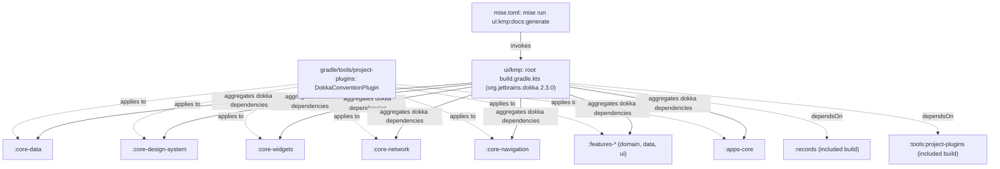

# Implementation Plan: Dokka Integration & Comprehensive Workspace KDocs

## Goal Description
Introduce **Dokka 2.3.0** documentation engine across `ui/kmp` and `records`, backed by dedicated convention plugins in `gradle/tools/project-plugins`. Systematically author thorough, structured, self-referencing, and navigable KDocs for every `public` declaration across all modules (`core/*`, `features/*`, `apps/*`, `gradle/tools/project-plugins`, and `records`), ensuring clear architectural context, parameter tags, return semantics, exception behavior, and cross-type linking (`[Type]`).

---

## User Review Required

> [!IMPORTANT]
> **Unified Multi-Project Dokka Architecture (Modeled after kotlin-stdlib)**:
> In alignment with standard Kotlin multi-module documentation (e.g. [`kotlin-stdlib`](https://kotlinlang.org/api/core/kotlin-stdlib/)):
> 1. All modules—including KMP subprojects, `records` (`records-parser`, `records-proto`), and `gradle/tools/project-plugins`—are registered as subprojects within Dokka and **bundled into 1 single unified Dokka documentation set**.
> 2. On the root landing page (`ui/kmp/dokka/index.html`), all participating projects are listed in a unified "Modules" table with their respective summaries.
> 3. The left navigation sidebar renders a single, shared, collapsible tree containing all modules, packages, and classes, with unified full-text search across the entire workspace.
> 4. In `ui/kmp/build.gradle.kts`:
>    - KMP submodules are passed via **Type-Safe Project Accessors exclusively** (`dokka(projects.<module>)`).
>    - Included build subprojects are declared via composite dependency coordinates (`dokka(libs.records.parser)`, `dokka(libs.records.proto)`, `dokka(libs.project.plugins)`), allowing Gradle composite build substitution to wire them directly into Dokka's aggregation graph.
> 5. **Output Destination**: The entire merged documentation set outputs directly to **`ui/kmp/dokka`** (`layout.projectDirectory.dir("dokka")`).
> 6. Triggered via a single root task: `mise run ui:kmp:docs:generate` (or `./gradlew :dokkaGenerate`).

> [!NOTE]
> **Explicit API Mode & Least Privilege Audit**:
> While adding KDocs, we will perform a least-privilege audit. Any internal implementation classes (such as `*RepositoryImpl`, `*DataSourceImpl`, private helpers, and screen internals) that were unintentionally exposed will be confirmed `internal`, ensuring the `public` documentation surface contains only genuine API contracts consumed across module boundaries.

---

## Component Architecture: Dokka & Documentation Flow



---

## Proposed Changes

### Component 0: Dokka 2.3.0 Setup & Convention Plugins

#### [MODIFY] `ui/kmp/gradle/libs.versions.toml`
Add Dokka version, library, and plugin coordinates:
```toml
[versions]
  dokka = "2.3.0"

[libraries]
  dokka-gradle-plugin = { module = "org.jetbrains.dokka:dokka-gradle-plugin", version.ref = "dokka" }
  project-plugins = { module = "dev.fnc314.tools.jobtracker.tools:project-plugins", version = "1.0.0" }

[plugins]
  dokka = { id = "org.jetbrains.dokka", version.ref = "dokka" }
  local-dokka = { id = "dev.fnc314.tools.jobtracker.dokka" }
```

#### [MODIFY] `ui/kmp/gradle/tools/project-plugins/build.gradle.kts`
Apply Dokka plugin, add Dokka Gradle plugin dependency, register convention plugin, and configure documentation generation for `project-plugins`:
```kotlin
plugins {
  alias(libs.plugins.kotlinJvm)
  alias(libs.plugins.dokka)
  `java-gradle-plugin`
}

group = "dev.fnc314.tools.jobtracker.tools"
version = "1.0.0"

dokka {
  dokkaPublications.html {
    moduleName.set(":tools:project-plugins")
    outputDirectory.set(layout.buildDirectory.dir("dokka/html"))
  }
}

dependencies {
  gradleApi()
  implementation(libs.android.gradle.plugin)
  implementation(libs.kotlin.gradle.plugin)
  implementation(libs.compose.gradle.plugin)
  implementation(libs.ksp.gradle.plugin)
  implementation(libs.dokka.gradle.plugin)
}

gradlePlugin {
  plugins {
    create("dokka") {
      id = libs.plugins.local.dokka.map { it.pluginId }.get()
      description = "Applies Dokka documentation generation conventions"
      implementationClass = "dev.fnc314.tools.jobtracker.kmp.gradle.plugins.config.DokkaConventionPlugin"
      displayName = "Dokka Documentation Convention"
    }
  }
}
```

#### [MODIFY] `ui/kmp/gradle/tools/project-plugins/src/main/kotlin/dev/fnc314/tools/jobtracker/kmp/gradle/catalog/CatalogTypes.kt`
Add Dokka enum entries:
```kotlin
public enum class Libraries(...) {
    ...
    DOKKA_GRADLE_PLUGIN("dokka-gradle-plugin");
}

public enum class Plugins(...) {
    ...
    DOKKA("dokka"),
    LOCAL_DOKKA("local-dokka");
}
```

#### [NEW] `ui/kmp/gradle/tools/project-plugins/src/main/kotlin/dev/fnc314/tools/jobtracker/kmp/gradle/plugins/config/DokkaConventionPlugin.kt`
Configure HTML publication format, output directories, source links, and markdown overview integration:
```kotlin
package dev.fnc314.tools.jobtracker.kmp.gradle.plugins.config

import dev.fnc314.tools.jobtracker.kmp.gradle.catalog.CatalogTypes
import dev.fnc314.tools.jobtracker.kmp.gradle.plugins.BaseConventionPlugin
import org.gradle.api.Plugin
import org.gradle.api.Project
import org.jetbrains.dokka.gradle.DokkaExtension

public class DokkaConventionPlugin : Plugin<Project>, BaseConventionPlugin {
    override fun apply(target: Project): Unit {
        target.configurePlugin()
    }

    override fun Project.configurePlugin(): Unit {
        pluginManager.apply(CatalogTypes.Plugins.DOKKA(this).get().pluginId)
        extensions.configure(DokkaExtension::class.java) { dokka ->
            dokka.dokkaPublications.named("html") { publication ->
                publication.outputDirectory.set(layout.buildDirectory.dir("dokka/html"))
                val readme = file("README.md")
                if (readme.exists()) {
                    publication.includes.from(readme)
                }
            }
        }
    }
}
```

#### [MODIFY] `ui/kmp/build.gradle.kts`
Apply root Dokka plugin, declare module aggregation using **Type-Safe Project Accessors exclusively** for KMP submodules, declare composite dependencies for included builds to bundle them into **1 final Dokka set** (mirroring `kotlin-stdlib`), and configure output to `ui/kmp/dokka`:
```kotlin
plugins {
    alias(libs.plugins.dokka)
    ...
}

dependencies {
    // Type-Safe Project Accessors exclusively for KMP subprojects
    dokka(projects.coreData)
    dokka(projects.coreDesignSystem)
    dokka(projects.coreNetwork)
    dokka(projects.coreWidgets)
    dokka(projects.coreNavigation)
    dokka(projects.featuresSignInDomain)
    dokka(projects.featuresSignInData)
    dokka(projects.featuresSignInUi)
    dokka(projects.featuresJobApplicationsListDomain)
    dokka(projects.featuresJobApplicationsListData)
    dokka(projects.featuresJobApplicationsListUi)
    dokka(projects.featuresJobApplicationsDetailsDomain)
    dokka(projects.featuresJobApplicationsDetailsData)
    dokka(projects.featuresJobApplicationsDetailsUi)
    dokka(projects.featuresSettingsDomain)
    dokka(projects.featuresSettingsData)
    dokka(projects.featuresSettingsUi)
    dokka(projects.featuresAddJobApplicationDomain)
    dokka(projects.featuresAddJobApplicationData)
    dokka(projects.featuresAddJobApplicationUi)
    dokka(projects.featuresTrackerEditsDomain)
    dokka(projects.featuresTrackerEditsData)
    dokka(projects.featuresTrackerEditsUi)
    dokka(projects.appsCore)

    // Included Builds bundled directly into 1 unified Dokka set (substituted by Gradle)
    dokka(libs.records.parser)
    dokka(libs.records.proto)
    dokka(libs.project.plugins)
}

dokka {
    dokkaPublications.html {
        moduleName.set("Job Search & Tracker Multiplatform Documentation")
        outputDirectory.set(layout.projectDirectory.dir("dokka"))
        val rootReadme = file("README.md")
        if (rootReadme.exists()) {
            includes.from(rootReadme)
        }
    }
}

// Ensure included builds execute their dokka tasks when building the unified set
tasks.named("dokkaGenerate") {
    dependsOn(
        gradle.includedBuild("records").task(":dokkaGenerate"),
        gradle.includedBuild("tools").task(":project-plugins:dokkaGenerate"),
    )
}
```

#### [MODIFY] `records/gradle/libs.versions.toml` & `records/build.gradle.kts`
Introduce Dokka into `records`:
- Add `dokka = "2.3.0"` and `plugins.dokka = { id = "org.jetbrains.dokka", version.ref = "dokka" }` to `records/gradle/libs.versions.toml`.
- Configure `records/build.gradle.kts` to apply Dokka across `records-proto` and `records-parser`.

---

### Component 1: Comprehensive KDocs for `records`

#### [MODIFY] `records/parser/src/main/kotlin/dev/fnc314/tools/jobsearch/parser/`
Add exhaustive KDoc documentation with `@param`, `@return`, and cross references:
- **`EnumMapping.kt`**: Document bidirectional conversions between namespaced Firestore strings (e.g. `status:applied`) and protobuf enum definitions (`TrackerStatus`, `TrackerEventType`, `ApplicationChannel`, `WorkMode`, etc.).
- **`JPypeBridge.kt` / `TrackerParser.kt`**: Document all `@JvmStatic` bridge methods called by Python / TUI via JPype, explaining timestamp conversion, legacy row projection, status normalization, and exception semantics.
- **`LegacyRowProjector.kt`**: Document flat-row dictionary transformations (`rowFromStore`) and projection of nested proto fields into legacy terminal table columns (`LEGACY_KEYS`).
- **`StatusNormalizer.kt`**: Document mapping from unstructured human strings to canonical namespaced status values, status rank weighting for table sorting, and terminal status checks.
- **`TimestampConverter.kt`**: Document bidirectional conversion between ISO-8601 strings, millisecond timestamps, and Google Protocol Buffer `Timestamp` objects.

---

### Component 2: Comprehensive KDocs for `core/data`

#### [MODIFY] Core Models & Entities (`core/data/src/commonMain/.../model/`)
- **`JobApplication.kt`**: Document all 22 properties including `uuid: Uuid7`, `schemaVersion: Int = 7`, `status: TrackerStatus`, `fitScore`, `timeline`, and contact references.
- **`Uuid7.kt`**: Expand existing rich KDocs detailing RFC 4122 Variant UUIDv7 format, 48-bit millisecond timestamp structure, monotonicity guarantees, and zero-allocation inline value class semantics.
- **`Company.kt`**, **`Compensation.kt`**, **`Contact.kt`**, **`Location.kt`**, **`Timeline.kt`**, **`TrackerArtifact.kt`**, **`TrackerCounts.kt`**, **`TrackerEdit.kt`**, **`TrackerEvent.kt`**, **`TrackerFit.kt`**, **`AuthModels.kt`**: Document every public property, nullability contract, and invariant.
- **Enums (`TrackerStatus`, `ApplicationChannel`, `TrackerEventType`, `TrackerArtifactKind`, `TrackerEditKind`, `TrackerEditState`, `WorkMode`, `Trigger`, `Confidence`, `DerivedFrom`, `EventActor`)**:
  - Document all enum constants.
  - Document self-contained helper methods: `displayName()`, `toFirestore()`, `containerColor()`, `contentColor()`, `isTerminal`, `isActive`, `icon`.

#### [MODIFY] Factory & Serialization (`core/data/src/commonMain/.../factory/` & `json/`)
- **`Factory.kt`**: Document `createJobApplication()`, `createTrackerEvent()`, `createTrackerArtifact()`, `createTrackerEdit()`, and key-value builders. Document default values, UUID synthesis, and defensive copying.
- **`JsonProvider.kt`**: Document `globalJson` configuration (ignoring unknown keys, encode defaults, naming policies).

#### [MODIFY] Relational Database & DAOs (`core/data/src/commonMain/.../database/`)
- **`AppDatabase.kt`**: Document database schema version, entity registry, and DAO accessors.
- **`JobApplicationDao.kt`**: Document `observeAll()`, `getAll()`, `getByUuid()`, `getBySlugId()`, `getByIdOrUuid()`, `insertAll()`, `insert()`, `deleteByUuid()`, `deleteBySlugId()`, and `deleteAll()`.
- **`JobApplicationEntity.kt`**: Document SQLite entity mapping, indices, and schema v7 alignment.
- **`DatabaseConverters.kt`**: Document all `@ColumnTypeConverter` methods for UUIDs, enums, timestamps, and comma-separated string lists.
- **`DatabaseHolder.kt`**: Document thread-safe container holding nullable `AppDatabase` and exposing safe `JobApplicationDao?`.
- **`DatabaseBuilder.kt`** (and platform expect/actuals): Document file path resolution, driver selection (`BundledSQLiteDriver`), and platform-specific behaviors (Android context, JVM home directory, iOS sandbox, Wasm/JS).
- **`JobApplicationMapper.kt`**: Document bidirectional mappings `toEntity()`, `toDomain()`, `toEntityList()`, and `toDomainList()`.

#### [MODIFY] Data Sources & Platform (`core/data/src/commonMain/.../source/` & `platform/`)
- **`LocalDataSource.kt`**, **`NetworkDataSource.kt`**, **`RemoteDataSource.kt`**, **`RemoteRecord.kt`**, **`DataResult.kt`**, **`UseCase.kt`**: Document contract interfaces, error handling conventions, and suspend mechanics.
- **`AppSettings.kt`** & **`SettingsStorage.kt`**: Document settings storage abstraction, theme mode preferences, and seed color persistence.
- **`PlatformFileOpener.kt`**: Document platform-native document viewing.

---

### Component 3: Comprehensive KDocs for `core/design-system` & `core/widgets`

#### [MODIFY] `core/design-system/src/commonMain/.../`
- Document `Theme.kt`, `Color.kt`, `SeedColors.kt`, `AppColors.kt`, `Type.kt`, `Spacing.kt`, `Shape.kt`, `WindowSizeClass.kt`, `WindowAdaptiveInfo.kt`.
- Emphasize Rule 3 (Zero Rogue `Color()` calls), seed-to-scheme derivation, and responsive breakpoints.

#### [MODIFY] `core/widgets/src/commonMain/.../`
- Document all reusable UI components: `StatusBadge`, `FitBadge`, `NotesWidget`, `TooltipIconButton`, etc.
- Detail preview states, accessibility descriptions, and parameters.

---

### Component 4: Comprehensive KDocs for `features/*` (Domain & UI)

#### [MODIFY] Feature Domain Modules (`features/*/domain/`)
Document all use cases, repository contracts, and domain models:
- **`job-applications-list/domain`**:
  - `JobApplicationsListRepository`: `getJobApplications()`
  - `LoadAllJobApplicationsUseCase`: Execution flow and forced refresh
  - `FilterJobApplicationsUseCase`: Status, text search, age, and tag filtering logic
  - `SortJobApplicationsUseCase`: Multi-column comparator sorting
  - `ApplicationAge`: Enum categories (`ALL`, `LAST_7_DAYS`, `LAST_14_DAYS`, `LAST_30_DAYS`, `OLDER_THAN_30_DAYS`)
  - `FilterCriteria` & `SortCriteria`
- **`job-applications-details/domain`**:
  - `JobApplicationsDetailsRepository`: Full CRUD, status transitions, timeline events, signed URLs
  - `LoadJobApplicationUseCase`, `LoadCompaniesUseCase`, `UpdateApplicationStatusUseCase`, `UpdateFitScoreUseCase`, `RecordEventUseCase`, `GetArtifactSignedUrlUseCase`
- **`add-job-application/domain`**:
  - `AddJobApplicationRepository`, `CreateJobApplicationUseCase`, `CreateLeadUseCase`
- **`settings/domain`**:
  - `SettingsRepository`, `LoadSettingsUseCase`, `SaveSettingsUseCase`
- **`tracker-edits/domain`**:
  - `TrackerEditsRepository`, `LoadPendingEditsUseCase`, `ApproveEditUseCase`, `RejectEditUseCase`
- **`sign-in/domain`**:
  - `SignInRepository`, `ObserveAuthStateUseCase`, `SignInUseCase`, `SignOutUseCase`

#### [MODIFY] Feature UI Modules (`features/*/ui/`)
Document all public UI contracts and models:
- Screen composables: `JobApplicationsListScreen`, `JobApplicationDetailScreen`, `AddJobApplicationScreen`, `SettingsScreen`, `TrackerEditsScreen`, `SignInScreen`.
- ViewModels: MVI intent handling and state flows.
- State interfaces: `JobApplicationsListUiState`, `JobApplicationsDetailsUiState`, `AddJobApplicationUiState`, `SettingsUiState`, `TrackerEditsUiState`.
- Intent interfaces: All user interactions and event dispatches.
- Decoupled UI Models: `JobApplicationItemUiModel`, `JobApplicationDetailUiModel`, `AddJobApplicationFormUiModel`, `AddLeadFormUiModel`, `TrackerEditItemUiModel`, `SettingsUiModel`.

---

### Component 5: Comprehensive KDocs for `gradle/tools/project-plugins`

#### [MODIFY] `gradle/tools/project-plugins/src/main/kotlin/.../`
- Document `CatalogTypes` (`Versions`, `Libraries`, `Bundles`, `Plugins`) explaining type-safe lookup from `libs.versions.toml`.
- Document all convention plugins (`KotlinMultiplatformConventionPlugin`, `AndroidKmpLibraryConventionPlugin`, `ComposeConventionPlugin`, `DokkaConventionPlugin`, dependency convention plugins) detailing their responsibilities and applied tasks.

---

### Component 6: Mise Task Registration & Documentation

#### [MODIFY] `mise.toml`
Add dedicated documentation tasks:
```toml
"ui:kmp:docs:generate" = { description = "Generate unified multi-module Dokka API documentation HTML for ui/kmp", run = "cd ui/kmp && ./gradlew :dokkaGenerate" }
"records:docs:generate" = { description = "Generate Dokka API documentation HTML for records", run = "cd records && ./gradlew :dokkaGenerate" }
"docs:all" = { description = "Generate all workspace documentation (Dokka, README validations, task docs)", run = "mise run ui:kmp:docs:generate && mise run records:docs:generate && mise run ui:kmp:docs:readmes && mise run mise:docs:tasks" }
```

---

## Verification Plan

### Automated Verification
1. **Dokka Documentation Generation**:
   - `cd ui/kmp && ./gradlew :dokkaGenerate` (triggers unified multi-module documentation aggregation across all KMP submodules and included builds, outputting 1 final Dokka set to `ui/kmp/dokka`).
   - `mise run ui:kmp:docs:generate` (verifies Mise task execution).
2. **Metadata & Explicit API Validation**:
   - `./gradlew compileCommonMainKotlinMetadata` (verifies strict explicit API compliance with full return types and visibility).
   - `./gradlew :records:records-parser:compileKotlin` (verifies records parser compilation).
3. **Test Suite Verification**:
   - `./gradlew :core-data:jvmTest :features-job-applications-list-data:jvmTest :features-job-applications-details-data:jvmTest` (ensures zero test regressions).
4. **README & Spec Verification**:
   - `mise run //:ui:kmp:docs:readmes` (verifies README synchronization).
   - `mise run //:tracker check --offline` (ensures tracker integrity).

### Manual Verification
- Inspect generated `ui/kmp/dokka/index.html` in browser to confirm the unified landing page with the "Modules" section listing all participating subprojects (`core-*`, `features-*`, `apps-core`, `records-parser`, `records-proto`, `project-plugins`), the collapsible left navigation tree, full-text search, and cross-module hyperlinking (structured identically to `kotlin-stdlib`).
