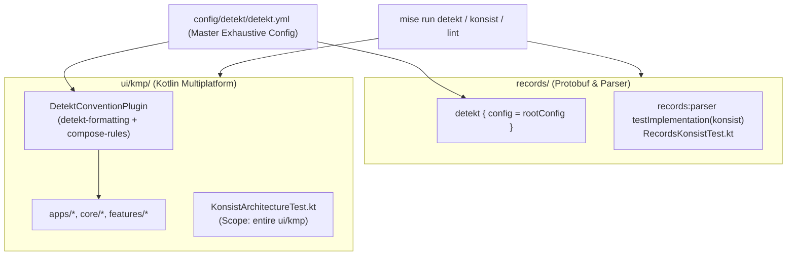

# Implementation Plan: Detekt & Konsist Static Analysis & Architectural Linting

**Status:** Completed  
**Date:** 2026-11-05  
**Target:** records and ui/kmp (cross-subsystem)  

---

## Overview & Goal
Introduce enterprise-grade static analysis and architectural guardrails across both **`records`** and **`ui/kmp`** in the `waleedtarbosh-ai-job-search` workspace using **Detekt 1.23.8** (code quality, formatting, bug detection, coroutine safety, and Compose linting) and **Konsist 0.18.1** (declarative architecture and structural invariant testing).

This plan devises:
1. **Centralized Configuration Architecture**:
   - Master Detekt configuration file ([`config/detekt/detekt.yml`](../../config/detekt/detekt.yml)) containing **all eligible Detekt rules and configurations** across all official rule sets plus Compose rules.
   - Every rule includes an **ELI5 description**, its **Input Type**, and an **official documentation URL**.
   - Uncovered or inactive options are preserved in commented-out format with full documentation.
2. **Two Structured Interactive Sessions**:
   - **Session 1: Detekt Rules Definition & Baseline Review** (interactively selecting key thresholds, formatting rules, and Compose policies).
   - **Session 2: Konsist Architecture Rules Definition** (interactively configuring modular boundaries, Clean Architecture layering, naming suffixes, and visibility policies).
3. **Global Test Suite Setup for Konsist**:
   - Architecture test suites configured for both `records` and `ui/kmp` targeting JVM test runners, with extensible foundation classes for subsequent rule additions.
4. **Convention Plugins & Mise Tasks**:
   - `DetektConventionPlugin` in `ui/kmp/gradle/tools/project-plugins` and standard application in `records`.
   - Top-level `mise` tasks (`mise run detekt`, `mise run konsist`, `mise run lint`).

---

## Tooling & Architecture Strategy



---

## Detailed Plan: Interactive Sessions

### Session 1: Detekt Rules Definition & Baseline Review
This interactive session is executed before rule enforcement to align on thresholds, strictness, and team preferences across 6 key categories:

| Category | Key Decision Points | Options / Recommended Defaults |
| :--- | :--- | :--- |
| **1. Formatting (Ktlint wrapper)** | • Trailing commas on call sites & declarations<br/>• Maximum line length<br/>• Wildcard imports | • **Trailing commas**: `true` (consistent diffs)<br/>• **Max line length**: `140` (with URL/import ignores)<br/>• **Wildcard imports**: Strictly forbidden (`NoWildcardImports: active: true`) |
| **2. Complexity Thresholds** | • Cyclomatic complexity per method<br/>• Long parameter list<br/>• Long method lines | • **Cyclomatic complexity**: `15` threshold<br/>• **Long parameter list**: `6` for standard functions, ignored for `@Composable` and data classes<br/>• **Long method**: `60` lines (excluding comments/blanks) |
| **3. Naming Conventions** | • Composable function naming<br/>• Package naming<br/>• Boolean properties | • **Composable naming**: Allow PascalCase (`[A-Z][A-Za-z0-9]*`) for `@Composable` returning `Unit`<br/>• **Package naming**: Lowercase letters without underscores (`^[a-z]+(\.[a-z][a-z0-9]*)*$`)<br/>• **Boolean properties**: Suggest `is*`, `has*`, `should*` prefixes |
| **4. Potential Bugs & Safety** | • Force unwrap (`!!`)<br/>• Unnecessary safe calls (`?.`)<br/>• Map not-null assertions | • **Force unwrap**: Forbidden (`UnnecessaryNotNullOperator`, `MapGetWithNotNullAssertionOperator`)<br/>• **Cast safety**: `UnsafeCast: active: true` |
| **5. Coroutine Invariants** | • `GlobalScope` usage<br/>• Thread sleep in coroutines<br/>• Redundant suspend | • `GlobalCoroutineUsage`: **Forbidden** (`active: true`)<br/>• `SleepInsteadOfDelay`: **Forbidden** (`active: true`)<br/>• `RedundantSuspendModifier`: **Active** |
| **6. Compose Multiplatform** | • Missing modifier parameter<br/>• Modifier parameter order<br/>• Mutable parameters<br/>• ViewModel forwarding | • `ModifierMissing`: Enabled for public/internal UI components<br/>• `ModifierNaming`: Enforce `modifier: Modifier = Modifier`<br/>• `MutableParams`: Forbid mutable collection/state parameters<br/>• `ViewModelForwarding`: Forbid passing ViewModels down to leaf composables |

---

### Session 2: Konsist Architecture Rules Definition
This interactive session establishes declarative architectural tests validating repo structure across `records` and `ui/kmp`:

| Architectural Invariant | Target Subsystem | Scope / Invariant Definition |
| :--- | :--- | :--- |
| **1. Module Decoupling (Option A)** | `ui/kmp` | • Feature UI modules (`features/*/ui`) must depend on `core:widgets`, **never directly on `core:design-system`**.<br/>• Feature modules must **never depend on sibling feature modules** (zero horizontal coupling). |
| **2. Clean Architecture Layering** | `ui/kmp` | • `core:data` provides raw engines/data sources only (`RemoteDataSource`, `NetworkDataSource`, `LocalDataSource`, `AppDatabase`), with **zero repository implementations**.<br/>• Feature repositories live in `features/<name>/domain/repository/`.<br/>• Feature repository implementations (`*RepositoryImpl`) live in `features/<name>/data/` and **must be `internal`** (never `public`). |
| **3. Zero Rogue `Color(...)` Calls** | `ui/kmp` | • Constructor `Color(...)` must **never** be invoked outside `core/design-system/.../Color.kt`.<br/>• All Compose colors must reference `MaterialTheme.colorScheme.*` or canonical `SeedColors` / `AppColors`. |
| **4. Explicit API & Visibility Rules** | `records` & `ui/kmp` | • All public classes/interfaces in domain layers must explicitly define return types.<br/>• Internal screens, helper functions, and use case implementations must remain `internal`. |
| **5. Architectural Naming & Packages** | `records` & `ui/kmp` | • ViewModels reside in `..ui.viewmodel` or `..ui` and end with `ViewModel`.<br/>• Use cases reside in `..domain.usecase` and expose a single `operator fun invoke`.<br/>• Repositories reside in `..domain.repository` and end with `Repository`.<br/>• Data sources reside in `..data.datasource` and end with `DataSource`. |
| **6. Records Integrity** | `records` | • `records-proto` contains zero business logic and zero Android imports.<br/>• `records-parser` depends strictly on `records-proto` and standard libraries. |

---

## Configuration File Structure (`config/detekt/detekt.yml`)

The configuration file will be placed at [`config/detekt/detekt.yml`](../../config/detekt/detekt.yml) and will contain **all 100+ standard Detekt rules plus Compose rules**.

### Format Standard for Every Rule:
```yaml
# ─────────────────────────────────────────────────────────────────────────────
# Rule: ReturnCount
# ELI5: Stops functions from having too many 'return' statements, which makes code confusing.
# Type: Int (threshold) / List<String> (excluded functions)
# Docs: https://detekt.dev/docs/rules/style#returncount
# ─────────────────────────────────────────────────────────────────────────────
ReturnCount:
  active: true
  max: 2
  excludedFunctions:
    - "equals"
  excludeLabeled: false
  excludeReturnFromLambda: true
  excludeGuardClauses: true
```

Uncovered or inactive rules are listed with full comments:
```yaml
# ─────────────────────────────────────────────────────────────────────────────
# Rule: PreferToOverPairSyntax
# ELI5: Encourages using the 'to' keyword (a to b) instead of Pair(a, b).
# Type: Boolean
# Docs: https://detekt.dev/docs/rules/style#prefertooverpairsyntax
# ─────────────────────────────────────────────────────────────────────────────
# PreferToOverPairSyntax:
#   active: false
```

---

## Implementation Steps & Proposed Code Changes

### Step 1: Version Catalog Updates
1. In [`ui/kmp/gradle/libs.versions.toml`](../../ui/kmp/gradle/libs.versions.toml):
   - Add Detekt plugin: `detekt = "1.23.8"`
   - Add Detekt Formatting: `io.gitlab.arturbosch.detekt:detekt-formatting:1.23.8`
   - Add Compose Detekt Rules: `io.nlopez.compose.rules:detekt:0.4.22`
   - Add Konsist: `com.lemonappdev:konsist:0.18.1`
2. In [`records/gradle/libs.versions.toml`](../../records/gradle/libs.versions.toml):
   - Add Detekt plugin: `detekt = "1.23.8"`
   - Add Konsist: `com.lemonappdev:konsist:0.18.1`

### Step 2: Detekt Convention Plugin & Multi-Project Wiring
1. Create `DetektConventionPlugin` in `ui/kmp/gradle/tools/project-plugins/src/main/kotlin/.../config/DetektConventionPlugin.kt`:
   - Configures the `detekt` extension:
     ```kotlin
     detekt {
         toolVersion = libs.versions.detekt.get()
         config.setFrom(rootProject.file("../../config/detekt/detekt.yml"))
         buildUponDefaultConfig = false
         allRules = false
         parallel = true
     }
     ```
   - Adds `detekt-formatting` and `compose-rules` to the `detektPlugins` configuration.
2. Apply `DetektConventionPlugin` across `apps/*`, `core/*`, `features/*`.
3. In `records/build.gradle.kts`:
   - Apply Detekt plugin to subprojects pointing to the same root `config/detekt/detekt.yml`.

### Step 3: Global Konsist Test Suites Setup
1. **`records` Konsist Setup**:
   - In `records/parser/build.gradle.kts`:
     - Add `testImplementation(libs.konsist)`
   - Create `records/parser/src/test/kotlin/dev/fnc314/tools/jobsearch/records/architecture/RecordsArchitectureTest.kt`:
     - Global baseline test fixture verifying `records-proto` and `records-parser` invariants.
2. **`ui/kmp` Konsist Setup**:
   - In `ui/kmp/apps/core/build.gradle.kts` (or a dedicated `:architecture-test` module):
     - Add `jvmTestImplementation(libs.konsist)`
   - Create `ui/kmp/apps/core/src/jvmTest/kotlin/dev/fnc314/tools/jobtracker/architecture/KonsistArchitectureTest.kt`:
     - Base test fixture referencing `Konsist.scopeFromDirectory(project.rootDir.parentFile.resolve("ui/kmp").absolutePath)`.
     - Validates Option A UI decoupling, layer isolation, ViewModel suffixing, and Zero Rogue Color rules.

### Step 4: Master `detekt.yml` Generation & Annotation
- Generate the complete `config/detekt/detekt.yml` containing every official rule with ELI5 documentation, input types, and doc URLs.

### Step 5: Mise Integration
Add tasks in root `mise.toml`:
- `detekt`: runs detekt across `records` and `ui/kmp`
- `konsist`: runs konsist tests across `records` and `ui/kmp`
- `lint`: runs both `detekt` and `konsist`

### Step 6: Plan In-Repo Relocation, Bookkeeping & Registry Status Synchronization
- Move/persist planning files into `.agents/plans/YYYY-MM-DD/HHMMSS_<plan-name>.md`.
- Synchronize `.agents/plans/README.md` to update the plan status to `Completed`.
- Ensure all execution plans explicitly enforce in-repo plan relocation and registry updates as standard completion criteria.

---

## Verification Plan

### Automated Checks:
1. `mise run detekt` / `./gradlew detekt`:
   - Verifies all files in `records` and `ui/kmp` are analyzed and reports match configured thresholds.
2. `mise run konsist`:
   - Executes `RecordsArchitectureTest` and `KonsistArchitectureTest` on JVM, verifying all architectural invariants pass.
3. Build validation:
   - `./gradlew compileCommonMainKotlinMetadata` remains clean.
   - `bash scripts/check-kmp-readmes.sh` remains verified.

### Interactive Review:
- Walk through Session 1 decisions with the user to activate agreed Detekt rules.
- Walk through Session 2 decisions with the user to activate agreed Konsist rules.
