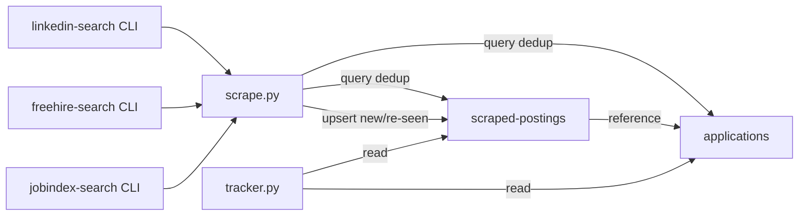

# Implementation Plan: Firestore Scraped Postings Collection

**Status:** Completed  
**Date:** 2026-11-05  
**Target:** tracker  
**Schema Authority:** [`tracker.schema.json`](../../tracker.schema.json)  

---

## 1. Executive Summary & Goals

Replace the static `job-scraper/seen_jobs.json` file with a Firestore collection (`scraped-postings`) to track job postings discovered during scrape sessions. This enables **multi-agent concurrent scraping** without file-locking conflicts and provides richer metadata storage for each posting. The solution includes a Protobuf message definition in `records/proto` and wire-contract integration in `records/parser` to maintain consistency with the project's type system.

## 2. Architecture & Design Principles

- **Collection name:** `scraped-postings` (kebab-case, plural, matching existing convention).
- **Document ID:** UUIDv7 (matching `pending-proposals` pattern).
- **Upsert semantics:** `set(merge=True)` to update `lastScrapedAt` and `scrapeCount` on re-scrapes.
- **Flat collection:** No subcollections for simple queries.
- **Schema extension:** New `$defs` in `tracker.schema.json`, new proto message in `records/proto`, no wire contract needed in `records/parser` (enum name matches Firestore value).
- **Admin SDK only:** No client-side rules changes; `firestore.rules` deny all client access.

## 3. Proposed Changes & Implementation Steps

### User Stories

- As a scraping agent, I want to write scraped postings to Firestore so that multiple agents can scrape simultaneously without overwriting each other's state.
- As a user, I want to query scraped postings by date, portal, company, or status so I can review what's been found without applying.
- As a user, I want to see how many times a posting has been re-scraped so I can identify consistently relevant roles.
- As a scraping agent, I want to deduplicate against both `scraped-postings` and `applications` so I don't re-report the same role.

### Functional Requirements

1. **New Firestore collection** `scraped-postings` in the existing `(default)` database (`job-search-fnc314-dev`).
2. **Document schema** includes: posting metadata (postingDate, deadline, reqId), scraping tracking (firstScrapedAt, lastScrapedAt, scrapeCount, portal, searchQuery), fit/status (fitRating, fitStatus, rejectionReason), and deduplication keys (normalizedUrl, companySlug, titleSlug, dedupKey).
3. **Update `scripts/scrape.py`** to read from and write to Firestore instead of `seen_jobs.json`.
4. **Preserve `--save-seen` flag** behavior but redirect writes to Firestore.
5. **Dedup logic** checks both `scraped-postings` and `applications` collections.
6. **Re-scrape detection**: if a posting is seen again, increment `scrapeCount` and update `lastScrapedAt` instead of creating a duplicate.
7. **Migration path**: seed existing `seen_jobs.json` entries into Firestore on first run.
8. **Protobuf message** `ScrapedPosting` in `records/proto` for type-safe wire format.
9. **Enum name as Firestore value**: `ScrapedPostingStatus` enum stored directly by name (e.g., `"NEW"`) — no wire contract needed since we own the contract.

### Non-Functional Requirements

- Follow existing naming conventions from `tracker.schema.json` (lowerPascalCase keys, kebab-case document IDs, namespaced enums).
- Use the Admin SDK (existing pattern in `scripts/tracker.py`); no client-side rules changes needed.
- The `--health` and `--summary` modes in `scrape.py` must continue to work unchanged.
- Backward compatible: `seen_jobs.json` remains readable for fallback during transition.

### Scope

**In Scope:**
- New `scraped-postings` collection schema and Firestore indexes
- `scripts/scrape.py` modifications to use Firestore
- Migration of existing `seen_jobs.json` data
- `tracker.schema.json` extension (new `$defs` for scraped postings)
- `records/proto` new `ScrapedPosting` message definition
- `records/parser` — no changes needed; enum name matches Firestore value
- `mise.toml` task updates
- Plan document in `.agents/plans/`
- Integration by any Python code
- Adherence to existing protocols for code changes

**Out of Scope:**
- UI changes (TUI/dashboard) for viewing scraped postings (future work)
- Portal CLI modifications
- Gmail collection pipeline changes
- Application tracker schema changes

### Current Implementation

- **`scripts/scrape.py`** (432 lines): Loads `job-scraper/seen_jobs.json` via `_load_seen()`, runs portal CLIs, deduplicates against seen dict and tracker IDs, outputs JSON report. Writes back to `seen_jobs.json` only if `--save-seen` is passed.
- **`job-scraper/seen_jobs.json`**: Static file with `{"seen": {<dedup-key>: {title, company, url, first_seen, fit, status, portal}}}`.
- **Firestore database**: `job-search-fnc314-dev`, Standard edition, `nam5` location. Collections: `applications`, `pending-proposals`, `companies`, `contacts`, `meta`, `sync-requests`.
- **`tracker.schema.json`**: Defines naming conventions (lowerPascalCase keys, kebab-case slugs, namespaced enums like `status:applied`). Schema version 7.
- **`scripts/tracker.py`**: Uses `client.getDb()` pattern for Firestore Admin SDK access. The `collectOnce()` function shows the pattern for writing to Firestore collections with UUIDv7 document IDs.
- **`records/proto`**: Protobuf definitions under `tracker/v1/`. Key files: `application.proto` (core record), `enums.proto` (all tracker enums), `fit_evaluation.proto` (nested message pattern). Package: `tracker.v1`, Java package: `dev.fnc314.tools.jobsearch.tracker.v1`.
- **`records/parser`**: Kotlin wire contracts in `ProtoWireContracts.kt` that map proto enums to Firestore wire keys (e.g., `TrackerStatus.wireKey` returns `"status:applied"`). Pattern: extension property on each proto enum type.

### Key Decisions

1. **Collection name**: `scraped-postings` (kebab-case, plural — matching existing convention: `applications`, `pending-proposals`).
2. **Document ID**: UUIDv7 (matching `pending-proposals` pattern in `tracker.py`), not derived slugs, since a single posting may appear across multiple portals with slightly different URLs.
3. **Dedup indexes**: Composite indexes on `normalizedUrl` and `dedupKey` for O(1) lookups during scrape.
4. **Upsert semantics**: Use `set(merge=True)` so re-scraped postings update `lastScrapedAt` and `scrapeCount` without creating duplicates.
5. **No subcollection**: Flat collection for simple queries (e.g., "show all postings from last 7 days").
6. **Schema extension**: Add scraped posting contract as a new `$defs` in `tracker.schema.json` rather than a separate schema file, keeping a single source of truth.
7. **Proto message**: New `ScrapedPosting` message in `tracker/v1/scraped_posting.proto` following the `JobApplication` pattern (flat fields, nested messages for complex types, `google.protobuf.Timestamp` for times).
8. **Fit status enum**: New `ScrapedPostingStatus` enum in `enums.proto` with values `NEW`, `REVIEWED`, `REJECTED`, `APPLIED` — stored in Firestore using the proto enum's `name` directly, no wire contract needed.

### Data Model

**Document structure** (lowerPascalCase per convention):

```
scraped-postings/{uuidv7}
  ├── uuid: string (UUIDv7, matches document ID)
  ├── dedupKey: string (composite: "<companySlug>-<titleSlug>")
  ├── normalizedUrl: string (URL without query/fragment, lowercased)
  ├── companySlug: string (kebab-case company name)
  ├── titleSlug: string (kebab-case title)
  │
  ├── title: string (original job title)
  ├── company: string (original company name)
  ├── url: string (original posting URL)
  ├── location: string (from portal)
  ├── portal: string (e.g. "linkedin-search", "freehire-search")
  ├── searchQuery: string (which query matched this posting)
  │
  ├── postingDate: string? (ISO date, from job listing if available)
  ├── applicationDeadline: string? (ISO date, from job listing)
  ├── jobId: string? (portal-specific ID, e.g. reqId)
  ├── description: string? (snippet from detail fetch)
  ├── keyRequirements: string[]? (extracted requirements)
  │
  ├── firstScrapedAt: string (ISO timestamp)
  ├── lastScrapedAt: string (ISO timestamp, updated on re-scrape)
  ├── scrapeCount: number (starts at 1, incremented on re-scrape)
  │
  ├── fitRating: number? (quick fit assessment, 0-100)
  ├── fitStatus: string ("NEW" | "REVIEWED" | "REJECTED" | "APPLIED")
  ├── rejectionReason: string? (why passed on)
  │
  ├── appliedToId: string? (reference to applications/{id} if converted)
  ├── createdAt: string (Firestore document creation time)
  └── updatedAt: string (last update time)
```

### Proposed Changes

#### 1. Extend `tracker.schema.json`

Add a new `$defs` section for `ScrapedPosting` with all fields, enums (`fitStatus` values), and naming conventions. Add `scraped-postings` to `x-firestore.collections`.

#### 2. Add Firestore composite indexes

Define in `firestore.indexes.json`:
- Single field index on `normalizedUrl` (ascending)
- Single field index on `dedupKey` (ascending)
- Composite index on `lastScrapedAt` (descending) + `fitStatus` (ascending) for "recent new postings" queries
- Composite index on `portal` (ascending) + `lastScrapedAt` (descending) for per-portal recency

#### 3. Add `ScrapedPosting` proto message

Create `records/proto/src/main/proto/tracker/v1/scraped_posting.proto`:

```protobuf
message ScrapedPosting {
  string uuid = 1;
  string dedupKey = 2;
  string normalizedUrl = 3;
  string companySlug = 4;
  string titleSlug = 5;
  string title = 6;
  string company = 7;
  string url = 8;
  string location = 9;
  string portal = 10;
  string searchQuery = 11;
  string postingDate = 12;
  string applicationDeadline = 13;
  string jobId = 14;
  string description = 15;
  repeated string keyRequirements = 16;
  google.protobuf.Timestamp firstScrapedAt = 17;
  google.protobuf.Timestamp lastScrapedAt = 18;
  int32 scrapeCount = 19;
  int32 fitRating = 20;
  ScrapedPostingStatus fitStatus = 21;
  string rejectionReason = 22;
  string appliedToId = 23;
  google.protobuf.Timestamp createdAt = 24;
  google.protobuf.Timestamp updatedAt = 25;
}
```

#### 4. Add `ScrapedPostingStatus` enum to `enums.proto`

Add to `records/proto/src/main/proto/tracker/v1/enums.proto`:

```protobuf
enum ScrapedPostingStatus {
  SCRAPED_POSTING_STATUS_UNSPECIFIED = 0;
  SCRAPED_POSTING_STATUS_NEW = 1;
  SCRAPED_POSTING_STATUS_REVIEWED = 2;
  SCRAPED_POSTING_STATUS_REJECTED = 3;
  SCRAPED_POSTING_STATUS_APPLIED = 4;
}
```

#### 5. Use enum name as Firestore value (no wire contract needed)

Because we own the `scraped-postings` contract, store enum values in Firestore using the proto enum's `name` property directly (e.g., `"NEW"`, `"REVIEWED"`, `"REJECTED"`, `"APPLIED"`). This eliminates the need for a `wireKey` extension property in `ProtoWireContracts.kt` — the enum name matches the stored value by default, which is the simplest and most maintainable approach for owned contracts.

No changes to `ProtoWireContracts.kt` are required for `ScrapedPostingStatus`.

#### 6. Modify `scripts/scrape.py`

- Add `_get_db()` helper using the same `client.getDb()` pattern as `tracker.py`.
- Add `_load_seen_from_firestore(db)` that queries `scraped-postings` for `normalizedUrl` and `dedupKey` values, returning the same dict structure as `_load_seen()`.
- Add `_save_seen_to_firestore(db, seen_dict)` that upserts documents: for each new entry, check if `normalizedUrl` or `dedupKey` already exists; if so, increment `scrapeCount` and update `lastScrapedAt`; if not, create a new document.
- Add `--migrate-seen` flag to seed existing `seen_jobs.json` into Firestore.
- In `run_searches()`, accept an optional `db` parameter; if provided, use Firestore for dedup; fall back to file-based `_load_seen()` for `--health` and `--summary` modes (which don't need writes).
- Use the same `client.getDb()` pattern as `tracker.py`.

#### 7. Update `firestore.indexes.json`

Add the required composite indexes and deploy via `firebase deploy --only firestore:indexes`.

#### 8. Update `mise.toml`

- Add `--migrate-seen` flag to the `scrape` task.
- Add `scrape:migrate` task for one-time migration of `seen_jobs.json`.

#### 9. Create plan document

Persist at `.agents/plans/2026-11-05/215800_firestore-scraped-postings-collection.md` and register in `.agents/plans/README.md`.

### Architecture Diagram



### Risks

- **Firestore write quota**: Standard edition has write limits. Scraping 6 portals × 3 queries × 20 results = 360 potential writes per run. Mitigation: batch upserts and use `set(merge=True)` to avoid read-before-write.
- **Index propagation delay**: New composite indexes take ~5 minutes to build. Mitigation: deploy indexes first, wait for propagation before running scrape.
- **Backward compatibility**: `--health` and `--summary` modes currently don't need Firestore. Mitigation: keep file-based `_load_seen()` as fallback when no DB connection is needed.
- **Proto build integration**: Adding a new proto file requires regenerating the Kotlin stubs via `./gradlew :records-proto:generateProto`. Mitigation: include proto generation in the build step.

## 4. Verification Plan & Testing Checklist

### Validation Approach

Validate by running `scrape.py` against the Firestore collection and confirming dedup, upsert, and migration behaviors. Validate proto build generates correct Kotlin stubs.

### Key Scenarios

1. **Fresh scrape**: Run `mise run scrape --save-seen --summary` — new postings appear in `scraped-postings` with `scrapeCount: 1`, `fitStatus: "NEW"`.
2. **Re-scrape dedup**: Run the same scrape again — existing postings get `scrapeCount` incremented and `lastScrapedAt` updated; no duplicate documents created.
3. **Cross-portal dedup**: Same company+title from two different portals — second match updates the existing record rather than creating a new one (via `dedupKey` match).
4. **URL dedup**: Same URL from the same portal — skipped via `normalizedUrl` match.
5. **Tracker dedup**: Posting already in `applications` collection — skipped in results.
6. **Migration**: Run `mise run scrape:migrate` — existing `seen_jobs.json` entries seed into Firestore with correct fields.
7. **Health mode unchanged**: `mise run scrape --health` runs without Firestore dependency.
8. **Proto build**: Run `cd records && ./gradlew :records-proto:generateProto` — confirms `ScrapedPosting` and `ScrapedPostingStatus` stubs generate without errors.
9. **Parser build**: Run `cd records && ./gradlew :records-parser:build` — confirms parser compiles against new enum.

### Edge Cases

- Empty `seen_jobs.json` on first run (no crash, creates Firestore docs).
- Corrupted `seen_jobs.json` (falls back to Firestore-only dedup).
- Firestore unavailable (graceful fallback to file-based mode with warning).
- Posting with no URL (dedup by `dedupKey` only).
- Posting with no company or title (skipped with warning, not written).

### Test Changes

- No unit tests to add (scrape.py is not currently unit-tested; follow existing pattern).
- Manual validation via Firestore console and `mise run scrape --summary`.

## 5. Bookkeeping

- [x] Plan persisted at `.agents/plans/2026-11-05/215800_firestore-scraped-postings-collection.md`
- [x] Registry `README.md` row added / status synchronized
- [x] Proto generated via `./gradlew :records-proto:generateProto`
- [x] `mise run mise:docs:tasks` run to regenerate task docs
- [x] `mise run completions:generate` run to regenerate zsh completions
- [x] Single git commit with message "Firestore for scraped postings"

## Delivery Steps

### ✓ Step 1: Define schema, indexes, proto message, and plan document

Completed. Added `ScrapedPosting` to `tracker.schema.json` `$defs`, registered `scraped-postings` collection, created proto message and enum, deployed Firestore indexes, and registered plan in README.

### ✓ Step 2: Implement Firestore integration in scrape.py

Completed. Added `_get_db()`, `_load_seen_from_firestore()`, `_save_seen_to_firestore()` with upsert semantics (Increment for scrapeCount), `--migrate-seen` flag, and Firestore dedup in `run_searches()`. Graceful fallback to file-based mode if Firestore unavailable.

### ✓ Step 3: Update mise tasks and validate end-to-end

Completed. Added `--migrate-seen` flag and `scrape:migrate` task to `mise.toml`. Health check passes without Firestore. Proto and parser builds succeed. Task docs and zsh completions regenerated.

### ✓ Step 4: Git commit and plan finalization

Completed. All changes committed with message "Firestore for scraped postings". Plan status set to Completed in README registry.
