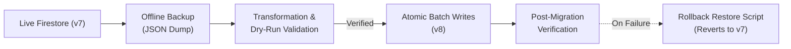

# Implementation Plan: Recorded Values to Enum.name Migration Execution and Rollback

**Status:** Completed  
**Date:** 2026-11-05  
**Target:** repository-wide  
**Evaluates:** [`recorded-values-to-enum-name-migration-plan.md`](./2026-11-05/220500_recorded-values-to-enum-name-migration-plan.md)  
**Schema Authority:** [`tracker.schema.json`](../../tracker.schema.json)  
**Depends On:** [`recorded-values-to-enum-name-migration-plan.md`](./2026-11-05/220500_recorded-values-to-enum-name-migration-plan.md)  

---

## 1. Executive Summary & Goals

### 1.1 Context
In the previous phase, all codebase definitions across `records/proto`, `records/parser`, `ui/kmp` (Room DB entities & domain models), and `scripts/contract.py` were modernized to **Schema Version 8**, replacing hyphenated/namespaced wire keys with uppercase `Enum.name` values (e.g., `status:drafting` $\rightarrow$ `DRAFTING`, `work-mode:remote` $\rightarrow$ `REMOTE` via `RoleLocation`, `confidence:high` $\rightarrow$ `HIGH_CONFIDENCE`, `region:us-remote` $\rightarrow$ `US_REMOTE`).

The active live Firestore database (`job-search-fnc314-dev`) currently stores legacy (Schema Version 7) wire strings across **112 applications**, **108 events**, **98 artifacts**, **14 pending proposals**, and **11 sync requests**.

### 1.2 Objective
Execute the live database migration with **100% deterministic fidelity** and **guaranteed rollback safety**.
Because there is only one user (the candidate), data can be fully backed up offline, transformed deterministically, verified via dry-run, written atomically, and restored cleanly in the event of any failure.

---

## 2. Inventory of Target Data & Schemas

A complete topology scan of the Firestore database confirms:

| Collection / Subcollection | Document Count | Fields to Transform |
| :--- | :--- | :--- |
| `applications/{id}` | 112 | `status`, `channel`, `locationDetail` (`roleLocation`, `region`), `tags` list, `schemaVersion` (bump to 8) |
| `applications/{id}/events/{id}` | 108 | `type`, `statusFrom`, `statusTo`, `actor`, `derivedFrom`, `confidence` |
| `applications/{id}/artifacts/{id}` | 98 | `kind` |
| `pending-proposals/{id}` | 14 | `kind`, `state`, `trigger`, `reviewedBy`, nested `changes` array |
| `sync-requests/{id}` | 11 | `kind`, `state` |
| `companies/{id}` | 5 | Pass-through check (no enum fields; ensure zero corruption) |
| `contacts/{id}` | 0 | Empty |

---

## 3. Migration & Rollback Architecture

### 3.1 Pre-Migration Backup (`scripts/backup_firestore.py`)
Prior to running any mutating operations:
1. Export every document and subcollection from Firestore into a structured JSON file: `generated/backup_v7_<timestamp>.json`.
2. Compute document counts and SHA-256 checksums of the raw exported state.
3. Validate that:
   - Export count matches live collection counts ($112$ apps, $108$ events, $98$ artifacts, $14$ proposals, $11$ sync requests, $5$ companies).
   - All subcollections are correctly associated with their parent document ID.

### 3.2 Offline Transformation & Dry-Run (`scripts/migrate_v8.py`)
1. Read the pre-migration backup JSON file offline without connecting to Firestore.
2. Apply value-normalization mappings:
   - **Status**: `drafting` $\rightarrow$ `DRAFTING`, `applied` $\rightarrow$ `APPLIED`, `rejected` $\rightarrow$ `REJECTED`, etc.
   - **Channel**: `email` $\rightarrow$ `EMAIL`, `referral` $\rightarrow$ `REFERRAL`, `linkedin` $\rightarrow$ `LINKEDIN`, etc.
   - **WorkMode / RoleLocation**: `remote` $\rightarrow$ `REMOTE`, `hybrid` $\rightarrow$ `HYBRID`, `onsite` $\rightarrow$ `ONSITE`. Rename field key `workMode` $\rightarrow$ `roleLocation`.
   - **Region**: `us-remote` $\rightarrow$ `US_REMOTE`, `pittsburgh` $\rightarrow$ `US_PIT`, `nyc` $\rightarrow$ `US_NYC`, `sf` $\rightarrow$ `US_SF`, etc.
   - **Tags**: Replace known legacy tags with exact enum names (e.g., `high-priority` $\rightarrow$ `HIGH_PRIORITY`).
   - **Events**: Normalize `type`, `actor`, `derivedFrom`, `confidence`, `statusFrom`, `statusTo`.
   - **Artifacts**: Normalize `kind` (`RESUME`, `COVER_LETTER`, `JOB_DESCRIPTION`, etc.).
   - **Proposals & Sync Requests**: Normalize `kind`, `state`, `trigger`, `reviewedBy`.
   - **Schema Version**: Set `schemaVersion: 8` on all application documents.
3. Emit a diff report (`generated/migration_v8_preview.diff`) highlighting transformed documents and verify zero unrecognized values.

### 3.3 Execution via Batch Writes (`scripts/migrate_v8.py --execute`)
1. Assert write safety: Check `TRACKER_ALLOW_WRITES=1`.
2. Group operations into Firestore `WriteBatch` chunks ($\le 400$ writes per batch to respect Firestore's 500-write limit).
3. Execute parent document updates first, followed by subcollection document updates.
4. Update `meta/schema` configuration document to `schemaVersion: 8`.

### 3.4 Guaranteed Rollback Procedure (`scripts/restore_firestore.py`)
If any step fails or tests identify an inconsistency:
1. Read `generated/backup_v7_<timestamp>.json`.
2. Run `python3 scripts/restore_firestore.py --backup generated/backup_v7_<timestamp>.json`:
   - Overwrite all documents and subcollections with their exact pre-migration state.
   - Delete any orphan documents created during an aborted run.
   - Reset `meta/schema` to `schemaVersion: 7`.
3. Verify rollback restoration against the original backup checksums.

---

## 4. Implementation Steps

### Step 1: Create Backup Utility (`scripts/backup_firestore.py`)
- Traverse `applications` (and nested `events`, `artifacts`), `pending-proposals`, `sync-requests`, `companies`, `contacts`.
- Serialize Firestore Timestamps, GeoPoints, and primitives cleanly to ISO-8601 strings and raw values.
- Save to `generated/backup_v7_<timestamp>.json`.

### Step 2: Refine Migration Script (`scripts/migrate_v8.py`)
- Enhance `scripts/migrate_v8.py` to support:
  - `--input <backup_file>` (offline mode).
  - `--dry-run` (writes summary diff without touching Firestore).
  - `--apply` (executes batched Firestore updates with `TRACKER_ALLOW_WRITES=1`).
- Map all subcollection documents (`events`, `artifacts`) and queue documents (`pending-proposals`, `sync-requests`).

### Step 3: Create Restore Utility (`scripts/restore_firestore.py`)
- Implement a dedicated restore script that takes a backup JSON file and restores all collections and subcollections using batched writes with `merge=False`.

### Step 4: Run Dry-Run and Inspect Diffs
- Execute `backup_firestore.py` to create the snapshot.
- Execute `migrate_v8.py --dry-run` and inspect transformed diffs.

### Step 5: Execute Migration
- Run `TRACKER_ALLOW_WRITES=1 python3 scripts/migrate_v8.py --apply`.

### Step 6: Post-Migration Verification
- Run `mise run tracker check` / `python3 scripts/contract.py` validation.
- Run KMP Room database sync and test suites (`cd ui/kmp && ./gradlew :core-data:jvmTest`).
- Run records parser test suites (`cd records && ./gradlew :records-parser:test`).
- Inspect live TUI / Dashboard view (`mise run tui`).

---

## 5. Verification Checklist

- [ ] Complete offline JSON backup created with 112 applications, 108 events, 98 artifacts, 14 pending proposals, 11 sync requests.
- [ ] Dry-run emits zero unmapped enums or validation warnings.
- [ ] Rollback script verified with `--dry-run`.
- [ ] Batched writes complete with exit code 0 under `TRACKER_ALLOW_WRITES=1`.
- [ ] Post-migration schema check passes for 100% of documents in Firestore.
- [ ] KMP JVM tests (`:core-data:jvmTest`) pass without conversion errors.
- [ ] Records parser tests (`:records-parser:test`) pass cleanly.

---

## 6. Bookkeeping
- [x] Plan persisted at `.agents/plans/2026-11-05/224500_migration-execution-and-rollback-plan.md`
- [x] Registry `README.md` row added / status synchronized
