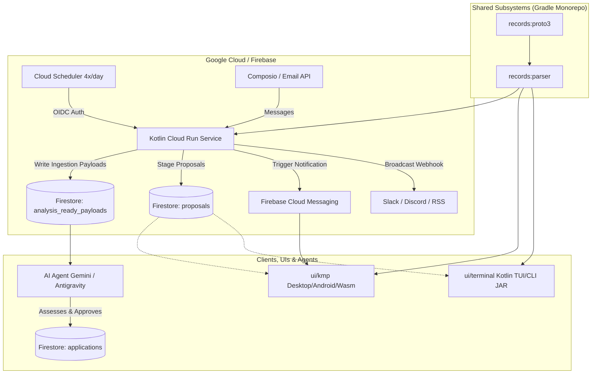

# Architecture & Implementation Plan: Kotlin Cloud Run Service, Shared Proto3 Models, and Remote Task Offloading

**Status:** Draft / Proposed  
**Date:** 2026-11-09  
**Target:** repository-wide  
**Model:** gemini-3.8-flash  
**Session:** 3e3f750b-aea3-46d6-8014-70592ca54e5d  
**Schema Authority:** [`tracker.schema.json`](file:///Users/fnc314/Work/Search/waleedtarbosh-ai-job-search/tracker.schema.json)  

---

## 1. Executive Summary & Goals

The AI Job Search toolkit is currently divided across Python automation scripts (`scripts/tracker.py`, `scripts/proposals.py`), a Python Curses/Textual TUI (`ui/terminal/tracker_tui.py`), and Kotlin Multiplatform modules (`records`, `ui/kmp`).

By migrating the deterministic task execution to a **Kotlin-based Cloud Run service**, we achieve:
1. **Unilateral Data Integrity via Shared Proto3**: All data structures, event models, and contracts defined in `:records` are compiled once and shared across the backend service, `:ui/kmp`, and any client TUIs.
2. **Headless Cloud Automation**: Routine ingestion (`email:sync-labels`, `email:read-inbox`, `email:collect`, `proposals:expire`, `tracker:sync-due`) is decoupled from local machine state and run via Google Cloud Scheduler.
3. **Staging Architecture**: Email signals and automated ingestion write to a staging collection (`analysis_ready_payloads`) and proposal queue (`proposals`), leaving high-stakes reasoning to AI agents and human approval.
4. **Push Notifications & Subscriber Feeds**: Events broadcast over Firebase Cloud Messaging (FCM) to `:ui/kmp` and outbound webhooks (Slack/Discord).
5. **Unified Kotlin Ecosystem**: Enables migrating `@ui/terminal` from Python curses to a Kotlin-source JAR/native CLI (using Mordant / Clikt / Lanterna or Compose Multiplatform for Terminal), creating a 100% unified Kotlin codebase.

---

## 2. Architecture & Design Principles

### 2.1 The Terminal Experience (@ui/terminal)
Currently, `@ui/terminal` is a ~100k Python script (`tracker_tui.py`) using curses.
- **Can it be migrated to a Kotlin JAR?**
  - **Yes, absolutely.** With a Kotlin CLI/TUI built on **Mordant / Clikt** (or **Lanterna / JLine** for full curses-style interactive panels), the terminal tool compiles to an executable JAR (`records-tui.jar`) or a GraalVM native binary.
  - **Key Benefit**: It directly imports `:records:proto` and `:records:parser`, using the identical serialization, validation, and Firestore models as Cloud Run and `:ui/kmp`.
  - **Visual Treatment for Auto-Updated Records**: The TUI can highlight rows updated by cloud workers (e.g. distinct cyan/magenta glyph or tag `[AUTO-SYNCED 12:00]`).

---

## 3. Remote Mise Tasks & Endpoints

### 3.1 The `remote:` Task Namespace
A new namespace in `.config/mise/tasks/remote/` connects local CLI workflows to the Cloud Run service:
- `mise run remote:email:read-inbox` — Calls Cloud Run `POST /tasks/email:read-inbox`
- `mise run remote:email:collect` — Calls Cloud Run `POST /tasks/email:collect`
- `mise run remote:proposals:expire` — Calls Cloud Run `POST /tasks/proposals:expire`
- `mise run remote:tracker:sync-due` — Calls Cloud Run `POST /tasks/tracker:sync-due`
- `mise run remote:sweep` — Runs the coordinated 4x/day sequence on demand
- `mise run remote:status` — Inspects Cloud Run worker health, pending queues, and last run timestamps

---

## 4. Proposed Changes & Implementation Phases

### Phase 1: Shared Models & Backend Subsystem Setup
- Create `:service` (or `:backend:cloud-runner`) module in Gradle.
- Configure Ktor Server (Netty/CIO engine) with Kotlinx Serialization and Google Cloud Firestore Admin SDK.
- Share `:records:proto` directly into the backend service.

### Phase 2: Ingestion & Staging Engine
- Port Composio/Gmail email fetching and message classifier logic to Kotlin coroutines.
- Implement `analysis_ready_payloads` schema in Firestore.
- Add deterministic proposal staging (`proposals` collection) and expiration jobs.

### Phase 3: Cloud Deployment & Scheduling
- Containerize the Ktor service with a multi-stage Dockerfile using Temurin JRE / Distroless.
- Set up Cloud Run deployment with Cloud Secret Manager (`COMPOSIO_API_KEY`).
- Configure Cloud Scheduler job (CRON: `0 */6 * * *`) targeting `/tasks/routine-sweep`.

### Phase 4: Push Notifications & Subscriber Outlets
- Integrate Firebase Cloud Messaging (FCM) into the Kotlin backend.
- Emit topic updates (`tracker-updates`) and webhook dispatchers.
- Add UI indicator badges in `:ui/kmp` and notification handling.

### Phase 5: Terminal UI (@ui/terminal) Kotlin Migration
- Implement Kotlin TUI module using Mordant/Lanterna sharing `:records`.
- Wire `mise run tui` to execute the packaged Kotlin JAR.
- Add distinct visual treatments for auto-synced/cloud-staged records.

---

## 5. Verification Plan

### Automated Tests
- Gradle unit tests: `./gradlew :service:test :records:test`
- Endpoint integration tests mocking Composio API responses.
- Konsist architecture tests verifying dependency graph and isolation.

### Manual Verification
- Deploy to Cloud Run test service.
- Trigger `mise run remote:sweep` and inspect `analysis_ready_payloads` in Firestore.
- Verify FCM push notification reception on a test client.
- Launch `mise run tui` and `:ui/kmp` to confirm auto-updated indicators display accurately.

---

## 6. Bookkeeping
- [x] Plan persisted at `.agents/plans/2026-11-09/125800_kotlin_cloud_run_remote_tasks_and_tui_plan.md`
- [ ] Registry `README.md` row added / status synchronized
