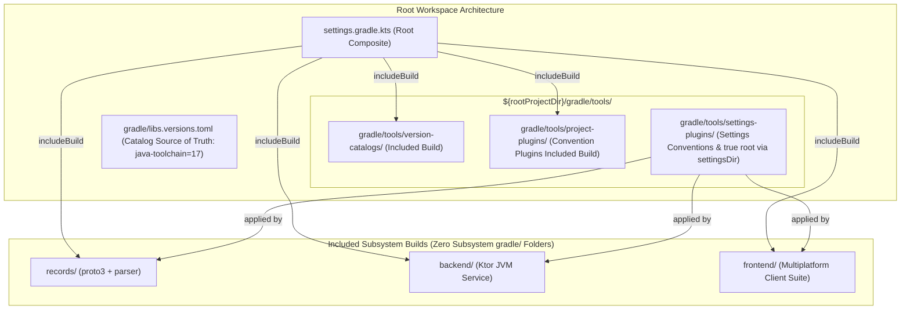

# Roadmap & Implementation Plan: Root Build Centralization, Quality Gates Hardening & Local Data Enrichment

**Status:** Completed  
**Date:** 2026-11-09  
**Target:** repository-wide  
**Supersedes:** [`.agents/plans/2026-11-09/170500_align_declared_versions_to_kebab_case_plan.md`](file:///Users/fnc314/Work/Search/waleedtarbosh-ai-job-search/.agents/plans/2026-11-09/170500_align_declared_versions_to_kebab_case_plan.md)  
**Schema Authority:** [`tracker.schema.json`](file:///Users/fnc314/Work/Search/waleedtarbosh-ai-job-search/tracker.schema.json)  

---

## 1. Executive Summary & Review Feedback Addressed

In response to direct user reviews and architecture decisions:

1. **Adopt Kebab-Casing Version Catalog Plan (L35)**:
   - Fully adopted and incorporated [`170500_align_declared_versions_to_kebab_case_plan.md`](file:///Users/fnc314/Work/Search/waleedtarbosh-ai-job-search/.agents/plans/2026-11-09/170500_align_declared_versions_to_kebab_case_plan.md).
   - Systematically normalizes 100% of declared version keys in `[versions]` into strict **kebab-case** format.
   - Unifies duplicate keys `javaToolchain = "26"` and `java-toolchains = "26"` into `java-toolchain = "17"`.
   - Synchronizes all `version.ref` attributes, `CatalogTypes.kt` keys, and Gradle type-safe accessors across all build scripts.
   - Formatted strictly using `tombi format` ensuring 2-space table entry indentation.

2. **True Root Path via `settings.layout.settingsDirectory` (L102, L26)**:
   - In `gradle/tools/settings-plugins/subsystem.settings.gradle.kts`, avoid ambiguous `rootDir` checks.
   - Use `settings.layout.settingsDirectory` property on `Settings` to locate the true workspace root lazily and idiomatic for configuration caching:
     ```kotlin
     val rootRepoDir = if (settings.layout.settingsDirectory.file("gradle/libs.versions.toml").asFile.exists()) {
         settings.layout.settingsDirectory.asFile.get()
     } else {
         settings.layout.settingsDirectory.dir("..").asFile.get()
     }
     ```
   - Guarantees deterministic path resolution whether executed from root or child included builds.

3. **Delete All Subsystem `gradle/` Directories (L23)**:
   - Remove `frontend/gradle/` and `records/gradle/` completely.
   - Wrapper, catalogs, plugins, and settings logic reside strictly at `${rootProjectDir}/gradle/`.

4. **Isolated Projects Compliance & CLI Task Invocations (L120)**:
   - To prevent cross-build configuration coupling and maintain full Gradle Isolated Projects and Configuration Cache purity, root `build.gradle.kts` will **not** define cross-project delegating tasks using `gradle.includedBuild(...).task(...)`.
   - We will rely entirely on Gradle composite build's native CLI addressing:
     - `./gradlew :records:<task>` (e.g. `./gradlew :records:detekt`, `./gradlew :records:test`)
     - `./gradlew :frontend:<task>` (e.g. `./gradlew :frontend:detekt`, `./gradlew :frontend:build`)
     - `./gradlew :backend:<task>` (e.g. `./gradlew :backend:test`)
   - All commands run directly from the repository root.

5. **Local Data Enrichment First (Ghostty Terminal over Cloud Run) (L132)**:
   - Remote Cloud Run deployment remains deferred.
   - Focus is on **Local Data Enrichment & Metadata Matching**:
     - Connect automatic `emailMessageId` propagation when new emails are fetched and proposals approved.
     - Implement metadata matching (company, sender, subject, recruiter domain tokenization) to correlate orphan message IDs in `gmail-sync/state.json` (211 historical messages) against the 110 Firestore application records.
     - Inspect and verify enriched records locally using `mise run tui` in Ghostty.

---

## 2. Target Root Gradle Architecture



---

## 3. Implementation Phases

### Phase 1: Tooling Centralization under `gradle/tools/` & Cleanup

1. **Relocate `project-plugins` to `${rootProjectDir}/gradle/tools/project-plugins`**:
   - Move contents of `frontend/gradle/tools/project-plugins` to `gradle/tools/project-plugins`.
   - Provide `gradle/tools/project-plugins/settings.gradle.kts`:
     ```kotlin
     rootProject.name = "project-plugins"
     dependencyResolutionManagement {
         versionCatalogs {
             create("libs") {
                 from(files("../../libs.versions.toml"))
             }
         }
     }
     ```
2. **Create `gradle/tools/settings-plugins/`**:
   - Move `gradle/conventions/subsystem.settings.gradle.kts` to `gradle/tools/settings-plugins/subsystem.settings.gradle.kts`:
     ```kotlin
     val rootRepoDir = if (settingsDir.resolve("gradle/libs.versions.toml").exists()) {
         settingsDir
     } else {
         settingsDir.parentFile
     }

     pluginManagement {
         includeBuild("${rootRepoDir}/gradle/tools/project-plugins")
     }

     dependencyResolutionManagement {
         versionCatalogs {
             if (findByName("libs") == null) {
                 create("libs") {
                     from(files("${rootRepoDir}/gradle/libs.versions.toml"))
                 }
             }
         }
     }
     ```
   - Delete `gradle/conventions/`.
3. **Delete All Subsystem `gradle/` Directories**:
   - Delete `frontend/gradle/` completely.
   - Delete `records/gradle/` completely.
   - Update `frontend/settings.gradle.kts` to remove `includeBuild("./gradle/tools")` and reference `apply(from = "../gradle/tools/settings-plugins/subsystem.settings.gradle.kts")`.
4. **Update Root `settings.gradle.kts`**:
   ```kotlin
   rootProject.name = "ai-job-search"

   includeBuild("gradle/tools/project-plugins")
   includeBuild("records")
   includeBuild("backend")
   includeBuild("frontend")
   ```

---

### Phase 2: Kebab-Case Version Catalog Normalization & Consumer Alignment

1. **Normalize `[versions]` in `gradle/libs.versions.toml` & `version-catalogs`**:
   - Unify `javaToolchain` and `java-toolchains` into `java-toolchain = "17"`.
   - Convert all camelCase keys to kebab-case:
     - `android-compileSdk` -> `android-compile-sdk = "37"`
     - `android-minSdk` -> `android-min-sdk = "24"`
     - `android-targetSdk` -> `android-target-sdk = "37"`
     - `androidx-testExt` -> `androidx-test-ext = "1.3.0"`
     - `androidx-testRunner` -> `androidx-test-runner = "1.7.0"`
     - `composeMultiplatform` -> `compose-multiplatform = "1.12.2"`
     - `composeMaterialIcons` -> `compose-material-icons = "1.7.3"`
     - `composeConstraintLayout` -> `compose-constraint-layout = "1.1.2"`
     - `googlePlayServices` -> `google-play-services = "4.5.0"`
     - `protobufGradlePlugin` -> `protobuf-gradle-plugin = "0.9.4"`
     - `androidGradlePlugin` -> `android-gradle-plugin = "8.5.1"`
   - Update corresponding `version.ref` attributes in `[libraries]` and `[plugins]`.
   - Copy to `gradle/tools/version-catalogs/src/main/resources/libs.versions.toml`.
   - Format with `tombi format`.
2. **Update `CatalogTypes.kt`**:
   Update `catalogKey` values in [`CatalogTypes.kt`](file:///Users/fnc314/Work/Search/waleedtarbosh-ai-job-search/frontend/gradle/tools/project-plugins/src/main/kotlin/dev/fnc314/tools/jobtracker/kmp/gradle/catalog/CatalogTypes.kt):
   ```kotlin
   public enum class Versions(
       override val catalogKey: String,
   ) : CatalogTypes<VersionConstraint> {
       JVM("jvm"),
       JAVA_TOOLCHAIN("java-toolchain"),
       ANDROID_COMPILE_SDK("android-compile-sdk"),
       ANDROID_MIN_SDK("android-min-sdk"),
       ANDROID_TARGET_SDK("android-target-sdk"),
       KOTLIN("kotlin"),
       AGP("agp"),
       NODE("node"),
       DETEKT("detekt"),
       ;
   ```
3. **Update Build Scripts with New Accessors**:
   - `frontend/apps/android/build.gradle.kts`:
     - `compileSdk = libs.versions.android.compile.sdk.get().toInt()`
     - `minSdk = libs.versions.android.min.sdk.get().toInt()`
     - `targetSdk = libs.versions.android.target.sdk.get().toInt()`
   - `records/parser/build.gradle.kts`:
     - `jvmToolchain(libs.versions.java.toolchain.get().toInt())`
   - `records/proto/build.gradle.kts`:
     - `jvmToolchain(libs.versions.java.toolchain.get().toInt())`
   - `project-plugins/build.gradle.kts`:
     - `libs.versions.java.toolchain.get().toInt()`
4. **Migrate Mise Tasks (`ui/kmp` -> `frontend`) & Native Root Invocation**:
   - Relocate `.config/mise/tasks/ui/kmp/` to `.config/mise/tasks/frontend/`.
   - Update Mise tasks to run native root Gradle commands:
     - `dev/detekt.sh`: `./gradlew :records:detekt :frontend:detekt`
     - `dev/test.sh`: `./gradlew :records:test :frontend:core-data:jvmTest`
     - `frontend:build`: `./gradlew :frontend:build -x test`
     - `frontend:desktop:run`: `./gradlew :frontend:apps-desktop:run`
5. **Docs & Rule Sync**:
   - Update `AGENTS.md` and module READMEs to replace `ui/kmp` references with `frontend`.
   - Run `mise run docs:tasks`.

---

### Phase 3: Local Data Enrichment & Metadata Matching

1. **Automatic Email Association for New Ingestion**:
   - Update proposal collection and approval logic (`scripts/proposals.py` and `scripts/render.py` / `apps-cli`):
     - Ensure that when a proposal with `sourceEmail.messageId` is approved, `emailMessageId` is automatically unioned into `JobApplication.emailMessageIds`.
     - When an event is recorded via `mise run tracker:event <id> <type> --email-message-id <id>`, ensure the ID is persisted to both the event and the parent application document.
2. **Metadata Matching Correlator (`mise run tracker:backfill:emails`)**:
   - Enhance `BackfillEmailsCommand` in `frontend/apps/cli`:
     - Scan all 211 messages in `gmail-sync/state.json` and `generated/` payload caches.
     - Extract subject, sender domain, and company names.
     - Match against the 110 Firestore application records using tokenized company names, recruiter domain maps, and role titles.
     - Perform dry-run audit, reporting matched messages and confidence scores.
     - Apply matches (`--apply`), populating `JobApplication.emailMessageIds`.
3. **Local Ghostty TUI Verification**:
   - Launch `mise run tui` in the local Ghostty terminal.
   - Verify `[AUTO-SYNCED]` badges on enriched applications.
   - Inspect applications (`i <id>`) to confirm linked message IDs in the **✉ Related Emails** card and timeline history.

---

## 4. Verification Plan

### Automated Verification
```bash
# 1. Verify TOML formatting with tombi
tombi format --check gradle/libs.versions.toml
tombi format --check gradle/tools/version-catalogs/src/main/resources/libs.versions.toml

# 2. Run Detekt natively from root
./gradlew :records:detekt :frontend:detekt

# 3. Run unit tests natively from root
./gradlew :records:test :frontend:core-data:jvmTest

# 4. Verify Android app compiles with android.compile.sdk
./gradlew :frontend:apps-android:assembleDebug

# 5. Run Mise quality gate wrappers
mise run dev:detekt
mise run dev:test
```

### Manual Verification
```bash
# 1. Run local email backfill dry-run
mise run tracker:backfill:emails

# 2. Apply enriched email associations to Firestore
TRACKER_ALLOW_WRITES=1 mise run tracker:backfill:emails --apply

# 3. Inspect enriched records in local terminal
mise run tui
```

---

## 5. Bookkeeping & Completion
- Master plan registered at `.agents/plans/2026-11-09/164500_post_monorepo_quality_gates_and_cloud_run_deployment_plan.md`
- Registry `README.md` updated
- Commit message: `164500_post_monorepo_quality_gates_and_cloud_run_deployment_plan.md`
- Push to `origin main`
