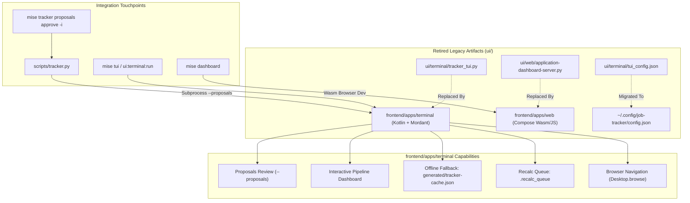

# Architecture & Implementation Plan: Replace Legacy `ui/` with `frontend/apps/` & Achieve Terminal Feature Parity

**Status:** Completed  
**Date:** 2026-11-09  
**Target:** `frontend/apps/terminal`, `frontend/apps/web`, `scripts/tracker.py`, repository-wide  

---

## 1. Executive Summary & Goals

The legacy `ui/` directory originally housed:
1. `ui/terminal/tracker_tui.py`: A Python curses-based terminal user interface providing application tracking, status updates, detail panes, and an interactive proposal approval mode (`--proposals`).
2. `ui/web/application-dashboard-server.py` & `ui/web/application-dashboard.html`: A static HTML report preview server.

As part of the monorepo evolution, the repository is consolidating into clean domain subsystems (`records/`, `backend/`, and `frontend/`). The Compose Multiplatform (KMC) web target (`frontend/apps/web`) replaces the static HTML web dashboard, while the Kotlin terminal application (`frontend/apps/terminal`) replaces the Python curses script.

However, `frontend/apps/terminal` is currently an initial prototype and lacks:
- **`--proposals` interactive mode**: Required by `mise tracker proposals approve -i` and `scripts/tracker.py`, which review and approve/reject staged email proposals.
- **Offline & sandbox resilience**: Inability to fall back to `generated/tracker-cache.json` when Firestore network access is unavailable.
- **Feature parity with `tracker_tui.py`**: Rich application inspection, browser link opening, fit recalculation queueing (`.recalc_queue`), sorting, and filtering via CLI flags/environment variables.

This plan details the replacement of legacy `ui/` by elevating `frontend/apps/terminal` and `frontend/apps/web`, wiring `scripts/tracker.py` to the compiled Kotlin terminal binary, and retiring the old `ui/` directory.

---

## 2. Architecture & Subsystem Mapping



---

## 3. Detailed Component Plan

### 3.1. `frontend/apps/terminal`: Full Feature Parity Implementation

#### A. Interactive Proposals Review Mode (`--proposals`)
- **CLI Flag Support**: Parse `--proposals` flag or `proposals` subcommand.
- **Data Loading**: Query `pending-proposals` from Firestore (filter `state == "proposal:pending"` or `"PENDING"`). Fall back to `generated/tracker-cache.json` (`pendingProposals`) if offline.
- **Zero Pending Proposals**:
  - Print message: `"No pending proposals to review."`
  - Emit JSON on stdout: `{"ok": true, "remaining_pending": 0, "summary": "proposals review complete"}`
  - Exit code `0`.
- **Interactive Review UI (Mordant)**:
  - Table showing: Checkbox selection `[x]`, Proposal ID, Creation Date, Change Count, Unmatched Count.
  - Commands:
    - `i <id>`: Inspect proposal detail (Application target, Event Type, status transition e.g. `APPLIED → REJECTED`, confidence, source email subject, message ID, timestamp, and unmatched email items with failure reason).
    - `a <id>` / `a`: Approve selected proposal(s). Invokes `scripts/tracker.py proposals approve <id> [--note note]` to maintain exact state-machine verification, batching, and lead-creation logic.
    - `r <id>` / `r`: Reject selected proposal(s). Invokes `scripts/tracker.py proposals reject <id> [--reason reason]`.
    - `s <id>`: Skip proposal.
    - `q` / `quit`: Exit review mode.
- **Exit Summary**:
  - When exiting, output JSON to stdout: `{"ok": true, "remaining_pending": <count>, "summary": "proposals review complete"}`. This maintains 100% compatibility with `scripts/tracker.py`'s `_interactive_proposal_approve`.

#### B. Pipeline Navigation & Dashboard
- **Banner & Aggregated Metrics**: Total applications, Open count, Interviews, Offers, Leads.
- **Mordant Table**:
  - Columns: ID, Company, Role, Status (with color formatting: green for applied/offer, yellow for interview, red for rejected), Fit Rating, Sync Cues (`[AUTO-SYNCED]`), Linked Email Count.
- **Interactive Commands & Filters**:
  - `o` / `open`: Toggle Open Only vs All.
  - `l` / `lead`: Filter leads.
  - `s <status>`: Filter by specific status.
  - `/ <query>` or `f <query>`: Full-text filter across company, role, ID, notes.
  - `sort <col>`: Sort by `id`, `company`, `role`, `status`, `fit`, `date`.
  - `all` / `reset`: Reset active filters.
  - `r <id>`: Write fit recalculation request to `.recalc_queue` at repository root:
    ```json
    {
      "schemaVersion": 4,
      "kind": "fit-recalculation",
      "requestedAt": "2026-11-09T19:50:00Z",
      "applicationId": "acme--staff-android-engineer",
      "company": "Acme",
      "role": "Staff Android",
      "currentFitRating": "88"
    }
    ```
  - `b <id>`: Open Job URL or Portal URL in default system browser using `java.awt.Desktop.getDesktop().browse(URI)`.
  - `i <id>` / `inspect <id>`: Deep inspection panel:
    - Company, Role, Status, Channel, Location, Fit, UUID.
    - Company Logo URL (Hunter.io metadata).
    - Job URL & Application Portal URL.
    - Linked email message IDs card.
    - Full timeline events table (Timestamp, Type, Actor, EmailMsgId, Notes).

#### C. Offline & Sandbox Resilience
- Wrap Firestore calls in `RemotePlatform.initialize()` with `try/catch` catching `ExecutionException`, `UnavailableException`, `StatusRuntimeException`, and connection errors.
- If offline or `TRACKER_SOURCE == "cache"`, parse `generated/tracker-cache.json` using `kotlinx.serialization.json`:
  - Load `applications` list into memory.
  - Load `pendingProposals` list.
  - Load `events` and `artifacts`.
  - Display badge `[SOURCE: CACHE (OFFLINE)]` in the dashboard banner.

#### D. Environment Variable & CLI Flag Invariants
- Support flags: `--open`, `--status <status>`, `--tag <tag>`, `--limit <n>`, `--proposals`, `--cache`.
- Respect env vars: `TRACKER_FILTER_OPEN=1`, `TRACKER_FILTER_STATUS`, `TRACKER_FILTER_TAG`, `TRACKER_FILTER_LIMIT`, `TRACKER_SOURCE`.

---

### 3.2. Integration & Replacement in `scripts/tracker.py`

#### A. Interactive Proposal Approve (`_interactive_proposal_approve`)
Update `scripts/tracker.py` line 2474:
- Replace `tui_path = client.REPO_ROOT / "ui" / "terminal" / "tracker_tui.py"` with:
  ```python
  tui_bin = client.REPO_ROOT / "frontend" / "apps" / "terminal" / "build" / "install" / "apps-terminal" / "bin" / "apps-terminal"
  if not tui_bin.exists():
      subprocess.run([str(client.REPO_ROOT / "gradlew"), ":frontend:apps-terminal:installDist"], check=True)
  cmd = [str(tui_bin), "--proposals"]
  ```
- Retain stdout JSON capture and `summary = json.loads(proc.stdout.strip())` check.

#### B. Tracker CLI TUI Hand-off (`_launch_tui`)
Update `scripts/tracker.py` line 307:
- Replace `tui_script = repo_root / "ui" / "terminal" / "tracker_tui.py"` with `tui_bin`.
- Forward filter flags via environment variables (`TRACKER_FILTER_OPEN`, `TRACKER_FILTER_STATUS`, etc.).

---

### 3.3. Web Dashboard Retirement (`ui/web/` -> `frontend/apps/web`)

1. **Retire Static Files**:
   - Delete `ui/web/application-dashboard-server.py` and `ui/web/application-dashboard.html`.
2. **Update Task Aliases**:
   - Update `.config/mise/tasks/ui/web/server.py` (alias `dashboard`):
     Redirect to `./gradlew :frontend:apps-web:wasmJsBrowserDevelopmentRun` (or run `.config/mise/tasks/frontend/web/wasm/dev.sh`).
   - Retain `ui/web/report.py` (alias `report`) which runs `scripts/generate_report.py` outputting to `reports/application-dashboard.html`.
3. **Clean `scripts/generate_report.py`**:
   - Remove checks for `ui/web/application-dashboard.html` (only write to `reports/application-dashboard.html`).

---

### 3.4. Deletion of `ui/` & Test Alignment

1. **Delete `ui/terminal/`**:
   - Remove `ui/terminal/tracker_tui.py` and `ui/terminal/tui_config.json`.
   - Remove `ui/` directory entirely.
2. **Retire/Replace Tests**:
   - Remove `scripts/tests/test_dashboard_server.py`.
   - Replace `scripts/tests/test_tracker_tui.py` with:
     - Kotlin test suite `frontend/apps/terminal/src/test/kotlin/dev/fnc314/tools/jobtracker/terminal/TerminalAppTest.kt` verifying CLI parsing, cache loading, recalc request generation, and proposals review logic.
     - Thin Python smoke test in `scripts/tests/test_terminal_bin.py` verifying that `scripts/tracker.py proposals approve -i` successfully invokes `apps-terminal` and receives expected JSON.

---

## 4. Verification Plan

### Automated Verification
```bash
# 1. Build the Kotlin terminal binary
./gradlew :frontend:apps-terminal:installDist

# 2. Run Kotlin unit tests in frontend:apps-terminal
./gradlew :frontend:apps-terminal:test

# 3. Verify interactive proposals execution in non-interactive pipeline
mise tracker proposals approve -i

# 4. Verify TUI launch with filters
TRACKER_SOURCE=cache frontend/apps/terminal/build/install/apps-terminal/bin/apps-terminal --open list

# 5. Run Python test suite
mise run dev:test

# 6. Verify Compose Wasm web dashboard builds
./gradlew :frontend:apps-web:wasmJsBrowserDistribution
```

### Manual Verification
1. Run `mise tui` and interactively filter by open, inspect an application, view related emails, and exit cleanly.
2. Run `mise tracker proposals approve -i` in a terminal window, review proposals, toggle inspection, approve or reject, and verify summary.
3. Verify that `ui/` directory is completely absent from repository root.
