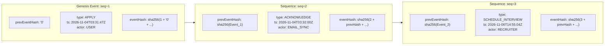
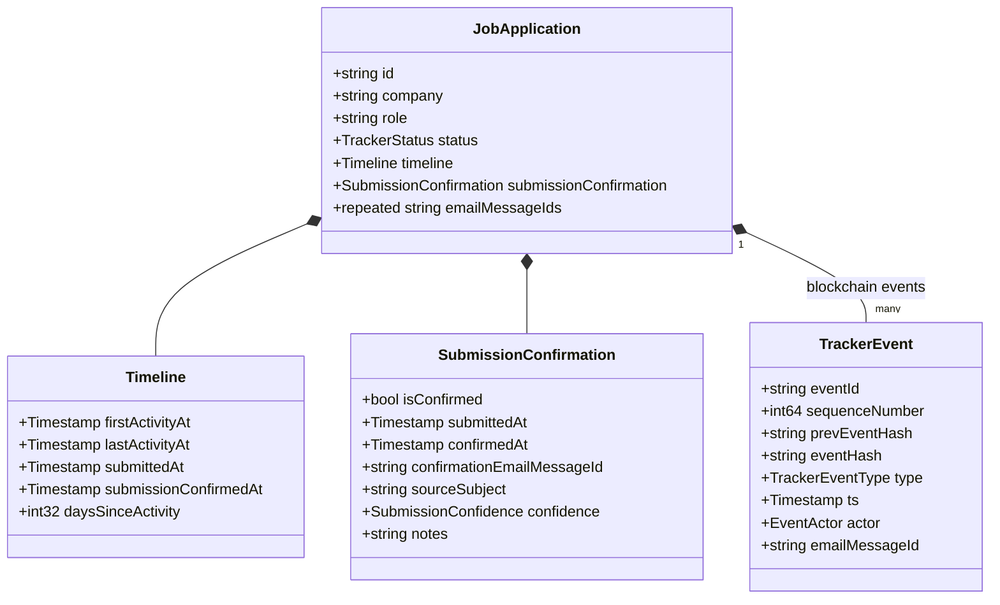

# Implementation Plan: Official Submission Single-Source-of-Truth & Immutable Event Hash Chain

**Status:** In Review  
**Date:** 2026-11-10  
**Target:** `records`, `backend`, `frontend`, `tracker.schema.json`, and Firestore Database (Repository-Wide Foundation)  
**Schema Authority:** [`tracker.schema.json`](../../tracker.schema.json)  
**Depends On:** [`records/proto/src/main/proto/tracker/v1/application.proto`](../../records/proto/src/main/proto/tracker/v1/application.proto), [`backend/src/main/kotlin/dev/fnc314/tools/jobtracker/backend/BackendService.kt`](../../backend/src/main/kotlin/dev/fnc314/tools/jobtracker/backend/BackendService.kt)  

---

## 1. Executive Summary & Foundation-Shifting Goals

### The Problem & Context
1. **Proliferation of Unaligned Date Fields:**
   - Over time, tracking application submission has drifted across multiple divergent representations: Firestore top-level `date`, `createdAt`, `updatedAt`, `appliedAt` (added in `frontend` details), `firstActivityAt`, and email `receivedAt`.
   - As the user noted, the naming and tracking is currently fragmented: *"I'm having a hard time tracing the fields through the layers. This shouldn't be so complicated (and it should not be tracked multiple ways as it is now...)"*.
2. **"Production" is Ours:**
   - We own all data. We are explicitly authorized to make **schema-foundation-shifting changes** for longevity, maintenance, clarity, and single-source-of-truth purity.
3. **Event Log Integrity & Immutability:**
   - Application audit events (`applications/{id}/events/*`) are append-only in intention, but lack tamper-evident cryptographic verification.
   - The user requests that the sequence of read-only `events` tied to a particular `JobApplication` be akin to a **blockchain**: verifiably sequential, immutable, and cryptographically chained.

### Core Objectives
1. **Single Source of Truth for Official Submission (`submittedAt` & `submissionConfirmedAt`):**
   - Eliminate redundant and confusing timestamp derivations.
   - Ground `submittedAt` in the invocation of `/outcome` (or interactive `/apply` completion) when the application is officially marked submitted.
   - Ground `submissionConfirmedAt` in the external validation of the employer's acknowledgement email (`receivedAt`).
   - Cleanly map and expose this through `RemoteRecord.getInstant(...)` across all frontend and backend consumers.
2. **Consolidation of Event Timestamps (/outcome + Scraped Emails):**
   - When an application transitions from local drafted documents into an employer's portal via `/outcome` (or `/apply`), a canonical `APPLY` event is created with the official submission timestamp.
   - When an email scrape confirms receipt, an `ACKNOWLEDGE` event is created with the employer's ACK timestamp (`receivedAt`) and `emailMessageId`.
3. **Cryptographically Verifiable Event Hash Chain (Blockchain Pattern):**
   - Every `TrackerEvent` in Firestore and protobuf will include:
     - `sequenceNumber` (int64, 1-indexed strictly monotonic)
     - `prevEventHash` (string, SHA-256 of the immediate predecessor event, or `"0"`/genesis for seq=1)
     - `eventHash` (string, SHA-256 of `sequenceNumber + prevEventHash + eventId + applicationId + type + ts + statusTo + actor`)
   - Guarantees the audit trail is verifiable, deterministic, sequentially ordered, and unmodifiable.

---

## 2. Review of Recent Changes (`frontend` / `job-application-details`)

In recent commits to `frontend`:
- `RemoteRecord` and `MapRemoteRecord` introduced `getInstant(key: String): Instant`.
- `JobApplicationDetailUiModel`, `JobApplication`, and `JobApplicationEntity` added `appliedAt: Instant?`.
- In `RemoteJobApplicationDetailsDataSourceImpl.kt`:
  ```kotlin
  private fun resolveAppliedAt(record: RemoteRecord): Instant {
    return when (val rawData = record.getInstant("date")) {
      Instant.DISTANT_PAST -> Instant.DISTANT_FUTURE
      else -> rawData
    }
  }
  ```
### Fixes & Cleanups:
1. **Unify `appliedAt` with Canonical `submittedAt`:**
   - Rename and align domain/UI fields from `appliedAt` to canonical `submittedAt` (or consolidate `date` into `submittedAt` in the schema).
   - Leverage `record.getInstant("submittedAt")` directly instead of falling back to legacy `date` aliases.
2. **Adopt `RemoteRecord.getInstant` Universally:**
   - Replace repetitive `InstantParser.parse(record.fields["..."])` throughout `RemoteJobApplicationDetailsDataSourceImpl`, `RemoteJobApplicationsListDataSourceImpl`, and `CompanyDetailsRepositoryImpl` with `record.getInstant("key")`.

---

## 3. Cryptographically Verifiable Event Chain (Blockchain Design)



### Event Hash Specification:
- **Canonical Hash Input:**
  `"${sequenceNumber}|${prevEventHash}|${eventId}|${applicationId}|${type}|${tsIso}|${statusTo ?: ''}|${actor}"`
- **Algorithm:** SHA-256 (standard hex string).
- **Genesis Block:** `sequenceNumber = 1`, `prevEventHash = "0000000000000000000000000000000000000000000000000000000000000000"`.
- **Validation Engine:**
  - In `lib/events.py` (Python) and `records-parser` (Kotlin), provide `verifyEventChain(events: List<TrackerEvent>): ChainVerificationResult`.
  - Flags any broken links, out-of-order sequence numbers, or modified notes/statuses.

---

## 4. Single-Source-of-Truth Submission Architecture



---

## 5. Detailed Proposed Changes

### Component 1: Protobuf Contracts (`records/proto` & `records/parser`)
#### [MODIFY] `records/proto/src/main/proto/tracker/v1/event.proto`
- Add blockchain verification fields to `TrackerEvent`:
  ```protobuf
  int64 sequenceNumber = 13;
  string prevEventHash = 14;
  string eventHash = 15;
  ```
#### [MODIFY] `records/proto/src/main/proto/tracker/v1/timeline.proto`
- Add:
  ```protobuf
  google.protobuf.Timestamp submittedAt = 5;
  google.protobuf.Timestamp submissionConfirmedAt = 6;
  ```
#### [MODIFY] `records/proto/src/main/proto/tracker/v1/application.proto`
- Add `SubmissionConfirmation submissionConfirmation = 24;`.
#### [NEW / MODIFY] `records/parser/.../EventChainVerifier.kt`
- Kotlin implementation of SHA-256 event chain validation and builder.

---

### Component 2: Schema Contract (`tracker.schema.json`)
#### [MODIFY] `tracker.schema.json`
- In `$defs/event`: Add `sequenceNumber`, `prevEventHash`, and `eventHash`.
- In `$defs/timeline`: Add `submittedAt` and `submissionConfirmedAt`.
- In `$defs/application`: Add `submissionConfirmation` and align `submittedAt`.
- Bump `schemaVersion` to 10.

---

### Component 3: Backend & CLI Tasks (`backend`, `lib/`, `scripts/`)
#### [MODIFY] `lib/events.py`
- Add `computeEventHash(...)` and `buildChainedEvent(events, type, ...)`.
- Update `readEvents` to verify the cryptographic chain on read and raise `ChainIntegrityError` if tampering is detected.
#### [MODIFY] `scripts/apply.py` & `.agents/commands/outcome.md`
- Ensure `/outcome` and `/apply` completion consistently call `events.buildChainedEvent("APPLY", ...)` and populate `submittedAt`.
#### [NEW] `scripts/backfill_event_chain.py` (`mise run tracker:chain:backfill`)
- Backfills `sequenceNumber`, `prevEventHash`, and `eventHash` across all historical events in Firestore.
- Backfills missing on-disk records from `job-applications/` (Marriott, AARP, PatientPoint, Tekgence, Capital One Senior Lead).
- Updates Capital One pre-November applications to `REJECTED` and latest November application to `INTERVIEW`.

---

### Component 4: Frontend Subsystem (`frontend`)
#### [MODIFY] `frontend/core/data/.../JobApplication.kt` & `JobApplicationMapper.kt`
- Cleanly standardize on `submittedAt: Instant?` across domain models, Room entities, and mappers.
- Adopt `record.getInstant("submittedAt")` across `RemoteJobApplicationDetailsDataSourceImpl.kt`.

---

## 6. Verification Plan

### Automated Tests
1. **Event Chain Verification Unit Tests:**
   ```bash
   mise run records:test
   python3 -m unittest scripts/tests/test_event_chain.py
   ```
2. **Backend & Schema Tests:**
   ```bash
   ./gradlew :backend:test
   mise run tracker:check
   mise run dev:guards
   ```
3. **Frontend Integration Tests:**
   ```bash
   ./gradlew :frontend:core:data:test
   ```

### Manual Verification
1. Inspect Firestore application documents: verify `submittedAt`, `submissionConfirmation`, and the chained SHA-256 hashes on `events/{eventId}`.
2. Run `mise run tracker:list` and open the app in `mise run tui` or desktop UI to confirm dates and statuses display seamlessly.
