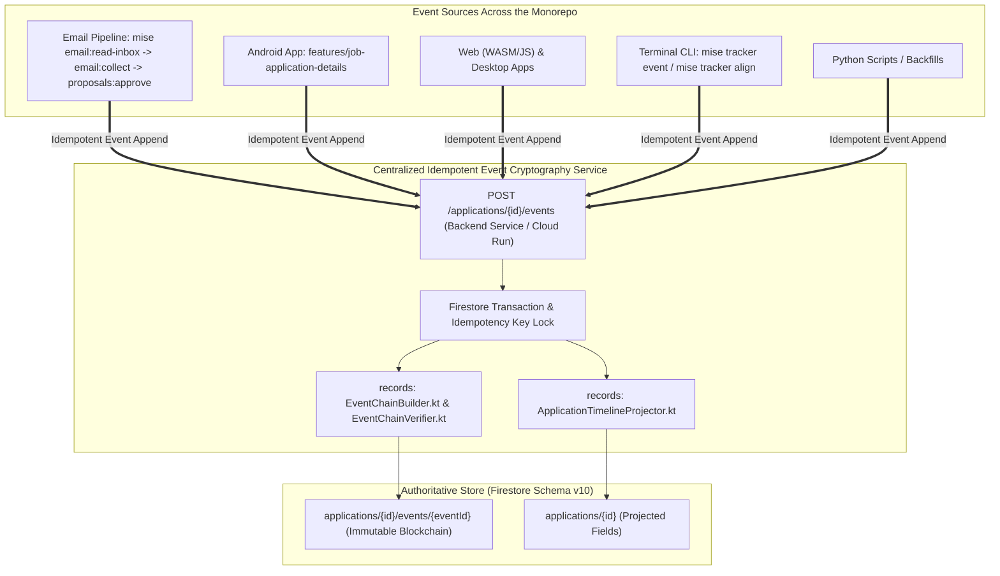

# Architecture & Implementation Plan: Universal Centralized Idempotent Event Cryptography & Email Pipeline Integration

**Status:** In Review  
**Date:** 2026-11-10  
**Target:** `backend`, `records/parser`, `frontend` (`apps-android`, `apps-cli`, `core-data`, `features`), `scripts/proposals.py`, `.config/mise/tasks/email/`, `TODO.md`  
**Harness:** Antigravity  
**Model:** gemini-3.8-flash  
**Session:** c8ab99d9-9541-44bf-a745-c066dcabd512  
**Schema Authority:** [`tracker.schema.json`](../../tracker.schema.json)  
**Depends On:** [`.agents/plans/2026-11-10/130500_official-submission-single-source-of-truth.md`](../../.agents/plans/2026-11-10/130500_official-submission-single-source-of-truth.md)  
**Evaluates:** [`TODO.md`](../../TODO.md) (TODO-001 & TODO-003)  

---

## 1. Goal Description & Architectural Mandate

The user issued an explicit system-wide requirement:
> *"Make sure the terminal-based flows of `mise email:read-inbox` and `mise email:collect` are wired to use this service. It's only viable if it is unilaterally used. This needs declared at the highest/all architectural levels"*

### The Architectural Invariant: Unilateral Event Append Ingestion
Every timeline event recorded in this repository—regardless of its origin—**MUST** pass through the centralized, idempotent event cryptography service. No process may directly write to `applications/{id}/events` without transactionally computing:
1. Monotonic 1-based `sequenceNumber`.
2. SHA-256 `prevEventHash` linking to the previous block (or genesis zeros).
3. SHA-256 `eventHash` over the canonical payload string.
4. Reprojection of the parent `applications/{id}` document (`timeline.submittedAt`, `timeline.submissionConfirmedAt`, `timeline.lastActivityAt`, and `submissionConfirmation`).



---

## 2. High-Level Architectural Declarations

1. **Unilateral Append Path:**
   - The authoritative mutation path for any timeline event is `POST /applications/{id}/events`.
   - The service is hosted by `backend` (Ktor Cloud Run service, run locally via `mise run dev:backend` or deployed).
   - In environments where direct local JVM execution is preferred (e.g. CLI running with direct service account credentials), the CLI uses the identical Kotlin `EventChainBuilder` and `ApplicationTimelineProjector` transactionally, guaranteeing identical bit-for-bit cryptographic integrity.

2. **Terminal Email Pipeline Alignment:**
   - **`mise run email:read-inbox`**: Fetches emails (via Composio) and writes payload to `generated/gmail-inbox.json`.
   - **`mise run email:collect`**: Reads messages, filters, matches to applications, and stages `pending-proposals`.
   - **`proposals.approve` (`mise run proposals:approve`)**: When approving proposal changes, instead of raw batch writes that bypass cryptographic hash chaining, each approved change is dispatched through the centralized event append service.
   - **Idempotency Guarantee:** Email `messageId` serves as the idempotency key. Rerunning `collect` or re-approving duplicate emails is guaranteed to be a no-op, preventing duplicate events or broken hash chains.

3. **Frontend Ecosystem Alignment:**
   - **`apps/android`**, **`apps/web`**, **`apps/desktop`**:
     All UI screens (`job-application-details`, `add-job-application`, `tracker-edits`) invoke `RecordEventUseCase` $\to$ `JobApplicationDetailsRepositoryImpl`.
     `RemoteJobApplicationDetailsDataSourceImpl` delegates to `NetworkDataSource.postJson("/applications/{id}/events", ...)` using the event's `UUIDv7` as the idempotency key.

---

## 3. Component Specifications & Proposed Changes

### Component 1: `records/parser` (Domain Hash Engine & Projection Core)

#### [NEW] `records/parser/src/main/kotlin/dev/fnc314/tools/jobsearch/parser/EventChainBuilder.kt`
- Implements:
  - `computeNextLink(existingEvents: List<TrackerEvent>, newEvent: TrackerEvent): TrackerEvent`
  - `chainEvents(events: List<TrackerEvent>, applicationId: String): List<TrackerEvent>`
  - `verifyChain(events: List<TrackerEvent>): Boolean` (delegates to `EventChainVerifier`)
  - Genesis hash constant: `"0000000000000000000000000000000000000000000000000000000000000000"`

#### [NEW] `records/parser/src/main/kotlin/dev/fnc314/tools/jobsearch/parser/ApplicationTimelineProjector.kt`
- Port of `lib/render.py`:
  - `projectTimeline(events: List<TrackerEvent>, today: Instant? = null): Map<String, Any?>` (computes `submittedAt` from earliest `APPLY`, `submissionConfirmedAt` from earliest `ACKNOWLEDGE`, `lastActivityAt`, `daysSinceActivity`)
  - `projectSubmissionConfirmation(current: Map<String, Any?>?, events: List<TrackerEvent>): Map<String, Any?>` (derives `CONFIRMED_SCRAPED`, `RECRUITER_LED`, or `UNCONFIRMED_USER_MARKED`)
  - `projectCounters(events: List<TrackerEvent>): Map<String, Int>`

#### [NEW] `records/parser/src/test/kotlin/dev/fnc314/tools/jobsearch/records/parser/EventChainBuilderTest.kt` & `ApplicationTimelineProjectorTest.kt`
- Comprehensive tests verifying chain construction, tamper detection, and projection accuracy.

---

### Component 2: `backend/` (Transactional Idempotent HTTP Service)

#### [MODIFY] `backend/src/main/kotlin/dev/fnc314/tools/jobtracker/backend/BackendService.kt`
- Add transactional event append with idempotency:
  ```kotlin
  public fun appendEventTransactional(
      applicationId: String,
      eventPayload: Map<String, Any?>,
      idempotencyKey: String? = null,
  ): Map<String, Any?>
  ```
  - Validates `applicationId` exists in Firestore.
  - Queries `applications/{id}/events` for matching `eventId` or `emailMessageId` (idempotency check). If found, returns existing event immediately without mutating state.
  - Inside a Firestore transaction:
    - Fetches current event chain.
    - Computes next `sequenceNumber`, `prevEventHash`, and SHA-256 `eventHash` via `EventChainBuilder`.
    - Writes the new event document.
    - Recomputes timeline and submission confirmation via `ApplicationTimelineProjector` and updates `applications/{id}` atomically.

#### [MODIFY] `backend/src/main/kotlin/dev/fnc314/tools/jobtracker/backend/Main.kt`
- Add endpoint:
  ```kotlin
  post("/applications/{id}/events") {
      val applicationId = call.parameters["id"] ?: return@post call.respond(HttpStatusCode.BadRequest, mapOf("error" to "Missing application id"))
      val body = call.receive<Map<String, Any?>>()
      val idempotencyKey = call.request.headers["Idempotency-Key"] ?: body["eventId"] as? String
      val result = BackendService.appendEventTransactional(applicationId, body, idempotencyKey)
      call.respond(HttpStatusCode.Created, result)
  }
  ```

#### [NEW] `backend/src/test/kotlin/dev/fnc314/tools/jobtracker/backend/BackendEventAppendTest.kt`
- Test cases for:
  - First-time append producing `seq=1`, `prevEventHash=0000...`.
  - Second append producing `seq=2` pointing to first hash.
  - Duplicate append returning existing event with identical status and hash (idempotent).
  - Parent document timeline projection update.

---

### Component 3: Terminal Email Pipeline Integration (`email:read-inbox` / `email:collect` / `proposals:approve`)

#### [MODIFY] `lib/proposals.py` & `scripts/proposals.py`
- Update `approve(db, proposalId, ...)`:
  - When approved changes are applied to applications, instead of writing raw `eventsModule.buildEvent` unchained into the batch:
    - Dispatch each approved event through `BackendService.appendEventTransactional` (or HTTP call to `POST /applications/{id}/events` when service is active, with fallback to `eventsModule.appendEvent` which now enforces hash chaining).
    - Email `messageId` is passed as `emailMessageId` and idempotency key.
    - Eliminates any risk of unchained events being injected during proposal approvals.

#### [MODIFY] `.config/mise/tasks/email/collect.py` & `read-inbox.py`
- Verify task documentation and environment routing ensure `email:collect` proposals preserve `messageId` and source metadata for idempotent proposal approval.

---

### Component 4: Frontend Multiplatform Integration (`apps-android`, `apps-cli`, `core-data`)

#### [MODIFY] `frontend/core/data/src/commonMain/kotlin/dev/fnc314/tools/jobtracker/core/data/source/NetworkDataSource.kt` & `NetworkDataSourceImpl.kt`
- Add:
  ```kotlin
  public suspend fun postJson(url: String, jsonBody: String, headers: Map<String, String> = emptyMap()): String
  ```

#### [MODIFY] `frontend/features/job-application-details/data/.../RemoteJobApplicationDetailsDataSourceImpl.kt`
- Update `recordEvent(event: TrackerEvent): String`:
  - Delegates to `networkDataSource.postJson("/applications/${event.applicationId}/events", ...)` using backend service base URL.
  - Falls back to direct Firestore append with hash chaining if offline or local-only.

#### [MODIFY] `frontend/apps/cli/src/main/kotlin/dev/fnc314/tools/jobtracker/cli/commands/AddEventCommand.kt`
- Wire event addition to use the centralized append service / `EventChainBuilder` to guarantee hash chain integrity.

---

### Component 5: Documentation & Tracking Alignment

#### [MODIFY] `TODO.md`
- Update `TODO-003` (Backend Functionality Abstraction) to `IN_PROGRESS`:
  - Mark completed: Cryptographic event hash chain builder in Kotlin, timeline projection engine, centralized idempotent HTTP append endpoint.
  - Document that terminal email flows (`email:read-inbox` $\to$ `email:collect` $\to$ `proposals:approve`) and all frontend apps strictly route event creation through this architecture.
- Update `TODO-001` (Kotlin-Only Migration) with ported module references.

---

## 4. Verification Plan

### Automated Verification
1. **Records Subsystem Verification:**
   ```bash
   ./gradlew -p records check
   ```
   *Expected: All protobuf generation, Detekt linting, and unit tests (`EventChainBuilderTest`, `ApplicationTimelineProjectorTest`) pass.*

2. **Backend Subsystem Verification:**
   ```bash
   ./gradlew -p backend test
   ```
   *Expected: All backend unit tests pass, including idempotency and transaction tests.*

3. **Frontend Compilation & Tests:**
   ```bash
   ./gradlew -p frontend :features-job-application-details-data:compileKotlinMetadata
   ./gradlew -p frontend :apps-cli:assemble
   ```
   *Expected: Clean compilation across multiplatform modules.*

4. **Terminal Email Pipeline Test:**
   ```bash
   python3 -m unittest scripts/tests/test_tracker_modules.py
   ```
   *Expected: Proposal approval tests verify that approved changes generate valid hash chains.*

5. **Tracker Schema Validation:**
   ```bash
   mise run tracker:check
   ```
   *Expected: Schema v10 validation passes.*
