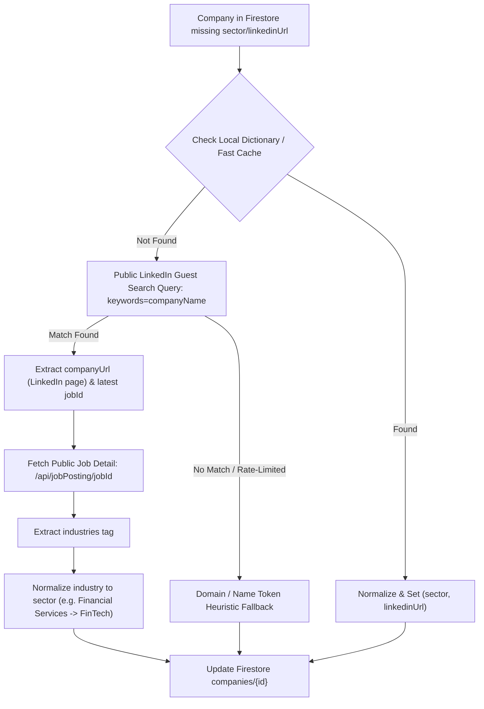

# Implementation Plan: Public LinkedIn Guest API Company Enrichment Backfill (RM-005)

**Status:** Proposed  
**Date:** 2026-11-10  
**Target:** `.agents/skills/linkedin-search/`, `backend/`, `scripts/tracker.py`, Firestore `companies` (`job-search-fnc314-dev`)  
**Evaluates:** User feedback on `rm005_company_enrichment_backfill_execution.md` (L51): "Fallback to public linkedin api scraping as used for job scraping"  
**Schema Authority:** `tracker.schema.json` v10 (`$defs/company`)  

---

## 1. Goal Description

In Firestore (`job-search-fnc314-dev`), 94 company records are missing `sector` and `linkedinUrl`.
Per user instruction, instead of relying on a paid Hunter.io API key, we will implement **public LinkedIn guest API scraping** (as used in `.agents/skills/linkedin-search/` for job scraping) as the fallback/enrichment mechanism for company metadata.

When querying LinkedIn's public guest search endpoint (`https://www.linkedin.com/jobs-guest/jobs/api/seeMoreJobPostings/search?keywords=<companyName>&location=United+States`), LinkedIn returns matching job cards containing:
- `company`: Official name
- `companyUrl`: Official LinkedIn company page (e.g. `https://www.linkedin.com/company/affirm`, `https://www.linkedin.com/company/anthropicresearch`)
- Associated job ID.

Calling the public job detail endpoint (`https://www.linkedin.com/jobs-guest/jobs/api/jobPosting/<jobId>`) yields the exact verified LinkedIn `industries` field (e.g., `"Financial Services"`, `"Research Services"`, `"Retail Apparel and Fashion"`), which maps cleanly into standardized sectors (`FinTech`, `Technology`, `Retail`, `Healthcare`).

---

## 2. Technical Architecture & Enrichment Pipeline



### 2.1. LinkedIn Company Metadata Lookup
Add a company enrichment command/function to the LinkedIn CLI or Python/Kotlin bridge:
1. **Input:** `companyName` (e.g., `"Anthropic"` or `"American Eagle Outfitters"`)
2. **Fetch:** `GET https://www.linkedin.com/jobs-guest/jobs/api/seeMoreJobPostings/search?keywords={encode(companyName)}&location=United+States&start=0`
3. **Parse:**
   - Find the first job card matching the company name.
   - Extract `companyUrl` (e.g. `https://www.linkedin.com/company/anthropicresearch`).
   - Extract `jobId` and query detail to extract `industries`.
4. **Rate Limiting & Safety:**
   - Sleep with jitter (500ms - 1000ms) between lookups.
   - Cache results in memory / Firestore so a company is only scraped once.
   - Use the local dictionary for the top 50 known companies to drastically minimize external HTTP calls.

### 2.2. Sector Normalization Rules
Map LinkedIn `industries` to standard sectors:
- `Financial Services`, `Banking`, `Investment Management` -> `FinTech`
- `Technology, Information and Internet`, `Software Development`, `Research Services`, `Computer Hardware` -> `Technology`
- `Hospitals and Health Care`, `Medical Equipment Manufacturing`, `Biotechnology Research` -> `Healthcare`
- `Retail Apparel and Fashion`, `Retail`, `Internet Marketplace Platforms` -> `Retail`
- `Motor Vehicle Manufacturing`, `Transportation, Logistics, Supply Chain and Storage` -> `Automotive`
- `Entertainment Providers`, `Broadcast Media Production and Distribution` -> `Media`

### 2.3. Batch Backfill Execution
Expose a script/task:
`mise run tracker:companies:enrich`
- Iterates over all companies in Firestore where `sector` or `linkedinUrl` is missing.
- Resolves LinkedIn URL and industry via dictionary -> public LinkedIn search scraping -> heuristic fallback.
- Saves non-destructively to Firestore with `lastEnrichedAt` and `updatedAt`.

---

## 3. Proposed File Changes

### [MODIFY] `.agents/skills/linkedin-search/cli/src/commands/company.ts` [NEW]
Add `company` command to LinkedIn search CLI:
```typescript
bun run src/cli.ts company "<companyName>"
```
Returns JSON:
```json
{
  "name": "Anthropic",
  "linkedinUrl": "https://www.linkedin.com/company/anthropicresearch",
  "industry": "Research Services",
  "sector": "Technology"
}
```

### [MODIFY] `backend/src/main/kotlin/dev/fnc314/tools/jobtracker/backend/BackendService.kt`
- Incorporate dictionary and public LinkedIn scraping resolution into `batchEnrichCompanies()` and `enrichCompany()`.

### [MODIFY] `.config/mise/tasks/tracker/companies/enrich.sh`
- Ensure the task executes the enhanced enrichment backfill.

---

## 4. Verification Plan

1. **Test LinkedIn CLI company lookup:**
   ```bash
   bun run .agents/skills/linkedin-search/cli/src/cli.ts company "Anthropic"
   bun run .agents/skills/linkedin-search/cli/src/cli.ts company "Affirm"
   ```
2. **Execute Backfill Task:**
   ```bash
   TRACKER_ALLOW_WRITES=1 TRACKER_PROJECT=job-search-fnc314-dev mise run tracker:companies:enrich
   ```
3. **Verify Firestore state:**
   ```bash
   python3 -c "
   from google.cloud import firestore
   db = firestore.Client(project='job-search-fnc314-dev')
   docs = list(db.collection('companies').stream())
   with_sector = sum(1 for d in docs if (d.to_dict().get('sector') or '').strip())
   with_linkedin = sum(1 for d in docs if (d.to_dict().get('linkedinUrl') or '').strip())
   print(f'Companies with sector: {with_sector}/94, with linkedinUrl: {with_linkedin}/94')
   "
   ```
