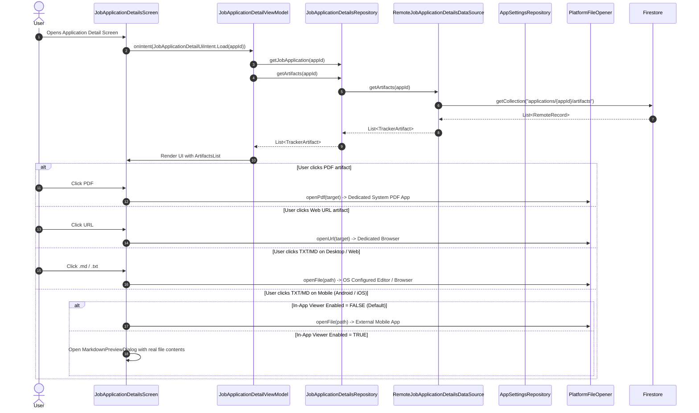

# Architecture & Implementation Plan: Interactive Artifact Presentation in KMC `frontend/apps`

**Status:** Proposed  
**Date:** 2026-11-10  
**Target:** `frontend/features/job-application-details`, `frontend/core/data`, `frontend/features/settings`, `frontend/apps/`, Firestore `applications/{id}/artifacts`  
**Depends On:** [`.agents/plans/2026-11-10/173600_unify_notes_and_events_timeline.md`](./173600_unify_notes_and_events_timeline.md) (predrafted from `.junie/plans/unify-notes-and-events-timeline.md`)  
**Evaluates:** Artifact loading gap, interactive file launching, and platform-specific in-app text/markdown viewer (Android & iOS exclusive)  
**Schema Authority:** `tracker.schema.json` v10 (`$defs/artifact`)  

---

## 1. Goal Description

In KMC `frontend/apps`, users navigating to an application's details screen see an empty state ("No artifacts attached") even for applications with existing compiled CVs, cover letters, and markdown posting notes. Furthermore, clicking on artifacts lacks complete platform launcher support (e.g., Android uses dummy `println` stubs), and in-app viewing of text/markdown files is hardcoded to a mock string rather than reading real content or respecting platform capabilities.

This plan addresses:
1. **Closing the Artifact Data Gap**: Resolving why `currentArtifacts` was hardcoded to `emptyList()` in `JobApplicationDetailViewModel` and querying the `applications/{id}/artifacts` subcollection from Firestore via `RemoteDataSource`.
2. **Backfilling & Syncing Local Artifacts**: Aligning local files in `job-applications/` (PDFs, Markdown, text files) with their Firestore `applications/{id}/artifacts` subcollections so every existing document on disk is reflected in the database.
3. **Interactive Launching & Dedicated Apps**:
   - Web URLs launch to default system browsers across all platforms.
   - PDFs launch to dedicated system PDF viewer apps across Desktop (AWT `Desktop.open` / `browse`) and Android (`Intent.ACTION_VIEW` with `application/pdf` via `FileProvider` or browser for remote URLs).
   - Local files open via native OS handlers.
4. **Platform-Scored Text/Markdown Handling (Android & iOS Exclusive Setting)**:
   - **Desktop OS & Web Platform**: Always delegate to the operating system's or browser's configured applications (e.g., VS Code, Mac TextEdit, default browser). Desktop OSes have robust file associations and window managers, so in-app overriding is unnecessary.
   - **Android & iOS Mobile Platforms**: Add setting `enableInAppTextViewer` (`Boolean`, default: `false`) in `AppSettings`, presented in `SettingsScreen` **only** when running on mobile targets (Android & iOS).
     - When `false` (default): Delegates to external mobile apps (e.g., installed text editors, Google Drive viewer) via `PlatformFileOpener.openFile(path)`.
     - When `true`: Opens an interactive in-app viewer reading and displaying the actual text/markdown content in a dedicated sheet/dialog.

---

## 2. Root Cause Investigation Findings

### A. The ViewModel Hardcoded Empty Artifacts
In [`JobApplicationDetailViewModel.kt`](file:///Users/fnc314/Work/Search/waleedtarbosh-ai-job-search/frontend/features/job-application-details/ui/src/commonMain/kotlin/dev/fnc314/tools/jobtracker/features/jobapplicationdetails/ui/JobApplicationDetailViewModel.kt#L93):
```kotlin
currentEvents = emptyList()
currentArtifacts = emptyList() // <-- HARDCODED TO EMPTY!
```
`JobApplicationDetailsRepository` had methods for `getJobApplication()`, `updateStatus()`, and `getArtifactSignedUrl()`, but **no method to fetch artifacts** (`getArtifacts(applicationId: String)`). Consequently, the UI model always received 0 artifacts.

### B. RemoteDataSource Missing Subcollection Querying
The subcollection in Firestore is located at:
`applications/{id}/artifacts/{artifactId}`
In `RemoteDataSource.jvm.kt` and `RemoteDataSource.android.kt`, `getCollection(collectionPath: String)` accepts any path string. Calling `remoteDataSource.getCollection("applications/$applicationId/artifacts")` works directly against Firestore!

### C. Local vs Firestore Sync Disconnect
There are 463 files in `job-applications/` across companies. Some applications in Firestore (e.g. `air-apps`, `baxter-international`) have artifact records pointing to relative local paths (`job-applications/baxter/...`), but others have missing local paths or were never registered in the `applications/{id}/artifacts` subcollection. Running artifact alignment ensures that every PDF, `.md`, and `.txt` file found in `job-applications/{company}/{role}/{date}` is indexed into Firestore with proper `artifactId`, `kind` (`CV`, `COVER_LETTER`, `POSTING`, `OUTCOME`), and file metadata.

### D. PlatformFileOpener Platform Implementation Stubs
- On JVM/Desktop: `PlatformFileOpener.jvm.kt` uses `Desktop.getDesktop().open(...)` and `browse(...)`.
- On Android: `PlatformFileOpener.android.kt` only printed logs (`println("Opening PDF: $url")`). It must use `Intent(Intent.ACTION_VIEW)` with `FLAG_ACTIVITY_NEW_TASK` and `FileProvider` (or direct URI for web URLs).

### E. Settings Flag Scoping: Mobile Only (Android & iOS)
- On Desktop (JVM) and Web, the operating system and browser already provide rich external applications (e.g., default markdown editors, VS Code, native PDF viewers, browser tabs).
- On mobile operating systems (Android and iOS), opening a local text file externally can fail if the user has no plain text viewer registered or prefers reviewing notes directly within the Job Tracker workflow.
- Therefore, the toggle `enableInAppTextViewer` belongs strictly to **Android and iOS**, exposed conditionally in `SettingsScreen` via a platform discriminator (`isMobilePlatform: Boolean` or expect/actual helper in `core/data`).

---

## 3. Architecture & Data Flow



---

## 4. Proposed Changes

### Component 1: `frontend/core/data` (Platform Launcher & Platform Capability Contract)

#### [NEW] `PlatformCapabilities.kt` (expect/actual) in `core/data`
- Define multiplatform capability check:
  ```kotlin
  public expect object PlatformCapabilities {
      /** True on Android and iOS; False on JVM Desktop and Web. */
      public val supportsInAppTextViewerToggle: Boolean
  }
  ```
  - `androidMain`: `supportsInAppTextViewerToggle = true`
  - `iosMain`: `supportsInAppTextViewerToggle = true`
  - `jvmMain`: `supportsInAppTextViewerToggle = false`
  - `webMain` / `jsMain` / `wasmJsMain`: `supportsInAppTextViewerToggle = false`

#### [MODIFY] [`AppSettings.kt`](file:///Users/fnc314/Work/Search/waleedtarbosh-ai-job-search/frontend/core/data/src/commonMain/kotlin/dev/fnc314/tools/jobtracker/core/data/settings/AppSettings.kt)
- Add `enableInAppTextViewer: Boolean = false` (defaulting strictly to `false`).

#### [MODIFY] [`PlatformFileOpener.kt`](file:///Users/fnc314/Work/Search/waleedtarbosh-ai-job-search/frontend/core/data/src/commonMain/kotlin/dev/fnc314/tools/jobtracker/core/data/platform/PlatformFileOpener.kt) & Platform Variants
- **JVM (`PlatformFileOpener.jvm.kt`)**: Verify file existence before opening with `Desktop.getDesktop().open(File(path))`, falling back to `openUrl(url)` if HTTP(S).
- **Android (`PlatformFileOpener.android.kt`)**: Implement actual Android intent launching via `ApplicationContextHolder.application`:
  - `openUrl(url)`: `Intent(Intent.ACTION_VIEW, Uri.parse(url))` with `FLAG_ACTIVITY_NEW_TASK`.
  - `openPdf(url)`: If local, open with `FileProvider` and MIME `application/pdf`; if remote, launch `Intent.ACTION_VIEW`.
  - `openFile(path)`: Launch `Intent.ACTION_VIEW` with appropriate MIME (`text/plain`, `application/pdf`, etc.).
- **Web (`PlatformFileOpener.js.kt` / `wasmJs.kt`)**: Launch URLs / blob links in browser tabs (`window.open(url, "_blank")`).

---

### Component 2: `frontend/features/job-application-details` (Data, Domain & UI)

#### [MODIFY] [`JobApplicationDetailsRepository.kt`](file:///Users/fnc314/Work/Search/waleedtarbosh-ai-job-search/frontend/features/job-application-details/domain/src/commonMain/kotlin/dev/fnc314/tools/jobtracker/features/jobapplicationdetails/domain/repository/JobApplicationDetailsRepository.kt)
- Add `public suspend fun getArtifacts(applicationId: String): List<TrackerArtifact>` to repository interface.

#### [MODIFY] [`RemoteJobApplicationDetailsDataSource.kt`](file:///Users/fnc314/Work/Search/waleedtarbosh-ai-job-search/frontend/features/job-application-details/data/src/commonMain/kotlin/dev/fnc314/tools/jobtracker/features/jobapplicationdetails/data/source/RemoteJobApplicationDetailsDataSource.kt) & Implementation
- Add `getArtifacts(applicationId: String): List<TrackerArtifact>`.
- In `RemoteJobApplicationDetailsDataSourceImpl`:
  ```kotlin
  override suspend fun getArtifacts(applicationId: String): List<TrackerArtifact> = withContext(Dispatchers.Default) {
      val records = remoteDataSource.getCollection("applications/$applicationId/artifacts")
      records.map(::mapRecordToTrackerArtifact)
  }
  ```
- Implement `mapRecordToTrackerArtifact(record: RemoteRecord): TrackerArtifact` mapping `artifactId`, `kind`, `filename`, `contentType`, `size`, `sha256`, `storage`, `localPath`, `externalUrl`, and `createdAt`.

#### [MODIFY] [`JobApplicationDetailsRepositoryImpl.kt`](file:///Users/fnc314/Work/Search/waleedtarbosh-ai-job-search/frontend/features/job-application-details/data/src/commonMain/kotlin/dev/fnc314/tools/jobtracker/features/jobapplicationdetails/data/repository/impl/JobApplicationDetailsRepositoryImpl.kt)
- Wire `getArtifacts(applicationId: String)` to remote data source (with local memory cache fallback).

#### [NEW] `LoadArtifactsUseCase.kt` & `LoadArtifactsUseCaseImpl.kt`
- Domain use case `LoadArtifactsUseCase` in `domain/usecase/` with parameter `Params(val applicationId: String)`.
- Register in `JobApplicationsDetailsDomainModule.kt`.

#### [MODIFY] [`JobApplicationDetailViewModel.kt`](file:///Users/fnc314/Work/Search/waleedtarbosh-ai-job-search/frontend/features/job-application-details/ui/src/commonMain/kotlin/dev/fnc314/tools/jobtracker/features/jobapplicationdetails/ui/JobApplicationDetailViewModel.kt)
- Inject `loadArtifactsUseCase: LoadArtifactsUseCase`.
- In `handleLoad(id: String)`:
  ```kotlin
  val artifacts = runCatching { loadArtifactsUseCase(LoadArtifactsUseCase.Params(id)) }.getOrDefault(emptyList())
  currentArtifacts = artifacts
  ```
- Pass `artifacts` to `createJobApplicationDetailUiModel`.

#### [MODIFY] [`ArtifactsList.kt`](file:///Users/fnc314/Work/Search/waleedtarbosh-ai-job-search/frontend/features/job-application-details/ui/src/commonMain/kotlin/dev/fnc314/tools/jobtracker/features/jobapplicationdetails/ui/component/ArtifactsList.kt) & [`DetailDialogs.kt`](file:///Users/fnc314/Work/Search/waleedtarbosh-ai-job-search/frontend/features/job-application-details/ui/src/commonMain/kotlin/dev/fnc314/tools/jobtracker/features/jobapplicationdetails/ui/DetailDialogs.kt)
- Refactor file click handling:
  - Check `isPdf`: Launch dedicated PDF app via `fileOpener.openPdf(target)`.
  - Check `isTextOrMd` (ends with `.md`, `.txt`, `.markdown`):
    - On Desktop & Web: Always delegate to external system app via `fileOpener.openFile(path)`.
    - On Mobile (Android / iOS):
      - If `settings.enableInAppTextViewer`: Open in-app `MarkdownPreviewDialog` reading real contents.
      - If `!settings.enableInAppTextViewer`: Delegate to dedicated external app via `fileOpener.openFile(path)`.
  - Web URLs: Launch dedicated browser via `fileOpener.openUrl(url)`.
- In `MarkdownPreviewDialog`: Read the file content from local disk (if `localPath` exists) using multiplatform file reading or platform helper, displaying real document text in a scrollable, monospace/styled container.

---

### Component 3: `frontend/features/settings` (Settings Screen Mobile-Exclusive Toggle)

#### [MODIFY] [`SettingsUiModel.kt`](file:///Users/fnc314/Work/Search/waleedtarbosh-ai-job-search/frontend/features/settings/ui/src/commonMain/kotlin/dev/fnc314/tools/jobtracker/features/settings/ui/SettingsUiIntent.kt) & [`SettingsUiIntent.kt`](file:///Users/fnc314/Work/Search/waleedtarbosh-ai-job-search/frontend/features/settings/ui/src/commonMain/kotlin/dev/fnc314/tools/jobtracker/features/settings/ui/SettingsUiIntent.kt)
- Add `showInAppTextViewerSetting: Boolean` and `enableInAppTextViewer: Boolean` to `SettingsUiModel`.
- Add intent `data class ToggleInAppTextViewer(val enabled: Boolean) : SettingsUiIntent`.

#### [MODIFY] [`SettingsViewModel.kt`](file:///Users/fnc314/Work/Search/waleedtarbosh-ai-job-search/frontend/features/settings/ui/src/commonMain/kotlin/dev/fnc314/tools/jobtracker/features/settings/ui/SettingsViewModel.kt)
- Map `showInAppTextViewerSetting = PlatformCapabilities.supportsInAppTextViewerToggle`.
- Map `settings.enableInAppTextViewer` in `uiState`.
- Handle `ToggleInAppTextViewer` by updating `AppSettings`.

#### [MODIFY] [`SettingsScreen.kt`](file:///Users/fnc314/Work/Search/waleedtarbosh-ai-job-search/frontend/features/settings/ui/src/commonMain/kotlin/dev/fnc314/tools/jobtracker/features/settings/ui/SettingsScreen.kt)
- Wrap "In-App Document Viewer" in `if (model.showInAppTextViewerSetting)`:
  - Hidden completely on Desktop (JVM) and Web.
  - Visible on Android & iOS mobile platforms.
  - Title: *"In-App Document Viewer"*
  - Subtitle: *"Open Markdown (.md) and text (.txt) files inside the app instead of launching external applications (Default: Off)"*

---

### Component 4: Local Artifacts Sync & Backfill Tool

#### [NEW] Task / CLI Script: `scripts/sync_local_artifacts.py` & Mise Task `tracker:artifacts:sync`
- Scan `job-applications/` for all PDF, TXT, and MD files.
- For each file found:
  - Match to its corresponding application in Firestore (by company and role directory name).
  - Compute `sha256`, file size, MIME type (`application/pdf`, `text/markdown`, `text/plain`).
  - Classify kind: `main_*` -> `CV`, `cover_*` -> `COVER_LETTER`, `job_posting.md` -> `POSTING`, `outcome.md` -> `OUTCOME`.
  - Check if document already exists in `applications/{appId}/artifacts`. If missing or path outdated, write or update the document with `localPath`.
- Provide `--dry-run` and live execution with `TRACKER_ALLOW_WRITES=1`.

---

## 5. User Review Required

> [!IMPORTANT]
> **Platform Scoping Alignment & Plan Dependency:**
> 1. **Dependency on Notes & Events Timeline Unification**: This plan explicitly depends upon [`.agents/plans/2026-11-10/173600_unify_notes_and_events_timeline.md`](./173600_unify_notes_and_events_timeline.md) (predrafted from `.junie/plans/unify-notes-and-events-timeline.md`), which standardizes subcollection queries (`applications/{id}/events`) and retires the redundant NOTES section in favor of real timeline events.
> 2. **Desktop & Web Always External**: Desktop (macOS, Windows, Linux) and Web platforms will not show the in-app document viewer toggle in Settings, and clicking `.md`/`.txt` files will directly open the user's configured editor or browser.
> 3. **Android & iOS In-App Toggle**: Android and iOS display the "In-App Document Viewer" switch in Settings (default: `FALSE`). When turned ON, mobile users can review `.md` and `.txt` notes natively within the app without needing external text viewer apps.
> 4. **Dedicated App Launching**: Web URLs launch the default web browser; PDFs launch the default system PDF reader (e.g. Preview on Mac, Acrobat/Chrome on Windows/Linux, Adobe/Drive on Android); text files launch the system text editor.
> 5. **Sync Scope**: The new task `mise run tracker:artifacts:sync` will index the 463 files currently in `job-applications/` (covering `job_posting.md`, `outcome.md`, `main_*.pdf`, `cover_*.pdf`, `*.txt`) into their respective Firestore subcollections so that all historical applications immediately show their artifacts.

---

## 6. Verification Plan

### Automated Tests
1. `./gradlew :frontend:core-data:compileKotlinJvm` - Verify data models, capabilities & settings compile.
2. `./gradlew :frontend:features-job-application-details-domain:allTests` - Verify `LoadArtifactsUseCase` and detail use case tests pass.
3. `./gradlew :frontend:features-job-application-details-data:allTests` - Verify repository and remote data source mapping tests pass.
4. `./gradlew :frontend:features-job-application-details-ui:jvmTest` - Verify UI state and intent handling with artifacts list.
5. `./gradlew :frontend:features-settings-ui:jvmTest` - Verify settings toggle intent and state emission.
6. `mise run dev:guards` - Ensure repository security and architecture guards pass.

### Manual Verification
1. Run `mise run tracker:artifacts:sync --dry-run` to inspect proposed artifact additions across `job-applications/`.
2. Run `TRACKER_ALLOW_WRITES=1 mise run tracker:artifacts:sync` to sync existing artifacts into Firestore.
3. Launch desktop app: `mise run desktop` (or launch via `./gradlew :frontend:apps-desktop:run`).
4. Select an application with artifacts (e.g., `baxter-international`, `air-apps`, `uber`). Verify the **Artifacts** section now displays the files with kind badge and file size.
5. Click a PDF artifact: Verify it opens in the external PDF viewer.
6. Click a Markdown artifact on Desktop: Verify it launches directly in the system's default text/markdown editor.
7. Verify Settings screen on Desktop: Confirm the mobile-exclusive "In-App Document Viewer" toggle is cleanly hidden on Desktop.
8. Test on Android (emulator or unit test): Verify the toggle appears in Settings and switches between external intent launching and in-app preview dialog.
