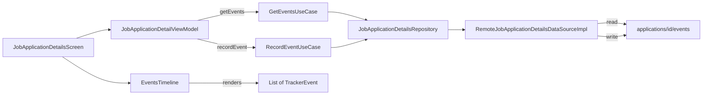

# Implementation Plan: Unify Notes and Events Timeline in Job Application Details

**Status:** Completed  
**Date:** 2026-11-10  
**Target:** `frontend` (`features/job-application-details`, `core/data/model`)  
**Harness:** Junie  
**Model:** Qwen/Qwen3.6-27B-FP8  
**Schema Authority:** [`tracker.schema.json`](../../../tracker.schema.json)  

---

## 1. Goal Description & Background

In the job application details screen (`features/job-application-details`), activity notes and timeline events are currently disconnected:
1. **Disconnected Notes vs Timeline**: The NOTES section renders a raw pre-computed markdown string (`notesRendered`) from the parent `JobApplication` document, while the Events Timeline renders at most 2 synthetic fallback events because real events are never queried from Firestore (`currentEvents = emptyList()`).
2. **Subcollection Mismatch**: `RemoteJobApplicationDetailsDataSourceImpl.recordEvent()` currently writes to a top-level collection `"events"`, whereas the schema and Firestore architecture mandate writing to the subcollection `applications/{id}/events`.
3. **Structured Interview Scheduling**: When scheduling interviews (`SCHEDULE_INTERVIEW`, `VISIT_ONSITE`), the event lacks a dedicated `scheduledAt` date-time field, forcing scheduling info into unstructured free text notes.

This plan unifies activity history so that **events are the single source of truth**:
- Real events are queried from `applications/{id}/events` upon detail load.
- `recordEvent` writes to `applications/{id}/events`.
- `TrackerEvent` and `tracker.schema.json` gain optional `scheduledAt` timestamp support for interview scheduling.
- The redundant, static NOTES card in `JobApplicationDetailsScreen` is retired in favor of the structured, interactive Events Timeline.

---

## 2. Architecture & Design Principles

### Key Decisions
1. **Subcollection Storage Invariant**: Both event reads and writes target `applications/{applicationId}/events` using the existing `RemoteDataSource` collection path support.
2. **Retiring NOTES Section**: The raw markdown `notesRendered` card is removed from `JobApplicationDetailsScreen.kt`. The Events Timeline displays event types, actors, notes, and dates chronologically.
3. **`scheduledAt` on TrackerEvent**: Add `scheduledAt: Instant?` to `TrackerEvent` and `tracker.schema.json` (`$defs/event/properties/scheduledAt`), with date-time input in `RecordEventDialog` when interview stages are selected.

---

## 3. Proposed Changes

### Component 1: Schema (`tracker.schema.json`)
- Add `scheduledAt` (`#/$defs/isoDateTime`) to `$defs/event/properties`.

### Component 2: Core Data (`frontend/core/data`)
- Add `public val scheduledAt: Instant? = null` to `TrackerEvent`.
- Update `Factory.createTrackerEvent()` with optional `scheduledAt`.

### Component 3: Details Feature Data & Domain (`frontend/features/job-application-details`)
- Add `getEvents(applicationId: String): List<TrackerEvent>` to `JobApplicationDetailsRepository` and `RemoteJobApplicationDetailsDataSource`.
- In `RemoteJobApplicationDetailsDataSourceImpl`:
  - `getEvents`: Fetch `remoteDataSource.getCollection("applications/$applicationId/events")` and map to `TrackerEvent`.
  - `recordEvent`: Write to `"applications/${event.applicationId}/events"` instead of top-level `"events"`.
- Add `GetEventsUseCase` (or include in composite details load).
- Update `JobApplicationDetailViewModel`: Load real events on `handleLoad(id)` and populate `currentEvents`.

### Component 4: Details Feature UI (`frontend/features/job-application-details/ui`)
- Remove `model.notesRendered` section card from `JobApplicationDetailsScreen.kt`.
- In `EventsTimeline.kt`: Render `scheduledAt` badge/timestamp for scheduled interview events.
- In `DetailDialogs.kt` (`RecordEventDialog`): Expose date/time input when event type represents scheduled interview stages.

---

## 4. Verification Plan

1. `./gradlew :frontend:core-data:compileKotlinJvm` - Verify data model updates.
2. `./gradlew :frontend:features-job-application-details-domain:allTests` - Verify use case tests pass.
3. `./gradlew :frontend:features-job-application-details-ui:jvmTest` - Verify ViewModel & UI tests pass with real events.
4. `mise run tracker:check` - Verify `tracker.schema.json` validity against Firestore.
