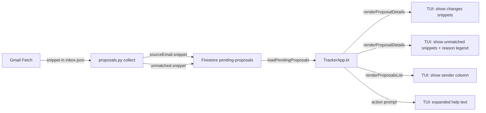

# Implementation Plan: Proposal Snippet Display in TUI

**Status:** Completed  
**Date:** 2026-11-12  
**Target:** tracker, records, and frontend (cross-subsystem)  
**Harness:** Junie  
**Model:** Qwen/Qwen3.6-27B-FP8  
**Session:** session-261112-182518-qe0z  
**Schema Authority:** [`tracker.schema.json`](../../tracker.schema.json)  

---

## 1. Executive Summary & Goals

The interactive proposal approval TUI (`mise run tui --proposals`) has three usability problems:

1. **Proposed changes table** shows `Application ID`, `Status Transition`, `Confidence`, and `Email Subject` — but **no email body content**. Users can't tell what the email actually says.
2. **Unmatched emails table** shows only `Subject` and `Reason` — again **no email body** and the `Reason` strings are technical without explaining what they mean or what to do.
3. **Action prompt help text** is terse and doesn't explain what approve/reject actually do.

The root cause: `gmail_fetch.py` fetches the email body and creates a `snippet` field (up to 800 chars), but `proposals.py` **drops** it for both matched changes (in `sourceEmail`) and unmatched emails. The TUI then has nothing to display.

### Goals
- Propagate the email `snippet` through the entire pipeline for both matched changes and unmatched emails: fetch → stage → store → display
- Show email snippets in the TUI proposal detail view for both changes and unmatched emails
- Show the email sender in the proposals list table for at-a-glance context
- Add explanatory help text for actions so the user understands what approve/reject imply
- Improve unmatched email reasons to be more descriptive and actionable

### Scope

**In Scope:**
- Add `snippet` to `sourceEmail` and `unmatched` items in `tracker.schema.json`
- Include `snippet` when staging proposals in `scripts/proposals.py`
- Add `snippet` to Kotlin `SourceEmail` and `UnmatchedMessage` data classes in `ProposalClassifier.kt`
- Display snippet in TUI `renderProposalDetails()` for both changes and unmatched emails in `TrackerApp.kt`
- Add `Sender` column to the proposals list table
- Improve action prompt help text with explanations of what actions do
- Add reason explanation text below the unmatched table

**Out of Scope:**
- Fetching full email body on demand (snippet is pre-fetched during collection)
- Changes to the web dashboard
- Changes to the Google Sheet view
- Interactive per-unmatched-email actions

## 2. Architecture & Design Principles

### Data Flow
1. `gmail_fetch.py` fetches emails via Composio, extracts body text, and creates a `snippet` field (up to 800 chars of subject + body) in `toInboxMessage()`
2. `proposals.py` reads the inbox payload, classifies each message, and stages a proposal — now **including** the `snippet` for both matched changes and unmatched emails
3. `tracker.schema.json` defines `sourceEmail` with 5 fields (`messageId`, `subject`, `sender`, `receivedAt`, `snippet`). The `unmatched` items have `sender`, `subject`, `receivedAt`, `reason`, `snippet`
4. `ProposalClassifier.kt` (Kotlin) defines `SourceEmail` and `UnmatchedMessage` with `snippet`
5. TUI `TrackerApp.kt` loads proposals from Firestore and renders snippets, sender info, and reason explanations

### Unmatched Email Reasons
The `match()` function in `proposals.py` returns these reasons:
- `no application matched` — no existing application's company appeared in the email
- `ambiguous: matched N applications (...)` — multiple applications matched the same company
- `no classification pattern matched` — company matched but no known status-change phrase was found
- `outreach detected but no company identified` — classified as recruiter outreach but company name extraction failed

### Architecture Diagram



## 3. Proposed Changes & Implementation Steps

### ✓ Done Step 1: Schema — Add `snippet` to `sourceEmail` and `unmatched`
- Added `snippet` as a `nullableString` property to the `sourceEmail` object in `tracker.schema.json`
- Added `snippet` as a `nullableString` property to the `unmatched` items object
- Bumped schema version to 13 with a changelog note

### ✓ Done Step 2: Collector — Include `snippet` when staging
In `scripts/proposals.py`:
- Added `"snippet": message.get("snippet")` to the `sourceEmail` dict in all places where changes are staged (matched changes, outreach/lead changes)
- Added `"snippet": message.get("snippet")` to the unmatched dict in all places

### ✓ Done Step 3: Kotlin model — Add `snippet` to `SourceEmail` and `UnmatchedMessage`
Added `val snippet: String? = null` to both `SourceEmail` and `UnmatchedMessage` data classes in `ProposalClassifier.kt`.

### ✓ Done Step 4: TUI — Display snippet in proposal details (changes)
In `TrackerApp.kt`'s `renderProposalDetails()`:
- After the changes table, render the email snippet for each change in a quoted/indented block
- Truncate to ~400 chars with "..." if longer
- Use `dim()` styling to distinguish it from the structured data

### ✓ Done Step 5: TUI — Display snippet in unmatched emails table
In `renderProposalDetails()`:
- Added a `Sender` column to the unmatched table (extracted from `sender`)
- After the unmatched table, render snippets for each unmatched email in a quoted/indented block
- Truncate to ~400 chars with "..." if longer
- Use `dim()` styling

### ✓ Done Step 6: TUI — Add reason explanations below unmatched table
Below the unmatched emails table, render a legend explaining what each reason means:
- `no application matched` → "No existing application's company was found in this email."
- `ambiguous: matched N applications` → "This email matched multiple applications for the same company."
- `no classification pattern matched` → "No known status-change phrase was detected in the email."
- `outreach detected but no company identified` → "Recruiter outreach, but company name could not be extracted."

### ✓ Done Step 7: TUI — Improve action prompt help text
Replaced terse help text with expanded explanations:
```
Review staged inbox proposals • Actions:
  a  - Approve selected: apply status changes to applications
  r  - Reject selected: discard these proposals without changes
  t <id> - Toggle selection for a proposal
  all  - Select all proposals | none - Clear selection
  i <id> - Inspect proposal details (email content, changes)
  q  - Quit without changes
```

### ✓ Done Step 8: TUI — Add Sender column to proposals list
In `renderProposalsList()`, added a `Sender` column showing the primary sender from the first change's `sourceEmail.sender`.

## 4. Verification Plan & Testing Checklist

- [x] `mise run records:build` — BUILD SUCCESSFUL
- [x] `mise run frontend:build` — BUILD SUCCESSFUL
- [x] `mise run records:test` — all tests pass
- [x] `mise run records:detekt` — BUILD SUCCESSFUL
- [x] Manual Python verification — `snippet` flows through `buildProposal()` and validates against updated schema
- [ ] Add unit test in `ProposalClassifierTest.kt` for `SourceEmail` with snippet
- [ ] Add test in `test_tracker_modules.py` for snippet in staged proposals

**Known pre-existing issues:** Python test failures (enum format mismatches, missing CSV archive) are unrelated to these changes.

## 5. Bookkeeping
- [x] Plan persisted at `.agents/plans/2026-11-12/183200_proposal-snippet-display.md`
- [ ] Registry `README.md` row added / status synchronized
- [ ] Craft a single commit of all changed files
- [ ] Stage changed files and craft a commit message based on the name of this file
- [ ] Push `git push origin main`
