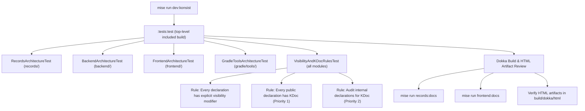

# Implementation Plan: Enforce Explicit API & KDocs via Top-Level Konsist Architecture Suite

**Status:** In Progress  
**Date:** 2026-11-14  
**Target:** `records`, `backend`, `frontend`, `gradle/tools`, and `tests` (repository-wide)  
**Harness:** Antigravity  
**Model:** Gemini 3.8 Flash  
**Session:** 24c50225-6e5f-4aa9-8cd6-deb6f8e7b2c7  

---

## 1. Executive Summary & Goals
Establish a unified, top-level architectural testing module (`tests/`) using **Konsist 1.0.0-beta.1** to enforce:
1. **Strict `explicitApi()` Mode**: All Kotlin projects (`records`, `backend`, `frontend`, `gradle/tools`) must have `explicitApi()` enabled, strictly requiring explicit visibility modifiers and explicit return types.
2. **Explicit Visibility Paired with KDoc**:
   - Every `public` declaration must have matching, complete, and up-to-date **`KDoc`**.
   - `internal` modifiers are the second priority for KDoc requirements and will be audited/documented.
3. **Systematic KDoc Authoring**: Author comprehensive KDocs across all public declarations in `@backend`, `@records`, `@frontend`, and `@gradle/tools` so that the new Konsist tests pass 100%.
4. **Dokka Documentation Verification**: Run Dokka across modules and review generated HTML documentation artifacts to confirm clean, warning-free generation.

---

## 2. Architecture & Design Principles

### Scope and Visibility Invariants
- In Kotlin, a declaration has `public` visibility either by explicit `public` modifier or by default visibility rules.
- Under `frontend/AGENTS.md` Rule 2 (Least Privilege), declarations that only serve internal module mechanisms (such as internal screen composables, dialogs, or platform helper methods in `apps/*`) must be marked `internal` rather than `public`.
- For all genuinely `public` declarations intended for cross-module or API exposure, complete and accurate KDocs will be authored.
- `internal` declarations are the second priority for KDoc requirements and will be audited.

### Top-Level `tests/` Architecture
```
tests/
├── settings.gradle.kts    # rootProject.name = "tests"
├── build.gradle.kts       # applies kotlin-jvm, libs.konsist, libs.kotlin.test
└── src/
    └── test/
        └── kotlin/
            └── dev/
                └── fnc314/
                    └── tools/
                        └── jobtracker/
                            └── architecture/
                                ├── BaseArchitectureTest.kt         # Root directory resolution & helper scopes
                                ├── RecordsArchitectureTest.kt       # Records subsystem invariant & KDoc rules
                                ├── BackendArchitectureTest.kt       # Backend subsystem invariant & KDoc rules
                                ├── FrontendArchitectureTest.kt      # Frontend KMP invariant & KDoc rules
                                ├── GradleToolsArchitectureTest.kt   # Gradle plugin invariant & KDoc rules
                                └── VisibilityAndKDocRulesTest.kt    # Repo-wide explicitApi & KDoc enforcement
```

### Verification Flow


---

## 3. Current State & Audit Findings

| Subsystem | Kotlin Files | Public Declarations | Currently Documented | Missing KDocs |
| :--- | :--- | :--- | :--- | :--- |
| **`records`** | 20 | 151 | 118 | 33 |
| **`backend`** | 18 | 93 | 76 | 17 |
| **`gradle/tools`** | 19 | 32 | 18 | 14 |
| **`frontend`** | 405 | 1579 | 647 | 932 |

---

## 4. Proposed Changes & Implementation Steps

### Phase 1: Enable Strict `explicitApi()` Across All Projects
1. **`records`**: In `records/parser/build.gradle.kts`, upgrade `explicitApiWarning()` $\rightarrow$ `explicitApi()`.
2. **`backend`**: In `backend/service/build.gradle.kts`, declare `kotlin { explicitApi() }`.
3. **`gradle/tools/project-plugins`**: In `KotlinSourceSetExtensions.kt` line 89, upgrade `explicitApiWarning()` $\rightarrow$ `explicitApi()`.
4. Ensure all frontend app build scripts declare `explicitApi()`.

---

### Phase 2: Create Top-Level `tests/` Included Build
1. Create `tests/settings.gradle.kts` with `rootProject.name = "tests"`.
2. Create `tests/build.gradle.kts` applying `libs.plugins.kotlinJvm`, `libs.konsist`, and `libs.kotlin.test`.
3. Register in root `settings.gradle.kts`: `includeBuild("tests")`.
4. Create test suites in `tests/src/test/kotlin/dev/fnc314/tools/jobtracker/architecture/`:
   - `RecordsArchitectureTest.kt`: migrates and expands existing records invariants + public KDoc rule.
   - `BackendArchitectureTest.kt`: backend modular boundaries + public KDoc rule.
   - `GradleToolsArchitectureTest.kt`: plugin conventions + public KDoc rule.
   - `FrontendArchitectureTest.kt`: migrates all existing rules from `KonsistArchitectureTest.kt` + public KDoc rule.
   - `VisibilityAndKDocRulesTest.kt`: global rule verifying that:
     1. Every declaration has an explicit modifier (`public`, `internal`, or `private`).
     2. Every `public` declaration has a matching `KDoc`.
     3. Auditing `internal` declaration KDoc coverage.
5. Update `.config/mise/tasks/dev/konsist.sh` to execute:
   ```bash
   exec "${MISE_PROJECT_ROOT}/gradlew" :tests:test "$@"
   ```
6. Clean up obsolete test locations in `frontend/apps/core` and `records/parser` once migrated to `tests/`.

---

### Phase 3: Author KDocs for `records` (33 declarations)
- `JobApplicationStatus.kt`: Sealed/enum objects (`Drafted`, `Submitted`, `Interviewing`, `NoResponse`, `Offer`, etc.), properties (`wireName`, `rank`, `isTerminal`), `parse()`, companion objects.
- `InterviewProgress.kt`: `displayName()`, `fromString()`, `toMap()`, `fromMap()`, companion objects.
- `EventChainBuilder.kt` & `EventChainVerifier.kt`: `GENESIS_PREV_HASH`.
- `EventNoteRenderer.kt`: `NOTE_SEPARATOR`, `NOTE_DASH`.
- `RankScorer.kt`: Keyword lists (`STRONG_TECH_KEYWORDS`, `MODERATE_TECH_KEYWORDS`, `WEAK_TECH_KEYWORDS`, `EXPERIENCE_KEYWORDS`, `BEHAVIORAL_KEYWORDS`, `CAREER_KEYWORDS`).

---

### Phase 4: Author KDocs for `backend` (17 declarations)
- `BackendService.kt`: `BackendService`, `firestore` (noted as tracked in RM-012), `appendEventTransactional`, `expireStaleProposals`, `processDueSyncs`, `performRoutineSweep`.
- `Main.kt`: `main(args: Array<String>)`.
- `EmailClassifier.kt`: `CLASSIFIERS`.
- `RankScorer.kt`: Tech/experience/behavioral keywords.
- `ScoringWeights.kt`: `DEFAULT` weights constant.
- `EventChainBuilder.kt` & `EventChainVerifier.kt`: `GENESIS_PREV_HASH`.

---

### Phase 5: Author KDocs for `gradle/tools` (14 declarations)
- `CatalogTypes.kt`: `catalogKey`, `fromCatalog`, `invoke`.
- `ProjectPlugins.kt`: `fromCatalog`, `configurePlugin`, `extensionClass`, `pluginClass`, `androidExtension`, `AndroidApplication`, `AndroidLibrary`, `MultiplatformLibrary`.
- `MultiplatformLibrary.kt`: `apply(project: Project)`.
- `FirebaseDependenciesConventionPlugin.kt`: Class KDoc.
- `AndroidApplicationConventionPlugin.kt`: Class KDoc.

---

### Phase 6: Author KDocs & Refine Visibility in `frontend` (932 declarations)
1. **Apply Least-Privilege Visibility**:
   - Internalize non-exported declarations in `apps/cli`, `apps/terminal`, and feature UI screen internals per `frontend/AGENTS.md` Rule 2.
2. **Author Comprehensive KDocs on All Exported Public Surfaces**:
   - **`core/data`**:
     - All domain model properties on `JobApplication`, `Company`, `CompanyMetrics`, `Compensation`, `Location`, `Timeline`, `TrackerCounts`, `TrackerEvent`, `TrackerEdit`, `TrackerFit`, `SourceEmail`, `Email`, etc.
     - Room entities and DAO methods (`JobApplicationEntity`, `JobApplicationDao`).
     - Storage factories and platform adapters (`DatabaseBuilder`, `PlatformFileReader`, `PlatformFileSaver`).
   - **`core/design-system`**:
     - Dimension tokens in `Dimensions.kt`.
     - Shape tokens in `Shapes.kt`.
     - Theme setup in `Theme.kt`.
   - **`core/widgets`**:
     - Model properties in `JobApplicationCardUiModel`, `TopLevelCard`, badges, and cards.
   - **`core/artifacts`, `core/network`, `core/navigation`, `core/logging`**:
     - Artifact models, network clients, navigation registries, and log writers.
   - **`features/*`**:
     - Domain use cases (`invoke`/`execute` methods), repository interfaces, data modules, and navigation registries.

---

### Phase 7: Verification & Dokka Artifact Review
1. **Automated Architectural Test Suite**:
   ```bash
   mise run dev:konsist
   ```
2. **Static Analysis & Security Guards**:
   ```bash
   mise run dev:detekt
   mise run dev:guards
   ```
3. **Dokka Documentation Generation & Artifact Review**:
   ```bash
   mise run records:docs
   mise run frontend:docs
   ```
   Inspect generated HTML artifacts in `records/parser/build/dokka/html` and `frontend/build/dokka/html` to confirm:
   - Zero broken `@see` / `[]` symbol references.
   - All public parameters and return values are clearly documented.
   - Output renders cleanly in a browser environment.

---

## 5. Bookkeeping
- [x] Implementation plan updated and persisted at `.agents/plans/2026-11-14/165500_public-declarations-kdoc-konsist-enforcement-plan.md`
- [x] Registry `.agents/plans/README.md` updated with plan row
- [ ] Craft commit of all changed files
- [ ] Push to origin/main
