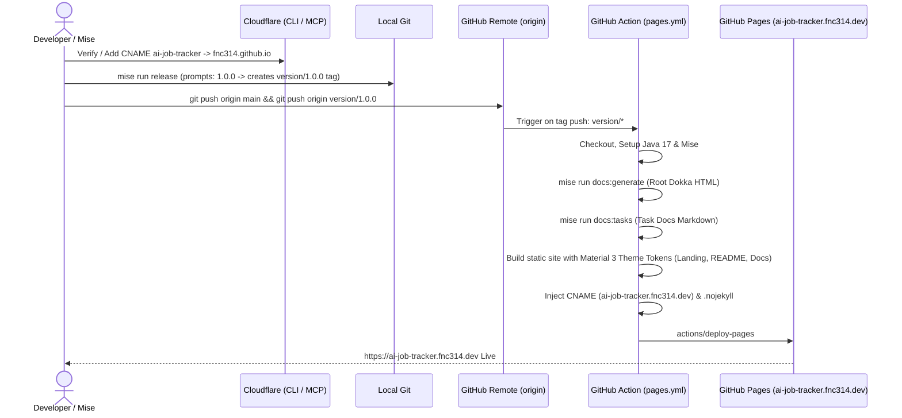

# Architecture & Implementation Plan: Public Documentation & Version Release Automation

**Status:** Completed  
**Date:** 2026-11-15  
**Target:** `.github/workflows/pages.yml`, `.config/mise/tasks/admin/release.py`, `docs/site/`, `docs/naming-inconsistencies.md`  

---

## Goal Description

Establish an automated, professional public documentation site for the repository hosted on **GitHub Pages** with the custom domain **`https://ai-job-tracker.fnc314.dev`**, deployed via a dedicated GitHub Actions workflow triggered whenever a tag matching `version/*` is pushed.

The public documentation deployment will assemble and publish:
1. **Root [README.md](file:///Users/fnc314/Work/Search/ai-job-search/README.md)** (rendered with clean responsive HTML and styling).
2. **Aggregated Dokka API Documentation** (generated at workspace root via `mise run docs:generate` -> `dokka/`).
3. **Mise Task Documentation** (rendered from `docs/mise/`).
4. **Portal Landing Page**: A modern, clean landing page styled using **Material 3 variables and themes** adhering to the [Material Theme Builder](https://material-foundation.github.io/material-theme-builder/) spec (anchored on the candidate profile's canonical Professional Blue `#2F5597`), featuring automatic light and dark mode support via CSS custom properties.
5. **Custom Domain & DNS Integration**: Bundling `CNAME` for `ai-job-tracker.fnc314.dev` and `.nojekyll` bypass. DNS records on Cloudflare (which manages `fnc314.dev`) can be created or verified directly via the **Cloudflare CLI / MCP tools**.

Additionally, this plan introduces an interactive and CLI-scriptable `mise` task (`mise run admin:release` / `mise run release`) that:
- Detects the current highest semantic version from existing git tags (or defaults to `1.0.0` if none exist).
- Prompts the user for the new version with the current version displayed, or accepts a version argument directly.
- Validates semantic version syntax (`X.Y.Z`).
- Verifies working directory cleanliness (`git status --porcelain`).
- Creates annotated tag `version/<version>`.
- Optionally pushes the tag to `origin` to trigger the Pages workflow.

Lastly, we audit and compile an explicit inventory of repository naming inconsistencies (e.g. `ai-job-search` vs `ai-job-tracker` vs `FNC314JobSearchTracker` vs package namespaces) as a tracked reference document for systematic alignment in **`version/2.0.0`**.

---

## User Review Required

> [!IMPORTANT]
> **Cloudflare DNS Configuration (CLI & MCP Available)**:
> `ai-job-tracker.fnc314.dev` points to `fnc314.github.io`. With Cloudflare available via CLI and MCP, we can configure or verify the CNAME record (`ai-job-tracker` -> `fnc314.github.io` with DNS-only / gray cloud mode for GitHub Pages SSL issuance).

> [!IMPORTANT]
> **Material 3 Theme Styling (CSS Design Tokens)**:
> The landing page and documentation wrapper will utilize full Material 3 design tokens exported in the format of the official **Material Theme Builder**:
> - Canonical Seed: `#2F5597` (Professional Blue).
> - Tokens for both Light and Dark modes: `--md-sys-color-primary`, `--md-sys-color-on-primary`, `--md-sys-color-primary-container`, `--md-sys-color-surface`, `--md-sys-color-surface-container`, `--md-sys-color-surface-variant`, `--md-sys-color-outline`, `--md-sys-typescale-*`, `--md-sys-shape-*`.
> - Auto theme switching via `@media (prefers-color-scheme: dark)` with a manual toggle stored in `localStorage`.

> [!NOTE]
> **Pending Dokka Migration Commits**:
> The pending Dokka migration changes (`build.gradle.kts`, `frontend/settings.gradle.kts`, `gradle/libs.versions.toml`, `.config/mise/tasks/docs/generate.sh`) will be committed to `main` before tagging `version/1.0.0`.

---

## Architectural Flow



---

## Proposed Changes

### Component 1: Material 3 Theme & Static Documentation Site Assembler

We establish Material 3 tokens generated from the `#2F5597` seed and an automated site assembler in `scripts/build_docs_site.py`.

#### [NEW] `docs/site/css/material3-tokens.css`
Complete CSS token set based on Material Theme Builder:
```css
:root {
  /* Seed: #2F5597 (Professional Blue) - Light Theme */
  --md-sys-color-primary: #2f5597;
  --md-sys-color-on-primary: #ffffff;
  --md-sys-color-primary-container: #d9e2ff;
  --md-sys-color-on-primary-container: #001945;
  --md-sys-color-secondary: #575e71;
  --md-sys-color-on-secondary: #ffffff;
  --md-sys-color-secondary-container: #dbe2f9;
  --md-sys-color-on-secondary-container: #141b2c;
  --md-sys-color-tertiary: #715573;
  --md-sys-color-on-tertiary: #ffffff;
  --md-sys-color-tertiary-container: #fcd7fb;
  --md-sys-color-on-tertiary-container: #29132d;
  --md-sys-color-error: #ba1a1a;
  --md-sys-color-on-error: #ffffff;
  --md-sys-color-error-container: #ffdad6;
  --md-sys-color-on-error-container: #410002;
  --md-sys-color-background: #fbf8fd;
  --md-sys-color-on-background: #1b1b1f;
  --md-sys-color-surface: #fbf8fd;
  --md-sys-color-on-surface: #1b1b1f;
  --md-sys-color-surface-variant: #e1e2ec;
  --md-sys-color-on-surface-variant: #44474f;
  --md-sys-color-outline: #757780;
  --md-sys-color-outline-variant: #c5c6d0;
  --md-sys-color-surface-container: #f0edf2;
  --md-sys-color-surface-container-high: #eae7ec;

  /* Typography: Heading Inconsolata (monospace) & Body Roboto/Sans */
  --md-sys-typescale-display-large: 700 57px/64px 'Inconsolata', monospace;
  --md-sys-typescale-headline-medium: 600 28px/36px 'Inconsolata', monospace;
  --md-sys-typescale-title-large: 600 22px/28px 'Inconsolata', monospace;
  --md-sys-typescale-body-large: 400 16px/24px system-ui, -apple-system, sans-serif;
  --md-sys-typescale-body-medium: 400 14px/20px system-ui, -apple-system, sans-serif;

  /* Shape & Elevation */
  --md-sys-shape-corner-small: 8px;
  --md-sys-shape-corner-medium: 12px;
  --md-sys-shape-corner-large: 16px;
  --md-sys-shape-corner-full: 9999px;
  --md-sys-elevation-1: 0 1px 3px 1px rgba(0,0,0,0.15), 0 1px 2px 0 rgba(0,0,0,0.30);
  --md-sys-elevation-2: 0 2px 6px 2px rgba(0,0,0,0.15), 0 1px 2px 0 rgba(0,0,0,0.30);
}

@media (prefers-color-scheme: dark) {
  :root {
    /* Dark Theme */
    --md-sys-color-primary: #afc6ff;
    --md-sys-color-on-primary: #002d6d;
    --md-sys-color-primary-container: #104082;
    --md-sys-color-on-primary-container: #d9e2ff;
    --md-sys-color-secondary: #bfc6dc;
    --md-sys-color-on-secondary: #293041;
    --md-sys-color-secondary-container: #404659;
    --md-sys-color-on-secondary-container: #dbe2f9;
    --md-sys-color-tertiary: #dfbbde;
    --md-sys-color-on-tertiary: #402843;
    --md-sys-color-tertiary-container: #583e5a;
    --md-sys-color-on-tertiary-container: #fcd7fb;
    --md-sys-color-error: #ffb4ab;
    --md-sys-color-on-error: #690005;
    --md-sys-color-error-container: #93000a;
    --md-sys-color-on-error-container: #ffdad6;
    --md-sys-color-background: #121316;
    --md-sys-color-on-background: #e3e2e6;
    --md-sys-color-surface: #121316;
    --md-sys-color-on-surface: #e3e2e6;
    --md-sys-color-surface-variant: #44474f;
    --md-sys-color-on-surface-variant: #c5c6d0;
    --md-sys-color-outline: #8f9099;
    --md-sys-color-outline-variant: #44474f;
    --md-sys-color-surface-container: #1e1f23;
    --md-sys-color-surface-container-high: #292a2d;
  }
}
```

#### [NEW] `scripts/build_docs_site.py`
A zero-dependency Python script that:
- Reads `docs/site/templates/landing.html` and injects dynamic version, date, and navigation.
- Converts `README.md` to styled HTML inside a Material 3 themed layout container.
- Converts markdown files in `docs/mise/` into indexed HTML task references.
- Copies root `dokka/` recursively into `build/gh-pages/dokka/`.
- Injects `build/gh-pages/CNAME` (`ai-job-tracker.fnc314.dev`) and `build/gh-pages/.nojekyll`.

#### [NEW] `docs/site/templates/landing.html`
Responsive M3-styled landing page:
- M3 Top App Bar with repository link, dark/light toggle, and version tag badge (`v1.0.0`).
- M3 Hero Card with headline, primary CTA ("Browse Multiplatform API"), secondary CTA ("Architecture Guide").
- Grid of elevated M3 Cards for:
  - **Dokka Multiplatform API Reference**: Interactive KDoc HTML for `core`, `features`, `records`, and `tools`.
  - **Multi-Modal Clients**: Android Compose app, Desktop app, Web (Wasm/JS), and Curses Terminal.
  - **Mise Task Catalog**: 60+ unified automation commands across development, tracking, and deploy.
  - **Portfolio & Candidate Profile**: Direct links to `fnc314.dev` and `blog.fnc314.dev`.

---

### Component 2: GitHub Pages Action Workflow

#### [NEW] `.github/workflows/pages.yml`
```yaml
name: Deploy Documentation to GitHub Pages

on:
  push:
    tags:
      - 'version/*'
  workflow_dispatch:

permissions:
  contents: read
  pages: write
  id-token: write

concurrency:
  group: 'pages'
  cancel-in-progress: false

jobs:
  build-and-deploy:
    environment:
      name: github-pages
      url: ${{ steps.deployment.outputs.page_url }}
    runs-on: ubuntu-latest
    steps:
      - name: Checkout repository
        uses: actions/checkout@v4
        with:
          fetch-depth: 0

      - name: Set up JDK 17
        uses: actions/setup-java@v4
        with:
          distribution: 'temurin'
          java-version: '17'

      - name: Set up mise
        uses: jdx/mise-action@v2

      - name: Generate Dokka API Documentation
        run: mise run docs:generate

      - name: Generate Mise Task Documentation
        run: mise run docs:tasks

      - name: Assemble Public Documentation Site
        run: python3 scripts/build_docs_site.py --output build/gh-pages --domain ai-job-tracker.fnc314.dev

      - name: Upload Pages artifact
        uses: actions/upload-pages-artifact@v3
        with:
          path: build/gh-pages

      - name: Deploy to GitHub Pages
        id: deployment
        uses: actions/deploy-pages@v4
```

---

### Component 3: Release Automation Mise Task

#### [NEW] `.config/mise/tasks/admin/release.py`
A task file with embedded `#MISE` configuration:
```python
#!/usr/bin/env python3
#MISE description="Automate semantic version tag creation (version/X.Y.Z) and release publishing"
#MISE alias="release"
#USAGE arg "<version>" help="Semantic version to release (e.g. 1.0.0). If omitted, prompts interactively." optional=true
#USAGE flag "-p --push" help="Push the commit and created version tag to origin" default=false
```

**Functionality**:
1. Queries existing git tags matching `version/*` (`git tag -l "version/*"`).
2. Extracts and calculates current highest version (defaulting to `0.0.0` or `None` if no tags exist).
3. If `<version>` argument is provided, validates semver syntax (`^\d+\.\d+\.\d+$`).
4. If `<version>` is omitted, prompts user:
   ```text
   Current version: 1.0.0 (or "None")
   Enter new version (e.g. 1.0.1 or 1.1.0): 
   ```
5. Checks working tree status (`git status --porcelain`). If dirty, warns or stops with instructions to commit.
6. Checks if tag `version/<version>` already exists.
7. Executes `git tag -a "version/<version>" -m "Release version <version>"`.
8. If `--push` flag is provided (or prompted), pushes `git push origin <current-branch>` and `git push origin version/<version>`.
9. Logs summary with link to GitHub Actions and expected Pages deployment URL (`https://ai-job-tracker.fnc314.dev`).

---

### Component 4: Cloudflare DNS Verification & Tag 1.0.0 Release

1. Verify Cloudflare DNS record using CLI / MCP for `ai-job-tracker.fnc314.dev` -> `fnc314.github.io`.
2. Commit pending Dokka migration work to `main`:
   - Commit message: `feat(docs): migrate dokka aggregation to root and streamline task docs`
3. Create initial `version/1.0.0` tag using the release task:
   - `mise run release 1.0.0`
4. Push `main` and `version/1.0.0` to `origin`.

---

### Component 5: Naming Inconsistencies Audit for Version 2.0.0

Document an explicit reference document at [docs/naming-inconsistencies.md](file:///Users/fnc314/Work/Search/ai-job-search/docs/naming-inconsistencies.md) cataloging identified inconsistencies to resolve in `version/2.0.0`:

1. **Repository & Domain vs Application Identity**:
   - Repository name: `ai-job-search`
   - Custom Domain & Project prompt: `ai-job-tracker.fnc314.dev`
   - Android Application Name & iOS Product: `FNC314JobSearchTracker` (`dev.fnc314.tools.jobtracker`)
   - Root project names across settings files: `ai-job-search` (root), `FNC314JobSearchTracker` (frontend), `ai-job-search_backend`, `ai-job-search_records`, `ai-job-search_internal`, `ai-job-search_gradle-tools_project-plugins`.
2. **Package Name Divergence**:
   - `dev.fnc314.tools.jobtracker` (frontend, backend, internal, tools)
   - `dev.fnc314.tools.jobsearch.records` (records parser and proto)
   - Compose resources auto-generated package: `fnc314jobsearchtracker.*`
3. **Task & CLI Naming Divergence**:
   - Search vs Tracker task groupings: `search:rank` vs `tracker:score`.
   - Tool-specific names in legacy scripts vs generic interface naming (`scripts/gmail_*.py` remnants vs `email:*`).
4. **Target Alignment Blueprint for 2.0.0**:
   - Standardize project namespace to `dev.fnc314.tools.jobtracker` across records, backend, frontend, tools.
   - Align Gradle rootProject name and Compose resource bundle namespace.

---

## Verification Plan

### Automated Verification
1. **Release Task Dry-Run & Semver Validation**:
   - Test semver parsing with invalid strings (e.g. `v1.0`, `1.0`, `abc`) to ensure clean error messages.
   - Run `mise run release --help` to verify `#USAGE` parsing and documentation generation.
2. **Site Builder Execution with M3 Tokens**:
   - Run `python3 scripts/build_docs_site.py --output build/gh-pages --domain ai-job-tracker.fnc314.dev`.
   - Check presence of `build/gh-pages/index.html`, `build/gh-pages/CNAME` containing `ai-job-tracker.fnc314.dev`, `build/gh-pages/.nojekyll`, `build/gh-pages/dokka/index.html`, `build/gh-pages/readme/index.html`, and `build/gh-pages/css/material3-tokens.css`.
3. **Code Quality & Security Guards**:
   - `mise run dev:guards`: Verify that workflow and files meet permission and package guard constraints.
   - `mise run dev:konsist`: Ensure architecture tests remain green.
   - `mise run dev:lint`: Ensure skill and command linter passes.

### Manual Verification
1. Inspect generated `build/gh-pages/index.html` in browser to confirm responsive design, M3 color tokens, dark/light theme switching, and navigation links.
2. Verify git tag creation: `git tag -l "version/*"`.
3. Following remote push, inspect GitHub Actions run under `.github/workflows/pages.yml` to confirm successful build and Pages deployment.
