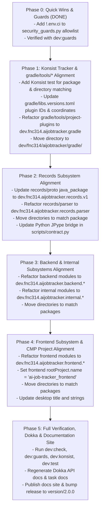

# Architecture Plan: Repository Naming Inconsistencies & Alignment for Release 2.0.0

**Status:** Proposed  
**Date:** 2026-11-15  
**Target:** Monorepo (`records`, `frontend`, `backend`, `internal`, `scripts`, `.config/mise`, `docs`)  
**Evaluates:** [docs/naming-inconsistencies.md](../../../docs/naming-inconsistencies.md)

---

## 1. Goal Description
The repository currently functions cleanly at `version/1.0.0` with documentation published at `https://ai-job-tracker.fnc314.dev`. However, historical evolution has created naming and package inconsistencies across the codebase.

The goal is to cleanly standardize all packages, directories, project coordinates, and build plugins on:
`dev.fnc314.aijobtracker.*` (dropping `.tools.`)

We will execute this systematically:
1. **`gradle/libs.versions.toml` + `gradle/tools/*`**: Update plugin IDs, package declarations, group IDs, and convention logic.
2. **Directory Structure Matching**: Ensure every file's directory structure strictly matches its package declaration (`src/main/kotlin/dev/fnc314/aijobtracker/...`).
3. **Konsist Enforcement & Tracking**: Add Konsist architecture rules verifying package prefixes and directory matching to track and validate progress across subsystems.

---

## 2. Inventory of Inconsistencies & Target Alignment

| Category | Item | Current Inconsistent State | Target v2.0.0 State | Impact / Scope |
| :--- | :--- | :--- | :--- | :--- |
| **Guards** | `.gitignore` CI env file | `!.env.ci` is not in `ALLOWED_IGNORE_NEGATIONS` in `scripts/security_guards.py` | Add `!.env.ci` to `ALLOWED_IGNORE_NEGATIONS` | **COMPLETED** (commit `3f8729a0`, unblocked `mise run dev:guards`) |
| **Gradle Plugins** | Plugin Group & IDs | `dev.fnc314.tools.jobtracker.*` in `gradle/tools/project-plugins` and `libs.versions.toml` | `dev.fnc314.aijobtracker.*` | `gradle/libs.versions.toml`, `gradle/tools/project-plugins/build.gradle.kts` |
| **Gradle Plugins Code** | Plugin Package & Dirs | `package dev.fnc314.tools.jobtracker.gradle.*` in `dev/fnc314/tools/jobtracker/gradle/` | `package dev.fnc314.aijobtracker.gradle.*` in `dev/fnc314/aijobtracker/gradle/` | `gradle/tools/project-plugins/src/main/kotlin/` |
| **Kotlin Namespace** | Protobuf Java Package | `option java_package = "dev.fnc314.tools.jobsearch.tracker.v1";` | `option java_package = "dev.fnc314.aijobtracker.records.v1";` | `records/proto`, `records/parser`, `backend`, `frontend/core-data` |
| **Kotlin Namespace** | Records Parser Package | `dev.fnc314.tools.jobsearch.parser.*` and `dev.fnc314.tools.jobsearch.records.parser.*` | `dev.fnc314.aijobtracker.records.parser.*` | `records/parser`, JPype bridge, `backend`, `tests` |
| **Frontend Project** | CMP Root Project Name | `rootProject.name = "FNC314JobSearchTracker"` in `frontend/settings.gradle.kts` | `rootProject.name = "ai-job-tracker_frontend"` | Generates `ai_job_tracker_frontend.*.Res` resources; updates desktop title & iOS config |
| **Konsist Rules** | Architecture Invariant Tracking | Checks public declarations and KDoc | Add Konsist tests: package prefix must start with `dev.fnc314.aijobtracker` and directory path must match package declaration | `tests/src/test/kotlin/.../PackageAndDirectoryArchitectureTest.kt` |
| **Email Subsystem** | Script & Cache Naming | `scripts/gmail_fetch.py`, `generated/gmail-inbox.json`, `kind="proposal:gmail-sync"` | `scripts/email_fetch.py`, `generated/email-inbox.json`, `kind="proposal:email-sync"` | Backward-compatible alias reads; updates task docs & tests |
| **Brand & Repo** | Repo slug & root dir | `ai-job-search` | Renaming repo and directory to `ai-job-tracker` | Remote redirect & directory renaming |

---

## 3. Phased Execution Strategy

---

## 4. Proposed Changes in Detail

### Phase 1: `gradle/libs.versions.toml` + `gradle/tools/project-plugins`
1. **`gradle/libs.versions.toml`**:
   - Change plugin IDs: `dev.fnc314.tools.jobtracker.<name>` $\rightarrow$ `dev.fnc314.aijobtracker.<name>`.
   - Update `project-plugins` module coordinate: `dev.fnc314.aijobtracker.tools:ai-job-tracker_gradle-tools_project-plugins`.
   - Update `records-parser` and `records-proto` group: `dev.fnc314.aijobtracker.records`.
2. **`gradle/tools/project-plugins`**:
   - `build.gradle.kts`: update `group = "dev.fnc314.aijobtracker.tools"`, and update plugin declarations (`id("dev.fnc314.aijobtracker....")`, `implementationClass = "dev.fnc314.aijobtracker.gradle.plugins...."`).
   - Relocate source directory:
     `gradle/tools/project-plugins/src/main/kotlin/dev/fnc314/tools/jobtracker/` $\rightarrow$ `gradle/tools/project-plugins/src/main/kotlin/dev/fnc314/aijobtracker/`
   - Update package headers to `package dev.fnc314.aijobtracker.gradle...`.
3. **Konsist Tracker (`tests/src/test/kotlin/dev/fnc314/aijobtracker/architecture/PackageAndDirectoryArchitectureTest.kt`)**:
   - Rule 1: Every package must start with `dev.fnc314.aijobtracker`.
   - Rule 2: Package declaration path must match file directory path (`path.endsWith(package.replace('.', '/') + '/' + file.name)`).
   - Use Konsist as the verification gate to track remaining modules.

---

## 5. User Review Required

> [!IMPORTANT]
> **Atomic Execution of Phase 1**:
> Phase 1 focuses exclusively on `gradle/libs.versions.toml`, `gradle/tools/project-plugins`, and introducing the Konsist tracker test. All convention plugin consumers in `frontend`, `backend`, and `records` will resolve the new `dev.fnc314.aijobtracker.*` plugin IDs from `libs.versions.toml`.

---

## 6. Decisions & Alignment
1. **Namespace Target**: `dev.fnc314.aijobtracker.*` (dropping `.tools.`).
2. **Directory Matching**: Mandatory 1:1 match between package declarations and physical filesystem directories.
3. **Konsist as Progress Tracker**: Konsist rules will assert the target package prefix and directory match.
4. **Phase 0 Status**: COMPLETED (commit `3f8729a0`). Clean `mise run dev:guards`.
