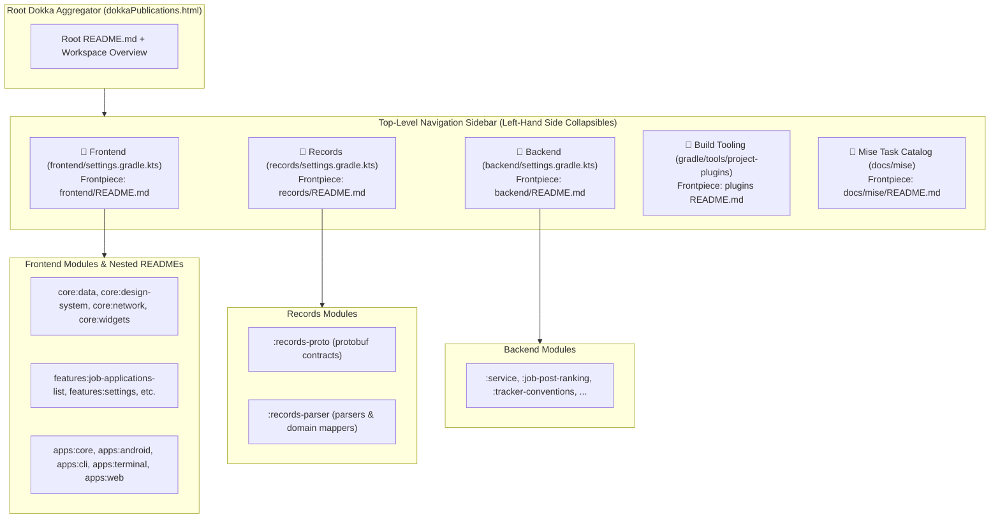

# Implementation Plan: Multi-Build Dokka Documentation Overhaul & Hierarchical Architecture

**Status:** Completed  
**Date:** 2026-11-16  
**Target:** repository-wide (root, `frontend`, `records`, `backend`, `gradle/tools/project-plugins`)  
**Harness:** Antigravity  
**Model:** gemini-3.8-flash  
**Session:** 54d0dcce-3356-4b69-96b7-39111a4682a5  
**Depends On:** [`.agents/plans/2026-11-05/163042_dokka-and-comprehensive-kdocs-plan.md`](../2026-11-05/163042_dokka-and-comprehensive-kdocs-plan.md)  

---

## 1. Executive Summary & Goals

### 1.1 Context & Problem Statement
Currently, Dokka integration across the repository is incomplete:
- The root `build.gradle.kts` aggregates a partial subset of modules (`records-parser`, `records-proto`, `project-plugins`), completely omitting the entire `frontend` subsystem (all `core/*`, `features/*`, `apps/*` modules) and `backend` modules.
- The repository is organized as a composite monorepo containing multiple independent included Gradle builds (`settings.gradle.kts` in `frontend/`, `records/`, `backend/`, and `gradle/tools/project-plugins/`). However, Dokka's generated site does not clearly convey this architecture or provide hierarchical navigation grouping corresponding to these included builds.
- Nested documentation (like `frontend/README.md`, `core/*/README.md`, `features/*/README.md`, and Mise task documentation) is disconnected from the API documentation.
- Despite having no external library consumers, the code should showcase meticulously documented, structured, self-referencing KDocs that reflect the system design and paradigms.

### 1.2 User Vision & Core Objectives
1. **Accurate & Comprehensive KDoc Documentation:** Ensure all public interfaces, models, components, composables, and convention plugins are documented with proper KDocs (including architectural context, parameter tags, return semantics, exception behaviors, and cross-references).
2. **Mirror Included Gradle Builds Structure:** The generated Dokka site will model the workspace as a collection of included Gradle builds (each defined by a `settings.gradle.kts`), structured visually into top-level collapsible navigation sections on the left-hand sidebar:
   - **Frontend Subsystem** (`frontend/settings.gradle.kts`): Apps, Core libraries, Features
   - **Records Subsystem** (`records/settings.gradle.kts`): Proto definitions, Parser, contract models
   - **Backend Subsystem** (`backend/settings.gradle.kts`): Cloud service, email classification, ranking, enrichment
   - **Project Plugins & Build Tooling** (`gradle/tools/project-plugins/settings.gradle.kts`): Convention plugins, project collections
   - **Mise Task Reference**: Operational workflows, scripts, and task documentation
3. **Nested READMEs as Section Frontpieces:**
   - Any nested `README.md` discovered within the hierarchy (such as `frontend/README.md` or subproject `README.md` files) must act as the frontpiece / overview for that documentation section.
   - For modules or groups with dedicated READMEs, Dokka will embed the markdown as the module/package description using Dokka's `includes` configuration or publication frontpiece descriptors.

---

## 2. Architecture & Design Principles

### 2.1 Dokka 2.3.0 Configuration Paradigm
In Dokka `2.3.0` (`org.jetbrains.dokka`):
1. **Module Name Hierarchy:** The left sidebar of Dokka renders modules based on publication module names. By structuring module names hierarchically or prefixing them cleanly (e.g., `frontend:core:design-system`, `records:parser`, `backend:service`), Dokka generates collapsible groupings on the left-hand navigation pane.
2. **Markdown Frontpieces via `includes`:** In Dokka V2, `dokkaSourceSets.configureEach { includes.from("README.md") }` embeds the markdown content at the top of the generated module and package documentation.
3. **Included Builds Composite Aggregation:** Dokka aggregates publications from composite builds when declared as dependencies in the aggregator project (`build.gradle.kts`). For each included build, all constituent subprojects apply the `DokkaConventionPlugin` and export their publication to the root aggregator.
4. **Standalone / Subsystem Docs Generability:** In addition to the root aggregated site (`mise run docs:generate`), each included build (`records`, `frontend`, `backend`) can also generate its own isolated documentation via `mise run <subsystem>:docs`.

---

## 3. Proposed Changes & Implementation Steps

### Phase 1: Convention Plugin & Dokka Source Configuration
- **Update `DokkaConventionPlugin.kt`**:
  - Enhance `DokkaConventionPlugin` to automatically check for a `README.md` in the project directory (`project.file("README.md")`).
  - When present, attach it to `includes.from(readmeFile)` across all source sets (`dokkaSourceSets.configureEach`).
  - Configure standardized module naming to reflect the included build hierarchy (e.g., prefixing with subsystem name `frontend:core:widgets` or maintaining settings-based path `settings.rootProject.name`).
  - Set documentation links to external standard libraries (Kotlin stdlib, Coroutines, AndroidX, Compose).

### Phase 2: Dokka Inclusion Across All Included Builds
- **Records Subsystem (`records/settings.gradle.kts`):**
  - Add `records/README.md` if missing, acting as the frontpiece for the records data layer.
  - Apply `local-dokka` to `:records-parser` and `:records-proto`.
- **Frontend Subsystem (`frontend/settings.gradle.kts`):**
  - Apply `local-dokka` across all frontend subprojects via the convention plugins (`KotlinMultiplatformConventionPlugin`, `AndroidLibraryConventionPlugin`, `JvmConventionPlugin`).
  - Ensure `frontend/README.md` is registered as the overview frontpiece for the frontend publication.
  - Wire all core (`core/data`, `core/design-system`, `core/network`, `core/navigation`, `core/widgets`), feature (`features/job-applications-list`, `features/job-application-details`, `features/settings`, `features/add-job-application`, `features/tracker-edits`, `features/sign-in`), and app modules.
- **Backend Subsystem (`backend/settings.gradle.kts`):**
  - Apply `local-dokka` to backend subprojects (`service`, `job-post-ranking`, `tracker-conventions`, `email-classification`, `company-metadata-enrichment`, `event-chain`).
  - Add/ensure `backend/README.md` exists as the frontpiece.
- **Build Tooling (`gradle/tools/project-plugins`):**
  - Ensure convention plugins have README frontpieces and are wired into Dokka.

### Phase 3: Root Aggregator Configuration & Navigation Structure
- **Root `build.gradle.kts`:**
  - Update `dependencies { dokka(...) }` to include all publications across `records`, `frontend`, `backend`, and `project-plugins`.
  - Configure root `dokkaPublications.html` with root `README.md` as the landing frontpiece overview.
- **Mise Tasks Documentation Integration:**
  - Ensure `docs/mise` task docs have a unified index / overview that can be linked or embedded as an appendix in the documentation site.

### Phase 4: Comprehensive KDocs Audit & Enrichment
- Review and author comprehensive KDoc comments for any under-documented public classes, functions, and composables:
  - Explain *why* the component exists and its architectural boundaries.
  - Document `@param`, `@return`, and `@throws` where applicable.
  - Provide cross-symbol links (`[JobApplication]`, `[JobApplicationsListUiState]`).
  - Ensure no broken KDoc reference warnings during generation.

### Phase 5: Verification & Site Generation
- Verify generation via `mise run docs:generate`.
- Verify the public documentation builder `scripts/build_docs_site.py` correctly links the aggregated Dokka tree.
- Inspect the generated output in a browser to confirm:
  - Left sidebar has clean, collapsible groupings for each included Gradle build.
  - Each subsystem frontpiece (`frontend/README.md`, etc.) renders at the top of its corresponding section.
  - All public symbols have rich, formatted KDocs.

---

## 4. Verification Plan & Testing Checklist

### 4.1 Automated Build & Generation Verification
- [ ] Run `mise run frontend:docs:readmes` to confirm all module READMEs exist and meet standards.
- [ ] Run `./gradlew :dokkaGenerateHtml` (via `mise run docs:generate`) to ensure zero fatal Dokka errors.
- [ ] Run `mise run dev:detekt` and `mise run dev:konsist` to guarantee adherence to repository rules and interface naming guidelines.
- [ ] Run `mise run ui:web:report` and `python scripts/build_docs_site.py` to verify full docs site builds cleanly.

### 4.2 Visual & Navigation Validation
- [ ] Inspect generated `dokka/index.html` locally:
  - Verify left sidebar displays distinct collapsible sections for `frontend`, `records`, `backend`, `project-plugins`.
  - Click on `frontend` and ensure `frontend/README.md` is rendered as the module introduction.
  - Click on nested modules (e.g. `frontend/core/widgets`) and ensure their respective READMEs and KDoc comments render seamlessly.
  - Verify search indexing in Dokka correctly resolves types from all included builds.

---

## 5. Bookkeeping
- [ ] Plan persisted at `.agents/plans/2026-11-16/012200_dokka_multibuild_hierarchy_plan.md`
- [ ] Registry `README.md` row added / status synchronized
- [ ] Craft a single commit of all changed files
- [ ] Stage changed files and craft a commit message based on the name of this file
- [ ] Push `git push origin main`
