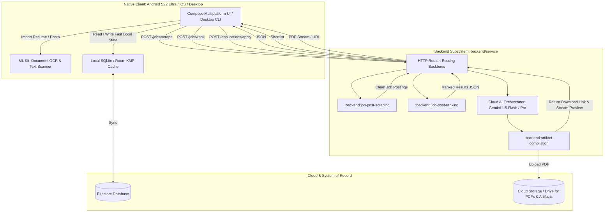
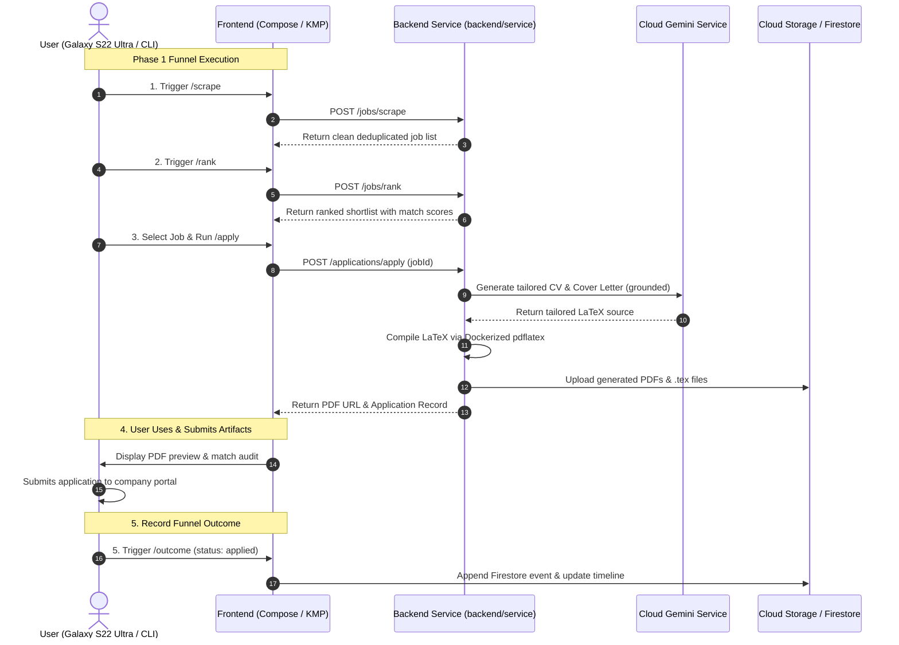

# Architecture & Implementation Plan: Mobile Migration & Backend-Assisted Intelligence

**Status:** Completed
**Date:** 2026-11-16
**Target:** `backend/`, `frontend/`, `records/`, and cross-platform native ecosystem

---

## 1. Goal Description & Scope Refinement

This plan re-architects the AI Job Tracker repository into a **multi-modal, AI-assisted job tracking tool** that exposes identical core capabilities to desktop CLI users and native app users across **Android, iOS, macOS, Web, and Windows**.

### 1.1 Core Principles & Hardware Baseline
1. **Move Heavy Lifting to `@backend`:**
   Deterministic business logic, concurrent job portal scraping, high-volume JSON parsing, multi-network coordination, and LaTeX PDF compilation live in `@backend` (Kotlin JVM / Ktor Server / Cloud Services). The mobile client remains thin, battery-efficient, and fast.
2. **Minimal On-Device AI Footprint:**
   Lean on on-device intelligence *strictly at the critical interactive moments* (e.g. streaming interview prep, fast UI assist, offline summaries). Everything else is backend-assisted or remote-compiled.
3. **Hardware Baseline:**
   **Samsung Galaxy S22 Ultra** (Snapdragon 8 Gen 1 / Exynos 2200, Android 14 / One UI 6, 8–12 GB RAM) serves as the baseline hardware target. Additional target devices in the fleet: Galaxy Z Fold6 (Snapdragon 8 Gen 3, Android 14+) and Galaxy Tab S10 FE (Exynos 1380 / MediaTek Dimensity, Wi-Fi only).
4. **Phase 1 Target Workflow:**
   Complete the end-to-end core funnel:
   $$\text{1. /scrape} \longrightarrow \text{2. /rank} \longrightarrow \text{3. /apply} \longrightarrow \text{4. User uses & submits artifacts} \longrightarrow \text{5. /outcome}$$
   Interactive mock interviews (`/interview`) and deep profile interviews (`/setup`) are deferred to Phase 2.
5. **Universal Portability via KMP & Composition of Functional Interfaces:**
   Define lightweight functional contracts (`fun interface`) in KMP `commonMain`. Intelligence engines are clean compositions of specialized SAM interfaces rather than bloated monolithic factories.
6. **Online-Friendly / Remote Compilation:**
   Online network connectivity is assumed. LaTeX documents are compiled remotely (pushing generated `.tex` to backend or cloud storage and streaming back PDFs or download links).
7. **Eradication of Unaligned `v*` Artifacts Across All Layers (`@records`, Proto, API):**
   Arbitrary version strings (`v1`, `v2`) that do not match repository git tags (`version/2.5.1`) must be systematically eliminated across the entire codebase:
   - **`@records` & Protobuf:** Migrate proto package from `tracker.v1` to canonical `tracker` (`src/main/proto/tracker/*.proto`) and java package from `dev.fnc314.aijobtracker.records.v1` to `dev.fnc314.aijobtracker.records`.
   - **Backend API Routes:** Remove all `/v1/` prefixes (`/jobs/scrape`, `/jobs/rank`, `/applications/apply`, `/compiler/compile`).
8. **Consistent Backend Packaging:**
   All new backend modules adhere strictly to `dev.fnc314.aijobtracker.backend.*` matching repository standards.

---

## 2. Eradication of `v*` Version Drift Across the Stack

The repository currently releases under SemVer git tags (`version/1.0.0`, `version/2.0.0`, `version/2.5.1`). Hardcoded sub-versioning like `v1` in proto packages or REST paths creates needless schema drift, mental overhead, and confusion.

### 2.1 Schema & Contract Alignment (`records/proto` & `records/parser`)
- **Current Proto State:**
  - Directory: `records/proto/src/main/proto/tracker/v1/*.proto`
  - Package: `package tracker.v1;`
  - Java Package: `option java_package = "dev.fnc314.aijobtracker.records.v1";`
- **Target Unversioned State:**
  - Directory: `records/proto/src/main/proto/tracker/*.proto`
  - Package: `package tracker;`
  - Java Package: `option java_package = "dev.fnc314.aijobtracker.records";`
  - Kotlin Records: `dev.fnc314.aijobtracker.records.*` (unversioned, continuous contract).

### 2.2 Backend HTTP Routing Alignment (`backend/service`)
- Unversioned, resource-oriented REST endpoints:
  - `POST /jobs/scrape` (replaces `/api/v1/jobs/scrape`)
  - `POST /jobs/rank` (replaces `/api/v1/jobs/rank`)
  - `POST /applications/apply` (replaces `/api/v1/applications/apply`)
  - `POST /compiler/compile` (replaces `/api/v1/compiler/compile`)

---

## 3. Intelligence Runtime Strategy: On-Device vs. Cloud Economics

### 3.1 The Critical Evaluation: Cloud Gemini API vs. On-Device Models
You asked:
1. *Is Google MediaPipe GenAI the "recommended" way?*
2. *Can you talk me out of Cloud Gemini API as the preferred solution? Is it cost prohibitive?*

Here is the candid, empirical analysis:

#### Why Cloud Gemini API is NOT Cost Prohibitive (The Numbers)
A single job application workflow (`/apply` + `/rank`) involves:
- Prompt + Candidate Profile (~1,500 tokens)
- Job posting text (~1,000 tokens)
- Output tailored CV bullets & cover letter text (~1,200 tokens)
- Total per application: **~2,500 input tokens + ~1,200 output tokens**.

Using current standard pricing for **Gemini 1.5 Flash**:
- Input: \$0.075 per 1,000,000 tokens $\rightarrow$ **\$0.0001875** per application
- Output: \$0.30 per 1,000,000 tokens $\rightarrow$ **\$0.00036** per application
- **Total cost per complete application evaluation & drafting: ~\$0.00055 (approx. 1/20th of a single cent!)**
- Even if you evaluate and tailor **500 jobs a month**, your total monthly cloud API cost is **~\$0.28 USD**. It is virtually free.

#### Why Cloud API via `@backend` is Actually Superior for Drafting & Analysis
1. **Instruction Following & Strict Formatting:**
   LaTeX tailoring demands strict obedience: zero syntax corruption, exact Inconsolata/Sans header syntax, 1-page constraints, and strict factual grounding. A 1B–2B local model (like Gemma 2B or Llama 3.2 1B) frequently hallucinates LaTeX syntax or drops formatting under tight token constraints. Gemini 1.5 Flash or Pro follows complex constraints flawlessly.
2. **Device Battery & Thermal Throttling:**
   Running continuous INT4 token generation on a Galaxy S22 Ultra's GPU/NPU consumes 2–4 Watts and heats up the chassis within 3–4 minutes. Offloading drafting to `@backend` costs the device zero compute and milliseconds of battery.
3. **App Bundle & Download Size:**
   MediaPipe requires users to download a **~1.2 GB to 1.8 GB** model weight file on first launch. On Wi-Fi only devices (Galaxy Tab S10 FE) or cellular (S22 Ultra), users hate large model downloads.

#### Where On-Device Intelligence Genuinely Belongs
1. **Google ML Kit (Zero Model Download, 100% On-Device):**
   Text Recognition / OCR from camera scans of physical resumes, document scanning, and offline keyword regex. This is fast, zero-cost, and uses built-in Google Play Services.
2. **Interactive UI Streaming (Phase 2):**
   Low-latency mock interview voice coaching (`/interview`) where round-trip network ping is noticeable.
3. **Recommendation:**
   - **Default & Preferred:** Route all heavy drafting, evaluation, and ranking through **`@backend` using Cloud Gemini API**.
   - **Local On-Device Engine:** Keep **Google ML Kit** for local document/OCR parsing. Keep MediaPipe / local SLMs as an optional, opt-in offline plugin rather than a mandatory requirement.

---

## 4. Workload Distribution: Client vs. Backend



### Phase 1 Funnel Allocation

| Step | Operation | Workload Distribution | Implementation Detail |
| :--- | :--- | :--- | :--- |
| **1. /scrape** | Multi-portal search (LinkedIn, FreeHire, Jobnet) | **100% Backend Service** (`@backend:job-post-scraping`) | Mobile client sends `POST /jobs/scrape`. Backend executes concurrent portal fetches, parses heavy HTML DOM, deduplicates against existing records, and returns clean JSON job summaries. |
| **2. /rank** | Batch job evaluation & shortlist triage | **100% Backend Service** (`@backend:job-post-ranking`) | Backend runs `RankScorer.evaluate()`. Keyword matching, deal-breaker evaluation, and sector weights execute server-side in parallel. The mobile client receives a pre-sorted shortlist with badges (🔥 Urgency, ⚠ Location flag). |
| **3. /apply** | Detailed fit evaluation + LaTeX tailoring | **Hybrid: Cloud AI Backend + Remote LaTeX Compilation** | **Step 1 (Fit Evaluation):** Backend analyzes nuanced job posting text against candidate profile using Gemini 1.5 Flash. Returns fit breakdown (Strengths, Gaps, Compensation benchmark).<br>**Step 2 (Tailored Drafts):** Backend generates customized LaTeX CV and Cover Letter adhering strictly to formatting and factual grounding rules.<br>**Step 3 (Compilation):** Backend compiles `.tex` via server-side TeX toolchain (Dockerized `pdflatex`/`xelatex`) and returns both the raw TeX and a cloud-stored PDF link (GCS or Google Drive). |
| **4. User Uses & Submits Artifacts** | Reviewing, customizing, applying | **Mobile UI (Compose Multiplatform)** | The user reviews the compiled PDFs in the app (via Android native `PdfRenderer`), downloads or shares them to the job portal application flow, and submits their application to the employer. |
| **5. /outcome** | Application funnel tracking & follow-ups | **Client Event Sourcing + Backend Sync** | Once the application is submitted, the user triggers `/outcome` (status: `applied`). Client logs outcome updates, creating append-only event sourcing records in Firestore. Backend handles follow-up reminders. |

---

## 5. Backend Architecture: Backbone & Module Structure

`backend/service` is the routing backbone: it acts as the HTTP gateway and orchestrates specialized library modules.

### 5.1 Backend Module Alignment

```
backend/
├── job-post-scraping/          # [NEW] dev.fnc314.aijobtracker.backend.scraping.*
│   └── src/main/kotlin/dev/fnc314/aijobtracker/backend/scraping/
│       ├── JobScraperService.kt
│       ├── PortalScraper.kt
│       └── model/ScrapedJobPosting.kt
├── job-post-ranking/           # dev.fnc314.aijobtracker.backend.ranking.*
├── artifact-compilation/       # [NEW] dev.fnc314.aijobtracker.backend.compilation.*
│   └── src/main/kotlin/dev/fnc314/aijobtracker/backend/compilation/
│       ├── DocumentCompilerService.kt
│       ├── CompilationResult.kt
│       └── LatexCompilerEngine.kt
├── event-chain/                # dev.fnc314.aijobtracker.backend.eventchain.*
├── tracker-conventions/        # dev.fnc314.aijobtracker.backend.conventions.*
├── company-metadata-enrichment/# dev.fnc314.aijobtracker.backend.enrichment.*
├── email-classification/       # dev.fnc314.aijobtracker.backend.classification.*
└── service/                    # dev.fnc314.aijobtracker.backend.* (ROUTING BACKBONE)
    └── src/main/kotlin/dev/fnc314/aijobtracker/backend/
        ├── Main.kt             # Application entry point (mainClass aligned)
        ├── BackendService.kt   # High-level coordinator
        ├── routes/             # Clean resource-based routes (no /v1/ drift)
        │   ├── ScrapingRoutes.kt       # POST /jobs/scrape
        │   ├── RankingRoutes.kt        # POST /jobs/rank
        │   ├── ApplicationRoutes.kt    # POST /applications/apply
        │   └── CompilerRoutes.kt       # POST /compiler/compile
        └── webhook/
            └── EmailWebhookRoute.kt
```

### 5.2 Backend Single Abstract Method (SAM) Interfaces

All 1-method interfaces adhere to SAM `fun interface` with `operator fun invoke`:

```kotlin
package dev.fnc314.aijobtracker.backend.compilation

import kotlinx.coroutines.flow.Flow

/**
 * Functional interface for compiling document source into formatted PDF artifacts.
 */
public fun interface DocumentCompilerEngine {
    public operator fun invoke(
        sourceContent: String,
        targetFilename: String
    ): Flow<CompilationResult>
}
```

```kotlin
package dev.fnc314.aijobtracker.backend.scraping

import kotlinx.coroutines.flow.Flow

/**
 * Functional interface for portal-specific job scraping execution.
 */
public fun interface PortalScraper {
    public operator fun invoke(
        query: String,
        location: String
    ): Flow<ScrapedJobPosting>
}
```

---

## 6. Universal Platform Architecture: Composition of SAM Interfaces

Instead of an unwieldy factory class, the client architecture decomposes intelligence capabilities into small, composable `fun interface` contracts.

### 6.1 Composable SAM Interfaces in `frontend/core/intelligence`

```kotlin
package dev.fnc314.aijobtracker.core.intelligence

import kotlinx.coroutines.flow.Flow

/**
 * Functional interface for generating text responses from prompts.
 */
public fun interface TextGenerationEngine {
    public operator fun invoke(prompt: GenerationPrompt): Flow<String>
}

/**
 * Functional interface for extracting text and document structure from files.
 */
public fun interface DocumentExtractionEngine {
    public operator fun invoke(documentUri: String): Flow<ExtractedDocumentText>
}

/**
 * Composed functional interface combining document ingestion with text intelligence.
 */
public fun interface CareerIntelligenceEngine {
    public operator fun invoke(
        documentEngine: DocumentExtractionEngine,
        generationEngine: TextGenerationEngine
    ): Flow<IntelligenceResult>
}
```

### 6.2 Clean Engine Implementations
- **Document Extraction (Android & Desktop):**
  - Android uses `Google ML Kit Text Recognition` (hardware accelerated, 0MB download).
  - Desktop uses PDFBox / Apache Tika text extractor.
- **Text Generation Engine:**
  - Standard implementation delegates via Ktor HTTP client to `@backend/service` (which calls Cloud Gemini).
  - Optional local implementation binds MediaPipe GenAI if a local model weight is present on disk.

---

## 7. Phase 1 Implementation Plan



### Concrete Execution Steps

#### Step 1: Cleanups, Version Eradication & Module Creation
1. Correct `mainClass.set("dev.fnc314.aijobtracker.backend.MainKt")` in `backend/service/build.gradle.kts`.
2. Remove the empty legacy directory `backend/service/src/main/kotlin/dev/fnc314/tools/`.
3. In `records/proto`: flatten `src/main/proto/tracker/v1/` to `src/main/proto/tracker/`, setting `package tracker;` and `option java_package = "dev.fnc314.aijobtracker.records";`.
4. Create new Gradle module `:backend:job-post-scraping` (package `dev.fnc314.aijobtracker.backend.scraping`).
5. Create new Gradle module `:backend:artifact-compilation` (package `dev.fnc314.aijobtracker.backend.compilation`).
6. Include both modules in `backend/settings.gradle.kts` and link them in `backend/service/build.gradle.kts`.

#### Step 2: Route Handlers in `backend/service` (The Routing Backbone)
Expose unversioned, clean endpoints in `backend/service/src/main/kotlin/dev/fnc314/aijobtracker/backend/routes/`:
- `POST /jobs/scrape`: Calls `:job-post-scraping`
- `POST /jobs/rank`: Calls `:job-post-ranking`
- `POST /applications/apply`: Orchestrates Gemini tailoring + calls `:artifact-compilation`
- `POST /compiler/compile`: Standalone compilation endpoint for raw `.tex` input

#### Step 3: Frontend KMP Integration
1. Extend `frontend/core/network` with Ktor client API methods connecting to backend endpoints.
2. In `frontend/features/artifact-previewer`, integrate Android native `PdfRenderer` for hardware-accelerated preview on Galaxy S22 Ultra and Z Fold6.
3. Connect `frontend/features/job-applications-list` to backend scraping and ranking feeds.
4. Support the review-and-submit flow so the user can easily share/export the PDF to submit their application before logging the `/outcome`.

---

## 8. Verification Plan

### Automated Tests
- **Backend Service & Module Tests:**
  ```bash
  ./gradlew :backend:service:test
  ./gradlew :backend:job-post-ranking:test
  ./gradlew :backend:job-post-scraping:test
  ./gradlew :backend:artifact-compilation:test
  ```
  Validate routes, ranking integration, and mock TeX compilation.
- **Records Proto & Parser Tests:**
  ```bash
  ./gradlew :records:proto:build
  ./gradlew :records:parser:test
  ```
- **Frontend KMP Client Tests:**
  ```bash
  ./gradlew :frontend:core:network:test
  ./gradlew :frontend:features:artifact-previewer:test
  ```
- **Interface & Architecture Compliance:**
  ```bash
  mise run dev:guards
  mise run dev:konsist
  ```
  Ensures 100% compliance with package prefixes, directory matching, and SAM `fun interface` rules.

### Manual Verification on Hardware
- **Samsung Galaxy S22 Ultra (Baseline):**
  - Install debug APK via `mise run frontend:android:install` or Android Studio.
  - Verify network calls to backend service over cellular connection.
  - Verify high-resolution PDF rendering via native `PdfRenderer`.
- **Samsung Galaxy Z Fold6:**
  - Verify foldable two-pane adaptive layouts during job ranking and artifact review.
- **Desktop CLI Parity:**
  - Verify existing `mise run search:*` commands execute against the same backend service endpoints.
