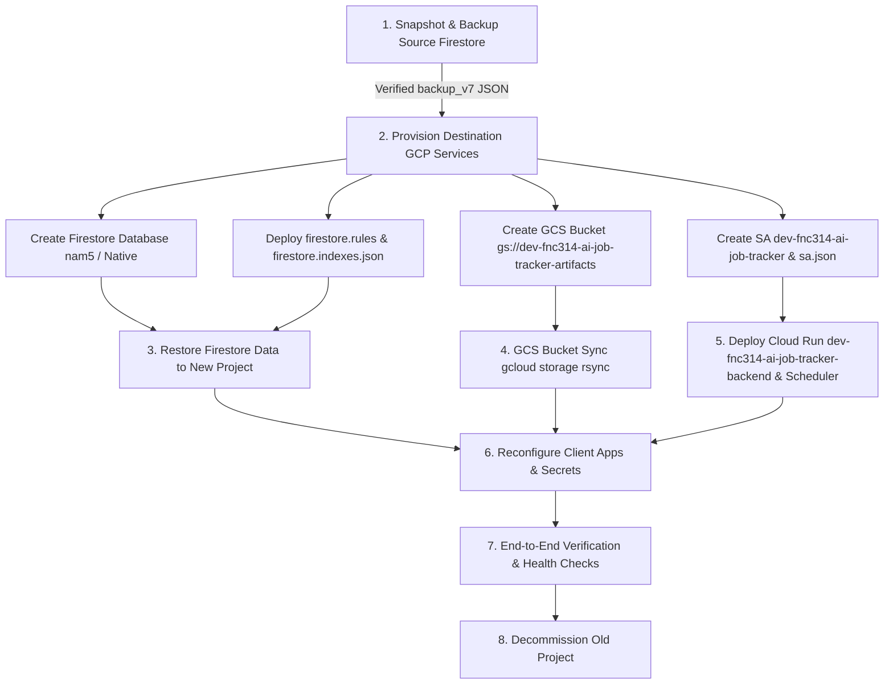

# Implementation Plan: Google Cloud & Firebase Project Migration to `dev-fnc314-ai-job-tracker`

**Status:** Completed  
**Date:** 2026-11-16  
**Target:** repository-wide (cloud infrastructure, database, backend, client configs)  
**Harness:** Antigravity  
**Model:** gemini-3.8-flash  
**Session:** `7093357f-5e5a-45e0-9093-a854e5ab458a`  

---

## 1. Executive Summary & Goals

### 1.1 Objective
Migrate all cloud backend resources, Firestore database state, Cloud Storage artifacts, Cloud Run services, Cloud Scheduler jobs, and client credentials from the legacy project:
- **Source Project:** `job-search-fnc314-dev` (Project Number: `399944190604`)
to the new naming-convention-aligned project:
- **Destination Project:** `dev-fnc314-ai-job-tracker` (Project Number: `375389268913`)

### 1.2 Inventory of Resources to Migrate
1. **Firestore Database:**
   - 117 applications, 209 append-only events, 297 artifacts, 35 pending proposals, 11 sync requests, 102 companies.
   - Exact offline snapshot already verified and saved at:  
     `generated/backup_v7_20261116_191453.json` (SHA-256: `fddc473f7f8638ae3f7e38f3a97895312ba9b2b05c32e174ba7804b3b25300a3`).
   - Firestore security rules (`firestore.rules`) and composite indexes (`firestore.indexes.json`) explicitly deployed and ported.
2. **Cloud Storage (GCS) Buckets:**
   - Source bucket: `gs://job-search-fnc314-dev-artifacts` (contains CV PDFs, cover letters, and application artifacts).
   - Target bucket: `gs://dev-fnc314-ai-job-tracker-artifacts` (Standard storage class, `us-east1` or `US` multi-region).
3. **IAM & Service Accounts:**
   - Create Service Account: `dev-fnc314-ai-job-tracker@dev-fnc314-ai-job-tracker.iam.gserviceaccount.com`
   - Grant roles: `roles/datastore.user` (Firestore), `roles/storage.objectAdmin` (GCS bucket), `roles/run.invoker`.
   - Generate local credential key: `~/.config/job-tracker/sa.json` (or `dev-sa.json`).
4. **Cloud Run Backend & Cloud Scheduler:**
   - Service: `dev-fnc314-ai-job-tracker-backend` in `us-east1`.
   - Scheduler: `dev-fnc314-ai-job-tracker-routine-sweep` (CRON `0 */6 * * *` -> `/tasks/sweep`).
5. **Firebase & Client Apps (`google-services.json` & `GoogleService-Info.plist`):**
   - Register Android app (`dev.fnc314.aijobtracker`) & iOS app in Firebase console under `dev-fnc314-ai-job-tracker`.
   - Download new `google-services.json` and `GoogleService-Info.plist`.
   - Encrypt with `mise run secrets:encrypt` into `credentials.tar.gz.enc`.
6. **Codebase & Config References Update:**
   - Update `.env.local` / `.env.example`: `TRACKER_PROJECT=dev-fnc314-ai-job-tracker`, `TRACKER_BUCKET=dev-fnc314-ai-job-tracker-artifacts`.
   - Update `tracker.schema.json`, `RemoteNetworkConfig.kt`, `BackendService.kt`, `client.py`, and GitHub Action workflows.

---

## 2. Migration Architecture & Sequence



---

## 3. Detailed Step-by-Step Execution Plan

### Step 1: Provision Core Services in `dev-fnc314-ai-job-tracker`
Enable required Google Cloud APIs:
```bash
gcloud services enable --project=dev-fnc314-ai-job-tracker \
  firestore.googleapis.com \
  storage.googleapis.com \
  run.googleapis.com \
  cloudbuild.googleapis.com \
  cloudscheduler.googleapis.com \
  iam.googleapis.com \
  artifactregistry.googleapis.com
```

Create Firestore Database (`(default)` in Native mode, location `nam5`):
```bash
gcloud firestore databases create \
  --project=dev-fnc314-ai-job-tracker \
  --location=nam5 \
  --type=firestore-native
```
Deploy Firestore security rules and indexes:
```bash
firebase deploy --only firestore:rules,firestore:indexes --project=dev-fnc314-ai-job-tracker
```

Create GCS Artifacts Bucket:
```bash
gcloud storage buckets create gs://dev-fnc314-ai-job-tracker-artifacts \
  --project=dev-fnc314-ai-job-tracker \
  --location=us-east1 \
  --uniform-bucket-level-access \
  --public-access-prevention
```

### Step 2: Provision Service Account & Local Credentials
Create service account:
```bash
gcloud iam service-accounts create dev-fnc314-ai-job-tracker \
  --project=dev-fnc314-ai-job-tracker \
  --display-name="Job Tracker Backend & CLI"

# Grant Firestore and Storage permissions
gcloud projects add-iam-policy-binding dev-fnc314-ai-job-tracker \
  --member="serviceAccount:dev-fnc314-ai-job-tracker@dev-fnc314-ai-job-tracker.iam.gserviceaccount.com" \
  --role="roles/datastore.user"

gcloud storage buckets add-iam-policy-binding gs://dev-fnc314-ai-job-tracker-artifacts \
  --member="serviceAccount:dev-fnc314-ai-job-tracker@dev-fnc314-ai-job-tracker.iam.gserviceaccount.com" \
  --role="roles/storage.objectAdmin"

# Generate new key for local development
gcloud iam service-accounts keys create ~/.config/job-tracker/sa.json \
  --iam-account=dev-fnc314-ai-job-tracker@dev-fnc314-ai-job-tracker.iam.gserviceaccount.com \
  --project=dev-fnc314-ai-job-tracker
```

### Step 3: Data Migration (Firestore & Storage)
1. **Firestore Data Restore:**
   - Execute the restore script targeting the new project using the freshly backed-up snapshot:
     ```bash
     TRACKER_PROJECT=dev-fnc314-ai-job-tracker \
     TRACKER_ALLOW_WRITES=1 \
     python3 scripts/remote_restore.py --backup generated/backup_v7_20261116_191453.json --apply
     ```
   - Verify counts match: 117 applications, 209 events, 297 artifacts, 102 companies.
2. **Cloud Storage Artifact Sync:**
   - Use `gcloud storage rsync` to replicate all files:
     ```bash
     gcloud storage rsync -r \
       gs://job-search-fnc314-dev-artifacts \
       gs://dev-fnc314-ai-job-tracker-artifacts
     ```

### Step 4: Deploy Cloud Run Backend & Cloud Scheduler
1. **Artifact Registry Repository:**
   ```bash
   gcloud artifacts repositories create dev-fnc314-ai-job-tracker-backend \
     --repository-format=docker \
     --location=us-east1 \
     --project=dev-fnc314-ai-job-tracker
   ```
2. **Deploy Service via Cloud Build:**
   ```bash
   SERVICE_NAME="dev-fnc314-ai-job-tracker-backend" \
   REMOTE_GCP_PROJECT=dev-fnc314-ai-job-tracker \
   REMOTE_BUILD_MODE=cloud \
   mise run remote:deploy:service
   ```
3. **Deploy Scheduler Job:**
   ```bash
   SERVICE_NAME="dev-fnc314-ai-job-tracker-backend" \
   JOB_NAME="dev-fnc314-ai-job-tracker-routine-sweep" \
   REMOTE_GCP_PROJECT=dev-fnc314-ai-job-tracker \
   mise run remote:deploy:scheduler
   ```
4. Note the new Cloud Run URL (e.g. `https://dev-fnc314-ai-job-tracker-backend-375389268913.us-east1.run.app`).

### Step 5: Firebase App Registration & Client Credentials
1. Register Android app: `dev.fnc314.aijobtracker` in Firebase project `dev-fnc314-ai-job-tracker`.
2. Register iOS app: `dev.fnc314.tools.jobtracker` / `dev.fnc314.aijobtracker`.
3. Download new `google-services.json` and `GoogleService-Info.plist`.
4. Replace local files in `frontend/apps/android/` and `frontend/apps/ios/iosApp/`.
5. Re-encrypt bundle:
   ```bash
   mise run secrets:encrypt
   ```

### Step 6: Codebase & GitHub Secrets Updates
1. Update `RemoteNetworkConfig.kt`:
   - Change `DEFAULT_REMOTE_BACKEND_URL` to the new Cloud Run URL.
2. Update `.env.example` & `.env.local`:
   - `TRACKER_PROJECT=dev-fnc314-ai-job-tracker`
   - `TRACKER_BUCKET=dev-fnc314-ai-job-tracker-artifacts`
3. Update `.github/workflows/deploy-backend.yml`:
   - Default `PROJECT` to `dev-fnc314-ai-job-tracker`.
4. Update GitHub Secrets:
   - Update `GCP_SA_KEY` with the base64 or JSON of `dev-fnc314-ai-job-tracker@dev-fnc314-ai-job-tracker.iam.gserviceaccount.com`.

---

## 4. Verification Plan & Testing Checklist

- [ ] **Firestore Verification:**
  - Query application count: `TRACKER_PROJECT=dev-fnc314-ai-job-tracker mise run tracker:status` returns exact matching application count (117).
  - Test read/write idempotency: `TRACKER_PROJECT=dev-fnc314-ai-job-tracker mise run tracker:check`.
- [ ] **Cloud Storage Verification:**
  - `gcloud storage ls gs://dev-fnc314-ai-job-tracker-artifacts` lists all application folders.
- [ ] **Cloud Run & Scheduler Verification:**
  - `curl -s https://<new-cloud-run-url>/health` returns `{"status":"UP", ...}`.
  - Test routine sweep: `mise run remote:sweep`.
- [ ] **Frontend Apps Verification:**
  - Build Android app: `./gradlew :frontend:apps-android:assembleDebug`.
  - Verify app communicates with new Firestore / Cloud Run instance.

---

## 5. Decommissioning & Cutover
- Keep the old project active in read-only state for 48 hours to confirm zero regressions.
- After validation, shut down `job-search-fnc314-dev`.
