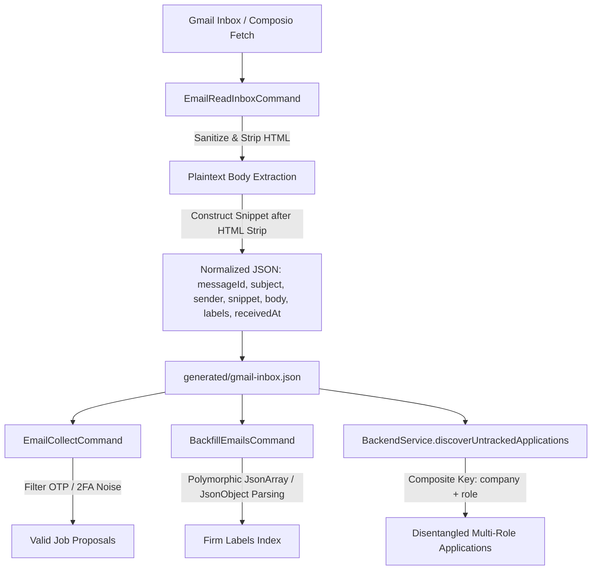

# Implementation Plan: Email Processing Pipeline Refinements and Architectural Hardening

**Status:** Completed  
**Date:** 2026-11-19  
**Target:** `frontend` and `backend` (cross-subsystem)  
**Harness:** Antigravity  
**Model:** gemini-3.8-flash  
**Session:** 1d507fc4-9938-4949-8da1-988bc1abfb43  
**Depends On:** [`.agents/plans/2026-11-17/160515_email-mise-tasks-to-kotlin-cli.md`](file:///Users/fnc314/Work/Search/ai-job-tracker/.agents/plans/2026-11-17/160515_email-mise-tasks-to-kotlin-cli.md)  
**Supersedes:** [`.agents/plans/2026-11-12/161900_email-job-application-discovery.md`](file:///Users/fnc314/Work/Search/ai-job-tracker/.agents/plans/2026-11-12/161900_email-job-application-discovery.md)  

---

## 1. Executive Summary & Goals

During our deep live synchronization and itemized walkthrough of email communications, 6 critical pipeline bugs were discovered across the email processing CLI commands (`frontend:apps-cli`) and backend discovery service (`backend:service`):

1. **Pre-Strip HTML Truncation (`EmailCommand.kt:219`):** Raw HTML emails from employers (Workday, Amazon, Walmart, Gartner) begin with large `<!DOCTYPE html><style>...` CSS boilerplate. Truncating to 800 characters *before* stripping HTML tags leaves the `snippet` containing only CSS boilerplate, completely blinding downstream classifiers and matching engines.
2. **Missing `labels` & `body` in Normalized Inbox JSON (`EmailCommand.kt:223–232`):** `EmailReadInboxCommand` serializes only `messageId`, `subject`, `sender`, `snippet`, and `receivedAt`. Dropping `labels` and `body` directly causes `BackendService.discoverUntrackedApplications()` (`email:discover`) to find 0 candidates, as it relies on matching `JOB/<Company>` labels and analyzing full email body context.
3. **JSON Schema Crash in `BackfillEmailsCommand.kt:55`:** `BackfillEmailsCommand` expects `gmail-job-labels.json` to be a `JsonObject` with a `"labels"` key. However, `EmailSyncLabelsCommand` serializes it as a top-level `JsonArray` of label objects, causing an unhandled deserialization warning and falling back to an empty label set.
4. **Noise / OTP False-Positive Proposals:** Verification codes and OTP messages (e.g. *\"Your Amazon A to Z verification code\"*, *\"Confirm your identity\"* from Ford) match employer domains and get erroneously staged as application proposals in `proposals/`.
5. **Workday Sender Identification:** Senders like `Gartner@myworkday.com` or `qualcomm@myworkday.com` have employer identity in the username prefix of the email address rather than the domain (`myworkday.com`). Without explicit Workday regex handling, generic domain extractors misidentify the employer as \"myworkday\".
6. **Multi-Role Grouping Collision (`BackendService.kt:1796`):** Untracked candidates are grouped solely by `company.lowercase()` and take only `emails.first()`, causing candidates applying to multiple concurrent positions at the same firm (e.g. Intuit's 3 distinct roles, Walmart's 3 distinct roles) to have all subsequent roles discarded.

This implementation plan outlines the architecture, code refactorings, and verification steps to resolve these defects cleanly across the monorepo.

---

## 2. Architecture & Design Principles



- **Clean Plaintext Extraction First:** HTML tags, `<style>`, and `<script>` blocks must be stripped prior to snippet calculation.
- **Contract Fidelity:** `gmail-inbox.json` is a shared contract between CLI tasks and backend discovery; required fields (`labels`, `body`) must never be dropped.
- **Fail-Safe Polymorphic Deserialization:** Shared cache files like `gmail-job-labels.json` must be deserialized robustly to handle both `JsonArray` and `JsonObject` schemas.
- **Precision Matching:** Grouping by `company` alone is insufficient for modern job searches; applications must resolve to composite identifiers `(company, normalizedRole)`.

---

## 3. Proposed Changes & Implementation Steps

### Component 1: `frontend/apps/cli` — Email Ingestion & Normalization

#### [MODIFY] `frontend/apps/cli/src/main/kotlin/dev/fnc314/aijobtracker/frontend/cli/commands/EmailCommand.kt`
- Implement HTML tag and style block stripper utility:
  ```kotlin
  private fun stripHtml(raw: String): String {
      if (raw.isBlank()) return ""
      val withoutStyles = raw.replace(Regex("<style[\\s\\S]*?</style>", RegexOption.IGNORE_CASE), "")
          .replace(Regex("<script[\\s\\S]*?</script>", RegexOption.IGNORE_CASE), "")
      val textOnly = withoutStyles.replace(Regex("<[^>]+>"), " ")
      return textOnly.replace(Regex("&nbsp;"), " ")
          .replace(Regex("&amp;"), "&")
          .replace(Regex("&lt;"), "<")
          .replace(Regex("&gt;"), ">")
          .replace(Regex("&quot;"), "\"")
          .replace(Regex("\\s+"), " ")
          .trim()
  }
  ```
- In `EmailReadInboxCommand`:
  - Extract `body` from `obj["messageText"]` or `obj["body"]`.
  - Compute `cleanBody = stripHtml(body)`.
  - Build `snippet = if (cleanBody.isNotBlank()) "$subj\n\n$cleanBody".take(800) else subj.take(800)`.
  - Extract `labels = obj["labels"]?.jsonArray ?: obj["labelIds"]?.jsonArray ?: JsonArray(emptyList())`.
  - Include both `"labels"` and `"body"` (sanitized) in normalized `JsonObject`.
- In `EmailCollectCommand`:
  - Add OTP / 2FA / verification code exclusion:
    ```kotlin
    val isVerificationNoise = Regex(
        "(?i)(?:verification\\s+code|confirm\\s+your\\s+identity|one-time\\s+passcode|\\botp\\b|security\\s+code|password\\s+reset)"
    ).containsMatchIn("$subject $snippet")
    if (isVerificationNoise) {
        // Skip noise from generating proposals
        continue
    }
    ```

---

### Component 2: `frontend/apps/cli` — Historical Email Backfill Deserializer

#### [MODIFY] `frontend/apps/cli/src/main/kotlin/dev/fnc314/aijobtracker/frontend/cli/commands/BackfillEmailsCommand.kt`
- Update `jobLabelsFile` parsing at lines 53–68 to polymorphically handle either top-level `JsonArray` or `JsonObject` with `"labels"`:
  ```kotlin
  if (jobLabelsFile.exists()) {
      try {
          val parsed = Json.parseToJsonElement(jobLabelsFile.readText())
          val labelStrings = when (parsed) {
              is JsonArray -> parsed.mapNotNull {
                  it.jsonObject["name"]?.jsonPrimitive?.contentOrNull
                      ?: it.jsonPrimitive.contentOrNull
              }
              is JsonObject -> parsed["labels"]?.jsonArray?.mapNotNull {
                  it.jsonObject["name"]?.jsonPrimitive?.contentOrNull
                      ?: it.jsonPrimitive.contentOrNull
              } ?: emptyList()
              else -> emptyList()
          }
          labelStrings.forEach { label ->
              knownJobLabels.add(label)
              if (label.startsWith("JOB/")) {
                  val firm = label.removePrefix("JOB/").lowercase().replace(" ", "").replace("-", "")
                  firmLabels[firm] = label
              }
          }
          t.println(green("Loaded ${knownJobLabels.size} JOB labels (${firmLabels.size} firm-specific) from ${jobLabelsFile.path}"))
      } catch (e: Exception) {
          t.println(yellow("Warning: Could not parse ${jobLabelsFile.path}: ${e.message}"))
      }
  }
  ```

---

### Component 3: `backend/service` — Employer Identification & Multi-Role Discovery

#### [MODIFY] `backend/service/src/main/kotlin/dev/fnc314/aijobtracker/backend/BackendService.kt`
- In `extractCompanyFromEmail`:
  - Add Workday sender parser:
    ```kotlin
    if (sender.contains("myworkday.com", ignoreCase = true) || sender.contains("myworkdayjobs.com", ignoreCase = true)) {
        val userPart = sender.substringBefore("@").trim().trim('"', '\'')
        if (userPart.isNotBlank() && !userPart.equals("noreply", ignoreCase = true) && !userPart.equals("no-reply", ignoreCase = true)) {
            return userPart
        }
    }
    ```
- In `discoverUntrackedApplications`:
  - Enhance grouping logic from `company.lowercase()` to composite key `(company.lowercase(), normalizedRole)`:
    ```kotlin
    val candidateKey = "$companyId::${DocumentIdGenerator.slug(role)}"
    ```
  - Preserve distinct roles submitted to the same company.

---

## 4. Verification Plan & Testing Checklist

### Automated Tests
1. **Compilation Check:**
   - Execute: `./gradlew :frontend:apps-cli:assemble :backend:service:assemble`
2. **Lint & Consistency:**
   - Run: `mise run dev:detekt` and verify zero new violations.

### Manual Verification
1. **Inbox Read Test:**
   - Run `mise run email:read-inbox --max 10`
   - Inspect `generated/gmail-inbox.json` and confirm:
     - Snippets for Amazon, Walmart, and Workday emails contain readable plaintext rather than CSS/DOCTYPE headers.
     - `labels` array is present.
     - `body` is present.
2. **Backfill Command Test:**
   - Run `mise run tracker:backfill:emails`
   - Verify that the warning `Could not parse generated/gmail-job-labels.json` no longer occurs and firm labels load successfully.
3. **Collect Dry Run:**
   - Run `mise run email:collect --dry-run`
   - Confirm that OTP emails (Amazon verification code, Ford identity confirmation) are ignored and do not generate proposals.

---

## 5. Bookkeeping
- [ ] Plan persisted at `.agents/plans/2026-11-19/144800_email-processing-pipeline-refinement.md`
- [ ] Registry `README.md` row added / status synchronized
- [ ] Stage and commit changes to git
