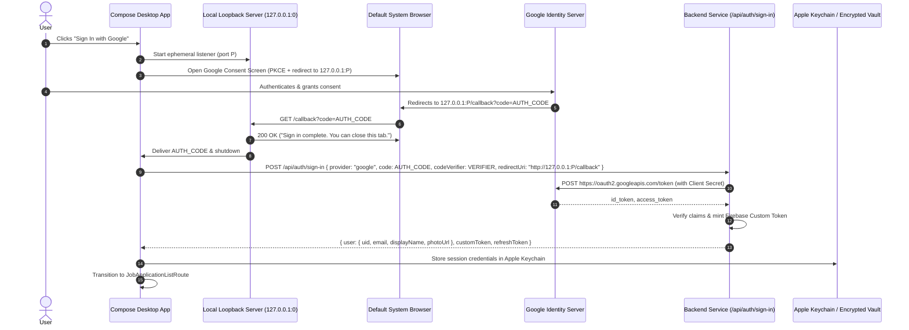

# Architecture Plan: Backend-Assisted Authentication API & Desktop Loopback Integration

**Status:** In Progress
**Date:** 2026-11-20
**Target:** `backend/service/src/main/kotlin/dev/fnc314/aijobtracker/backend/routes/AuthRoutes.kt`, `backend/service/src/main/kotlin/dev/fnc314/aijobtracker/backend/BackendService.kt`, `frontend/features/sign-in/data/src/jvmMain/kotlin/dev/fnc314/aijobtracker/frontend/features/signin/data/PlatformSignInHandler.jvm.kt`

---

## 1. Context & Architecture Overview

Instead of handling third-party token exchange, client secrets, and token validation directly on the client, identity exchange is delegated to the cloud backend (`backend/service`).

- **Endpoint:** `POST /api/auth/sign-in` (and alias `POST /api/auth/sign-up`)
- **Protocol:** Multi-provider authentication gateway supporting `provider = "google"`, `code`, `codeVerifier`, `redirectUri`.
- **Backend Role (GCP / Cloud Run):**
  1. Receives provider credential/authorization payload.
  2. Securely exchanges authorization code with provider (Google Identity) using client secret stored in GCP Secret Manager / environment (`GOOGLE_CLIENT_SECRET`).
  3. Validates OpenID claims (`sub`, `email`, `name`, `picture`).
  4. Mints a Firebase Custom Auth Token via Firebase Admin SDK (`FirebaseAuth.getInstance().createCustomToken(uid, claims)`).
  5. Returns a structured JSON session response enclosing `UserAccount` and the Firebase custom token.
- **Client Role (Desktop JVM / WasmJS):**
  1. Launches user browser to provider consent screen with PKCE parameters.
  2. Binds ephemeral loopback server (`127.0.0.1:0`) to capture redirect callback `code` and `state`.
  3. Calls `POST /api/auth/sign-in` on the backend service.
  4. Stores the returned session securely in macOS Keychain / encrypted vault.



---

## 2. API Contract: `POST /api/auth/sign-in` (and `/api/auth/sign-up`)

### Request Payload
```json
{
  "provider": "google",
  "code": "4/0AeanS0...",
  "codeVerifier": "E9Melhoa2OwvFrGMTJgu...",
  "redirectUri": "http://127.0.0.1:54321/callback"
}
```

### Success Response (`200 OK`)
```json
{
  "status": "SUCCESS",
  "data": {
    "user": {
      "uid": "117283910293847291023",
      "email": "fnc314@gmail.com",
      "displayName": "Franco N. Colaizzi",
      "photoUrl": "https://lh3.googleusercontent.com/a/..."
    },
    "customToken": "eyJhbGciOiJSUzI1NiIsInR5cCI6IkpXVCJ9...",
    "expiresIn": 3600
  }
}
```

### Error Response (`401 Unauthorized` / `400 Bad Request`)
```json
{
  "status": "ERROR",
  "message": "Failed to exchange provider credentials: invalid_grant"
}
```

---

## 3. Implementation Plan

### Phase 1: Backend Route & Service Integration (`backend/service`)
1. Create `dev.fnc314.aijobtracker.backend.routes.AuthRoutes`:
   - Register routes `post("/api/auth/sign-in")` and `post("/api/auth/sign-up")`.
   - Validate input: `provider` (required, "google"), `code`, `codeVerifier`, `redirectUri`.
2. Add auth exchange method to `BackendService`:
   - POST to `https://oauth2.googleapis.com/token` using Ktor HTTP client or standard Java HTTP client.
   - Extract `id_token` and verify payload.
   - Use Firebase Admin `FirebaseAuth.getInstance().createCustomToken(uid, mapOf("email" to email))` to mint token.
   - Return composite user account + token model.

### Phase 2: Desktop Client Integration (`frontend/features/sign-in/data`)
1. Create `DesktopOAuthServer` in `jvmMain`:
   - Ephemeral `HttpServer` bound to `127.0.0.1:0`.
   - Generates PKCE verifier + challenge.
   - Launches browser using `java.awt.Desktop.getDesktop().browse()`.
   - Awaits callback on `/callback`.
2. Update `PlatformSignInHandler.jvm.kt`:
   - On `signIn()`:
     - Run loopback capture to get `code`, `codeVerifier`, `redirectUri`.
     - POST to `/api/auth/sign-in` (configured via backend service base URL or local dev server fallback `http://localhost:8080`).
     - Save user account and token into Apple Keychain (`security add-generic-password`).
     - Return `Result.success(userAccount)`.
   - On `getCurrentUser()`:
     - Read from Apple Keychain (`security find-generic-password`).
     - If session exists, return `UserAccount`.
   - On `signOut()`:
     - Clear Apple Keychain (`security delete-generic-password`).

### Phase 3: Verification & Architectural Tests
1. Run `./gradlew :tests:test` to verify interface-first naming and Konsist rules.
2. Unit tests for backend auth route and desktop loopback server.
3. Test desktop sign-in via `mise frontend:desktop:run`.
