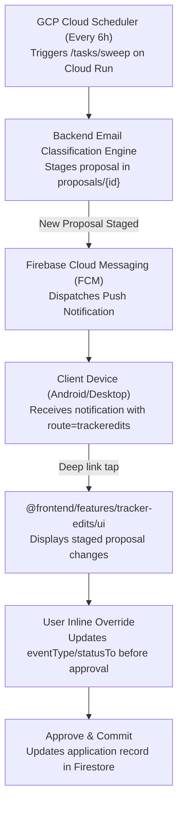

# Architecture Plan: Firebase Cloud Messaging (FCM) Push Notifications & Proposal Review Overrides

**Status:** Completed  
**Date:** 2026-11-20  
**Target:** `records` and `frontend` (cross-subsystem)  
**Harness:** Antigravity  
**Model:** gemini-3.8-flash  
**Session:** abbfb0e8-5323-4b16-ab25-0ca4d047341d  

---

## 1. Executive Summary & Goals

This plan coordinates the end-to-end architecture for real-time notification and human-in-the-loop override of email parsing and status classification:

1. **The Problem:** Email rules are evolving and subject to false positives (such as conditional guidance *"if you are not selected"* being interpreted as an immediate `REJECT`). When GCP Cloud Run performs unattended sweeps, status changes should not occur blindly without user visibility.
2. **The Solution:**
   - **GCP Cloud Run:** When new email proposals are staged during routine sweeps, dispatch an FCM push notification summarizing the pending changes.
   - **Client Apps (Android / Desktop):** Receive the push notification and deep-link directly into the review screen (`JobApplicationEditsRoute`).
   - **`@frontend/features/tracker-edits/ui`:** Provide inline override controls allowing the user to correct the event type or status transition on individual change items before approving.

---

## 2. Architecture & Subsystem Plan Delegation



This cross-subsystem plan links to two dedicated subsystem plans:
- **Records Proto Contract:** Defined in [`records/proto/src/main/proto/tracker/notification.proto`](../../records/proto/src/main/proto/tracker/notification.proto).
- **Backend Subsystem Plan:** [`backend/.agents/plans/2026-11-20/145500_backend-fcm-push-notifications.md`](../../backend/.agents/plans/2026-11-20/145500_backend-fcm-push-notifications.md)  
  *Covers device token registration endpoint, Firebase Admin SDK messaging, and sweep integration.*
- **Frontend Subsystem Plan:** [`frontend/.agents/plans/2026-11-20/145500_frontend-fcm-and-proposal-override-ui.md`](../../frontend/.agents/plans/2026-11-20/145500_frontend-fcm-and-proposal-override-ui.md)  
  *Covers token exchange, notification handling, and inline editing controls in `TrackerEditsScreen`.*

---

## 3. Data & Communication Contracts

### Protobuf Specification (`records/proto/src/main/proto/tracker/notification.proto`)
The notification payload and device registration contracts are strictly defined in `records/proto`:
```protobuf
syntax = "proto3";

package tracker;

import "google/protobuf/timestamp.proto";
import "tracker/enums.proto";

option java_package = "dev.fnc314.aijobtracker.records";
option java_multiple_files = true;

enum TopLevelDestination {
  TOP_LEVEL_DESTINATION_UNSPECIFIED = 0;
  APPLICATIONS = 1;
  COMPANIES = 2;
  APPLY = 3;
  EDITS = 4;
  SETTINGS = 5;
}

enum DevicePlatform {
  DEVICE_PLATFORM_UNSPECIFIED = 0;
  DEVICE_PLATFORM_ANDROID = 1;
  DEVICE_PLATFORM_IOS = 2;
  DEVICE_PLATFORM_DESKTOP = 3;
  DEVICE_PLATFORM_WEB = 4;
}

message DeviceRegistration {
  string deviceId = 1;
  string token = 2;
  DevicePlatform platform = 3;
  google.protobuf.Timestamp updatedAt = 4;
}

message DeviceHeartbeat {
  string deviceId = 1;
  DevicePlatform platform = 2;
  string make = 3;                  // e.g. "Google", "Apple", "Samsung"
  string model = 4;                 // e.g. "Pixel 8 Pro", "MacBookPro18,1"
  string osVersion = 5;             // e.g. "Android 15", "macOS 15.1"
  string appVersion = 6;
  string targetProposalId = 7;
  google.protobuf.Timestamp timestamp = 8;
}

message TrackerNotificationPayload {
  TopLevelDestination destination = 1;  // Strongly typed destination enum
  string route = 2;                     // Fallback string route identifier (e.g. "trackeredits")
  string proposalId = 3;                // Target proposal ID
  string title = 4;                     // Notification title
  string body = 5;                      // Human-readable message body
  int32 stagedChangesCount = 6;         // Count of staged change items
  TrackerEventType dominantEventType = 7;
  TrackerStatus targetStatus = 8;
  google.protobuf.Timestamp dispatchedAt = 9;
}
```

### Device Registration Document (`users/{userId}/devices/{deviceId}`)
```json
{
  "token": "dGhpcy1pcy1hbi1mY20tdG9rZW4...",
  "platform": "ANDROID",
  "updatedAt": "2026-11-20T19:50:00Z"
}
```

### Push Notification Payload
```json
{
  "notification": {
    "title": "Job Tracker: Staged Email Updates",
    "body": "3 new status transitions staged from recent emails"
  },
  "data": {
    "route": "trackeredits",
    "proposalId": "ba6b7784-2ebf-480f-b628-42af1e535ee7",
    "changeCount": "3"
  }
}
```

---

## 4. Implementation Stages

| Stage | Subsystem | Action | Verification |
| :--- | :--- | :--- | :--- |
| **Stage 1** | `backend` | Implement `POST /api/notifications/register-device` & `NotificationDispatchService` | Unit test token retrieval & mock FCM message delivery |
| **Stage 2** | `backend` | Wire `NotificationDispatchService` into `/tasks/sweep` in Cloud Run | Deploy revision and verify logs on sweep with staged proposals |
| **Stage 3** | `frontend` | Implement Android `FirebaseMessagingService` & token registration on sign-in | Verify device token written to Firestore |
| **Stage 4** | `frontend` | Enhance `TrackerEditsScreen` with inline edit modal for changing proposed transitions | Manual UI test & unit test `EditProposedChangeUseCase` |

---

## 5. Verification Plan

1. **Automated Verification:**
   - `./gradlew :backend:service:test`
   - `./gradlew :frontend:features-tracker-edits-domain:test`
   - `./gradlew :frontend:features-tracker-edits-ui:compileKotlinJvm`
2. **Manual & Cloud Verification:**
   - Run `mise run remote:sweep` with a staged proposal and verify an FCM notification reaches the registered device.
   - Tap notification on Android/Desktop emulator $\to$ verify it launches directly to `JobApplicationEditsRoute`.
   - In `TrackerEditsScreen`, edit a change item from `REJECT` to `ACKNOWLEDGE`, tap Approve, and verify the application status in Firestore is preserved.
