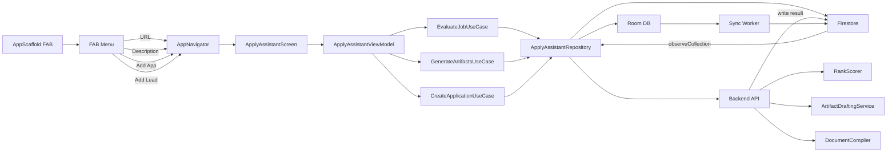

# Requirements

### Overview & Goals
Extend the `/apply` workflow from the agent CLI to the Android app. Users will tap a FAB (promoted from the list screen to the global `AppScaffold`) to open an expanded input form where they provide a job posting URL or raw text. The form then navigates to the chat-style interface for fit evaluation and optional artifact generation — all within the app.

### Scope

**In Scope:**
- New `features/apply-assistant/` module (data/domain/ui layers)
- FAB replaced across all screens with an M3 FAB Menu in `AppScaffold` in `apps/core` (globally available)
- FAB Menu actions: "Job Posting URL", "Job Description", "Add Application", "Add Lead"
- Chat-style interface: fit evaluation → yes/no follow-ups (input is collected in the bottom sheet before navigation)
- Backend `/applications/apply` route (existing stub in `ApplicationRoutes.kt`): Replace with `RankScorer` for fit evaluation + Gemini Flash-Lite for CV/cover letter drafting
- Backend `/artifacts/create` route for artifact generation with configurable model
- Room-based conversation state with background Firestore sync
- New `RANKED` TrackerStatus for evaluated-but-not-submitted postings
- Auto-creation of JobApplication record in tracker when evaluation completes
- Generated artifacts presented as clickable download links in chat
- PDF preview via existing `artifact-previewer` feature

**Out of Scope:**
- On-device LLM inference (impractical for long-form CV drafting)
- Cross-platform (iOS/Desktop) — Android-only for this phase
- Real-time streaming of AI responses (batch responses only)
- Multi-tenant support (personal tool)

### User Stories
1. As a job seeker, I want to paste a job URL or posting text into the app so I can evaluate fit without leaving the app.
2. As a job seeker, I want to see a fit score and breakdown (skills, experience, behavioral, career) so I can decide whether to apply.
3. As a job seeker, I want to generate a tailored CV and cover letter with one tap so I can submit them.
4. As a job seeker, I want to download generated PDFs so I can submit them to the job portal.
5. As a job seeker, I want evaluated postings tracked automatically so I don't lose them.

### Functional Requirements
- **Input Form**: The FAB opens an M3 FAB Menu with actions: "Job Posting URL" and "Job Description". Tapping an action navigates to the apply-assistant chat screen with the appropriate input mode pre-selected. Secondary actions "Add Application" and "Add Lead" are also available in the menu.
- **Evaluation**: Backend returns `RankResult` (fit score, strengths, gaps, deal-breakers) instantly via `RankScorer`
- **Chat Flow**: After evaluation, the app asks "Generate assets?" (Yes/No). If Yes, generates CV + cover letter. Then asks "Did you submit?" (Yes/No). Yes → SUBMITTED status, No → DRAFTING status
- **Artifacts**: Generated as LaTeX → PDF via backend `/compiler/compile`, returned as downloadable links
- **Tracking**: On evaluation completion, auto-create JobApplication record with RANKED status and fit score

### Non-Functional Requirements
- **Budget**: $0 — all AI via free-tier generative model (Flash-Lite), all evaluation via deterministic RankScorer
- **Performance**: Fit evaluation < 1 second (deterministic). Artifact generation < 30 seconds (AI + LaTeX compilation)
- **Offline**: Fit evaluation works offline using cached RankScorer logic. Artifact generation requires network.
- **Resilience**: Artifact generation must survive device rotation, app backgrounding, and process death. Generated artifacts are delivered via Firestore listeners so the user receives them regardless of app state at completion.


# Technical Design

### Current Implementation
- **Frontend**: Compose Multiplatform, Navigation 3, MVI architecture, feature-based modularization (`features/*/data`, `features/*/domain`, `features/*/ui`), Koin DI
- **Backend**: Ktor service in `backend/service/` with routes registered in `Main.kt` under `ApiKeyAuthPlugin`:
  - `/jobs/rank` — `RankingRoutes.kt`, calls `RankScorer.evaluate(text)` and returns `RankResult`
  - `/applications/apply` — `ApplicationRoutes.kt`, **stub** returning hardcoded JSON (`{"status":"SUCCESS","fitScore":85,...}`)
  - `/compiler/compile` — `CompilerRoutes.kt`, calls `DocumentCompilerService.compileLatex()` for LaTeX→PDF
  - `/jobs/scrape` — `ScrapingRoutes.kt`, stub for job scraping
- **FAB**: Currently in `JobApplicationsListScreen` as a dropdown menu with "Add Application" and "Add Lead"
- **AppScaffold**: In `apps/core`, renders TopAppBar, bottom nav/rail, but no FAB
- **TrackerStatus**: Sealed interface with Known enum (LEAD, DRAFTING, APPLIED, INTERVIEW, etc.). Proto enum in `records/proto/src/main/proto/tracker/v1/enums.proto`
- **RankScorer**: Deterministic keyword-based evaluation in `backend/job-post-ranking/`. Returns `RankResult` with overall score, verdict, strengths, gaps, deal-breakers
- **DocumentCompilerService**: LaTeX→PDF compilation in `backend/artifact-compilation/`

### Key Decisions

1. **M3 FAB Menu in AppScaffold**: Replace the FAB in `JobApplicationsListScreen` and add a new FAB to `AppScaffold` in `apps/core`. The FAB shows on all top-level destinations (Applications, Companies, Edits). Tapping the FAB opens an M3 FAB Menu with actions: "Job Posting URL", "Job Description", "Add Application", and "Add Lead". Tapping "Job Posting URL" or "Job Description" navigates to the apply-assistant chat screen with the appropriate input mode pre-selected.

2. **RankScorer for evaluation, AI for drafting**: Fit evaluation uses the existing deterministic `RankScorer` (instant, free, no API calls). CV/cover letter drafting uses a free-tier generative model via backend (free tier, quality output). This separates the instant evaluation from the slower AI drafting.

3. **Replace `/applications/apply` stub**: The existing `ApplicationRoutes.kt` contains a stub `POST /applications/apply` that returns hardcoded JSON (`{"status":"SUCCESS","fitScore":85,...}`). Replace it with real `RankScorer.evaluate()` call, following the pattern in `RankingRoutes.kt`. Accepts `{url? | text, title?, company?}`. Returns `RankResult` immediately. A separate `/artifacts/create` endpoint handles CV/cover letter generation asynchronously.

4. **Async artifact generation with Firestore delivery**: The `/artifacts/create` endpoint returns immediately with a job ID (HTTP 202). The backend processes the job (AI drafting + LaTeX compilation) in the background, then writes the result (PDF URLs, status) to a Firestore document in an `artifact_jobs` collection. The app observes this collection via the existing `RemoteDataSource.observeCollection()` pattern. When the job completes, the Firestore listener updates the chat UI with the artifact links — even if the app was backgrounded or killed during generation.

5. **RANKED status**: New TrackerStatus between LEAD and DRAFTING. Represents a posting that has been evaluated (has an outcome and fit score) but not yet submitted. Auto-created when the user completes the evaluation step.

6. **Room + Firestore hybrid**: Conversation state stored in Room for UI responsiveness. Background worker syncs to Firestore (`apply_sessions` collection) for cross-device persistence. JobApplication record created in tracker on evaluation completion. Artifact generation state (job ID, status) is stored in Room so the chat screen can restore on process death and reconnect to the Firestore listener.

7. **Chat as simple message list**: Not a full chat framework — a `LazyColumn` of message bubbles (user input, system evaluation, yes/no prompts, artifact links). State managed by ViewModel with MVI pattern. The ViewModel collects from both Room (for restoration) and Firestore listeners (for real-time artifact delivery).

### Proposed Changes

#### Backend Changes
1. **Replace `/applications/apply` stub** in `ApplicationRoutes.kt`: The current implementation returns hardcoded JSON. Replace with `RankScorer.evaluate(text)` call, following the pattern in `RankingRoutes.kt`. Accepts `{url? | text, title?, company?}`. Returns `RankResult` with company/role extraction.
2. **New `/artifacts/create` route** in `backend/service/`: Accepts `RankResult` + candidate profile context. Returns HTTP 202 with a job ID immediately. The backend launches a background coroutine that calls the AI client to generate CV + cover letter LaTeX, compiles via `DocumentCompilerService`, then writes the result (PDF URLs, status) to Firestore in an `artifact_jobs` collection.
3. **Generative model client** in `backend/`: New module `backend/ai-client/` with `ArtifactDraftingService` public interface for AI calls. Configurable model parameter. Internal implementation hides the provider name from the public surface.
4. **Wire `ArtifactRoutes` into `Main.kt`**: Register the new `/artifacts/create` route under the `ApiKeyAuthPlugin`-protected section, alongside existing routes.
5. **Firestore artifact job writer**: New service in `backend/service/` that writes artifact job results to Firestore. Uses the existing Firebase Admin SDK (already configured for the tracker).

#### Frontend Changes
1. **New `features/apply-assistant/` module** with data/domain/ui layers:
   - `data/`: `ApplyAssistantRepository`, Room DAO for conversation state, Firestore listener for artifact job results via `RemoteDataSource.observeCollection()`
   - `domain/`: `EvaluateJobUseCase`, `GenerateArtifactsUseCase`, `CreateApplicationUseCase`
   - `ui/`: Chat screen, ViewModel (MVI), message bubble composables, URL/text input
2. **AppScaffold FAB with M3 FAB Menu**: Add FAB to `AppScaffold.kt` that opens an M3 FAB Menu. The menu contains actions: "Job Posting URL", "Job Description", "Add Application", and "Add Lead". Tapping an action navigates to the appropriate destination.
3. **Remove FAB from JobApplicationsListScreen**: Remove the FAB and dropdown menu from `JobApplicationsListScreen.kt` since the FAB is now global in `AppScaffold`.
3. **Navigation**: New `ApplyAssistantRoute` in `apply-assistant/ui/`, registered in `App.kt` entry provider.
4. **TrackerStatus**: Add `RANKED` to proto enum and frontend `TrackerStatus.Known` enum.
5. **AppNavigator**: Add `navigateToApplyAssistant(url: String?)` and `navigateToApplyAssistant(description: String?)` methods to pass the initial input.
6. **ViewModel resilience**: `ApplyAssistantViewModel` collects from Room on initialization to restore any in-progress artifact generation. It also subscribes to the Firestore `artifact_jobs` collection listener to receive completion events in real-time.

### Data Models / Contracts

#### Backend API Contracts
```
POST /applications/apply (existing stub, to be replaced)
Body: { "url": "https://..." } | { "text": "...", "title": "...", "company": "..." }
Response: RankResult (existing model)

POST /artifacts/create (NEW, async)
Body: { "rankResult": RankResult, "postingText": "...", "model": "gemini-2.0-flash-lite" }
Response (HTTP 202): { "job_id": "...", "status": "ACCEPTED" }
Firestore: artifact_jobs/{job_id} document updated with { "cv_pdf_url": "...", "cover_letter_pdf_url": "...", "status": "SUCCESS" | "FAILED" }
```

#### Room Entities
```
ApplySession(id, postingUrl, postingText, company, role, rankResult, 
             cvArtifactId, coverLetterArtifactId, trackerApplicationId,
             artifactJobId, artifactJobStatus,  // For async generation tracking
             status, createdAt, updatedAt)

ApplyMessage(id, sessionId, type [USER_INPUT, EVALUATION, PROMPT, ARTIFACT_LINK, SYSTEM], 
             content, timestamp)
```

#### TrackerStatus Addition
```
Proto: RANKED = 13;  // Posting evaluated, fit score recorded, not yet submitted
Frontend: RANKED(displayName="Ranked", wireKey="RANKED", wireTag=13)
- isTerminal: false
- isActive: true  
- sectionOrder: 2  // Grouped with DRAFTING/LEAD
```

### File Structure

```
backend/
  ai-client/ (internal implementation — public facade hides provider name)
    build.gradle.kts
    src/main/kotlin/.../artifactdrafting/
      ArtifactDraftingService.kt (public facade)
      impl/AiClientImpl.kt (internal — hides provider name)
      impl/AiModels.kt (internal)
  service/
    src/main/kotlin/.../routes/
      ApplicationRoutes.kt (MODIFIED — replace stub with RankScorer)
      ArtifactRoutes.kt (NEW)
    src/main/kotlin/.../ArtifactJobWriter.kt (NEW — writes job results to Firestore)
    src/main/kotlin/.../Main.kt (MODIFIED — register ArtifactRoutes)
  settings.gradle.kts (MODIFIED — add ai-client module)
  service/build.gradle.kts (MODIFIED — add ai-client dependency)

frontend/
  features/apply-assistant/
    data/
      build.gradle.kts
      src/commonMain/kotlin/.../applyassistant/data/
        di/ApplyAssistantDataModule.kt
        repository/ApplyAssistantRepository.kt
        repository/impl/ApplyAssistantRepositoryImpl.kt
        source/LocalApplyAssistantDataSource.kt
        source/NetworkApplyAssistantDataSource.kt
        source/RemoteApplyAssistantDataSource.kt
        source/impl/LocalApplyAssistantDataSourceImpl.kt
        source/impl/NetworkApplyAssistantDataSourceImpl.kt
        source/impl/RemoteApplyAssistantDataSourceImpl.kt
        room/ApplySessionDao.kt
        room/ApplyMessageDao.kt
        room/entity/ApplySessionEntity.kt
        room/entity/ApplyMessageEntity.kt
    domain/
      build.gradle.kts
      src/commonMain/kotlin/.../applyassistant/domain/
        di/ApplyAssistantDomainModule.kt
        repository/ApplyAssistantDomainRepository.kt
        usecase/EvaluateJobUseCase.kt
        usecase/GenerateArtifactsUseCase.kt
        usecase/CreateApplicationUseCase.kt
        usecase/impl/*
    ui/
      build.gradle.kts
      src/commonMain/kotlin/.../applyassistant/ui/
        ApplyAssistantScreen.kt
        ApplyAssistantViewModel.kt
        ApplyAssistantUiState.kt
        ApplyAssistantUiIntent.kt
        ApplyAssistantNavigation.kt
        ApplyAssistantEntryRegistry.kt
        component/
          ChatMessageBubble.kt
          ApplyInputPanel.kt
          YesNoPrompt.kt
          ArtifactLink.kt
      src/commonMain/composeResources/values/strings.xml
  apps/core/
    src/commonMain/kotlin/.../app/core/ui/
      AppScaffold.kt (MODIFIED — add FAB with M3 FAB Menu)
    src/commonMain/kotlin/.../app/core/
      App.kt (MODIFIED — register ApplyAssistantEntryRegistry)
  core/data/
    src/commonMain/kotlin/.../data/model/
      TrackerStatus.kt (MODIFIED — add RANKED)
  core/navigation/
    src/commonMain/kotlin/.../navigation/
      AppNavigator.kt (MODIFIED — add navigateToApplyAssistant with parameters)
  features/job-applications-list/ui/
    src/commonMain/kotlin/.../jobapplicationslist/ui/
      JobApplicationsListScreen.kt (MODIFIED — remove FAB and dropdown)

records/
  proto/src/main/proto/tracker/v1/
    enums.proto (MODIFIED — add RANKED status)
```

### Architecture Diagram



### Risks
- **AI free tier rate limits**: Flash-Lite has daily request caps. CV + cover letter drafting may consume significant tokens. Mitigation: cache generated artifacts, allow re-use.
- **URL fetching**: The backend needs to fetch job posting content from URLs. Some sites block automated requests. Mitigation: user can paste text directly as fallback.
- **LaTeX compilation**: Backend compilation requires LaTeX installed. Mitigation: the existing `DocumentCompilerService` already handles this.
- **Room schema migration**: Adding new entities requires a Room migration. Mitigation: new entities with auto-migration support.
- **Firestore listener lifecycle**: The `observeCollection()` listener must be properly managed to avoid memory leaks. Mitigation: use `repeatOnLifecycle(STARTED)` in ViewModel, with `awaitClose` in the callbackFlow.
- **Backend background coroutine lifecycle**: If the backend process restarts during artifact generation, the in-flight job is lost. Mitigation: the backend could persist job state to Firestore before starting, and a recovery mechanism could re-queue orphaned jobs. For the initial implementation, accept that backend restarts during generation are rare and will result in a FAILED status.
- **Firestore free tier costs**: Each artifact generation writes one document to Firestore. Within free tier limits for occasional use (~1 write per session).


# Testing

### Validation Approach
Validate each layer independently: domain use cases with mocked repositories, UI with mocked ViewModels, backend routes with test HTTP client.

### Key Scenarios
1. **URL input → fit evaluation**: User pastes URL, receives `RankResult` with score, strengths, gaps in chat
2. **Text input → fit evaluation**: User pastes raw posting text, same evaluation flow
3. **Generate assets → Yes**: User confirms, backend returns job ID, chat shows "generating..." state
4. **Generate assets → No**: User declines, conversation ends, record stays RANKED
5. **Did you submit? → Yes**: Record moves to SUBMITTED status
6. **Did you submit? → No**: Record stays DRAFTING
7. **Auto-tracker creation**: After evaluation, JobApplication record exists in tracker with RANKED status and fit score
8. **Config change survival**: Room-backed state survives rotation/process death
9. **FAB from all top-level screens**: FAB appears on Applications, Companies, and Edits screens
10. **FAB Menu actions**: FAB opens M3 FAB Menu with URL, Description, Add Application, and Add Lead actions
11. **Pre-selected input mode**: After tapping an action, the chat screen receives the input mode and displays the appropriate input field
12. **Artifact generation during rotation**: User triggers generation, rotates device — generation continues, result appears in chat after rotation
13. **Artifact generation during app background**: User triggers generation, backgrounds app — Firestore listener delivers result when app foregrounds
14. **Artifact generation during process death**: User triggers generation, process is killed — on app restart, chat restores from Room, Firestore listener reconnects and delivers result
15. **Artifact generation failure**: Backend fails — Firestore writes FAILED status, chat shows error message with retry option

### Edge Cases
- Empty or invalid URL
- AI API rate limit hit (graceful error message in chat)
- Backend unavailable (offline fallback: show cached evaluations only)
- Very long job posting text (token limit handling)
- Duplicate evaluation of the same posting (idempotency)
- Artifact generation failure (partial success — CV ok, cover letter failed)
- Firestore listener disconnected (network loss during generation) — retry on reconnect
- Multiple artifact jobs in flight (user triggers generation twice) — only the latest job's result is used
- Stale artifact job (job completed before app restart) — Room contains the result, no Firestore listener needed

### Test Changes
- **Domain tests**: `EvaluateJobUseCaseTest`, `GenerateArtifactsUseCaseTest`, `CreateApplicationUseCaseTest` (JUnit5 + MockK + coroutines-test)
- **UI tests**: `ApplyAssistantScreenTest` (Compose Testing — verify message bubbles, input modes, yes/no prompts)
- **UI tests**: `ApplyAssistantFabMenuTest` (Compose Testing — verify FAB Menu actions, navigation to correct destinations)
- **Backend tests**: `ApplyRoutesTest`, `ArtifactRoutesTest` (Ktor test client)
- **Konsist tests**: Verify `apply-assistant` module follows feature architecture conventions
- **TrackerStatus tests**: Update `EnumLogicTest` to cover RANKED status
- **Test naming**: `` `given [precondition] when [action] then [expected result]` `` convention


# Delivery Steps

###   Step 1: Add RANKED status and replace `/applications/apply` stub
Add the RANKED TrackerStatus to the proto enum and frontend model, then replace the existing `/applications/apply` stub with RankScorer integration.
- Add `RANKED = 13` to `records/proto/src/main/proto/tracker/v1/enums.proto`
- Add `RANKED` to `frontend/core/data/.../TrackerStatus.kt` (displayName, wireKey, wireTag, sectionOrder=2, isActive=true, isTerminal=false)
- Update `EnumLogicTest.kt` with RANKED coverage
- Replace `ApplicationRoutes.kt` stub: wire `RankScorer.evaluate(text)` instead of hardcoded JSON response in `POST /applications/apply`, following the pattern in `RankingRoutes.kt`
- Add `navigateToApplyAssistant()` to `AppNavigator.kt` and `AppNavigatorImpl.kt`
- Run `mise run records:build` to regenerate proto classes

###   Step 2: Create features/apply-assistant module skeleton and data layer
Create the new feature module with data/domain/ui layers following existing conventions.
- Create `features/apply-assistant/data/`, `domain/`, `ui/` modules with `build.gradle.kts` files
- Create Room entities: `ApplySessionEntity.kt`, `ApplyMessageEntity.kt`
- Create DAOs: `ApplySessionDao.kt`, `ApplyMessageDao.kt`
- Create `ApplyAssistantRepository` interface and `ApplyAssistantRepositoryImpl`
- Create `LocalApplyAssistantDataSource` (Room), `NetworkApplyAssistantDataSource` (HTTP to backend), and `RemoteApplyAssistantDataSource` (Firestore sync)
- Create `ApplyAssistantDataModule.kt` (Koin DI)
- Add only `featuresApplyAssistantUi` as a dependency to `apps/core/build.gradle.kts`. Transitive dependencies will automatically pull in `domain` and `data` layers. The custom Gradle project collections plugin auto-discovers new feature modules, so `settings.gradle.kts` does not need to be touched

###   Step 3: Implement domain use cases and Firestore sync
Create the domain layer with use cases for evaluation, artifact generation, and tracker integration.
- Create `EvaluateJobUseCase` — calls backend `/applications/apply`, stores result in Room
- Create `GenerateArtifactsUseCase` — calls backend `/artifacts/create`, stores artifact refs in Room
- Create `CreateApplicationUseCase` — creates JobApplication record in tracker with RANKED status and fit score
- Create `ApplyAssistantDomainRepository` interface
- Create background sync worker (Room → Firestore) for `apply_sessions` collection
- Create `ApplyAssistantDomainModule.kt` (Koin DI)
- Add domain tests: `EvaluateJobUseCaseTest`, `CreateApplicationUseCaseTest`

###   Step 4: Build chat UI and ApplyAssistantRoute with input mode
Create the chat-style interface with MVI architecture, and update navigation to accept input mode.
- Create `ApplyAssistantScreen.kt` with `LazyColumn` message list
- Create `ApplyAssistantViewModel.kt` (MVI: UiState, UiIntent, effects)
- Create `ApplyInputPanel.kt` with URL/text toggle input (inside the chat screen, pre-selected based on FAB Menu action)
- Create `ChatMessageBubble.kt` composable (user, evaluation, prompt, artifact link types)
- Create `YesNoPrompt.kt` composable for follow-up questions
- Create `ArtifactLink.kt` composable with clickable PDF download
- Create `ApplyAssistantNavigation.kt` with `ApplyAssistantRoute(inputMode: InputMode)` carrying the input mode as parameter
- Create `ApplyAssistantEntryRegistry` and register in `App.kt` entry provider and navigation saved state config
- Add string resources to `composeResources/values/strings.xml`
- ViewModel pre-selects input mode based on route parameter

###   Step 5: Add M3 FAB Menu to AppScaffold and integrate async artifact drafting backend
Replace the FAB across all screens with an M3 FAB Menu in AppScaffold, remove the old FAB, add async artifact drafting client to backend with Firestore delivery, and wire everything together.
- Modify `AppScaffold.kt` to include FAB that opens an M3 FAB Menu with actions: "Job Posting URL", "Job Description", "Add Application", "Add Lead"
- Remove FAB and dropdown menu from `JobApplicationsListScreen.kt` entirely
- Update `AppNavigator.kt` with `navigateToApplyAssistant(inputMode: InputMode)` method
- Update `AppNavigatorImpl.kt` to pass input mode to `ApplyAssistantRoute`
- Create `backend/ai-client/` module with `ArtifactDraftingService` public facade and internal implementation
- Create `backend/service/.../routes/ArtifactRoutes.kt` with `POST /artifacts/create` endpoint (async, HTTP 202 response)
- Create `backend/service/.../ArtifactJobWriter.kt` to write job results to Firestore `artifact_jobs` collection
- Register `ArtifactRoutes` in `Main.kt` under `ApiKeyAuthPlugin`-protected section
- Wire `ArtifactDraftingService` into artifact generation flow (internal implementation provides the actual AI calls)
- Add `ai-client` to `backend/settings.gradle.kts` and `backend/service/build.gradle.kts`
- Add string resources for FAB Menu actions to `apps/core composeResources`
- Integration test: FAB → FAB Menu → chat with pre-selected input mode → evaluation → async artifacts → Firestore delivery → tracker record