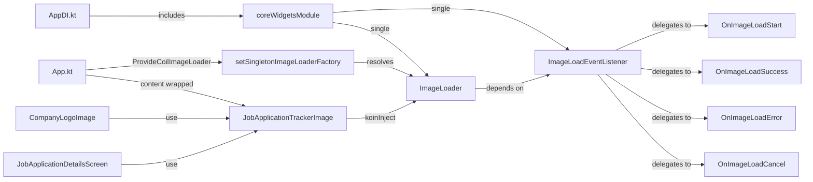

# Requirements

### Overview & Goals
Configure Coil 3 as a centrally managed, Koin-injected image loading subsystem with observability hooks. All image loading within the app should flow through a single wrapper composable (`JobApplicationTrackerImage`) in `core/widgets`, making it easy to monitor, extend, and control image loading behavior.

### Scope

**In Scope:**
- Create a Koin DI module in `core/widgets` that registers a configured `ImageLoader` singleton
- Define 4 framework-agnostic `fun interface` callbacks (`OnImageLoadStart`, `OnImageLoadSuccess`, `OnImageLoadError`, `OnImageLoadCancel`) for fine-grained observability
- Define a unified `ImageLoadEventListener` interface that aggregates the 4 callbacks
- Create a `DefaultImageLoadEventListener` class that accepts the 4 callbacks and satisfies `ImageLoadEventListener` via delegation
- Create a `ProvideCoilImageLoader` app-level wrapper composable (following the `JobTrackerTheme`/`ProvideWindowSizeClass` pattern) that configures Coil's singleton
- Create a `JobApplicationTrackerImage` composable in `core/widgets` that wraps all image loading
- Migrate existing `AsyncImage` usages (`CompanyLogoImage.kt`, `JobApplicationDetailsScreen.kt`) to use `JobApplicationTrackerImage`
- Wire `coreWidgetsModule` into `AppDI.kt`

**Out of Scope:**
- Disk cache customization beyond Coil defaults
- Platform-specific image decoders or custom fetchers
- Analytics integration (the listener interfaces are provided but no concrete analytics impl)

# Technical Design

### Current Implementation
- Coil 3.6.3 is used via `libs.bundles.coil` (coil-compose, coil-core, coil-network-ktor3)
- `core/widgets` is the only module with a direct Coil dependency; `features/job-application-details/ui` gets it transitively
- Two places use `AsyncImage` directly: `CompanyLogoImage.kt` and `JobApplicationDetailsScreen.kt`
- No custom `ImageLoader` is configured — Coil's default singleton is used
- Koin DI follows the pattern `val *Module: Module = module { ... }` in `di/` packages, assembled in `AppDI.kt`
- `core/widgets` has no DI module yet and no `local.dependencies.di` plugin
- App-level wrappers (`JobTrackerTheme`, `ProvideWindowSizeClass`) are composable functions that wrap content

### Key Decisions
1. **`ImageLoader` as Koin singleton** — registered in a new `coreWidgetsModule` so it's testable, configurable, and inspectable via Koin
2. **`ProvideCoilImageLoader` wrapper composable** — follows the `JobTrackerTheme`/`ProvideWindowSizeClass` pattern; calls `setSingletonImageLoaderFactory` at the app root so all `AsyncImage` calls (including those in libraries) use the configured loader
3. **4 `fun interface` callbacks** — `OnImageLoadStart(url: String)`, `OnImageLoadSuccess(url: String, durationMs: Long)`, `OnImageLoadError(url: String, throwable: Throwable)`, `OnImageLoadCancel(url: String)`. Each is a `fun interface` so callers can pass lambda expressions directly. No "Coil" in any name to minimize framework coupling.
4. **`ImageLoadEventListener` unified interface** — exposes the 4 lifecycle methods. Used by the `ImageLoader` configuration internally.
5. **`DefaultImageLoadEventListener` class** — accepts one of each `OnImageLoad*` callback in its constructor and delegates each `ImageLoadEventListener` method to the corresponding callback. Provides no-op defaults for each callback via default lambda parameters.
6. **`JobApplicationTrackerImage` composable** — the single public image loading API; injects the `ImageLoader` via Koin; delegates to `AsyncImage`
7. **`core/widgets` as the ownership boundary** — all Coil configuration and image loading lives here; feature modules depend on `core/widgets` and never import Coil directly

### Proposed Changes

**1. `core/widgets/build.gradle.kts`** — Add `local.dependencies.di` plugin

**2. New: `core/widgets/.../di/CoreWidgetsModule.kt`**
- 4 `fun interface` declarations:
  - `fun interface OnImageLoadStart { operator fun invoke(url: String) }`
  - `fun interface OnImageLoadSuccess { operator fun invoke(url: String, durationMs: Long) }`
  - `fun interface OnImageLoadError { operator fun invoke(url: String, throwable: Throwable) }`
  - `fun interface OnImageLoadCancel { operator fun invoke(url: String) }`
- `ImageLoadEventListener` interface with methods:
  - `fun onLoadStart(url: String)`
  - `fun onLoadSuccess(url: String, durationMs: Long)`
  - `fun onLoadError(url: String, throwable: Throwable)`
  - `fun onLoadCancel(url: String)`
- `class DefaultImageLoadEventListener` accepting the 4 callbacks as constructor params with default no-op lambdas, and delegating each method to the corresponding callback
- `coreWidgetsModule: Module` that registers:
  - `single<ImageLoadEventListener> { DefaultImageLoadEventListener() }`
  - `single<ImageLoader> { createImageLoader(context, get()) }` where `createImageLoader` builds the loader with `DebugLogger` and the event listener

**3. New: `core/widgets/.../CoilImageLoaderProvider.kt`**
- `@Composable fun ProvideCoilImageLoader(content: @Composable () -> Unit)` — calls `setSingletonImageLoaderFactory { context -> koinInject<ImageLoader>() }` and wraps `content`

**4. New: `core/widgets/.../JobApplicationTrackerImage.kt`**
- `@Composable fun JobApplicationTrackerImage(model: Any?, contentDescription: String?, modifier: Modifier = Modifier, contentScale: ContentScale = ContentScale.Fit, onState: (AsyncImagePainter.State) -> Unit = {})`
- Injects `ImageLoader` via `koinInject`; passes it to `AsyncImage(imageLoader = ...)`
- Delegates all parameters through to `AsyncImage`

**5. `core/widgets/.../CompanyLogoImage.kt`** — Replace `AsyncImage` with `JobApplicationTrackerImage`

**6. `features/job-application-details/ui/.../JobApplicationDetailsScreen.kt`** — Replace `AsyncImage` with `JobApplicationTrackerImage` (imported via `core/widgets`)

**7. `apps/core/.../di/AppDI.kt`** — Include `coreWidgetsModule` in `appModule`

**8. `apps/core/.../App.kt`** — Wrap content with `ProvideCoilImageLoader` inside `JobTrackerTheme`

### Architecture Diagram

### File Structure

| Status | File |
|--------|------|
| Modified | `frontend/core/widgets/build.gradle.kts` |
| Added | `frontend/core/widgets/src/commonMain/kotlin/dev/fnc314/tools/jobtracker/core/widgets/di/CoreWidgetsModule.kt` |
| Added | `frontend/core/widgets/src/commonMain/kotlin/dev/fnc314/tools/jobtracker/core/widgets/CoilImageLoaderProvider.kt` |
| Added | `frontend/core/widgets/src/commonMain/kotlin/dev/fnc314/tools/jobtracker/core/widgets/JobApplicationTrackerImage.kt` |
| Modified | `frontend/core/widgets/src/commonMain/kotlin/dev/fnc314/tools/jobtracker/core/widgets/CompanyLogoImage.kt` |
| Modified | `frontend/features/job-application-details/ui/src/commonMain/kotlin/dev/fnc314/tools/jobtracker/features/jobapplicationdetails/ui/JobApplicationDetailsScreen.kt` |
| Modified | `frontend/apps/core/src/commonMain/kotlin/dev/fnc314/tools/jobtracker/app/core/di/AppDI.kt` |
| Modified | `frontend/apps/core/src/commonMain/kotlin/dev/fnc314/tools/jobtracker/app/core/App.kt` |
| Modified | `frontend/core/widgets/README.md` |

# Delivery Steps

### ✓ Step 1: Add DI module, event listener, and ImageLoader singleton to core/widgets
Create the Koin DI infrastructure in `core/widgets` for Coil configuration.
- Add `local.dependencies.di` plugin to `frontend/core/widgets/build.gradle.kts`
- Create `CoreWidgetsModule.kt` in `core/widgets/.../di/` with:
  - 4 `fun interface` callbacks: `OnImageLoadStart`, `OnImageLoadSuccess`, `OnImageLoadError`, `OnImageLoadCancel`
  - `ImageLoadEventListener` unified interface aggregating the 4 lifecycle methods
  - `DefaultImageLoadEventListener` class accepting the 4 callbacks and delegating to them
  - `coreWidgetsModule` registering `ImageLoadEventListener` and `ImageLoader` (with `DebugLogger` and Ktor3 network)
- Create `CoilImageLoaderProvider.kt` with `ProvideCoilImageLoader` composable that calls `setSingletonImageLoaderFactory`
- Create `JobApplicationTrackerImage.kt` composable that injects `ImageLoader` and delegates to `AsyncImage`
- Wire `coreWidgetsModule` into `AppDI.kt` `appModule`
- Wrap `App.kt` content with `ProvideCoilImageLoader` inside `JobTrackerTheme`

### ✓ Step 2: Migrate existing AsyncImage usages to JobApplicationTrackerImage
Replace all direct `AsyncImage` calls with `JobApplicationTrackerImage` to centralize image loading.
- Update `CompanyLogoImage.kt` to use `JobApplicationTrackerImage` instead of `AsyncImage`; remove direct `coil3.compose` imports
- Update `JobApplicationDetailsScreen.kt` to use `JobApplicationTrackerImage` instead of `AsyncImage`; remove direct `coil3.compose` imports
- Update `core/widgets/README.md` to document the new components and DI module
- Verify compilation with `./gradlew :frontend:core-widgets:compileCommonMainKotlinMetadata` and `./gradlew :frontend:apps:core:compileKotlinMetadata`