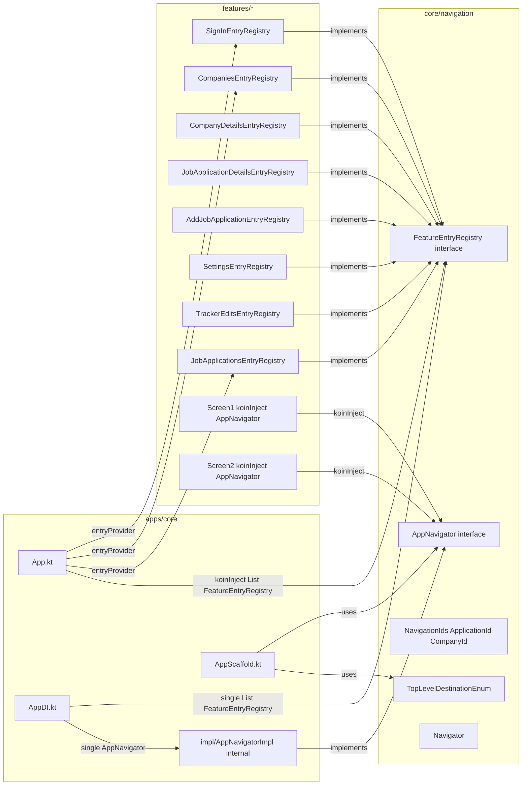

# Implementation Plan: App Navigator Refactoring

**Status:** Draft  
**Date:** 2026-11-11  
**Target:** `frontend`  
**Harness:** Junie  
**Model:** GPT-6.1 Terra  
**Session:** session-261111-101632-rjw4  
**Supersedes:** [Initial Company Profile Navigation Plan](./company-profile-navigation.md)  

---

## 1. Executive Summary & Goals

Refactor the navigation layer to replace the callback-heavy `FeatureNavigationHook` pattern with a clean `AppNavigator` interface injected via Koin. This enables feature screens to navigate declaratively via dependency injection rather than receiving navigation callbacks through composable parameters.

**Goals:**
- Introduce `AppNavigator` interface in `core/navigation` for type-safe, DI-based navigation.
- Replace `FeatureNavigationHook` with `FeatureEntryRegistry` for feature entry registration.
- Add `ApplicationId` and `CompanyId` as `@JvmInline` value classes for type safety.
- Rename all app routes with `JobApplication*` prefix for consistency.
- Simplify `CompanyDetailsRoute` to `companyId` only (remove `companyName`, `website`).
- Create `TopLevelDestinationEnum` for bottom nav selection state.
- Update `AppScaffold` to use enum-based selection instead of Route type checks.
- Ensure all `*Impl` classes are `internal` and in `.impl` package per Konsist rules.

**Out of Scope:**
- Changes to ViewModel business logic.
- Changes to Screen composables beyond navigation callback removal.
- Multi-platform specific navigation adapters.
- Authentication flow changes beyond `login()`/`logout()` methods.

### User Stories
- As a feature developer, I want to navigate to another feature's screen by injecting `AppNavigator` so that I don't need to thread callbacks through my UI layer.
- As a feature developer, I want to register my feature's navigation entries via Koin so that `core/navigation` doesn't depend on `features/`.
- As a developer, I want type-safe IDs (`ApplicationId`, `CompanyId`) so that I can't accidentally pass the wrong ID type.
- As a developer, I want a finite `TopLevelDestinationEnum` so that bottom nav selection is type-safe and extensible.
- As a developer, I want consistent `JobApplication*` route naming so that all app routes are clearly identifiable.

### Non-Functional Requirements
- `core/*` modules must never depend on `features/*` modules.
- Navigation must use standard Navigation 3 backstack behavior (push/pop).
- The `AppNavigator` interface must be testable (mockable) in feature tests.
- All `*Impl` classes must be `internal` and in `.impl` package per Konsist architecture tests.

## 2. Architecture & Design Principles

### Current Implementation

**Navigation Pattern:** `App.kt` uses `entryProvider` with 8 `*NavHook` functions. Each hook factory returns a `FeatureNavigationHook` (a `fun interface`) that registers entries and receives navigation callbacks (e.g., `onApplicationClick`, `onCompanyClick`, `onNavigateBack`) as lambda parameters. This creates a deep callback chain through composables.

**Key Files:**
- `core/navigation/FeatureNavigationHook.kt` — `fun interface` with `invoke(scope, navigator)`
- `core/navigation/Navigator.kt` — wrapper around `NavBackStack` with `navigate()`, `popBackStack()`, `popToRoot()`, `switchRoot()`
- `core/navigation/TopLevelDestination.kt` — interface with properties and `companion.from()` factory
- `core/navigation/NavKey.kt` — app-wide route contract extending `AndroidxNavKey`
- `apps/core/App.kt` — 217 lines; `entryProvider` block with all 8 nav hooks and callback wiring
- `apps/core/ui/AppScaffold.kt` — 264 lines; Route type checks (`is ListRoute`, etc.) for selection and title
- 8 feature `*Navigation.kt` files — route definitions and `*NavHook` factory functions
- 8 feature DI modules — `*FeatureModule` combining data/domain/ui modules

**Konsist Constraints:**
- `*Impl` classes must be `internal` and in `.impl` package
- Feature domain code must not import `.data.` or `.ui.` packages
- Data source interfaces and implementations must be `internal`

### Key Design Decisions

1. **AppNavigator as Koin singleton**: Interface in `core/navigation`, implementation (`AppNavigatorImpl`) in `apps/core/impl/`. Features inject via `koinInject<AppNavigator>()`. Keeps implementation in the app layer. Implementation is `internal` per Konsist rules.

2. **FeatureEntryRegistry for entry registration**: `core/navigation` defines the interface with `register(scope: EntryProviderScope)`. Each feature implements and registers as a Koin `single`. `App.kt` collects all registries from Koin. Eliminates `FeatureNavigationHook` while respecting the core-can't-depend-on-features constraint.

3. **JvmInline value classes**: `ApplicationId` and `CompanyId` provide type safety and prevent passing the wrong ID type. Used in `AppNavigator.navigateTo*` methods.

4. **CompanyDetailsRoute simplification**: Only `companyId` required. `companyName` and `website` removed since `CompanyDetailsViewModel` loads them from the repository.

5. **TopLevelDestination enum**: Finite enum (Applications, Companies, Edits, Settings) replaces Route type checks in `AppScaffold`. The existing `TopLevelDestination` interface is kept for icon/label metadata.

6. **login/logout with switchRoot**: `logout()` calls `switchRoot(SignInRoute)`, `login()` calls `switchRoot(JobApplicationListRoute)`. Both clear the backstack to prevent back navigation between auth states.

7. **Consistent route naming**: All routes prefixed with `JobApplication*` to indicate they belong to the job tracker app domain. `SignInRoute` remains unchanged as it's a generic auth destination.

### Architecture Diagram



## 3. Proposed Changes & Implementation Steps

### Step 1: core/navigation — New Types

**New file: `AppNavigator.kt`**
```kotlin
public interface AppNavigator {
    fun navigateToApplicationDetails(applicationId: ApplicationId)
    fun navigateToCompanyDetails(companyId: CompanyId)
    fun navigateTo(topLevelDestination: TopLevelDestinationEnum)
    fun navigateToSettings()
    fun login()
    fun logout()
    fun popBackStack()
}
```

**New file: `NavigationIds.kt`**
```kotlin
@JvmInline public value class ApplicationId(public val value: String)
@JvmInline public value class CompanyId(public val value: String)
```

**New file: `FeatureEntryRegistry.kt`**
```kotlin
public interface FeatureEntryRegistry {
    fun register(scope: EntryProviderScope<PlatformNavKey>)
}
```

**New file: `TopLevelDestinationEnum.kt`**
```kotlin
public enum class TopLevelDestinationEnum(
    public val route: NavKey,
    public val labelRes: StringResource,
    public val selectedIcon: ImageVector,
    public val unselectedIcon: ImageVector,
    public val contentDescriptionRes: StringResource,
) {
    Applications(...),
    Companies(...),
    Edits(...),
    Settings(...);
}
```

**Delete: `FeatureNavigationHook.kt`**

**Update: `build.gradle.kts`** — Add `alias(libs.plugins.local.dependencies.koin)` plugin to enable Koin core.

### Step 2: apps/core — AppNavigator Implementation

**New file: `impl/AppNavigatorImpl.kt`** (in `apps/core/impl/` package, marked `internal` per Konsist rules)
```kotlin
internal class AppNavigatorImpl(
    private val backStack: NavBackStack<PlatformNavKey>,
) : AppNavigator {
    override fun navigateToApplicationDetails(applicationId: ApplicationId) {
        backStack.add(JobApplicationDetailRoute(applicationId.value))
    }
    override fun navigateToCompanyDetails(companyId: CompanyId) {
        backStack.add(JobApplicationCompanyDetailsRoute(companyId.value))
    }
    override fun navigateTo(topLevelDestination: TopLevelDestinationEnum) {
        backStack.add(topLevelDestination.route)
    }
    override fun navigateToSettings() {
        backStack.add(JobApplicationSettingsRoute)
    }
    override fun login() {
        backStack.clear()
        backStack.add(JobApplicationListRoute)
    }
    override fun logout() {
        backStack.clear()
        backStack.add(SignInRoute)
    }
    override fun popBackStack() {
        if (backStack.size > 1) backStack.removeLastOrNull()
    }
}
```

**Update: `AppDI.kt`** — Add `navigationModule` providing `AppNavigatorImpl` as a Koin `single`.

### Step 3: Each Feature — FeatureEntryRegistry Implementation

Each feature creates a `FeatureEntryRegistry` implementation and registers it as a Koin `single`:

```kotlin
internal class JobApplicationDetailsEntryRegistry : FeatureEntryRegistry {
    override fun register(scope: EntryProviderScope<PlatformNavKey>) {
        scope.entry<JobApplicationDetailRoute> { key ->
            JobApplicationDetailsScreen(
                applicationId = key.applicationId,
                onNavigateBack = { koinInject<AppNavigator>().popBackStack() },
            )
        }
    }
}
```

DI module:
```kotlin
single<FeatureEntryRegistry> { JobApplicationDetailsEntryRegistry() }
```

### Step 4: apps/core — App.kt Rewrite

**Update: `App.kt`** — Replace `entryProvider` block:
```kotlin
val entryRegistries = koinInject<List<FeatureEntryRegistry>>()
entryProvider {
    entryRegistries.forEach { it.register(this) }
}
```

Remove all `*NavHook` imports and callback wiring.

### Step 5: Route Renames

| Current | New |
|---------|-----|
| `ListRoute` | `JobApplicationListRoute` |
| `CompaniesListRoute` | `JobApplicationCompaniesRoute` |
| `CompanyDetailsRoute` | `JobApplicationCompanyDetailsRoute(id: CompanyId)` |
| `DetailRoute` | `JobApplicationDetailRoute` |
| `SettingsRoute` | `JobApplicationSettingsRoute` |
| `EditsRoute` | `JobApplicationEditsRoute` |
| `AddApplicationRoute` | `JobApplicationAddApplicationRoute` |
| `AddLeadRoute` | `JobApplicationAddLeadRoute` |
| `SignInRoute` | `SignInRoute` (unchanged) |

All references in `App.kt`, `AppScaffold.kt`, and feature modules must be updated.

### Step 6: CompanyDetailsRoute Simplification

**Update: `JobApplicationCompanyDetailsRoute`** — Remove `companyName` and `website`:
```kotlin
@Serializable
public data class JobApplicationCompanyDetailsRoute(
    public val companyId: String,
) : NavKey {
    @Transient
    override val titleRes: StringResource = Res.string.company_details_title
}
```

`AppScaffold` will use the generic `titleRes` for Company Details instead of `companyName`.

### Step 7: AppScaffold Updates

**Update: `AppScaffold.kt`** — Replace Route type checks with `TopLevelDestinationEnum` matching. Use the enum for bottom nav items and selection state.

### Files Modified

| File | Change |
|------|--------|
| `frontend/core/navigation/build.gradle.kts` | Add Koin plugin |
| `frontend/core/navigation/FeatureNavigationHook.kt` | **Deleted** |
| `frontend/core/navigation/AppNavigator.kt` | **New** — AppNavigator interface |
| `frontend/core/navigation/NavigationIds.kt` | **New** — JvmInline value classes |
| `frontend/core/navigation/FeatureEntryRegistry.kt` | **New** — Entry registration interface |
| `frontend/core/navigation/TopLevelDestinationEnum.kt` | **New** — Finite TLD enum |
| `frontend/apps/core/App.kt` | Rewrite entryProvider, use AppNavigator |
| `frontend/apps/core/AppScaffold.kt` | Use TopLevelDestinationEnum, rename routes |
| `frontend/apps/core/di/AppDI.kt` | Add navigationModule with AppNavigatorImpl |
| `frontend/apps/core/impl/AppNavigatorImpl.kt` | **New** — internal AppNavigator implementation |
| `frontend/features/job-applications-list/ui/JobApplicationsListNavigation.kt` | Rename route, create EntryRegistry |
| `frontend/features/companies-list/ui/CompaniesListNavigation.kt` | Rename route, create EntryRegistry |
| `frontend/features/company-details/ui/CompanyDetailsNavigation.kt` | Simplify route, create EntryRegistry |
| `frontend/features/job-application-details/ui/JobApplicationDetailsNavigation.kt` | Create EntryRegistry |
| `frontend/features/settings/ui/SettingsNavigation.kt` | Rename route, create EntryRegistry |
| `frontend/features/tracker-edits/ui/TrackerEditsNavigation.kt` | Rename route, create EntryRegistry |
| `frontend/features/add-job-application/ui/AddJobApplicationNavigation.kt` | Rename routes, create EntryRegistry |
| `frontend/features/sign-in/ui/SignInNavigation.kt` | Create EntryRegistry |
| All feature DI modules | Add FeatureEntryRegistry single |

### Risks
- **Backstack serialization**: Renaming routes may break saved backstack state. `SavedStateConfiguration` must be updated. Users may see a navigation reset.
- **CompanyDetailsRoute title**: Removing `companyName` means `AppScaffold` shows generic "Company Details" until the ViewModel loads.
- **FeatureEntryRegistry ordering**: Entry registration order may matter if routes conflict. Unlikely given current structure but should be documented.
- **Konsist test compliance**: All `*Impl` classes must be `internal` and in `.impl` package. The `AppNavigatorImpl` must follow this convention.

## 4. Verification Plan & Testing Checklist

- [ ] Verify `frontend:build` compiles successfully after all changes.
- [ ] Verify `frontend:detekt` passes with no new violations.
- [ ] Verify `frontend:konsist` passes with no new violations (especially `*Impl` in `.impl` package).
- [ ] Verify navigation flows: Application List → Application Details → Company Details → (back) → Application Details.
- [ ] Verify bottom nav bar selection state uses `TopLevelDestinationEnum` correctly.
- [ ] Verify `login()` and `logout()` clear the backstack and switch roots correctly.
- [ ] Verify `AppNavigator` is injectable in feature tests via Koin mock.
- [ ] Verify `CompanyDetailsScreen` loads company data correctly with `companyId`-only route.
- [ ] Verify `SavedStateConfiguration` uses renamed route class names.
- [ ] Run `frontend:test` to ensure existing ViewModel tests pass without changes.

## 5. Bookkeeping
- [ ] Plan persisted at `frontend/.agents/plans/2026-11-11/105449_app-navigator-refactoring.md`
- [ ] Registry `frontend/.agents/plans/README.md` row added / status synchronized
- [ ] Craft a single commit of all changed files
- [ ] Stage changed files and craft a commit message based on the name of this file
- [ ] Push `git push origin main`