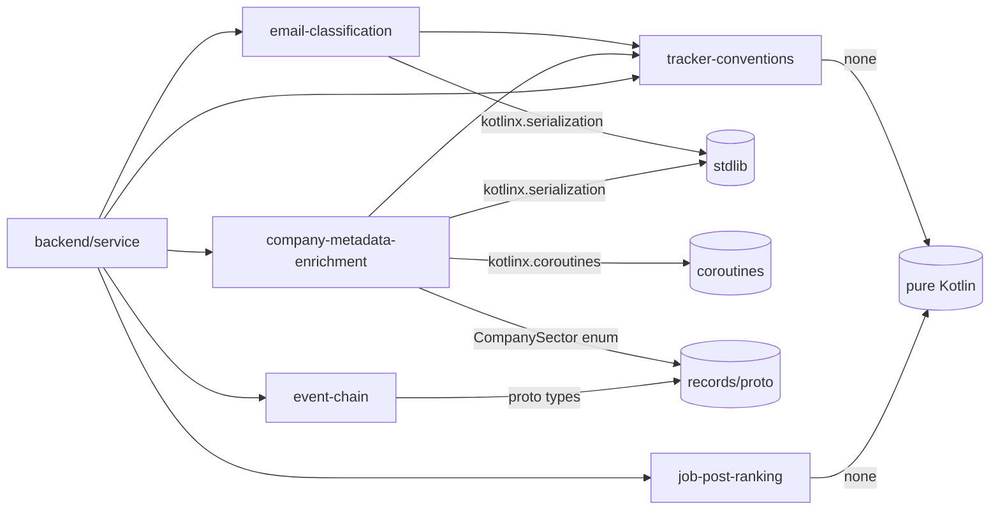

# Implementation Plan: Extract Deterministic AI-Flow Processes into Standalone Libraries

**Status:** Proposed  
**Date:** 2026-11-12  
**Target:** `records`, `backend` (cross-subsystem)  
**Harness:** Junie  
**Model:** Qwen/Qwen3.6-27B-FP8  
**Depends On:** [`185800_deterministic-fit-score-unification.md`](./2026-11-12/185800_deterministic-fit-score-unification.md)  

---

## 1. Executive Summary & Goals

The `185800_deterministic-fit-score-unification` plan successfully extracted `RankScorer` into `backend/job-post-ranking/` as a standalone library. This plan identifies **all other deterministic, idempotent processes** embedded in AI command flows that can be similarly packaged as isolated Kotlin libraries.

The goal is to catalog every pure-function process currently living in `records/parser/` that AI commands (`/apply`, `/gmail-sync`, `/outcome`, `/scrape`, `/rank`) rely on — and determine which ones should be extracted into their own Gradle modules under `backend/`, following the `job-post-ranking` pattern. This extends the amount of work UIs can perform locally without being coupled to AI flows or the backend service.

### Key Objectives
1. **Catalog** all deterministic processes in `records/parser/` used by AI flows
2. **Assess** each for extraction readiness (pure functions, no framework deps, test coverage)
3. **Propose** which processes to extract into standalone `backend/` modules
4. **Define** the module boundaries and inter-module dependencies
5. **Address** proto availability, Hunter.io packaging, proto scoping, and naming concerns

### Scope

**In Scope:**
- Inventory of deterministic processes in `records/parser/`
- Assessment of extraction readiness per process
- Proposal of new `backend/` modules with clear boundaries
- Module dependency map
- Proto availability strategy for extracted modules
- Hunter.io API integration as a standalone package
- Proto definition scoping analysis
- Naming corrections (ProposalClassifier → EmailClassifier)

**Out of Scope:**
- Actual implementation (this is a planning/cataloging exercise)
- Modifying AI command workflows
- Frontend UI changes

## 2. Current State: Deterministic Processes in `records/parser/`

The following pure Kotlin processes live in `records/parser/` and are used by AI command flows. Each is idempotent, well-tested, and framework-agnostic.

### 2.1 DocumentIdGenerator

**Location:** `records/parser/src/main/kotlin/.../parser/DocumentIdGenerator.kt` (173 lines)  
**Tests:** `DocumentIdGeneratorTest.kt`  
**Used by:** `/outcome`, `/apply`, `/gmail-sync`, `/rank` (via `mise run tracker` CLI)  
**What it does:** Derives canonical company slugs and application document IDs from free-form names. Strips corporate suffixes, stop words, expands contractions, applies alias resolution (e.g. `meta-platforms` → `meta`).  
**Dependencies:** None (pure Kotlin, `java.text.Normalizer` only)  
**Extraction readiness:** ✅ High — pure functions, no framework deps, comprehensive tests

### 2.2 ProposalClassifier

**Location:** `records/parser/src/main/kotlin/.../parser/ProposalClassifier.kt` (280 lines)  
**Tests:** `ProposalClassifierTest.kt`  
**Used by:** `/gmail-sync` Step 3d (email classification)  
**What it does:** Classifies email messages into event types (REJECT, OFFER, SCHEDULE_INTERVIEW, ASSESS, ACKNOWLEDGE, RECRUITER_OUTREACH) using regex patterns. Matches messages to applications via company name matching.  
**Dependencies:** `kotlinx.serialization` (for `@Serializable` data classes), `DocumentIdGenerator` (for company matching)  
**Extraction readiness:** ✅ High — pure regex matching, no framework deps

### 2.3 StatusNormalizer

**Location:** `records/parser/src/main/kotlin/.../parser/StatusNormalizer.kt` (154 lines)  
**Tests:** None (but trivially testable)  
**Used by:** `/outcome`, TUI, CLI (status normalization and ranking)  
**What it does:** Normalizes legacy/human-entered status strings to canonical Firestore status keys. Provides status rank ordering and terminal state detection.  
**Dependencies:** None (pure Kotlin, lookup tables)  
**Extraction readiness:** ✅ High — pure lookup tables, no framework deps

### 2.4 UrlSanitizer

**Location:** `records/parser/src/main/kotlin/.../parser/UrlSanitizer.kt` (134 lines)  
**Tests:** `UrlSanitizerTest.kt`  
**Used by:** `/scrape`, `/apply`, `/gmail-sync` (URL cleaning)  
**What it does:** Strips tracking, click IDs, referral sources, and telemetry query parameters from URLs. Preserves functional parameters (e.g. `gh_jid`).  
**Dependencies:** None (pure Kotlin, `java.net.URI` only)  
**Extraction readiness:** ✅ High — pure functions, no framework deps

### 2.5 CompanySectorNormalizer

**Location:** `records/parser/src/main/kotlin/.../parser/CompanySectorNormalizer.kt` (217 lines)  
**Tests:** `CompanySectorNormalizerTest.kt`  
**Used by:** `/apply` evaluation, `/rank` (sector alignment)  
**What it does:** Maps company slugs to canonical `CompanySector` enum values (FinTech, Healthcare, Tech, etc.). Fallback for companies where Hunter.io returns no data.  
**Dependencies:** `tracker.v1.CompanySector` proto enum  
**Extraction readiness:** ⚠️ Medium — depends on proto enum. Could be extracted if the enum is moved to a shared module or the normalizer uses its own enum.

### 2.6 EventChainBuilder / EventChainVerifier

**Location:** `records/parser/src/main/kotlin/.../parser/EventChainBuilder.kt` (123 lines), `EventChainVerifier.kt` (77 lines)  
**Tests:** `EventChainBuilderTest.kt`  
**Used by:** `/outcome`, backend (cryptographic event hash chains)  
**What it does:** Constructs and verifies SHA-256 hash chains for tamper-evident event timelines. Blockchain pattern for immutable tracker logs.  
**Dependencies:** `tracker.v1.TrackerEvent` proto message, `tracker.v1.TrackerStatus` proto enum  
**Extraction readiness:** ⚠️ Medium — depends on proto messages. Could be extracted if the proto types are in a shared module.

### 2.7 Already Extracted: RankScorer

**Location:** `backend/job-post-ranking/` (extracted by the previous plan)  
**Tests:** `RankScorerTest.kt`, `ScoringWeightsTest.kt`  
**Used by:** `/rank` (via CLI), `RankCommand.kt`  
**Status:** ✅ Already done. Serves as the reference pattern.

### 2.8 UuidGenerator — What it does

**Location:** `records/parser/src/main/kotlin/.../parser/UuidGenerator.kt` (77 lines)  
**Tests:** `UuidGeneratorTest.kt`  
**Used by:** `/outcome`, `/apply`, backend (document ID generation for new records)  
**What it does:** Generates and validates UUIDv7 (RFC 9562) identifiers. UUIDv7 carries a 48-bit millisecond timestamp in its high bits, so the textual form sorts in creation order — critical for Firestore document IDs that need chronological ordering. Provides three operations:
- `newUuid()` — generates a local UUIDv7 (manual construction for JVM compatibility, not relying on Java 20+ built-in support)
- `isUuid(value)` — validates canonical lowercase UUIDv7 format (version nibble = 7, variant = RFC 4122)
- `uuidTimestamp(value)` — extracts the millisecond timestamp from a UUIDv7

**Dependencies:** None (pure Kotlin, `java.util.UUID`, `java.security.SecureRandom`)  
**Extraction readiness:** ✅ High — pure functions, no framework deps. Small enough to include in `tracker-conventions` alongside `DocumentIdGenerator`.

### 2.9 Not Candidates for Extraction

The following are **not** good candidates because they depend on framework-specific types or are tightly coupled to the tracker data model:

| Process | Reason |
|---------|--------|
| `ApplicationTimelineProjector` | Depends on proto `TrackerApplication` and Firestore projection logic |
| `ArtifactMetadata` | Tied to GCS artifact storage |
| `CompanyMetricsParser` | Depends on Hunter.io API response parsing — **will be replaced by `company-metadata-enrichment` package** |
| `EventNoteRenderer` | Depends on proto event types and rendering templates |
| `InterviewProgress` | Depends on proto interview round types |
| `JPypeBridge` | Python interop bridge (RM-001 target) |
| `JobApplicationEventBuilder` | Depends on proto event types |
| `JobApplicationStatus` | Depends on proto status enum |
| `LegacyRowProjector` | CSV-to-Firestore migration logic |
| `ProtoWireContracts` | Proto conversion utilities |
| `TrackerCache` | In-memory cache for tracker documents |
| `TimestampConverter` | Proto timestamp conversion |

## 3. Addressing User Questions

### 3.1 Proto Availability — What do we need to do for `proto` to be available as necessary?

**Current state:** `records/proto/` is a single Gradle module (`:records-proto`) that compiles all 17 `.proto` files into Kotlin classes under `dev.fnc314.tools.jobsearch.tracker.v1`. Consumers access it via `includeBuild("../records")` in their `settings.gradle.kts` (used by `frontend/` and `backend/`).

**The problem for extracted modules:** If `backend/email-classification/` or `backend/event-chain/` need proto types, they currently cannot depend on `:records-proto` directly because `backend/` is a separate Gradle composite build from `records/`. The only way to access proto types is via `includeBuild("../records")` in `backend/settings.gradle.kts` — but `backend/settings.gradle.kts` currently does not include this.

**Options:**

**Option A: Add `includeBuild("../records")` to `backend/settings.gradle.kts`** (Recommended)
- Simplest change. Proto types become available to any `backend/` sub-module via `implementation(projects.recordsProto)`.
- This is already how `frontend/` consumes proto types.
- Drawback: `backend/` becomes coupled to the `records/` build. If `records/` fails to build, `backend/` cannot build.

**Option B: Publish `records-proto` to a local Maven repo**
- `records/proto` already has `maven-publish` configured in `records/build.gradle.kts`.
- Run `cd records && ./gradlew :records-proto:publishToMavenLocal` to publish.
- `backend/` modules depend on `dev.fnc314.tools.jobsearch.records:records-proto:1.0.0`.
- Drawback: Requires explicit publish step. Version drift between published proto and source proto.

**Option C: Duplicate the needed proto types as plain Kotlin data classes**
- For modules that need only a few proto types (e.g., `CompanySector` enum), duplicate them as plain Kotlin `enum class` in the extracted module.
- Drawback: Duplication, divergence risk. Only viable for small types.

**Recommendation:** Use **Option A** for modules that need proto types (`event-chain`, `company-metadata-enrichment`). Use **Option C** for modules that need only a single enum (`CompanySectorNormalizer` if extracted). Pure modules (`tracker-conventions`, `email-classification`) need no proto access.

**Action required:**
- Add `includeBuild("../records")` to `backend/settings.gradle.kts`
- Modules needing proto add `implementation(projects.recordsProto)` in their `build.gradle.kts`

### 3.2 Hunter.io as `company-metadata-enrichment` Package

**Current state:** Hunter.io integration is embedded directly in `BackendService.kt` as three private methods:
- `fetchHunterCompanyInfo(website: String)` — HTTP GET to `api.hunter.io/v2/companies/find`, parses JSON response into a `Map<String, Any?>`
- `enrichCompany(...)` — 20+ optional parameters, writes to Firestore (non-destructive merge)
- `batchEnrichCompanies()` — iterates all companies, credit-aware (45 calls max), skips recently enriched

**The problem:** The Hunter.io logic is tightly coupled to `BackendService` and Firestore. The HTTP call + JSON parsing is a pure function that could be extracted. The Firestore write logic is framework-bound.

**Proposed `backend/company-metadata-enrichment/` module:**

```
company-metadata-enrichment/
  src/main/kotlin/
    dev/fnc314/tools/jobtracker/enrichment/
      HunterClient.kt          — HTTP client for Hunter.io API
      HunterCompanyInfo.kt     — Data class for Hunter.io response
      CompanyEnricher.kt       — Pure function: HunterCompanyInfo → enrichment result
      CompanySectorResolver.kt — Sector resolution from Hunter.io data
```

**`HunterClient` interface:**
```kotlin
interface HunterClient {
    suspend fun lookup(domain: String): HunterCompanyInfo?
}

class HunterHttpClient(private val apiKey: String) : HunterClient {
    override suspend fun lookup(domain: String): HunterCompanyInfo? { ... }
}
```

**`HunterCompanyInfo` data class:**
```kotlin
@Serializable
data class HunterCompanyInfo(
    val id: String?,
    val name: String?,
    val industry: String?,
    val subIndustry: String?,
    val sector: String?,
    val linkedinHandle: String?,
    val twitterHandle: String?,
    val crunchbaseHandle: String?,
    val logoUrl: String?,
    val description: String?,
    val foundedYear: Int?,
    val companyType: String?,
    val employees: String?,
    val employeesCount: Int?,
    val location: String?,
    val city: String?,
    val state: String?,
    val country: String?,
    val tags: List<String>?,
    val raised: Long?
)
```

**What this makes redundant:** `CompanySectorNormalizer` becomes a **fallback** for when Hunter.io returns no data. The normalizer's hardcoded `KNOWN_COMPANY_SECTORS` map (120+ entries) can be pruned to only cover companies that Hunter.io consistently misses. The `CompanySectorResolver` in the enrichment module will:
1. Try Hunter.io first (via `HunterClient`)
2. Fall back to `CompanySectorNormalizer` if Hunter.io returns empty
3. Return `CompanySector.TECH` as the ultimate default

**Dependencies:** `kotlinx.serialization`, `kotlinx.coroutines` (for `suspend`), `tracker-conventions` (for `DocumentIdGenerator.slug()`)

**Impact on `CompanySectorNormalizer`:** It becomes a secondary fallback, not the primary source. The hardcoded map can be reduced to ~20 entries for companies Hunter.io consistently misses (small startups, private companies). The keyword-based guessing rules stay intact.

### 3.3 Proto Definition Scoping — Is it worth breaking `records/proto` into scoped definitions?

**Current state:** All 17 proto files live in `tracker/v1/` under a single package `tracker.v1`. They are compiled by one Gradle task into one JAR. The files are:

| Proto File | Purpose | Size |
|------------|---------|------|
| `enums.proto` | All enums (TrackerStatus, InterviewType, etc.) | 360 lines |
| `application.proto` | JobApplication core record | 57 lines |
| `company.proto` | Company record + metrics | 78 lines |
| `event.proto` | TrackerEvent timeline entries | 32 lines |
| `fit_evaluation.proto` | TrackerFit, ScoringWeights | 28 lines |
| `artifact.proto` | GCS artifact metadata | ~30 lines |
| `compensation.proto` | Compensation ranges | ~30 lines |
| `contact.proto` | Contact person records | ~30 lines |
| `counters.proto` | Event counters | ~20 lines |
| `edit.proto` | Edit lifecycle | ~30 lines |
| `interview.proto` | Interview rounds | ~40 lines |
| `location.proto` | Location details | ~20 lines |
| `scraped_posting.proto` | Scraped job postings | 40 lines |
| `sync_request.proto` | Sync operations | ~30 lines |
| `timeline.proto` | Timeline projection | ~20 lines |
| `fit_evaluation.proto` | Fit scoring | 28 lines |
| `README.md` | Proto documentation | — |

**Analysis:** The proto files are already logically scoped by domain (application, company, event, etc.). However, they all share the same `java_package` and depend heavily on `enums.proto`. Breaking them into separate Gradle modules would:
- **Add complexity:** Each proto module needs its own `build.gradle.kts`, proto compilation config, and publish config
- **Provide minimal benefit:** The total proto code is ~900 lines. The compilation time is negligible
- **Create circular dependency risks:** `application.proto` imports 8 other proto files. Splitting them means each sub-module must depend on the others

**Recommendation: Do NOT split `records/proto` into separate Gradle modules.** The current single-module approach is the right balance. The proto files are already logically separated by file — that's sufficient scoping.

**What to do instead:** If a module needs only specific proto types (e.g., `event-chain` needs only `TrackerEvent` and `TrackerEventType`), it can still depend on the full `:records-proto` module. The unused types add no runtime cost — they're just compiled classes on the classpath. The Gradle dependency is resolved at build time, not runtime.

**Exception:** If `CompanySector` enum is needed by a module that should NOT depend on the full proto (e.g., a pure Kotlin library published independently), duplicate `CompanySector` as a plain Kotlin `enum class` in that module. This is Option C from section 3.1.

### 3.4 ProposalClassifier Naming — Is it an accurate name?

**Answer: No.** `ProposalClassifier` is a misnomer. The class processes **email contents**, not proposals. The name comes from the Python `proposals.py` module it mirrors, where "proposal" referred to "proposed status changes from email classification" — not job proposals or proposals in any business sense.

**What it actually does:**
1. **Classifies emails** into event types (REJECT, OFFER, SCHEDULE_INTERVIEW, ASSESS, ACKNOWLEDGE, RECRUITER_OUTREACH) using regex patterns
2. **Matches emails to applications** via company name matching
3. **Extracts company names** from outreach emails

**Recommended rename:** `EmailClassifier`

**Changes required:**
- Rename `ProposalClassifier.kt` → `EmailClassifier.kt`
- Rename `object ProposalClassifier` → `object EmailClassifier`
- Rename `ProposalClassifierTest.kt` → `EmailClassifierTest.kt`
- Update all import statements and references in:
  - `BackendService.kt` (if it references the classifier)
  - AI commands (`/gmail-sync`)
  - Any CLI commands
- Update `CLASSIFIERS` → `EMAIL_CLASSIFIERS` (or keep as `CLASSIFIERS` since it's scoped to the object)

**Data class renames (optional but recommended):**
- `ClassificationResult` → `EmailClassificationResult` (to distinguish from other classification domains)
- `StagedChange` → `StagedEmailChange`
- `SourceEmail` — keep as-is (already accurate)
- `UnmatchedMessage` → `UnmatchedEmail`
- `ClassifierRule` → `EmailClassifierRule`

**Recommendation:** Perform the rename during extraction to `backend/email-classification/`. The old name in `records/parser/` can be kept with `@Deprecated("Renamed to EmailClassifier", ReplaceWith("EmailClassifier"))` during a transition period, then removed.

### 3.5 UuidGenerator — Summary

See section 2.8 for full details. Short answer: **UUIDv7 generation and validation**. Generates timestamp-sortable identifiers for Firestore document IDs. Small enough to include in `tracker-conventions` alongside `DocumentIdGenerator`. Not worth extracting as its own module.

---

## 4. Proposed Module Structure

### 4.1 New Modules

Based on the analysis, the following new modules are proposed under `backend/`:

#### `backend/tracker-conventions/` — Slug, Status, URL Utilities

**Contents:**
- `DocumentIdGenerator` — Company slug and document ID generation
- `StatusNormalizer` — Status string normalization and ranking
- `UrlSanitizer` — URL tracking parameter stripping
- `UuidGenerator` — UUIDv7 generation and validation (timestamp-sortable IDs for Firestore)

**Rationale:** These four utilities are tightly related — they all normalize free-form input into canonical forms or generate canonical identifiers. They share no dependencies beyond pure Kotlin. Together they form a "conventions" library that any consumer can use to derive IDs, clean URLs, normalize statuses, and generate sortable document IDs.

**Isolation Boundary:** Pure input/output functions. If exposed behind a URL, each operation would be a separate endpoint:
- `POST /slug` → `{"name": "Meta Platforms, Inc."}` returns `{"slug": "meta"}`
- `POST /status/normalize` → `{"status": "interview"}` returns `{"canonical": "INTERVIEWING", "rank": 3}`
- `POST /url/clean` → `{"url": "..."}` returns `{"cleanUrl": "..."}`
- `GET /uuid` → returns `{"uuid": "..."}`

No state, no side effects. Each function is independently callable.

**Dependencies:** None (pure Kotlin)

**Consumers:** `/outcome`, `/apply`, `/gmail-sync`, `/rank`, CLI, frontend (for local ID derivation)

#### `backend/email-classification/` — Email Event Classification

**Contents:**
- `EmailClassifier` (renamed from `ProposalClassifier`) — Email-to-event-type classification
- `EmailClassificationResult`, `StagedEmailChange`, `SourceEmail`, `UnmatchedEmail`, `EmailClassifierRule`, `MatchResult` data classes

**Rationale:** Email classification is a self-contained pipeline: fetch emails → classify → match to applications → stage changes. The classifier is pure regex matching and could be used by any email integration (Gmail, Outlook, etc.) without depending on the tracker data model.

**Isolation Boundary:** Accepts raw email text and known application slugs; returns classified results. If exposed behind a URL:
- `POST /classify` → `{"subject": "...", "body": "...", "knownSlugs": [...]}` returns `{"eventType": "REJECT", "matchedSlug": "pnc", "confidence": 0.95}`
- `POST /batch-classify` → `{"emails": [...], "knownSlugs": [...]}` returns `{"results": [...], "unmatched": [...]}`

No state. The `tracker-conventions` dependency is only for slug matching, which could be replaced by passing pre-computed slugs in the input.

**Dependencies:** `kotlinx.serialization`, `tracker-conventions` (for `DocumentIdGenerator` used in company matching)

**Consumers:** `/gmail-sync`, backend email sync endpoint

#### `backend/company-metadata-enrichment/` — Hunter.io API Integration

**Contents:**
- `HunterClient` — Interface for Hunter.io API access
- `HunterHttpClient` — HTTP implementation of `HunterClient`
- `HunterCompanyInfo` — Data class for Hunter.io response
- `CompanySectorResolver` — Sector resolution: Hunter.io → CompanySectorNormalizer fallback → TECH default

**Rationale:** Hunter.io integration is currently embedded in `BackendService.kt` as inline HTTP calls and JSON parsing. Extracting it into a standalone package allows:
- Testing without Firestore
- Reuse by CLI, frontend, or other services
- Clear separation between API client logic and Firestore write logic
- `CompanySectorNormalizer` becomes a documented fallback, not the primary source

**Isolation Boundary:** Accepts a company domain or slug; returns enriched metadata. If exposed behind a URL:
- `POST /lookup` → `{"domain": "pnc.com"}` returns `{"name": "PNC", "sector": "FINTECH", "industry": "...", "employees": 19000}`
- `POST /sector/resolve` → `{"slug": "pnc"}` returns `{"sector": "FINTECH"}`

The `HunterClient` interface abstracts the HTTP layer, allowing the module to be tested with mock implementations. The `records-proto` dependency is only for the `CompanySector` enum, which defines the output format.

**Dependencies:** `kotlinx.serialization`, `kotlinx.coroutines` (for `suspend`), `tracker-conventions` (for `DocumentIdGenerator.slug()`), `records-proto` (for `CompanySector` enum via `includeBuild("../records")`)

**Consumers:** `backend/service` (replaces inline Hunter.io methods), CLI enrichment command

#### `backend/event-chain/` — Cryptographic Event Hash Chains

**Contents:**
- `EventChainBuilder` — Hash chain construction
- `EventChainVerifier` — Hash chain verification

**Rationale:** Event chain integrity is a cross-cutting concern used by both the backend service and any client that appends events. Extracting it allows UIs to verify chain integrity locally without calling the backend.

**Isolation Boundary:** Accepts a list of events and produces a hash chain; or accepts a hash chain and verifies its integrity. If exposed behind a URL, it would accept `{"events": [...]}` and return `{"chain": [...], "rootHash": "..."}` for building, or `{"chain": [...], "valid": true}` for verification. The proto dependency is only for the `TrackerEvent` message structure, which defines the input format.

**Dependencies:** Proto types (`TrackerEvent`, `TrackerStatus`) via `records-proto` (accessible via `includeBuild("../records")` in `backend/settings.gradle.kts`)

**Consumers:** `/outcome`, backend event-append endpoint, frontend (for local verification)

### 4.2 Module Dependency Graph



### 4.3 Updated `backend/settings.gradle.kts`

```
includeBuild("../records")

include(":service")
include(":job-post-ranking")
include(":tracker-conventions")
include(":email-classification")
include(":company-metadata-enrichment")
include(":event-chain")
```

## 5. Key Decisions

1. **Each module is an isolation boundary.** Design every extracted module as if it will be exposed behind a URL — a standalone service with a clear input/output contract. This means:
- Each module's public API is self-contained: no hidden dependencies on sibling modules
- Inputs are data classes or primitive types, not framework-specific types
- Outputs are data classes or sealed classes, not framework-specific types
- The module could be replaced by an HTTP call to a remote service without changing its callers
- This principle guides which processes are extractable and how their boundaries are drawn

2. **Extract only pure processes.** Processes that depend on proto types, Firestore, or framework-specific APIs stay in `records/parser/` unless the dependency can be abstracted. This keeps the extracted modules truly standalone.

3. **`tracker-conventions` as the foundation.** `DocumentIdGenerator`, `StatusNormalizer`, `UrlSanitizer`, and `UuidGenerator` are the most widely used utilities. Grouping them together reduces the number of modules and creates a natural dependency for other extracted modules.

4. **Proto dependency via `includeBuild`.** `backend/settings.gradle.kts` will add `includeBuild("../records")` to make proto types available to modules that need them (`company-metadata-enrichment`, `event-chain`). Pure modules (`tracker-conventions`, `email-classification`) need no proto access.

5. **`CompanySectorNormalizer` becomes a fallback.** With `company-metadata-enrichment` providing Hunter.io as the primary source, `CompanySectorNormalizer` is demoted to secondary fallback. The hardcoded map can be pruned to ~20 entries for companies Hunter.io consistently misses.

6. **`ProposalClassifier` renamed to `EmailClassifier`.** The old name is a misnomer inherited from Python `proposals.py`. The rename happens during extraction to `backend/email-classification/`.

7. **Do NOT split `records/proto` into separate Gradle modules.** The 17 proto files (~900 lines total) are already logically scoped by file. Splitting them adds complexity with minimal benefit. Modules that need specific proto types depend on the full `:records-proto` module.

8. **Follow the `job-post-ranking` pattern.** Each new module uses the same `build.gradle.kts` template: Kotlin JVM, `kotlinx.serialization`, `explicitApi()`, JVM 21 toolchain, `maven-publish` for local JAR export.

## 6. Delivery Steps

### ✓ Step 1: Create `backend/tracker-conventions/` Module
Extract `DocumentIdGenerator`, `StatusNormalizer`, `UrlSanitizer`, and `UuidGenerator` into a new pure Kotlin library module.

- Create `backend/tracker-conventions/build.gradle.kts` following the `job-post-ranking` template
- Move `DocumentIdGenerator.kt` and `ContractError` to `tracker-conventions/src/main/kotlin/`
- Move `StatusNormalizer.kt` to `tracker-conventions/src/main/kotlin/`
- Move `UrlSanitizer.kt` to `tracker-conventions/src/main/kotlin/`
- Move `UuidGenerator.kt` to `tracker-conventions/src/main/kotlin/`
- Migrate tests: `DocumentIdGeneratorTest.kt`, `UrlSanitizerTest.kt`, `UuidGeneratorTest.kt`; add `StatusNormalizerTest.kt`
- Update `backend/settings.gradle.kts` to include `:tracker-conventions`
- Update `records/parser/` to depend on `tracker-conventions` via `includeBuild` or keep copies with `@Deprecated` pointers

### ✓ Step 2: Create `backend/email-classification/` Module
Extract `ProposalClassifier` (renamed to `EmailClassifier`) and its data classes into a standalone email classification library.

- Create `backend/email-classification/build.gradle.kts`
- Move `ProposalClassifier.kt` (renamed to `EmailClassifier.kt`) and all data classes to `email-classification/src/main/kotlin/`
- Rename data classes: `ClassificationResult` → `EmailClassificationResult`, `StagedChange` → `StagedEmailChange`, `UnmatchedMessage` → `UnmatchedEmail`, `ClassifierRule` → `EmailClassifierRule`
- Add `implementation(projects.trackerConventions)` for `DocumentIdGenerator` used in company matching
- Migrate `ProposalClassifierTest.kt` (renamed to `EmailClassifierTest.kt`)
- Add `@Deprecated` annotation to the old `ProposalClassifier` in `records/parser/` with `ReplaceWith("EmailClassifier")`
- Update `backend/settings.gradle.kts` to include `:email-classification`

### ✓ Step 3: Create `backend/company-metadata-enrichment/` Module
Extract Hunter.io API integration from `BackendService.kt` into a standalone enrichment package.

- Create `backend/company-metadata-enrichment/build.gradle.kts`
- Create `HunterClient.kt` with interface and `HunterHttpClient` implementation
- Create `HunterCompanyInfo.kt` data class mirroring Hunter.io response fields
- Create `CompanySectorResolver.kt` with fallback chain: Hunter.io → CompanySectorNormalizer → TECH default
- Add `implementation(projects.trackerConventions)` for `DocumentIdGenerator.slug()`
- Add `implementation(projects.recordsProto)` for `CompanySector` enum (requires `includeBuild("../records")` in `backend/settings.gradle.kts`)
- Add `implementation(libs.kotlinx.coroutines.core)` for `suspend` support
- Add tests for `HunterHttpClient` (mock HTTP responses), `CompanySectorResolver` (fallback chain)
- Update `backend/settings.gradle.kts` to include `:company-metadata-enrichment` and add `includeBuild("../records")`
- Update `BackendService.kt` to use `HunterClient` instead of inline HTTP calls

### ✓ Step 4: Extract `event-chain/` and Verify Proto Access
Extract `EventChainBuilder/Verifier` now that `includeBuild("../records")` is available in `backend/`.

- Create `backend/event-chain/build.gradle.kts`
- Move `EventChainBuilder.kt` and `EventChainVerifier.kt` to `event-chain/src/main/kotlin/`
- Add `implementation(projects.recordsProto)` for `TrackerEvent`, `TrackerStatus` proto types
- Migrate `EventChainBuilderTest.kt`
- Update `backend/settings.gradle.kts` to include `:event-chain`
- Verify that proto types are accessible via the `includeBuild` composite build

### ✓ Step 5: Update AI Commands, CLI, and Bookkeeping
Update AI commands, CLI, and registry to reference the new modules.

- Update `/gmail-sync` command to note that `EmailClassifier` is available via `email-classification` module
- Update `/outcome` command to note that `DocumentIdGenerator` is available via `tracker-conventions` module
- Update `RankCommand.kt` if it uses any extracted utilities
- Register this plan in `.agents/plans/README.md`
- Update plan frontmatter to `Completed` after implementation
- Commit and push

## 7. Verification Plan & Testing Checklist

### Key Scenarios

**tracker-conventions:**
1. `DocumentIdGenerator.normalizeDirName("Meta Platforms, Inc.")` → `"meta"`
2. `StatusNormalizer.normalizeStatus("interview")` → `"INTERVIEWING"`
3. `UrlSanitizer.cleanUrl("https://example.com?utm_source=google&gh_jid=123")` → `"https://example.com?gh_jid=123"`
4. `UuidGenerator.newUuid()` produces valid UUIDv7 (passes `isUuid()` check)
5. `UuidGenerator.uuidTimestamp(uuid)` extracts correct millisecond timestamp
6. All existing tests pass after migration

**email-classification:**
1. `EmailClassifier.classify("We regret to inform you", "")` → `REJECT`
2. `EmailClassifier.classify("Job Offer", "")` → `OFFER`
3. `EmailClassifier.match()` with company name matching works
4. All existing tests pass after migration

**company-metadata-enrichment:**
1. `HunterHttpClient.lookup("pnc.com")` returns `HunterCompanyInfo` with sector, industry, etc.
2. `HunterHttpClient.lookup("nonexistent-domain-xyz.com")` returns `null`
3. `CompanySectorResolver.resolve("pnc")` → `FINTECH` (from Hunter.io)
4. `CompanySectorResolver.resolve("unknown-company")` → falls back to `CompanySectorNormalizer`
5. Missing `HUNTER_IO_API_KEY` → skips Hunter.io, uses fallback

**event-chain:**
1. `EventChainBuilder.chainEvents()` produces valid hash chain
2. `EventChainVerifier.verifyChain()` returns true for valid chain
3. All existing tests pass after migration

### Regression Checks
- `records:test` still passes (extracted files are replaced by module dependencies)
- `backend/service` builds and tests pass with new module dependencies
- CLI still works with extracted utilities
- No broken imports in `records/parser/` after extraction
- `backend/settings.gradle.kts` `includeBuild("../records")` resolves correctly

## 8. Bookkeeping
- [ ] Plan persisted at `.agents/plans/2026-11-12/HHMMSS_extract-deterministic-ai-flow-processes.md`
- [ ] Registry `README.md` row added / status synchronized
- [ ] Craft a single commit of all changed files
- [ ] Stage changed files and craft a commit message based on the name of this file
- [ ] Push `git push origin main`


