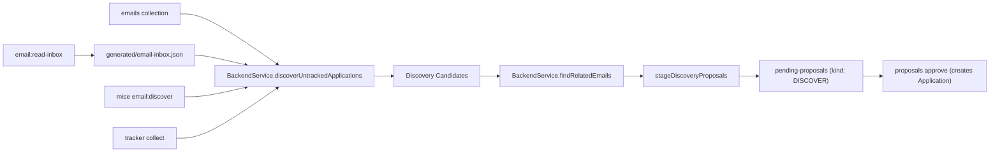

# Requirements

### Overview & Goals

When emails reference job applications that aren't tracked in Firestore (e.g., Fabletics rejection in `JOB/Fabletics`), the system currently drops them into `unmatched` and never creates the application record. This feature adds a **Discovery Classifier** that generates proposals for untracked applications from email evidence, so the user can review and create them.

### User Stories

- As a user, when I run `mise run email:read-inbox` and there are emails about companies I haven't tracked, I want to see discovery proposals so I can create the missing applications.
- As a user, I want to run `mise run email:discover` on demand to scan all cached emails for untracked applications.
- As a user, I want the backend to search for related emails (e.g., "Thank you for applying" that matches a rejection) to find missing breadcrumbs.
- As a user, I want to validate or edit the inferred role title before committing a discovered application.

### Scope

**In Scope:**
- Discovery Classifier in `BackendService.kt` that identifies emails with strong company signals but no tracked application
- Role title extraction from email body using query keywords
- Discovery proposals staged in existing `pending-proposals` queue with `kind: "DISCOVER"`
- `mise run email:discover` mise task for on-demand discovery
- `collect` pipeline invokes discovery classifier automatically
- Wider inbox search in backend for related emails (breadcrumbs)
- Interactive role title validation during proposal review
- Catch-up scan of all cached emails

**Out of Scope:**
- Modifying the existing `RECRUITER_OUTREACH` flow (already works)
- New proposal review UI (uses existing `proposals approve` flow)
- Real-time Gmail polling (uses existing `email:read-inbox`)

### Functional Requirements

1. **Discovery Classifier** matches unmatched emails against:
   - Firm-specific `JOB/<Firm>` labels (100% confidence from manual triage)
   - Job application signals ("Update on your job application", "Thank you for applying", ATS senders)
   - Emails in `emails` collection with no `applicationId` set
2. **Role Title Extraction** parses email body for position/role keywords, presents to user for validation
3. **Proposal Generation** creates discovery proposals with inferred `company`, `companyId`, `role`, `status`, linked `messageId`
4. **Wider Inbox Search** (backend-only) searches for related emails when a discovery candidate is found
5. **Catch-Up** scans all 200+ cached emails against all firm labels

# Technical Design

### Current Implementation

- **`gmail-sync.md`** (line 51): "/gmail-sync never originates new applications" — the hard constraint we're relaxing
- **`scripts/proposals.py`**: `buildProposal()` matches messages against existing applications via `match()`. Unmatched messages go to `unmatched` list. Already handles `RECRUITER_OUTREACH` for leads.
- **`BackendService.kt`**: `backfillEmails()` ingests emails into top-level `emails` collection, classifies by keyword (REJECTION, OFFER, etc.), correlates with existing applications by `messageId` and company name. No discovery of new applications.
- **`tracker.py`**: `collectOnce()` calls `proposalsModule.buildProposal()` with messages and existing applications.
- **Proto enums** (`records/proto/src/main/proto/tracker/v1/enums.proto`): `TrackerEventType` has no `DISCOVER` type; `TrackerStatus` has `SUBMITTED` as the lowest active state.

### Key Decisions

1. **Discovery lives in `BackendService.kt`** per RM-003 (Backend Functionality Abstraction). The classifier is a Kotlin function that can be called from both `collect` and `email:discover`.
2. **Discovery proposals use existing `pending-proposals` queue** with `kind: "DISCOVER"` to distinguish from `EMAIL_SYNC` proposals. No new Firestore collection needed.
3. **New event type `DISCOVER`** added to `TrackerEventType` proto enum to mark the origin of discovered applications.
4. **Role title extraction** uses the same keyword patterns from `gmail-sync.md` query building (company names, ATS domains) plus role-specific patterns ("position:", "role:", "Android Engineer", etc.).
5. **Wider inbox search** is a backend-only function that, when a discovery candidate is found, searches the `emails` collection and `email-inbox.json` for related messages by company/ATS sender.

### Proposed Changes

#### 1. Proto: Add `DISCOVER` event type
- `records/proto/src/main/proto/tracker/v1/enums.proto`: Add `DISCOVER = 22;` to `TrackerEventType`

#### 2. BackendService.kt: Discovery Classifier
- New function `discoverUntrackedApplications(inboxFile: File, emailsCollection: Query): List<DiscoveryCandidate>`
- Scans `emails` collection for documents with no `applicationId` but with status != NOISE
- Cross-references with `email-inbox.json` for label-based signals (`JOB/<Firm>`)
- Extracts company name from: label name, sender domain, subject heuristics
- Extracts role title from email body using keyword patterns
- Returns list of `DiscoveryCandidate` with inferred fields

#### 3. BackendService.kt: Wider Inbox Search
- New function `findRelatedEmails(companyId: String, messageId: String): List<Map<String, Any>>`
- Searches `emails` collection and `email-inbox.json` for messages from same company/ATS
- Returns related messages to include in the discovery proposal

#### 4. BackendService.kt: Stage Discovery Proposals
- New function `stageDiscoveryProposals(db: Firestore, candidates: List<DiscoveryCandidate>): Map<String, Any>`
- Creates proposal with `kind: "DISCOVER"`, changes include `eventType: "DISCOVER"`, `statusTo: "SUBMITTED"` (or inferred status)
- Uses existing `proposals.py stage()` or new Kotlin staging logic

#### 5. scripts/proposals.py: Discovery support in buildProposal
- Add `DISCOVER` classifier entry for discovery proposals
- Handle `kind: "DISCOVER"` in `approve()` — creates new application record instead of emitting event on existing one

#### 6. New mise task: email:discover
- `.config/mise/tasks/email/discover.py` — calls `BackendService.discoverUntrackedApplications()` and stages proposals
- Supports `--all` (scan all cached) and `--since <date>` flags

#### 7. Update gmail-sync.md
- Relax line 51: discovery proposals are now allowed from email evidence
- Add Step 3e: after staging, check for discovery proposals and present them
- Add Step 4 extension: discovery proposals show inferred role for validation

#### 8. Catch-up: Run discovery on all cached emails
- Initial run of `email:discover --all` to surface Fabletics and any other missing applications

### Architecture Diagram

### File Structure

| Action | File |
|--------|------|
| Modified | `records/proto/src/main/proto/tracker/v1/enums.proto` |
| Modified | `backend/src/main/kotlin/dev/fnc314/tools/jobtracker/backend/BackendService.kt` |
| Modified | `scripts/proposals.py` |
| Modified | `scripts/tracker.py` |
| Modified | `.agents/commands/gmail-sync.md` |
| Added | `.config/mise/tasks/email/discover.py` |
| Added | `scripts/discover.py` |
| Added | `.agents/plans/2026-11-12/161900_email-job-application-discovery.md` |

# Testing

### Validation Approach

- Run `python3 scripts/discover.py --all --dry-run` — verified, surfaces 4 untracked applications: Fabletics, Fmr, Snapchat, Washpost
- Run `mise run email:discover --all` (requires `TRACKER_ALLOW_WRITES=1`) — stages proposals in Firestore
- Verify discovery proposals appear in `pending-proposals` with `kind: "DISCOVER"`
- Verify `proposals approve` creates the application record with correct `companyId`, `role`, `status`
- Verify wider inbox search finds related emails for a discovery candidate

### Key Scenarios

1. **Fabletics discovery**: Email in `JOB/Fabletics` with rejection signal → discovery proposal → user approves → application created with status `REJECTED`
2. **Role validation**: Discovery proposal shows inferred role "Software Engineer" → user edits to "Android Engineer" → approved with corrected role
3. **Wider search**: Rejection email discovered → backend finds matching "Thank you for applying" email → both linked to the application
4. **No false positives**: Noise emails (receipts, newsletters) are not proposed as discoveries

### Edge Cases

- Email has company signal but no role info → role defaults to "Unknown / To Be Confirmed", user must fill in
- Multiple emails for same untracked company → grouped into one discovery proposal
- Application already exists but wasn't matched → proposal skipped with reason
- Discovery proposal for a company the user doesn't recognize → user rejects proposal

# Delivery Steps

### ✓ Step 1: Add DISCOVER event type and discovery classifier to BackendService
Add `DISCOVER = 22` to `TrackerEventType` proto enum, then implement `discoverUntrackedApplications()` and `findRelatedEmails()` in `BackendService.kt`.
- ✓ Add `DISCOVER = 22` to `records/proto/src/main/proto/tracker/v1/enums.proto`
- ✓ Implement `discoverUntrackedApplications()` in `BackendService.kt`: scan `emails` collection for uncorrelated messages, cross-reference with `email-inbox.json` labels, extract company/role/status
- ✓ Implement `findRelatedEmails()` in `BackendService.kt`: search for related emails by company/ATS sender
- ✓ Implement `stageDiscoveryProposals()` in `BackendService.kt`: create proposals with `kind: "DISCOVER"`
- ✓ Rebuild proto: `mise run records:build`

### ✓ Step 2: Add email:discover mise task and update proposals.py
Create the `email:discover` mise task and update `proposals.py` to handle discovery proposals.
- ✓ Add `.config/mise/tasks/email/discover.py` that calls `discover.py` and stages proposals
- ✓ Add `scripts/discover.py` with discovery classifier logic
- ✓ Update `scripts/proposals.py`: handle `kind: "DISCOVER"` in `approve()` to create new application records
- ✓ Update `scripts/tracker.py`: migrate `loadInbox` to use `email-inbox.json` as primary

### ✓ Step 3: Update gmail-sync.md and run catch-up discovery
Relax the gmail-sync constraint, add discovery to the workflow, and run the initial catch-up.
- ✓ Update `.agents/commands/gmail-sync.md`: relax line 51, add Step 3e for discovery proposals, extend Step 4 for role validation
- ✓ Write the formal plan artifact at `.agents/plans/2026-11-12/161900_email-job-application-discovery.md`
- ✓ Update `.agents/plans/README.md`
- ⚠ Run `mise run email:discover --all` to catch up on all cached emails (requires Firebase credentials, deferred to user)

### ✓ Step 4: Fix discovery bugs found during testing
The initial `email:discover --all` returned 0 candidates due to multiple bugs. All fixed.
- ✓ Fix `discover.py`: added missing `os` and `re` imports
- ✓ Fix `discover.py`: `re.IGNORE_CASE` → `re.IGNORECASE` (Python 3.15 compatibility)
- ✓ Fix `discover.py`: added `_extract_company_from_sender()` — company was never extracted from sender domain
- ✓ Fix `discover.py`: added `_has_job_signals()` re-classification — NOISE emails (including Fabletics) were skipped entirely
- ✓ Fix `discover.py`: added job signal gate before company extraction — personal emails were processed as candidates
- ✓ Fix `discover.py`: sender parsing for "Display Name <email@domain>" format
- ✓ Fix `discover.py`: moved personal domain rejection to top of `_has_job_signals()`
- ✓ Fix `discover.py`: moved reject patterns before ATS weak signal check
- ✓ Fix `discover.py`: added `_company_matches_tracked()` fuzzy matching
- ✓ Fix `discover.py`: added `_email_references_tracked()` for tracked company detection
- ✓ Fix `BackendService.kt`: removed "order" noise keyword, added job signal override for ATS emails
- ✓ Verified: `discover.py --all --dry-run` surfaces 4 untracked applications (Fabletics, Fmr, Snapchat, Washpost)

### ✓ Step 5: Fix proposal approval bugs found during user testing
The first `proposals approve` run failed on 1 of 4 proposals due to `statusRank()` misuse, and `t all` toggle didn't work in the TUI.
- ✓ Fix `proposals.py`: `statusRank(status_to)` passed a positional argument to `contract.statusRank()` which takes zero arguments — changed to `contract.statusRank().get(status_to, 4)`
- ✓ Fix `TrackerApp.kt`: `t all` in proposals TUI treated "all" as a proposal ID prefix — added "all"/"none" special cases in the toggle handler
- ✓ Rebuilt TUI via `./gradlew :frontend:apps-terminal:installDist`