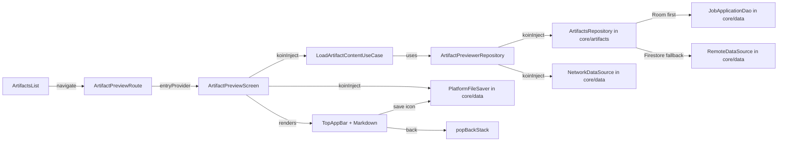

# Implementation Plan: Immersive Artifact Previewer

**Status:** Proposed  
**Date:** 2026-11-12  
**Target:** `frontend`  
**Harness:** Antigravity  
**Model:** claude-sonnet-4-5-20250929  
**Session:** session-261112-200233-14sh  

---

## 1. Executive Summary & Goals

Replace the current dialog-based Markdown previewer (`MarkdownPreviewDialog` in `DetailDialogs.kt`) with a full-page immersive experience delivered as a standalone `frontend/features/artifact-previewer` feature module with `data`, `domain`, and `ui` submodules. When the user taps a Markdown artifact (e.g. a cover letter or job posting), the app navigates to a dedicated full-screen Markdown viewer instead of showing an `AlertDialog`.

A new `core/artifacts` module will own `TrackerArtifact`, `TrackerArtifactKind`, `ArtifactStorage`, and `ArtifactsRepository` — extracting artifact-specific types from `core/data` so that `core/data` is not clogged with artifact concerns. This module depends on `core/data` for shared infrastructure (`WireContract`, `UseCase`, `NetworkDataSource`, `RemoteDataSource`, `LocalDataSource`).

**Goals:**
- Create `core/artifacts` module with `TrackerArtifact`, `TrackerArtifactKind`, `ArtifactStorage`, and `ArtifactsRepository` (Room cache first, then Firestore).
- Move artifact models from `core/data/model/` to `core/artifacts/model/`.
- Create `features/artifact-previewer` with `data`, `domain`, `ui` submodules following the established feature pattern.
- **Strict no cross-feature dependencies**: No `feature/A` may depend on `feature/B`. Shared logic lives in `core/*`.
- Full-page immersive preview with `TopAppBar` (back button + filename title + save-to-device icon).
- Save-to-device flow via new `PlatformFileSaver` expect/actual API (floppy diskette toolbar icon).
- All UI text, labels, and accessibility content descriptions sourced from `strings.xml` — no hardcoded strings.
- Font-scaled Markdown rendering mapped to `MaterialTheme.typography` scales for easy reading.
- Remove `MarkdownPreviewDialog` and related dialog state from `job-application-details`.

## 2. Architecture & Design Principles

### Current Implementation
- **`DetailDialogs.kt`** (lines 265-410): `MarkdownPreviewDialog` is an `AlertDialog` that loads content via `LaunchedEffect` and renders it with `com.mikepenz.markdown.m3.Markdown`. It accepts `TrackerArtifact`, `onDismiss`, and `fetchContent: suspend (String) -> String?`.
- **`ArtifactsList.kt`** (lines 68-76): Holds local state `previewMarkdownArtifact` and shows the dialog when non-null. Triggered from `ArtifactItem.onClick` and `onViewInternal`.
- **`JobApplicationDetailsScreen.kt`** (line 165-167): Creates `fetchContent` from `NetworkDataSource.get(url)` and passes it to `ArtifactsList`.
- **Navigation**: Navigation 3 with `@Serializable` route classes, `FeatureEntryRegistry` for registration, `App.kt` registers all feature registries in `entryRegistries` list and all routes in `serializersModule`.
- **Data layer**: `JobApplicationDetailsRepository` (in `job-application-details/domain`) implements local-cache-first via `LocalJobApplicationDetailsDataSource` (Room) before `RemoteJobApplicationDetailsDataSource` (Firestore). The `getArtifacts()` method fetches artifacts from the `applications/{id}/artifacts` Firestore subcollection, cached in memory.
- **Feature module pattern**: All features follow `data`, `domain`, `ui` submodule structure. Each feature's `ui` module exports an aggregate Koin module (e.g., `jobApplicationDetailsFeatureModule`) that includes data + domain + ui submodules. The aggregate is wired into `apps/core/di/AppDI.kt`.
- **DI pattern**: `apps/core/di/AppDI.kt` includes `coreDataModule`, `coreNetworkModule`, `coreWidgetsModule`, and all feature aggregate modules. Feature `ui` modules depend on their own `domain` and `data` modules only.

### Key Decisions
- **`core/artifacts` new module**: `TrackerArtifact`, `TrackerArtifactKind`, `ArtifactStorage`, and `ArtifactsRepository` are moved from `core/data/model/` into a dedicated `core/artifacts` module. This keeps `core/data` focused on general data infrastructure (database, network, settings) and prevents artifact-specific types from clogging it. `core/artifacts` depends on `core/data` for `WireContract` (used by `TrackerArtifactKind`), `UseCase`, `NetworkDataSource`, `RemoteDataSource`, and `LocalDataSource`. `WireContract` stays in `core/data` because it's used by many other enums (e.g., `TrackerStatus`, `TrackerEventType`, `Region`, etc.).
- **`ArtifactsRepository` in `core/artifacts`**: The artifact fetching logic (get artifacts by applicationId, Room cache, Firestore fetch, content resolution) lives in `core/artifacts` as `ArtifactsRepository` interface and `ArtifactsRepositoryImpl`. This is the single source of truth for artifact data, injectable by any feature. Registered in `coreArtifactsModule` (Koin).
- **No cross-feature dependencies**: `artifact-previewer` depends only on `core/artifacts`, `core/navigation`, `core/widgets`, and its own `domain`/`data` submodules. It does NOT depend on `job-application-details` or any other feature. The `job-application-details` feature will also migrate to use `ArtifactsRepository` from `core/artifacts` instead of its own artifact-fetching logic.
- **Three-submodule feature**: `artifact-previewer` has `data`, `domain`, `ui` submodules. The `domain` layer exposes `LoadArtifactContentUseCase` for the 4-tier content pipeline. The `data` layer implements `ArtifactPreviewerRepository` wrapping `ArtifactsRepository` (from `core/artifacts`) and `NetworkDataSource`.
- **Pass IDs, fetch artifact in-screen**: Because `TrackerArtifact` is not `@Serializable`, the route carries `applicationId` and `artifactId`. The `domain` use case resolves the full artifact via `ArtifactsRepository`, then applies the 4-tier content resolution.
- **`PlatformFileSaver` new expect/actual**: A new `PlatformFileSaver` object will be added to `core/data/platform/` with `saveText(content: String, filename: String): Result<Unit>` — implemented via Android `MediaStore`/SAF, JVM `FileOutputStream`, iOS `FileManager`, and Web `Blob` download.
- **Font-scaled Markdown**: The `com.mikepenz.markdown.m3.Markdown` composable will be configured with a `MarkdownTheme` that maps headings, body, code, and list items to `MaterialTheme.typography` scales for comfortable reading.
- **All strings from `strings.xml`**: Every label, error message, loading text, accessibility content description, and button label will be sourced from `strings.xml` via `stringResource()`.
- **Navigation**: The `ArtifactPreviewRoute` is registered in `ArtifactPreviewerEntryRegistry` inside `artifact-previewer/ui`. The registry is Koin-injected in `App.kt` like other feature registries. Navigation is triggered from `ArtifactsList` via `LocalAppNavigator.current.navigate(ArtifactPreviewRoute(...))`.

### Architecture Diagram



### Module Dependency Graph

```
core/data          (WireContract, UseCase, NetworkDataSource, RemoteDataSource, LocalDataSource, DatabaseHolder, PlatformFileSaver)
       ↑
core/artifacts     (TrackerArtifact, TrackerArtifactKind, ArtifactStorage, ArtifactsRepository)
       ↑
features/artifact-previewer/data   (ArtifactPreviewerRepository wrapping ArtifactsRepository + NetworkDataSource)
       ↑
features/artifact-previewer/domain (LoadArtifactContentUseCase)
       ↑
features/artifact-previewer/ui     (ArtifactPreviewScreen, navigation, strings.xml)
```

## 3. Proposed Changes & Implementation Steps

### ✓ Step 1: Create `core/artifacts` module and move artifact models

**New module:**

```
frontend/core/artifacts/
├── build.gradle.kts
└── src/commonMain/kotlin/dev/fnc314/tools/jobtracker/core/artifacts/
    ├── model/
    │   ├── TrackerArtifact.kt          # MOVED from core/data/model/
    │   ├── TrackerArtifactKind.kt      # MOVED from core/data/model/
    │   └── ArtifactsRepository.kt      # NEW interface
    ├── impl/
    │   └── ArtifactsRepositoryImpl.kt  # NEW implementation
    └── di/
        └── CoreArtifactsModule.kt      # NEW Koin module
```

**`build.gradle.kts`**:
- Plugins: `kotlin-multiplatform`, `android-kmp-library`, `compose`, `dependencies-compose`, `dependencies-serialization`, `dependencies-di`, `dependencies-datasource`, `dependencies-firebase` (same as `core/data`).
- Dependencies: `implementation(projects.coreData)` and `implementation(projects.coreNetwork)`.
- The `projectCollections` plugin with `depth=2` for `core` in `frontend/settings.gradle.kts` will auto-discover the new module.

**Moved files** (change package from `dev.fnc314.tools.jobtracker.core.data.model` to `dev.fnc314.tools.jobtracker.core.artifacts.model`):
- `TrackerArtifact.kt`: Data class with `id`, `applicationId`, `kind`, `filename`, `contentType`, `size`, `sha256`, `storage`, `localPath`, `content`, `externalUrl`, `createdAt`.
- `TrackerArtifactKind.kt`: Sealed interface extending `WireContract` (still imported from `core/data`). Contains `Known` enum and `Unrecognized` class.
- `ArtifactStorage` will be co-located with `TrackerArtifact` (currently defined in the same file).

**`ArtifactsRepository` interface**:
- `suspend fun getArtifacts(applicationId: String): List<TrackerArtifact>` — Room cache first, then Firestore fallback.
- `suspend fun getArtifact(applicationId: String, artifactId: String): TrackerArtifact?` — convenience method filtering by artifact ID.

**`ArtifactsRepositoryImpl`**:
- Injects `DatabaseHolder` (from `core/data`, for Room access via `JobApplicationDao`) and `RemoteDataSource` (from `core/data`, for Firestore).
- Room cache: Artifacts are stored as part of the `JobApplicationEntity` or in an in-memory cache keyed by `applicationId`. If Room has the application cached, extract artifacts from the cached record.
- Firestore fallback: Query `applications/{applicationId}/artifacts` subcollection via `RemoteDataSource.getCollection()` and map to `TrackerArtifact` list using `ArtifactFactory.createTrackerArtifact()` (in `core/artifacts`).
- On successful Firestore fetch, cache the result in memory (and persist to Room if the application entity is updated).
- Registered in `coreArtifactsModule` as `single<ArtifactsRepository> { ArtifactsRepositoryImpl(get(), get()) }`.

**`CoreArtifactsModule.kt`**: Koin module that binds `ArtifactsRepository`. Included in `AppDI.kt` alongside `coreDataModule`.

**Updated files in `core/data`**:
- Remove `TrackerArtifact.kt`, `TrackerArtifactKind.kt` from `core/data/model/`.
- `core/data/factory/Factory.kt`: Update `createTrackerArtifact()` to import `TrackerArtifact` and `TrackerArtifactKind` from `core/artifacts` instead of local model. (This requires `core/data` to depend on `core/artifacts`, creating a circular dependency — **resolve by moving `createTrackerArtifact()` to `core/artifacts` instead, or inlining the constructor call at the call site in `RemoteJobApplicationDetailsDataSourceImpl`**.)
- `core/data/di/CoreDataModule.kt`: No artifact bindings added (they go to `coreArtifactsModule`).
- `core/data/src/commonTest/FactoryTest.kt`: Move artifact factory test to `core/artifacts` tests, or update imports.
- `core/data/src/commonTest/EnumLogicTest.kt`: Move `TrackerArtifactKind` test cases to `core/artifacts` tests.

**Circular dependency resolution**: `core/artifacts` depends on `core/data` (for `WireContract`, `RemoteDataSource`, etc.), but `core/data/factory/Factory.createTrackerArtifact()` references `TrackerArtifact`. To avoid a circular dependency:
- **Option chosen**: Move `createTrackerArtifact()` out of `Factory` in `core/data` and into a standalone `ArtifactFactory` object in `core/artifacts`. The call site in `RemoteJobApplicationDetailsDataSourceImpl` (in `job-application-details/data`) will import from `core/artifacts` instead of `core/data/Factory`.
- Remove `createTrackerArtifact()` from `Factory.kt` in `core/data`.
- Create `ArtifactFactory.kt` in `core/artifacts` with the same signature.
- Update `RemoteJobApplicationDetailsDataSourceImpl` to use `ArtifactFactory.createTrackerArtifact()`.
- Update `FactoryTest.kt` to remove the artifact test (move to `core/artifacts` tests).

### ✓ Step 2: Create `artifact-previewer` feature module (`data`, `domain`, `ui`)

**New files:**

```
frontend/features/artifact-previewer/
├── data/
│   ├── build.gradle.kts
│   └── src/commonMain/kotlin/dev/fnc314/tools/jobtracker/features/artifactpreviewer/data/
│       ├── repository/ArtifactPreviewerRepository.kt
│       ├── repository/impl/ArtifactPreviewerRepositoryImpl.kt
│       └── di/ArtifactPreviewerDataModule.kt
├── domain/
│   ├── build.gradle.kts
│   └── src/commonMain/kotlin/dev/fnc314/tools/jobtracker/features/artifactpreviewer/domain/
│       ├── usecase/LoadArtifactContentUseCase.kt
│       ├── usecase/impl/LoadArtifactContentUseCaseImpl.kt
│       └── di/ArtifactPreviewerDomainModule.kt
└── ui/
    ├── build.gradle.kts
    └── src/commonMain/
        ├── kotlin/dev/fnc314/tools/jobtracker/features/artifactpreviewer/ui/
        │   ├── ArtifactPreviewerNavigation.kt
        │   ├── ArtifactPreviewScreen.kt
        │   └── di/ArtifactPreviewerUiModule.kt
        └── composeResources/values/
            └── strings.xml
```

**`data` module**:
- `build.gradle.kts`: Dependencies on `projects.coreArtifacts` and `projects.coreData` only (no feature dependencies).
- `ArtifactPreviewerRepository` interface: `suspend fun fetchContent(url: String): String?`.
- `ArtifactPreviewerRepositoryImpl`: Injects `NetworkDataSource` for URL fetching.
- `ArtifactPreviewerDataModule.kt`: Koin module binding the repository.

**`domain` module**:
- `build.gradle.kts`: Dependencies on `projects.coreArtifacts`, `projects.coreData` and `projects.featuresArtifactPreviewerData`.
- `LoadArtifactContentUseCase` interface: `UseCase<LoadArtifactContentUseCase.Params, String>` where `Params(applicationId, artifactId)`.
- `LoadArtifactContentUseCaseImpl`: Injects `ArtifactsRepository` (from `core/artifacts`) to get artifact, then applies 4-tier content resolution (inline → external URL → GCS → local via `PlatformFileReader`).
- `ArtifactPreviewerDomainModule.kt`: Koin module binding the use case.

**`ui` module**:
- `build.gradle.kts`: Dependencies on `projects.coreArtifacts`, `projects.coreData`, `projects.coreNavigation`, `projects.coreWidgets`, `projects.featuresArtifactPreviewerDomain`, `projects.featuresArtifactPreviewerData`, `libs.bundles.androidx.lifecycle.compose`, `libs.kotlinx.coroutines.core`, `libs.markdown.renderer.m3`.
- `ArtifactPreviewerNavigation.kt`: `@Serializable data class ArtifactPreviewRoute(applicationId: String, artifactId: String) : JobApplicationsTrackerNavKey` with `@Transient override val titleRes`. `ArtifactPreviewerEntryRegistry : FeatureEntryRegistry`.
- `ArtifactPreviewScreen.kt`: Full-page composable that:
  - Injects `LoadArtifactContentUseCase` and `ArtifactsRepository` via Koin.
  - Loads artifact metadata (for filename/title) and content (via use case).
  - Renders `TopAppBar` with:
    - Back button (content description from `strings.xml`).
    - Filename as title.
    - **Save-to-device** icon button (floppy diskette, `Icons.Filled.Save`, content description from `strings.xml`) that triggers `PlatformFileSaver.saveText()` with the resolved content and artifact filename.
  - Scrollable `Surface` with `com.mikepenz.markdown.m3.Markdown` content, configured with `MarkdownTheme` mapping to `MaterialTheme.typography` scales:
    - `h1` → `MaterialTheme.typography.headlineSmall`
    - `h2` → `MaterialTheme.typography.titleLarge`
    - `h3` → `MaterialTheme.typography.titleMedium`
    - `body` → `MaterialTheme.typography.bodyLarge`
    - `code` → `MaterialTheme.typography.bodyMedium` (monospace)
    - `list` → `MaterialTheme.typography.bodyLarge`
  - Loading state: `CircularProgressIndicator` with `stringResource()` content description.
  - Error state: `Text` with error message from `strings.xml`.
  - Save success/error feedback via inline message.
- `di/ArtifactPreviewerUiModule.kt`: Koin module for `ArtifactPreviewerEntryRegistry`. Aggregate `artifactPreviewerFeatureModule` includes data + domain + ui submodules.
- `strings.xml`: All UI strings including:
  - `artifact_previewer_route_title`
  - `artifact_previewer_loading` (with content description)
  - `artifact_previewer_error_not_found`
  - `artifact_previewer_error_fetch`
  - `artifact_previewer_error_no_content`
  - `artifact_previewer_action_save` (save button content description)
  - `artifact_previewer_action_back` (back button content description)
  - `artifact_previewer_save_success`
  - `artifact_previewer_save_error`

### ✓ Step 3: Update `core/data` to remove artifact models and add `PlatformFileSaver`

**Remove from `core/data`**:
- Delete `core/data/src/commonMain/kotlin/dev/fnc314/tools/jobtracker/core/data/model/TrackerArtifact.kt` (moved to `core/artifacts`).
- Delete `core/data/src/commonMain/kotlin/dev/fnc314/tools/jobtracker/core/data/model/TrackerArtifactKind.kt` (moved to `core/artifacts`).
- Remove `createTrackerArtifact()` from `Factory.kt` (moved to `ArtifactFactory` in `core/artifacts`).
- Move `TrackerArtifactKind` test cases from `EnumLogicTest.kt` to `core/artifacts` tests.
- Move artifact factory test from `FactoryTest.kt` to `core/artifacts` tests.

**Add `PlatformFileSaver` to `core/data`**:

```
frontend/core/data/src/commonMain/kotlin/dev/fnc314/tools/jobtracker/core/data/platform/PlatformFileSaver.kt
frontend/core/data/src/androidMain/kotlin/dev/fnc314/tools/jobtracker/core/data/platform/PlatformFileSaver.android.kt
frontend/core/data/src/jvmMain/kotlin/dev/fnc314/tools/jobtracker/core/data/platform/PlatformFileSaver.jvm.kt
frontend/core/data/src/iosMain/kotlin/dev/fnc314/tools/jobtracker/core/data/platform/PlatformFileSaver.ios.kt
frontend/core/data/src/jsMain/kotlin/dev/fnc314/tools/jobtracker/core/data/platform/PlatformFileSaver.js.kt
frontend/core/data/src/wasmJsMain/kotlin/dev/fnc314/tools/jobtracker/core/data/platform/PlatformFileSaver.wasmJs.kt
```

- `expect object PlatformFileSaver { suspend fun saveText(content: String, filename: String): Result<Unit> }`
- **Android**: Use `MediaStore` or `StorageAccessFramework` (SAF) to save a `.md` file to the Downloads directory. Return `Result.Success` or `Result.Failure`.
- **JVM (Desktop)**: Use `java.io.File` / `FileOutputStream` to write to `System.getProperty("user.home") + "/Downloads/" + filename`.
- **iOS**: Use `FileManager.default.urls(.documentDirectory)` to save to app documents directory.
- **JS/WasmJS**: Create a `Blob` with the content, trigger a browser download via `URL.createObjectURL` and a temporary `<a>` element.

### ✓ Step 4: Migrate `job-application-details` to use `ArtifactsRepository` from `core/artifacts`

**`JobApplicationDetailsRepository` (domain)**:
- Remove `getArtifacts()` and `getArtifactSignedUrl()` methods from the interface.
- These are now provided by `ArtifactsRepository` in `core/artifacts`.

**`JobApplicationDetailsRepositoryImpl` (data)**:
- Remove `getArtifacts()` and `getArtifactSignedUrl()` implementations.
- Remove `NetworkJobApplicationDetailsDataSource` dependency if only used for signed URLs.

**`LoadArtifactsUseCase` and `GetArtifactSignedUrlUseCase` (domain)**:
- Remove these use cases — replaced by `ArtifactsRepository` in `core/artifacts`.

**`JobApplicationDetailsScreen.kt`**:
- Replace `LoadArtifactsUseCase` with `ArtifactsRepository` from `core/artifacts`.
- Remove `fetchContent` lambda creation.
- Remove `fetchContent` parameter from `ArtifactsList` calls.

**`JobApplicationDetailsEntryRegistry`**: Update to inject `ArtifactsRepository` instead of `LoadArtifactsUseCase` if needed.

**`JobApplicationsDetailsDomainModule.kt`**: Remove `LoadArtifactsUseCase` and `GetArtifactSignedUrlUseCase` bindings.

**`JobApplicationDetailsDataModule.kt`**: Remove `NetworkJobApplicationDetailsDataSource` if no longer needed.

**`RemoteJobApplicationDetailsDataSourceImpl` (data)**:
- Update `Factory.createTrackerArtifact()` calls to use `ArtifactFactory.createTrackerArtifact()` from `core/artifacts`.
- Add `implementation(projects.coreArtifacts)` to `job-application-details/data/build.gradle.kts`.

### ✓ Step 5: Update `job-application-details` to navigate and remove dialog

**`ArtifactsList.kt`**:
- Remove `previewMarkdownArtifact` state.
- Remove `MarkdownPreviewDialog` call.
- Remove `fetchContent` parameter.
- Replace `isMd && renderMarkdownInternally` branch with `LocalAppNavigator.current.navigate(ArtifactPreviewRoute(applicationId, artifact.id))`.
- Add import for `ArtifactPreviewRoute` from `artifact-previewer/ui`.
- Update `TrackerArtifact` imports to use `core/artifacts` package.

**`DetailDialogs.kt`**:
- Remove `MarkdownPreviewDialog` composable entirely.
- Remove unused imports (`com.mikepenz.markdown.m3.Markdown`, `PlatformFileReader`, etc.).
- Update `TrackerArtifact` imports to use `core/artifacts` package.

**`App.kt`**:
- Import `ArtifactPreviewerEntryRegistry` and `ArtifactPreviewRoute`.
- Add `koinInject<ArtifactPreviewerEntryRegistry>()` to `entryRegistries` list.
- Add `subclass(ArtifactPreviewRoute::class, ArtifactPreviewRoute.serializer())` to `serializersModule`.

**`apps/core/di/AppDI.kt`**:
- Add `coreArtifactsModule` to the `appModule` includes list (alongside `coreDataModule`).
- Add `artifactPreviewerFeatureModule` to the `appModule` includes list.

**`job-application-details/ui/build.gradle.kts`**:
- Add `implementation(projects.featuresArtifactPreviewerUi)` dependency.
- Add `implementation(projects.coreArtifacts)` dependency for `TrackerArtifact` imports.

**All files that import `TrackerArtifact` or `TrackerArtifactKind`**: Update package from `dev.fnc314.tools.jobtracker.core.data.model` to `dev.fnc314.tools.jobtracker.core.artifacts.model`.

## 4. Verification Plan & Testing Checklist

### Key Scenarios
1. **Navigate to artifact preview**: Tap a `.md` artifact in the ArtifactsList → app navigates to full-screen preview → Markdown renders with font-scaled typography.
2. **Back navigation**: Press back from the preview screen → return to the job application details screen.
3. **Content resolution**: Verify inline content loads (best case), and fallback to external URL / GCS / local path works.
4. **Error state**: When content cannot be loaded, an error message from `strings.xml` is displayed.
5. **Save to device**: Tap the floppy diskette icon → file is saved to device Downloads/documents → success message shown.
6. **Non-Markdown artifacts**: PDFs and other file types continue to open externally (unchanged behavior).
7. **Accessibility**: All content descriptions are sourced from `strings.xml` — no hardcoded strings.
8. **No cross-feature dependencies**: Verify `artifact-previewer` build.gradle.kts has no `featuresJobApplicationDetails*` dependency.
9. **`job-application-details` still works**: Artifacts still load and display in the detail screen via `ArtifactsRepository` from `core/artifacts`.
10. **`core/artifacts` module isolation**: Verify `core/artifacts` depends only on `core/data` and `core/network` — no feature dependencies.
11. **No circular dependencies**: Verify `core/data` does NOT depend on `core/artifacts` (one-way: `core/artifacts` → `core/data`).

### Edge Cases
- Artifact not found in the application's artifact list (error state).
- Empty inline content with no fallback URLs (error state).
- Configuration change (rotation) during preview — Navigation 3 should restore state via serialization.
- `renderMarkdownInternally` setting is false — artifact opens externally (unchanged).
- Save to device fails (e.g., no storage permission on Android) — error message from `strings.xml`.
- Local-cache-first: Verify Room is queried before Firestore (check via logging or test).

### Build Verification
- `frontend:build` succeeds with the new modules.
- `frontend:detekt` passes on new code.
- No unused imports in `DetailDialogs.kt` after removal.
- No hardcoded strings in `ArtifactPreviewScreen.kt` (all via `stringResource()`).
- No cross-feature dependencies in `artifact-previewer` module graph.
- No circular dependency between `core/data` and `core/artifacts`.
- All `TrackerArtifact` and `TrackerArtifactKind` imports point to `core/artifacts` package.

## 5. Bookkeeping
- [ ] Plan persisted at `frontend/.agents/plans/YYYY-MM-DD/HHMMSS_immersive-artifact-previewer.md`
- [ ] Registry `frontend/.agents/plans/README.md` row added / status synchronized
- [ ] Craft a single commit of all changed files
- [ ] Stage changed files and craft a commit message based on the name of this file
- [ ] Push `git push origin main`