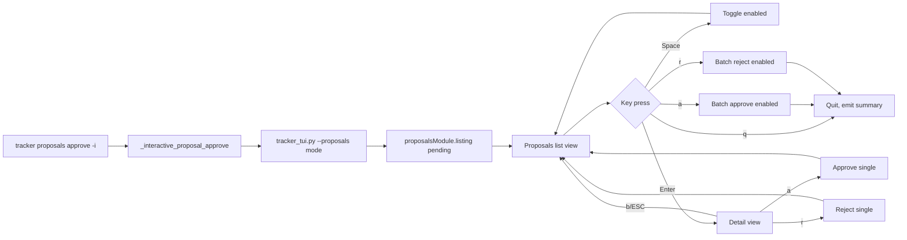

# Requirements

### Overview
Replace the readline-based `_interactive_proposal_approve` in `scripts/tracker.py` with a curses-based TUI mode inside the existing `ui/terminal/tracker_tui.py`. The new experience provides:

1. **Always-visible keyboard commands** — a footer bar shows bindings at all times
2. **Proposal detail view** — pressing Enter on a proposal reveals all changes and unmatched emails in a scrollable detail pane
3. **Checkbox-style enable/disable** — each proposal row has a `[ ]` / `[x]` toggle so the user can select which proposals to approve/reject in batch
4. **Legible layout** — proper curses rendering with color pairs, scrollable panes, and structured output

### Scope

**In Scope:**
- New `in_proposals` mode in `tracker_tui.py` with list view, detail view, and batch actions
- Proposal rows show: ID, date, #changes, #unmatched, enabled checkbox
- Detail view shows each change (company, event type, status transition, confidence, email subject) and unmatched emails
- Footer bar with keyboard bindings always visible
- `[Space]` toggle enable/disable, `[Enter]` detail, `[a]` approve selected, `[r]` reject selected, `[q]` quit
- Integration: `tracker proposals approve -i` launches the TUI proposals mode instead of readline loop

**Out of Scope:**
- Modifying `proposals.py` — existing `approve()`, `reject()`, and `listing()` are reused as-is
- Changing the TUI's main application list view
- Adding a separate `mise` task — the existing `tracker proposals approve -i` entry point is used

# Technical Design

### Current Implementation
- **`scripts/tracker.py`** — `_interactive_proposal_approve()` (line 2458) uses `_read_line()` prompts with `sys.stderr.write`. It iterates proposals sequentially, showing all changes then prompting for action. Issues: commands only visible at prompt, no detail investigation, output is dense/illegible.
- **`ui/terminal/tracker_tui.py`** — Full curses-based TUI with established patterns: list/detail views, split mode, settings view, edit view, file view. Uses `safe_addstr()`, color pairs, scrollable panes, and a `while True` main loop with key bindings.
- **`scripts/proposals.py`** — `listing(db, "proposal:pending")` returns full proposal documents; `approve()` and `reject()` apply changes.

### Key Decisions
- **Add proposals mode to the TUI's main loop** — A new `in_proposals` boolean flag is added to the existing `main()` loop, mirroring the existing `in_settings`, `in_edit`, and `in_detail` patterns. This keeps a single entry point and reuses all rendering infrastructure.
- **Entry from `tracker proposals approve -i`** — The CLI command spawns `tracker_tui.py` with a `--proposals` flag, which loads pending proposals directly and enters the proposals mode. No changes to `proposals.py` needed.
- **Checkbox selection model** — Each proposal has an `enabled` boolean. `[Space]` toggles. `[a]` approves all enabled, `[r]` rejects all enabled. Individual proposals can also be approved/rejected from the detail view.
- **Detail view reuses `load_detail_lines` pattern** — A new `load_proposal_detail_lines(proposal, max_width)` function generates `(text, file_path)` tuples for the detail pane, following the same tuple-based format as application details.

### Proposed Changes

**1. `ui/terminal/tracker_tui.py` — New `--proposals` CLI flag and entry point**
- Add `--proposals` argument to `__main__` block
- When `--proposals` is set, skip the application data load and instead call `proposalsModule.listing(db, "proposal:pending")` to fetch pending proposals
- Enter the main loop with `in_proposals = True`

**2. `ui/terminal/tracker_tui.py` — `load_proposal_detail_lines(proposal, max_width)` function**
- Returns list of `(text, file_path)` tuples
- Shows: proposal ID, created date, state
- Each change: index, company/application ID, event type, status transition, confidence, email subject
- Unmatched emails: subject, reason
- Follows the same format as `load_detail_lines()`

**3. `ui/terminal/tracker_tui.py` — Proposals list view rendering**
- Header: `PROPOSALS REVIEW | N pending | M enabled`
- Column headers: `[ ] # | ID | Date | Changes | Unmatched`
- Each row: checkbox `[x]`/`[ ]`, proposal ID (truncated), date, change count, unmatched count
- Selected row highlighted with `c_selected`
- Footer: `[Space]: Toggle | [j/k]: Nav | [Enter]: Detail | [a]: Approve Selected | [r]: Reject Selected | [q]: Quit`

**4. `ui/terminal/tracker_tui.py` — Proposals detail view**
- Full-screen detail (like `in_detail` mode)
- Shows all changes with transitions and email subjects
- Unmatched emails section
- Actions: `[a]` approve this proposal, `[r]` reject this proposal, `[b]`/`[ESC]` back

**5. `ui/terminal/tracker_tui.py` — Key bindings in proposals mode**
- `[Space]`: toggle enabled checkbox for current proposal
- `[j/k]`: navigate list
- `[Enter]`: open detail view for current proposal
- `[a]`: approve all enabled proposals (batch), with confirmation
- `[r]`: reject all enabled proposals (batch), with confirmation
- `[q]`/`[ESC]`: quit
- Detail view: `[a]` approve this one, `[r]` reject this one, `[b]`/`[ESC]` back

**6. `scripts/tracker.py` — `_interactive_proposal_approve()` refactored**
- Instead of readline loop, spawn `tracker_tui.py --proposals` via `subprocess`
- On return, emit the summary JSON with approved/rejected/skipped counts

### Architecture Diagram

### Risks
- **TUI import path**: `tracker_tui.py` loads `scripts/` modules via `sys.path` manipulation. The proposals module import needs the same pattern.
- **curses vs Textual handoff**: The TUI's Textual loading screen is for application data. Proposals mode should skip it and go straight to curses.
- **Write permission**: `TRACKER_ALLOW_WRITES=1` must still be checked before approve/reject. The TUI calls `subprocess.run` for edit operations; the same pattern applies for proposal actions.

# Testing

### Validation Approach
Verify the TUI proposals mode works correctly by running `mise run tracker proposals approve -i` and testing each interaction.

### Key Scenarios
- **No pending proposals**: TUI shows empty list with "No pending proposals" message, quit works
- **Single proposal**: List shows one row, detail view shows changes, approve works
- **Multiple proposals**: Navigate with j/k, toggle with Space, batch approve selected
- **Detail investigation**: Enter on proposal shows all changes with email subjects, unmatched emails visible
- **Footer always visible**: Keyboard commands visible at all times, not just at prompts
- **Write permission**: Approve/reject without `TRACKER_ALLOW_WRITES=1` shows error

### Edge Cases
- Proposal with zero changes but unmatched emails
- Very long proposal IDs truncated correctly
- Terminal resize during proposals mode
- Quit from detail view returns to list
- Approve/reject updates the list (proposal removed from pending)

# File Structure

### Modified Files
- `ui/terminal/tracker_tui.py` — Add proposals mode: `--proposals` flag, `load_proposal_detail_lines()`, proposals list/detail rendering, key bindings
- `scripts/tracker.py` — Refactor `_interactive_proposal_approve()` to launch TUI proposals mode instead of readline loop

# Delivery Steps

### ✓ Step 1: Add proposals mode to tracker_tui.py
Replace the readline-based interactive loop in `tracker.py` with a TUI launch.
- Added `load_proposal_detail_lines()`, `main_proposals()`, `_run_proposal_action()` to `tracker_tui.py`
- Added `--proposals` CLI flag to `__main__` block in `tracker_tui.py`
- Refactored `_interactive_proposal_approve()` in `scripts/tracker.py` to spawn `tracker_tui.py --proposals` via `subprocess.run`
- The TUI returns a summary JSON on stdout with remaining pending count
- Removed the old readline-based display and prompt logic from `_interactive_proposal_approve()`
- Kept the TTY check: if no TTY, fall back to an error message since the TUI requires a terminal
- Added `os` and `subprocess` imports to tracker.py top-level imports