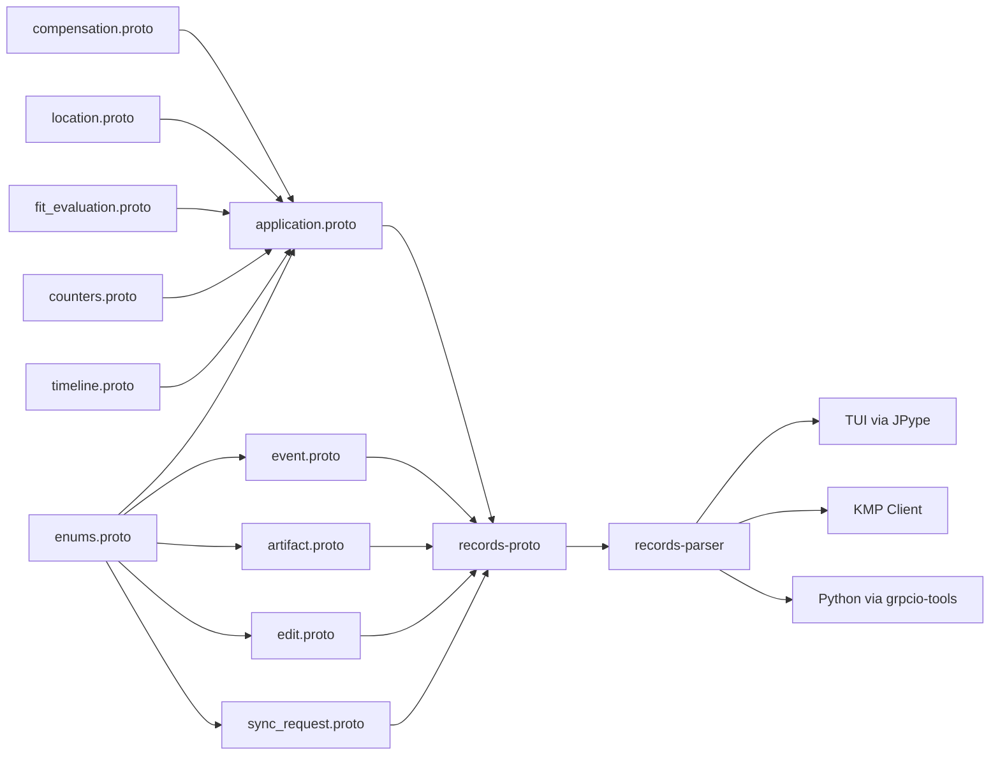

# Requirements

## Overview & Goals

Generate `.proto` files for all type contracts in `tracker.schema.json` and create a shared Kotlin parsing module (`tracker-parser`) that migrates the Firebase parsing logic from Python to Kotlin. The protos serve as the shared contract layer; the parser module provides timestamp conversion, status normalization, and document projection — consumable by both the KMP client and the TUI via JPype. Additionally, perform a top-level project structure cleanup (STEP 0) before any KMP work begins.

### Scope

#### In Scope

- **STEP 0: Project structure cleanup** (prerequisite for all work):
  - Scrub empty directories: `documents/linkedin/`, `documents/postings/`, `documents/references/`, `documents/diplomas/` (all contain only `.gitkeep`)
  - Move `documents/cv/` content (1 PDF) to `templates/cv/` and remove `documents/cv/`
  - Move `documents/applications/` to top-level `job-applications/` (82 company directories)
  - Rename `gmail_sync/` → `gmail-sync/`, `job_scraper/` → `job-scraper/`, `cover_letters/` → `cover-letters/`
  - Fold `cv/` and `cover-letters/` under `templates/` (so `templates/cv/` and `templates/cover-letters/`)
  - Combine `scripts/` and `tools/` into `scripts/`, move `tests/` under `scripts/tests/` (sibling to `scripts/specs/`)
  - Update ALL references in `.gitignore`, `.agents/skills/`, `*.md` files, `.kdl` specs, Python imports, and CI workflows
- Generate 13 `.proto` files: 1 shared enums file + 5 nested object messages + 6 document types
- All protos use `proto3` syntax with `google.protobuf.Timestamp` for timestamps
- Protos live inside `records/proto/tracker/v1/`
- Enums preserve namespaced values (e.g., `status:applied`) as proto enum entries
- KMP targets: `android`, `js` (Web), `ios`, `jvm` (CLI)
- Gradle 9.8.2+ and Kotlin 2.4.21+ (latest stable)
  - Avoid using `mise.toml` to track `kotlin` versions as it shadows the toolchain on the `$PATH`
- Use `kotlin` CLI from the Kotlin Toolchain to scaffold the project structure
- A `records-parser` Kotlin module (`records/parser/`) with parsing/conversion logic migrated from Python:
  - `fromFirestore()` / `toFirestore()` — Firestore Timestamp ↔ proto Timestamp conversion
  - `normalizeStatus()` — legacy/human status → namespaced enum
  - `deriveStatusFields()` — computes statusRank and isOpen
  - `rowFromStore()` — projects JobApplication to legacy flat row for TUI display
  - Enum value mapping — namespaced strings ↔ proto enum values
- Gradle build setup for both `records-proto` and `records-parser` modules
- JPype-compatible API surface in `records-parser` so the TUI can call Kotlin functions from Python
- All new CLI invocations exposed via root `mise.toml` with `scripts/specs/*.usage.kdl` definitions
- A `README.md` documenting the proto structure, parser APIs, KMP build/run instructions, and generation approach
- Python can consume proto3 directly via `grpcio-tools` (`python -m grpc_tools.protoc --python_out=.`), generating `*_pb2.py` files. This means the existing Python scripts can eventually consume the same proto definitions, eliminating schema drift between Python and Kotlin consumers.

#### Out of Scope

- Firebase Functions or server-side Kotlin code
- Platform-specific Firebase SDK integration (handled by each consumer)
- Modifying existing Python scripts to use protobuf (but the protos are consumable)
- The TUI's full migration to Kotlin (JPype bridge is the integration point)

### User Stories

- As a KMP developer, I want typed proto definitions so I can generate Kotlin data classes for all tracker types.
- As a maintainer, I want the protos to mirror `tracker.schema.json` so the contract stays consistent across Python and KMP.
- As a developer, I want enums grouped together so they're easy to import and reference across message types.
- As a TUI developer, I want to call Kotlin parsing functions via JPype so the same logic serves both Python and Kotlin consumers.
- As a developer, I want timestamp conversion, status normalization, and document projection in one shared module so there's no drift between Python and Kotlin.
- As a Python developer, I want the same proto3 definitions to be consumable from Python so the schema doesn't drift between language boundaries.

## Technical Design

### Current Implementation

The data model lives in `tracker.schema.json` (678 lines, JSON Schema draft 2020-12). It defines:

#### 6 Document Types (with renamed models)

- `application` → **`JobApplication`** — one per job application (the core record)
- `event` → **`TrackerEvent`** — append-only timeline entries in `applications/{id}/events`
- `artifact` → **`TrackerArtifact`** — file metadata in `applications/{id}/artifacts`
- `proposal` → **`TrackerEdit`** — collector output awaiting human review
- `syncRequest` → **`TrackerSyncRequest`** — deferred sync tasks (local Cloud Tasks substitute)
- `company` → **`Company`** — normalized employer records (unchanged)
- `contact` → **`Contact`** — recruiters and hiring contacts (unchanged)

#### 5 Nested Objects (with renamed models)

- `compensation` → **`Compensation`** — salary range with min/max/currency/period (unchanged)
- `location` → **`Location`** — city/region/country + workMode/relocation flags (unchanged)
- `fitEvaluation` → **`TrackerFit`** — rubric version, evaluatedAt, gaps array
- `counters` → **`TrackerCounts`** — events/followUpsSent/interviews/rejections counts
- `timeline` → **`Timeline`** — firstActivityAt/lastActivityAt/daysSinceActivity/nextFollowUpAt (unchanged)

#### 15 Enums (with resolved naming)

All enums follow the `Tracker` prefix pattern for tracker-specific concepts, and use domain-specific names otherwise:

| Schema Def | Proto Enum | Purpose |
| --- | --- | --- |
| `statusValue` | `TrackerStatus` | Application funnel status (drafting → hired/rejected) |
| `eventTypeValue` | `TrackerEventType` | Event types (applied, interview-scheduled, offer, ...) |
| `sourceValue` | `ApplicationChannel` | Source channel of Job Application (Greenhouse, Workday, Lever, LinkedIn, referral, direct, other) |
| `artifactKindValue` | `TrackerArtifactKind` | Artifact types (cv, cover-letter, outcome, posting, assessment) |
| `workModeValue` | `WorkMode` | Work arrangement (onsite, hybrid, remote) |
| `actorValue` | `EventActor` | Who created an event (user, agent, gmail-sync, import, scheduler) |
| `proposalStateValue` | `TrackerEditState` | Edit lifecycle (pending, approved, rejected, expired) |
| `proposalKindValue` | `TrackerEditKind` | Edit source (gmail-sync, sheet-sync) |
| `triggerValue` | `Trigger` | What triggered a TrackerEdit (cron, application-created, application-updated, manual) |
| `syncKindValue` | `SyncKind` | Sync operation type (gmail-collect). Distinct from Trigger: Trigger answers "what triggered this edit?" while SyncKind answers "what operation does this sync request perform?" |
| `syncStateValue` | `SyncState` | Sync request lifecycle (pending, claimed, done, failed) |
| `confidenceValue` | `Confidence` | Provenance confidence (high, medium, low) |
| `derivedFromValue` | `DerivedFrom` | How a TrackerEvent was created (manual, notes-regex, gmail, csv-import). Answers "how was this event created?" — used only on TrackerEvent. |
| `regionValue` | `Region` | Geographic regions for compensation tags (PIT, NYC, SF, LA, DC, REMOTE-US) |
| `tagValue` | `Tag` | Controlled vocabulary tags (relocation, compensation, fit, process) |

### Key Decisions

- **PACKAGING:** Use `dev.fnc314.tools.job-search`.
- **One proto per type + shared enums:** 13 files total. Each document type gets its own `.proto`, all enums live in `enums.proto`, and nested objects are standalone messages.
- **`google.protobuf.Timestamp`** for all timestamp fields instead of strings. This gives native time handling in KMP via `kotlin.time.Instant`.
- **Namespaced enum values preserved:** `status:applied` becomes `STATUS_APPLIED` in proto (the namespace prefix is dropped as it's redundant in proto enum scoping). The string value mapping is preserved via comments.
  - **NOTE:** The `enum` should be `JobApplicationStatus.APPLIED`, do not repeat `STATUS_` or other "should be in the `enum` name" words, I *HATE* repetition like `STATUS_`
- **`google.protobuf.Struct`** for `metadata` fields (the escape-hatch objects in `JobApplication`, `TrackerEvent`, `Company`, `Contact`).
- **Package name:** `tracker.v1` — versioned from the start for future schema evolution.
- **Two-module KMP structure:** `records-proto` contains only proto definitions and generated code. `records-parser` contains the parsing/conversion logic migrated from Python (`contract.py` and `reader.py`). The parser depends on the proto module.
- **KMP targets:** `android`, `js` (Web), `ios`, `jvm` (CLI). The `records-proto` and `records-parser` modules target `commonMain` so they're shared across all platforms. When ready for UI work, `ui/kmp/` will be scaffolded separately via the `kotlin` CLI interactive flow (Compose Multiplatform application template).
- **Gradle 9.8.2+ and Kotlin 2.4.21+:** Latest stable versions. Project scaffolded using the `kotlin` CLI from the Kotlin Toolchain, then edited to point to the preferred versions.
- **JPype bridge for TUI:** The TUI calls `records-parser` functions from Python via JPype. The parser exposes `@JvmStatic` functions in a `TrackerParser` object so they're callable from Python. The TUI will remain at `ui/terminal/` (no move to `ui/tui/`).
- **Legacy row projection in Kotlin:** `rowFromStore()` from `reader.py` is migrated to Kotlin so the TUI can get the flat dict shape it expects, produced by the same logic that serves the KMP client.
- **Python proto consumption:** Python can consume the same proto3 definitions via `grpcio-tools` (`python -m grpc_tools.protoc --python_out=.`), generating `*_pb2.py` files. This means the Python scripts can eventually use the protos directly, eliminating schema drift.
- **Mise integration:** All new CLI invocations (Gradle builds, proto generation) are exposed via root `mise.toml` with corresponding `scripts/specs/*.usage.kdl` definitions.
- **Model renaming:** All models use the `Tracker` prefix for tracker-specific types (`TrackerEvent`, `TrackerArtifact`, `TrackerEdit`, `TrackerSyncRequest`, `TrackerFit`, `TrackerCounts`, `TrackerStatus`, `TrackerEventType`, `TrackerArtifactKind`, `TrackerEditState`, `TrackerEditKind`). Generic types keep their domain names (`ApplicationChannel`, `WorkMode`, `EventActor`, `Trigger`, `SyncKind`, `SyncState`, `Confidence`, `DerivedFrom`, `Region`, `Tag`).

### File Structure

```
records/
  settings.gradle.kts                    # Includes records-proto, records-parser
  build.gradle.kts                       # Root build config (Kotlin multiplatform)
  gradle.properties                      # Kotlin/Gradle settings
  gradle/
    wrapper/                             # Gradle wrapper (9.8.2+)
  proto/
    build.gradle.kts                     # Proto generation config (protobuf-kotlin plugin)
    proto/
      tracker/
        v1/
          README.md                      # Proto structure, Firestore mapping, build/run instructions
          enums.proto          # All 15 enums (TrackerStatus, TrackerEventType, etc.)
          compensation.proto   # Compensation message
          location.proto       # Location message
          fit_evaluation.proto # TrackerFit message
          counters.proto       # TrackerCounts message
          timeline.proto       # Timeline message
          application.proto    # JobApplication + references nested types
          event.proto          # TrackerEvent
          artifact.proto       # TrackerArtifact
          edit.proto           # TrackerEdit (was proposal.proto)
          sync_request.proto   # TrackerSyncRequest
          company.proto        # Company
          contact.proto        # Contact
  parser/
    build.gradle.kts                     # Depends on records-proto
    src/commonMain/kotlin/dev/fnc314/tools/jobsearch/parser/
      TimestampConverter.kt     # fromFirestore/toFirestore
      StatusNormalizer.kt       # normalizeStatus, deriveStatusFields, statusRank, terminalStatuses
      LegacyRowProjector.kt     # rowFromStore, legacyStatus
      EnumMapping.kt            # namespaced string ↔ proto enum conversions
      JPypeBridge.kt            # @JvmStatic TrackerParser object for JPype access
```

### Project Structure After STEP 0 Cleanup

```
templates/
  cv/                          # Moved from cv/ + documents/cv/
    main_example.tex
    sample_*.tex
  cover-letters/               # Renamed from cover_letters/
    cover_example.tex
    cover.cls
    OpenFonts/
job-applications/              # Moved from documents/applications/
  <Company>/
    <Role>/
      <YYYY-MM-DD>/
scripts/                       # Merged: scripts/ + tools/
  <all original scripts>
  <all original tools>
  specs/                       # Usage KDL specs (unchanged)
  tests/                       # Moved from tests/
gmail-sync/                    # Renamed from gmail_sync/
job-scraper/                   # Renamed from job_scraper/
records/                       # The Kotlin+Proto code
ui/
  tui/                         # Existing
  web/                         # Existing
  kmp/                         # Upcoming
(removed) documents/linkedin/
(removed) documents/postings/
(removed) documents/references/
(removed) documents/diplomas/
(removed) documents/cv/
(removed) documents/applications/
```

### Proto Design Details

**enums.proto** — All enums use PascalCase names with values that don't repeat the enum name (e.g., `TrackerStatus.APPLIED`, not `TrackerStatus.STATUS_APPLIED`). The namespace prefix (e.g., `status:`) is dropped since proto enum scoping provides the namespace. Includes: `TrackerStatus`, `TrackerEventType`, `ApplicationChannel`, `TrackerArtifactKind`, `WorkMode`, `EventActor`, `TrackerEditState`, `TrackerEditKind`, `Trigger`, `SyncKind`, `SyncState`, `Confidence`, `DerivedFrom`, `Region`, `Tag`.

**application.proto** — The largest message. Defines `JobApplication`. References `Compensation`, `Location`, `TrackerFit`, `TrackerCounts`, `Timeline`, and enums for `TrackerStatus`, `ApplicationChannel`, `Tag`. Uses `repeated` for `tags` and `contactIds`. Uses `Struct` for `metadata`.

**event.proto** — Defines `TrackerEvent`. References `TrackerEventType`, `TrackerStatus`, `EventActor`, `DerivedFrom`, `Confidence`. Uses `Struct` for `metadata`.

**artifact.proto** — Defines `TrackerArtifact`. References `TrackerArtifactKind`. Has a nested `Storage` message for the bucket/path pair.

**edit.proto** — Defines `TrackerEdit` (was proposal). References `TrackerEditKind`, `TrackerEditState`, `Trigger`, `TrackerEventType`, `TrackerStatus`, `Confidence`. Has nested `Change`, `Unmatched`, `SourceEmail`, and `Scope` messages.

**sync_request.proto** — Defines `TrackerSyncRequest`. References `SyncKind`, `SyncState`.

**company.proto** — Defines `Company`. Uses `Struct` for `metadata`. Repeated `aliases`.

**contact.proto** — Defines `Contact`. Uses `Struct` for `metadata`. Repeated `applicationIds`.

### Parser Module (`records/parser`)

A KMP library module (depends on `records/proto`) containing the parsing/conversion logic migrated from Python:

**TimestampConverter.kt** — Migrated from `contract.py` `toFirestore()` / `fromFirestore()`:

- `toFirestore(value: Any?): Any?` — Converts ISO date strings to `google.protobuf.Timestamp` recursively
- `fromFirestore(value: Any?): Any?` — Converts `google.protobuf.Timestamp` back to ISO strings recursively
- Handles nested maps and lists (matching the Python recursive behavior)

**StatusNormalizer.kt** — Migrated from `contract.py`:

- `normalizeStatus(raw: String): String` — Maps legacy/human status to namespaced value
- `deriveStatusFields(status: String): Map<String, Any>` — Computes statusRank and isOpen
- `getStatusRank(): Map<String, Int>` — Returns the status ranking map
- `getTerminalStatuses(): Set<String>` — Returns terminal status values
- Contains the legacy status map from `tracker.schema.json` `x-legacy-csv.statusMap`

**LegacyRowProjector.kt** — Migrated from `reader.py` `rowFromStore()`:

- `rowFromStore(application: JobApplication, artifacts: List<TrackerArtifact>): Map<String, String>` — Projects a typed JobApplication to the legacy flat row shape
- `legacyStatus(value: String?): String` — Converts namespaced status back to legacy label
- `artifactValue(artifacts, kind)` — Finds an artifact by kind and returns its path

**EnumMapping.kt** — Bidirectional enum conversions:

- `trackerStatusToEnum(raw: String): TrackerStatus` — Namespaced string to proto enum
- `trackerStatusToString(enum: TrackerStatus): String` — Proto enum to namespaced string
- Similar mappings for all 15 enums (TrackerEventType, ApplicationChannel, TrackerArtifactKind, WorkMode, EventActor, TrackerEditState, TrackerEditKind, SyncTrigger, SyncKind, SyncState, Confidence, DerivedFrom, Region, Tag)

**JPypeBridge.kt** — Top-level functions for JPype access:

- All functions are `@JvmStatic` top-level functions (in a `TrackerParser` object) so Python can call them as `TrackerParser.fromFirestore(...)`
- Accepts and returns `Map<String, Any>` and `List<Any>` for Python compatibility
- Wraps the typed parser functions to handle untyped Python dicts

### Architecture Diagram



The 5 nested object protos are leaf messages (no imports beyond `google/protobuf/timestamp.proto`). `application.proto` is the only consumer of nested objects. `event.proto` and `edit.proto` reference enums and each other indirectly through shared types. The `records-proto` module generates Kotlin data classes from all protos. The `records-parser` module depends on `records-proto` and provides parsing/conversion logic. The TUI accesses the parser via JPype; the KMP client uses it directly; Python can generate bindings via `grpcio-tools`.

## Delivery Steps

### ✓ Step 0: Project structure cleanup

Restructure the top-level project directories and update all references so the repository is clean before any KMP work begins.

- **Scrub empty directories**: Remove `documents/linkedin/`, `documents/postings/`, `documents/references/`, `documents/diplomas/` (all contain only `.gitkeep`).
- **Move `documents/cv/` content**: Move the 1 PDF (`FrancoNColaizzi_Resume_Template.pdf`) to `templates/cv/`, then remove `documents/cv/`.
- **Move `documents/applications/`**: Move the entire directory (82 company subdirectories) to top-level `job-applications/`.
- **Rename to kebab-case**: `gmail_sync/` → `gmail-sync/`, `job_scraper/` → `job-scraper/`, `cover_letters/` → `cover-letters/`.
- **Fold under `templates/`**: Move `cv/` contents into `templates/cv/` (merging with existing `templates/cv/`), move `cover-letters/` into `templates/cover-letters/`.
- **Combine scripts, tools, and tests**: Move all files from `tools/` into `scripts/`, move `tests/` to `scripts/tests/` (sibling to `scripts/specs/`).
- **Update ALL references** in:
  - `.gitignore` (patterns for `cover_letters/`, `gmail_sync/`, `job_scraper/`, `documents/cv/**`, `documents/linkedin/**`, `documents/diplomas/**`, `documents/references/**`, `documents/applications/**`, `documents/postings/**`)
  - `.agents/skills/job-tracker/SKILL.md` (any path references)
  - Top-level `*.md` files: `AGENTS.md`, `CODEX.md`, `GEMINI.md`, `OPENCODE.md`, `README.md`, `SETUP.md`, `ai-job-search-plan.md`
  - `.claude/commands/`: `add-template.md`, `apply.md`, `interview.md`, `notion-sync.md`, `rank.md`, `expand.md`, `reset.md`
  - `.claude/skills/job-application-assistant/`: `06-cover-letter-templates.md`, `SKILL.md`
  - `.claude/skills/job-scraper/SKILL.md`
  - `.github/workflows/ci.yml` (path references)
  - `scripts/specs/*.usage.kdl` (any path references)
  - `tools/security_guards.py` (path patterns)
  - `templates/README.md` (layout diagram)
  - `documents/README.md` (update or remove)
  - Python imports in `scripts/` and `scripts/tests/` (e.g., `from tools import mock_data` → `from scripts.tools import mock_data` or similar)
- Verify `mise run tui` and `mise run tracker` still work after the restructuring.

### * Step 1: Scaffold KMP project and create shared enums.proto

Initialize the KMP project structure using the `kotlin` CLI and generate the shared enums proto.

- Run `kotlin init --from-template=kmp-lib` (from Kotlin Toolchain) to scaffold a multiplatform library at `records/` with targets: `android`, `js`, `ios`, `jvm`. The `kmp-lib` template is the correct starting point for a shared library (not a UI app).
- Edit the generated `build.gradle.kts` and `settings.gradle.kts` to use Gradle 9.8.2+ and Kotlin 2.4.21+.
- Split the scaffolded single module into two: `records/proto/` (proto generation via `protobuf-kotlin` plugin targeting `commonMain`) and `records/parser/` (parsing logic depending on `records/proto`).
- Generate `records/proto/tracker/v1/enums.proto` with all 15 enums from `tracker.schema.json`:
  - `TrackerStatus`, `TrackerEventType`, `ApplicationChannel`, `TrackerArtifactKind`, `WorkMode`, `EventActor`, `TrackerEditState`, `TrackerEditKind`, `Trigger`, `SyncKind`, `SyncState`, `Confidence`, `DerivedFrom`, `Region`, `Tag`.
- Define package `tracker.v1` and syntax `proto3`.
- Convert each namespaced enum (e.g., `status:applied`) to a proto enum value without repeating the enum name (e.g., `TrackerStatus.APPLIED`, not `TrackerStatus.STATUS_APPLIED`).
- Drop the namespace prefix since proto enum scoping provides it.
- Add comments preserving the original namespaced string values for reference.
- Add `mise.toml` tasks for `records:build`, `records:proto:generate`, and `records:parser:assemble` with corresponding `scripts/specs/*.usage.kdl` definitions.
- Verify `./gradlew :records-proto:compileKotlinJvm` succeeds with generated enum classes.
- When ready for UI work, `ui/kmp/` will be scaffolded separately via the `kotlin` CLI interactive flow (selecting "Compose Multiplatform application").

### Step 2: Generate nested object protos

Create the 5 leaf-level message protos (no cross-references to other custom protos).

- `compensation.proto`: `Compensation` message with min/max (double), currency (string), period (enum), bandSource (string), vsTarget (enum).
- `location.proto`: `Location` message with city/region/country (string), workMode (enum from enums.proto), relocation/superCommuter (bool).
- `fit_evaluation.proto`: `TrackerFit` message with rubricVersion (int32), evaluatedAt (Timestamp), gaps (repeated string).
- `counters.proto`: `TrackerCounts` message with events/followUpsSent/interviews/rejections (int32).
- `timeline.proto`: `Timeline` message with firstActivityAt/lastActivityAt/nextFollowUpAt (Timestamp), daysSinceActivity (int32).
- All use `google.protobuf.Timestamp` for timestamp fields.
- All fields are optional (using proto3 `optional` or wrapper types for nullable fields).
- Verify proto compilation produces Kotlin data classes for each nested type.
- Package all protos under `dev.fnc314.tools.jobsearch`.

### Step 3: Generate document type protos

Create the 6 document-type protos, each importing `enums.proto` and relevant nested object protos.

- `application.proto`: Defines `JobApplication`. Imports enums + compensation, location, fit_evaluation, counters, timeline. Uses `Struct` for metadata. Repeated fields for tags and contactIds.
- `event.proto`: Defines `TrackerEvent`. Imports enums. Uses `Struct` for metadata. Optional fields for statusFrom/statusTo/note/emailMessageId.
- `artifact.proto`: Defines `TrackerArtifact`. Imports enums. Nested `Storage` message for bucket/path. Optional fields for contentType/size/sha256/storage/localPath/externalUrl.
- `edit.proto`: Defines `TrackerEdit` (was proposal). Imports enums. Nested `Change`, `Unmatched`, `SourceEmail`, and `Scope` messages. Repeated fields for changes and unmatched.
- `sync_request.proto`: Defines `TrackerSyncRequest`. Imports enums. Repeated applicationIds.
- `company.proto`: Defines `Company`. Imports nothing custom. Uses `Struct` for metadata. Repeated aliases.
- `contact.proto`: Defines `Contact`. Imports nothing custom. Uses `Struct` for metadata. Repeated applicationIds.
- Verify all protos compile cleanly with no circular imports.
- Confirm `JobApplication` is the largest message with ~40+ fields referencing nested types and enums.

### Step 4: Implement records-parser — timestamp and status logic

Migrate the core parsing/conversion functions from Python to Kotlin.

- **TimestampConverter.kt**: `toFirestore()` and `fromFirestore()` — recursive conversion between ISO date strings and `google.protobuf.Timestamp`, matching `contract.py` behavior.
- **StatusNormalizer.kt**: `normalizeStatus()`, `deriveStatusFields()`, `getStatusRank()`, `getTerminalStatuses()` — migrated from `contract.py`, embedding the legacy status map from `tracker.schema.json`.
- **EnumMapping.kt**: Bidirectional conversions between namespaced strings (e.g., `status:applied`) and proto enum values (e.g., `TrackerStatus.APPLIED`) for all 15 enums.
- Verify parser compiles against the generated proto classes from `records-proto`.

### Step 5: Implement records-parser — legacy row projection and JPype bridge

Complete the parser module with TUI-facing functionality and documentation.

- **LegacyRowProjector.kt**: `rowFromStore()` and `legacyStatus()` — migrated from `reader.py`, projecting typed `JobApplication` to the flat dict shape the TUI expects.
- **JPypeBridge.kt**: `TrackerParser` object with `@JvmStatic` top-level functions wrapping all parser functions to accept/return `Map<String, Any>` and `List<Any>` for Python compatibility.
- Add `README.md` to `records/proto/tracker/v1/` documenting:
  - Package structure and which proto maps to which Firestore collection
  - Enum naming convention (namespaced string → proto enum value mapping)
  - Schema-to-proto field mapping table for non-trivial transformations
  - KMP build/run instructions (`./gradlew :records-proto:assemble`, `./gradlew :records-parser:assemble`, platform-specific targets)
  - How to regenerate Python bindings via `grpcio-tools`
- Verify `./gradlew :records-parser:assemble` produces a JAR usable by JPype.
- Confirm every field from `tracker.schema.json` `$defs` has a corresponding proto field.
- Verify `mise run tui` still works (TUI remains at `ui/terminal/`).
- Tie the `jar` generation into invocations of `tui` as standard `Gradle` ties will not work

##
