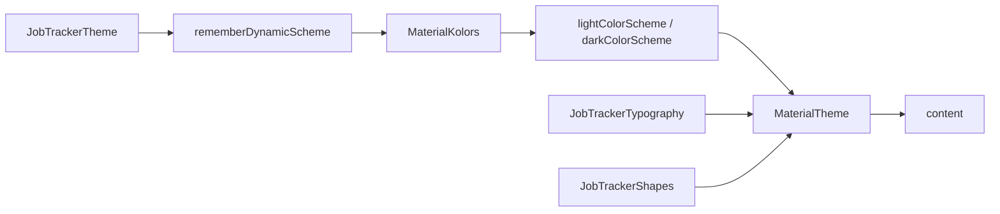

# Requirements

### Overview & Goals
Migrate from `material-kolor-material3` (6.0.0) to `material-kolor-core` (6.0.0) to eliminate the transitive dependency on `material3:1.12.0-alpha03` that causes the `*Emphasized` internal API build failures. This allows the project to use its declared stable Material 3 version (`1.9.0`) exclusively.

### Scope

**In Scope:**
- Replace `material-kolor-material3` with `material-kolor-core` in the version catalog
- Update `core-design-system/build.gradle.kts` dependency reference
- Rewrite `Theme.kt` to use `rememberDynamicScheme` + `MaterialKolors` with manual `ColorScheme` mapping

**Out of Scope:**
- Adding color scheme animation (the `DynamicMaterialExpressiveTheme` animation is lost; can be added later if needed)
- Changing the seed color, typography, or shapes
- Modifying any other module — only `core-design-system` is affected

### Key Decision
Use `material-kolor-core` (not force the Material 3 version). Forcing `1.9.0` via Gradle resolution strategy is fragile because MaterialKolor 6.0.0 compiles against `1.12.0-alpha03` APIs and may cause runtime `NoSuchMethodError`. Switching to `material-kolor-core` has **zero** Material 3 dependency, so the project's declared `1.9.0` is used cleanly.

# Technical Design

### Current Implementation

**Theme.kt** uses `DynamicMaterialExpressiveTheme` from `com.materialkolor.material3`:
```
DynamicMaterialExpressiveTheme(
    seedColor = seedColor,
    isDark = darkTheme,
    typography = JobTrackerTypography,
    shapes = JobTrackerShapes,
    content = content,
)
```

This pulls in `material-kolor-material3:6.0.0` → `material3:1.12.0-alpha03` (with internal `*Emphasized` APIs).

**libs.versions.toml** declares:
```
materialKolor-material3 = { module = "com.materialkolor:material-kolor-material3", version.ref = "materialKolor" }
```

**core-design-system/build.gradle.kts** references:
```
api(libs.materialKolor.material3)
```

### Proposed Changes

1. **libs.versions.toml**: Rename `materialKolor-material3` to `materialKolor-core` and change module to `com.materialkolor:material-kolor-core`.

2. **core-design-system/build.gradle.kts**: Update reference from `libs.materialKolor.material3` to `libs.materialKolor.core`.

3. **Theme.kt**: Replace `DynamicMaterialExpressiveTheme` with:
   - `rememberDynamicScheme(seedColor, isDark)` to generate the color scheme
   - `MaterialKolors(scheme)` to read individual color roles as Compose `Color` values
   - Manual `lightColorScheme`/`darkColorScheme` builder mapping all ~40 M3 color roles
   - Standard `MaterialTheme(colorScheme, typography, shapes, content)`

### Color Scheme Mapping

`MaterialKolors` exposes methods matching M3 color roles: `primary()`, `onPrimary()`, `primaryContainer()`, `onPrimaryContainer()`, `secondary()`, `onSecondary()`, `secondaryContainer()`, `onSecondaryContainer()`, `tertiary()`, `onTertiary()`, `tertiaryContainer()`, `onTertiaryContainer()`, `error()`, `onError()`, `errorContainer()`, `onErrorContainer()`, `surface()`, `onSurface()`, `surfaceDim()`, `surfaceBright()`, `surfaceContainerLowest()`, `surfaceContainerLow()`, `surfaceContainer()`, `surfaceContainerHigh()`, `surfaceContainerHighest()`, `onSurfaceVariant()`, `outline()`, `outlineVariant()`, `inverseSurface()`, `inverseOnSurface()`, `inversePrimary()`, `shadow()`, `scrim()`, `surfaceTint()`, `surfaceVariant()`.

Each role maps 1:1 to the corresponding parameter in `lightColorScheme`/`darkColorScheme`.

### Architecture Diagram



### Risks
- **Color scheme animation loss**: `DynamicMaterialExpressiveTheme` provided animated transitions between light/dark. The manual approach switches instantly. This can be added back with `AnimatedContent` or `Transition` if needed.
- **Boilerplate**: ~40 color roles need to be mapped explicitly. This is mechanical but verbose. The mapping is 1:1 with M3 roles, so correctness is straightforward.

# Delivery Steps

### ✓ Step 1: Update libs.versions.toml and build.gradle.kts to use material-kolor-core
Update the version catalog to replace `material-kolor-material3` with `material-kolor-core`.

- In `gradle/libs.versions.toml`, rename the library entry `materialKolor-material3` to `materialKolor-core` and change the module from `com.materialkolor:material-kolor-material3` to `com.materialkolor:material-kolor-core`.
- In `frontend/core/design-system/build.gradle.kts`, update the dependency reference from `libs.materialKolor.material3` to `libs.materialKolor.core`.

### ✓ Step 2: Rewrite Theme.kt to use rememberDynamicScheme and MaterialKolors with manual ColorScheme mapping
Replace `DynamicMaterialExpressiveTheme` with manual `MaterialTheme` + `ColorScheme` builder using `material-kolor-core`.

- In `Theme.kt`, remove the `import com.materialkolor.material3.DynamicMaterialExpressiveTheme`.
- Add imports for `rememberDynamicScheme`, `MaterialKolors` from `com.materialkolor`, and `lightColorScheme`/`darkColorScheme` from `androidx.compose.material3`.
- Generate the scheme with `rememberDynamicScheme(seedColor, isDark)` and wrap it in `MaterialKolors`.
- Build `lightColorScheme` and `darkColorScheme` by mapping all ~40 M3 color roles from `MaterialKolors` (primary, onPrimary, primaryContainer, onPrimaryContainer, secondary, onSecondary, secondaryContainer, onSecondaryContainer, tertiary, onTertiary, tertiaryContainer, onTertiaryContainer, error, onError, errorContainer, onErrorContainer, surface, onSurface, surfaceDim, surfaceBright, surfaceContainerLowest, surfaceContainerLow, surfaceContainer, surfaceContainerHigh, surfaceContainerHighest, onSurfaceVariant, outline, outlineVariant, inverseSurface, inverseOnSurface, inversePrimary, shadow, scrim, surfaceTint, surfaceVariant).
- Call `MaterialTheme(colorScheme = colorScheme, typography = JobTrackerTypography, shapes = JobTrackerShapes, content = content)` instead of `DynamicMaterialExpressiveTheme`.
- Verify the build succeeds with `./gradlew :frontend:core-design-system:compileAndroidMain`.