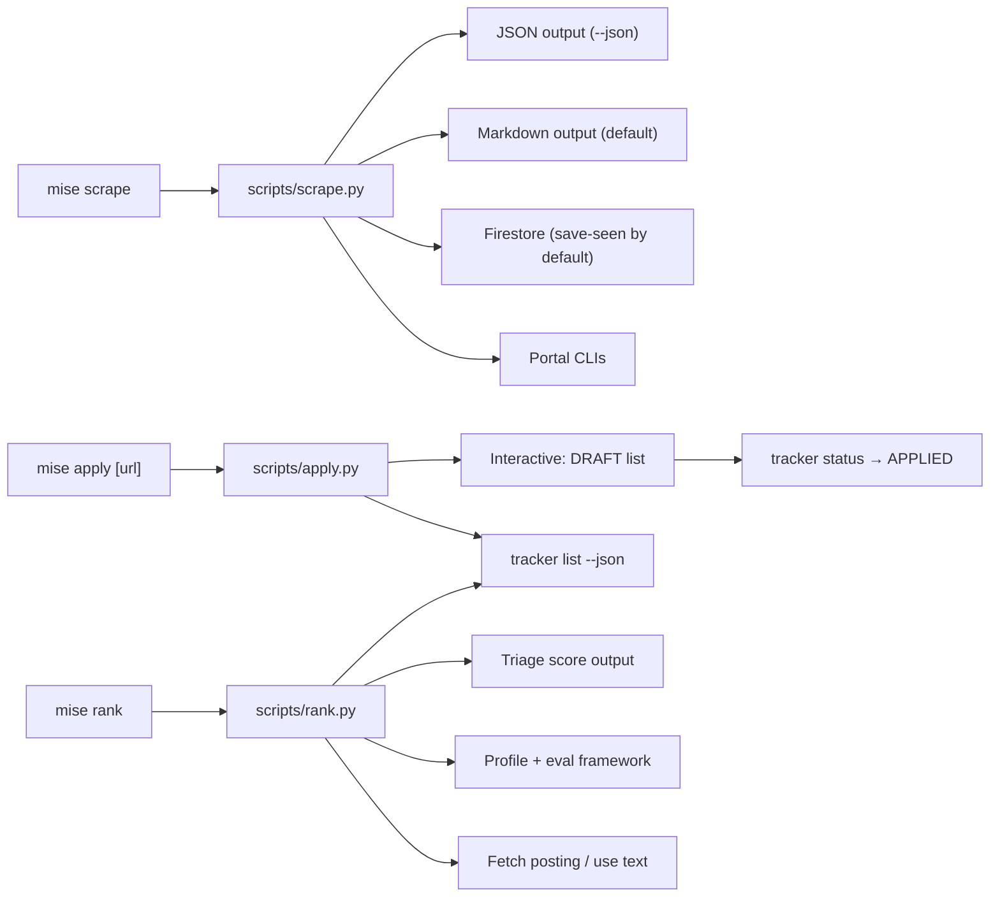

<!--
This plan has been moved to its canonical location.
See: .agents/plans/2026-11-05/230500_mise-task-changes.md
-->

# Requirements

### Overview
The user wants four changes to the `mise` task runner to improve the job search workflow:
1. Flip `mise scrape` output default from JSON to markdown, with `--json` as an opt-in.
2. Flip `mise scrape` to default to `--save-seen` (persist seen postings to Firestore), with `--no-save-seen` as an opt-out.
3. Add a top-level `mise apply` command that accepts a URL/JD or falls back to an interactive prompt over existing DRAFT applications.
4. Add a top-level `mise rank` command that accepts a required URL/JD and evaluates fit.

### Current State
- **`mise scrape`** — Defined in `mise.toml` (lines 227-242), backed by `scripts/scrape.py`. Currently defaults to JSON output with `--table` for markdown; `--save-seen` is opt-in. Usage spec at `scripts/specs/scrape.usage.kdl`.
- **`mise apply`** — Does not exist. The `/apply` workflow lives as a Claude command (`.claude/commands/apply.md`) and is fully agent-driven (fit evaluation, CV/cover letter drafting, reviewer agent, PDF compilation).
- **`mise rank`** — Does not exist. The `/rank` workflow lives as a Claude command (`.claude/commands/rank.md`) and is agent-driven (batch-scoring of scraped jobs).
- **Tracker statuses** — `tracker.schema.json` defines: `LEAD`, `DRAFTING`, `APPLIED`, `INTERVIEW`, `OFFER_EXPECTED`, `HIRED`, `REJECTED`, `NO_RESPONSE`, `OFFER_DECLINED`, `APPLICATION_WITHDRAWN`. `DRAFTING` (rank 1) represents applications with artifacts but not yet confirmed as submitted.

### In Scope
- Invert `scrape` output default (markdown default, `--json` flag).
- Invert `scrape` save-seen default (save-seen default, `--no-save-seen` flag).
- New `mise apply` task with interactive draft management.
- New `mise rank` task with single-job fit evaluation.
- Update `scripts/specs/scrape.usage.kdl` for completions/docs consistency.

### Out of Scope
- Modifying the agent-driven `/apply` or `/rank` Claude commands.
- Changing the tracker schema or status enum.
- Modifying the `scrape:migrate` task.
- Adding batch-ranking to `mise rank` (that remains in `/rank`).


# Technical Design

### Current Implementation

**Scrape pipeline:** `mise.toml` → `scripts/scrape.py` → portal CLIs (`.agents/skills/*/cli/src/cli.ts`). Output is JSON by default; `--table` renders markdown. `--save-seen` writes to Firestore opt-in. Usage spec at `scripts/specs/scrape.usage.kdl` feeds completions and docs.

**Apply workflow:** `.claude/commands/apply.md` — 6-step agent-driven process (parse input → evaluate fit → draft CV/cover letter → reviewer agent → compile PDFs → present). Creates artifacts in `job-applications/<company>/<role>/<date>/`. Tracker status `DRAFTING` is used for in-progress applications.

**Rank workflow:** `.claude/commands/rank.md` — 5-step agent-driven process (load state → batch-fetch and score → aggregate → update state → present shortlist). Scores from `seen_jobs.json` against the candidate profile.

**Tracker CLI:** `scripts/tracker.py` with subcommands including `list`, `status`, `event`, `score`, `artifact`. Status transitions via `mise run tracker status <id> <status>`. Events appended via `mise run tracker event <id> --type <type>`.

### Key Decisions

1. **`scrape` default inversion** — Swap the flag semantics: `--json` replaces `--table` as the opt-in; `--no-save-seen` replaces `--save-seen` as the opt-out. The Python script inverts its conditional logic accordingly.

2. **`apply` as a CLI thin wrapper** — The full `/apply` workflow is agent-driven (drafting, reviewing, compiling). The `mise apply` task will be a thin CLI that:
   - With a URL/JD argument: checks the tracker for existing records and prints guidance to run `/apply`.
   - Without arguments: enters interactive mode over DRAFT applications (those with status `DRAFTING`), allowing the user to review, mark as submitted, or discard.

3. **`rank` as a lightweight single-job evaluator** — Unlike the batch `/rank` command, `mise rank` will evaluate a single job (from URL or JD text) using the same scoring dimensions from `04-job-evaluation.md`. It will be non-agent and produce immediate output.

### Proposed Changes

#### 1. `scripts/scrape.py`
- Replace `--table` argument with `--json` (store_true). Default behavior becomes markdown table output.
- Replace `--save-seen` (store_true) with `--no-save-seen` (store_true). Default behavior becomes saving seen postings to Firestore.
- In `main()`: invert the conditional — Firestore DB is initialized by default; skipped only if `--no-save-seen`. Markdown table is the default output path; JSON is emitted only with `--json`.

#### 2. `mise.toml` (scrape task, lines 227-242)
- Replace `--table` flag with `--json` in the `usage` block.
- Replace `--save-seen` with `--no-save-seen`.
- Update the `run` template to pass the new flags.
- Update the description.

#### 3. `scripts/specs/scrape.usage.kdl`
- Mirror the flag changes: `--json` replaces `--table`; `--no-save-seen` replaces `--save-seen`.

#### 4. `scripts/apply.py` (new file)
- Accepts optional `[url_or_jd]` argument and `--mark-submitted` flag.
- **With argument:** queries `tracker list --json` to check for existing records; prints status and guidance.
- **Without argument (interactive):** queries `tracker list --status DRAFTING --json`, presents numbered list, allows user to:
  - View draft details
  - Mark as submitted (transitions DRAFTING → APPLIED via `tracker status` and `tracker event`)
  - Discard draft

#### 5. `scripts/rank.py` (new file)
- Accepts required `url_or_jd` argument and optional `--json` flag.
- Fetches posting content if URL, or uses text directly.
- Loads profile and evaluation framework.
- Computes triage score (Technical 30%, Experience 25%, Behavioral 15%, Career 30%).
- Checks deal-breakers from candidate profile.
- Outputs markdown summary (default) or JSON (`--json`).
- Checks tracker for existing records.

#### 6. `mise.toml` (new tasks)
- Add `apply` task definition with usage block and run template.
- Add `rank` task definition with usage block and run template.

### File Structure

```
Modified:
  mise.toml                          — scrape task flags + new apply/rank tasks
  scripts/scrape.py                  — inverted defaults for output and save-seen
  scripts/specs/scrape.usage.kdl     — mirrored flag changes

Added:
  scripts/apply.py                   — new CLI for apply workflow entry point
  scripts/rank.py                    — new CLI for single-job fit evaluation
```

### Architecture Diagram



### Risks
- **`--no-save-seen` typo in issue** — The user wrote `--no-save-screen` (with an extra 'r'). The plan uses `--no-save-seen` to match the existing `--save-seen` naming convention.
- **Firestore dependency for default save-seen** — Making save-seen the default means `mise scrape` will attempt a Firestore connection on every run. The existing fallback (print warning, continue in file-based mode) handles this gracefully.
- **`apply` interactive mode requires tracker access** — If Firestore is unavailable, the interactive draft management won't work. The script should print a clear error.


# Delivery Steps

### ✓ Step 1: Flip scrape defaults: markdown output and save-seen
Change `mise scrape` to default to markdown table output and `--save-seen` behavior, and add `--json` and `--no-save-seen` flags as opt-outs.

**scripts/scrape.py**:
- Change `--table` (store_true) to `--json` (store_true). When `--json` is NOT set (default), render the markdown table. When `--json` IS set, emit JSON.
- Change `--save-seen` (store_true, default false) to `--no-save-seen` (store_true, default false). Invert the logic: save-seen is now the default behavior; `--no-save-seen` skips it.
- Update the `main()` function: default path is markdown table output + Firestore save-seen; `--json` path emits JSON; `--no-save-seen` skips Firestore write.

**mise.toml** (scrape task):
- Replace `--table` flag with `--json` flag in the `usage` block.
- Replace `--save-seen` flag with `--no-save-seen` in the `usage` block.
- Update the `run` template to pass `--json` and `--no-save-seen` instead of `--table` and `--save-seen`.
- Update the task description to reflect the new defaults.

**scripts/specs/scrape.usage.kdl**:
- Replace `--save-seen` with `--no-save-seen`.
- Replace `--table` with `--json`.
- Update help text to reflect the inverted defaults.

### ✓ Step 2: Add top-level `apply` mise task
Create a new top-level `mise apply` task that accepts a URL or JD as input, and falls back to an interactive prompt over existing DRAFT applications.

**mise.toml**:
- Add a new `apply` task with:
  - `arg "[url-or-jd]"` — optional URL or job description text.
  - `flag "--mark-submitted"` — in interactive mode, offer to mark a draft as submitted (transition from DRAFTING to APPLIED).
  - The `run` script invokes `.venv/bin/python scripts/apply.py` with the parsed arguments.

**scripts/apply.py** (new):
- If `url-or-jd` is provided: print instructions for the user to run the `/apply` Claude command with the given input (since the full apply workflow is agent-driven and lives in `.claude/commands/apply.md`). The script will:
  1. Check if the application already exists in the tracker (via `tracker list --json`).
  2. If it exists and is in DRAFTING status, print the ID and current state.
  3. If it's new, print a summary and instruct the user to proceed with `/apply`.
- If no argument is provided (interactive mode):
  1. Query `mise run tracker list --status DRAFTING --json` to find all applications with artifacts but not yet confirmed as submitted.
  2. Present a numbered list of draft applications.
  3. Let the user pick one.
  4. Show the draft's details (company, role, artifacts, date).
  5. Offer options: (a) re-open the draft for editing, (b) mark as submitted (transition status to APPLIED via `mise run tracker status <id> APPLIED`), (c) discard.
  6. On mark-as-submitted, append an `event:applied` event and update the status.

This keeps the heavy agent-driven drafting workflow in the Claude command while providing a CLI entry point for the common cases.

### ✓ Step 3: Add top-level `rank` mise task
Create a new top-level `mise rank` task that accepts a URL or JD as input (required) and evaluates fit.

**mise.toml**:
- Add a new `rank` task with:
  - `arg "url-or-jd"` — required URL or job description text.
  - `flag "--json"` — output as JSON.
  - The `run` script invokes `.venv/bin/python scripts/rank.py` with the parsed arguments.

**scripts/rank.py** (new):
- Accept a required URL or JD argument.
- If the input is a URL, fetch the job posting content.
- If the input is text, use it directly as the job description.
- Load the candidate profile from `.claude/skills/job-application-assistant/01-candidate-profile.md`.
- Load the evaluation framework from `.claude/skills/job-application-assistant/04-job-evaluation.md`.
- Perform a quick triage score (technical match, experience match, behavioral match, career alignment) using the same weighting as `/rank` (Technical 30%, Experience 25%, Behavioral 15%, Career 30%).
- Check deal-breakers (consulting, hybrid stacks, people-management-only, compensation thresholds from the candidate profile).
- Output a ranked evaluation:
  - Default: markdown summary with score, verdict band (Strong/Good/Moderate/Weak/Poor Fit), strengths, gaps, and deal-breaker flags.
  - `--json`: structured JSON output.
- Optionally check if the job already exists in the tracker and note that.

This is a lightweight, non-interactive CLI version of the `/rank` workflow focused on single-job evaluation rather than batch scoring.