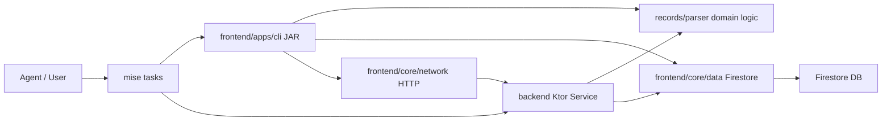

# Requirements

### Overview & Goals
Continue the RM-001 Kotlin-Only Migration (currently at 40% completion) by creating a comprehensive, phased plan to migrate the remaining ~54 Python scripts in `scripts/` and ~50 Python mise task files in `.config/mise/tasks/` to Kotlin. The target architecture is `Agent → mise → Kotlin JAR <ARGS>`.

### Current State
- **2 scripts deprecated**: `scripts/render.py` and `scripts/urls.py` have Kotlin equivalents in `records/parser/`
- **Kotlin infrastructure exists**: `records/parser/` (19 .kt files), `backend/` (3 .kt files), `frontend/apps/cli/` (13 command classes)
- **~54 scripts remain** in `scripts/` (excluding tests and the 2 deprecated)
- **~50 mise task files** are still Python scripts

### Scope
- **In Scope**: Migrate remaining Python scripts to Kotlin across three target modules (`records/parser/`, `frontend/apps/cli/`, `backend/`). Update mise tasks to invoke Kotlin JARs. Mark migrated scripts as deprecated. Remove Python dependencies.
- **Out of Scope**: Big-bang rewrite. AI-generated content (CVs, cover letters) remains agent-driven. LaTeX templates unchanged.

### Acceptance Criteria
- All Python scripts in `scripts/` have Kotlin equivalents or are archived
- Python dependencies removed from the project (`.venv`, `requirements.txt`, etc.)
- `mise` tasks invoke Kotlin JARs instead of Python scripts
- No behavioral regression from existing functionality
- TDD-driven: tests written or ported before implementation
- ROADMAP.md RM-001 updated to DONE with 100% completion

# Technical Design

### Current Architecture
```
scripts/ (Python)          →  records/parser/ (Kotlin domain logic)
.config/mise/tasks/*.py    →  frontend/apps/cli/ (Kotlin CLI commands)
backend/ (Kotlin HTTP)     →  already exists, grows with new endpoints
```

**Existing Kotlin patterns:**
- `records/parser/`: Pure Kotlin domain logic (EventChainBuilder, UrlSanitizer, ApplicationTimelineProjector, etc.)
- `frontend/apps/cli/`: Clikt-based CLI (AddApplicationCommand, AlignCommand, etc.)
- `backend/`: Ktor HTTP service (BackendService.kt)

### Script Categorization

The remaining ~54 scripts fall into 6 categories:

**Category 1 — Core Tracker Logic (highest priority, most complex)**
- `tracker.py` (3308 lines) — Main CLI, delegates to all other modules
- `contract.py` (422 lines) — Schema validation, derived fields, URL cleaning
- `events.py` (327 lines) — Event building, hash chaining, status derivation
- `alignment.py` — Fit recalculation, document ID alignment
- `reader.py` — Firestore read operations
- `tasks.py` — Task enqueueing for email sync

**Category 2 — Firestore Client & Infrastructure**
- `client.py` (139 lines) — Firestore/Storage client singleton
- `cache.py` — Offline cache for Firestore reads
- `sheets.py` — Google Sheets sync (projection, never source)
- `proposals.py` — Pending proposals management
- `artifacts.py` — GCS artifact management
- `importer.py` — CSV importer (one-time, can be archived)

**Category 3 — Search & Application Workflow**
- `scrape.py` — Job portal scraping
- `rank.py` — Fit ranking
- `apply.py` — Application generation orchestration
- `fit_evaluator.py` — Job fit evaluation logic

**Category 4 — Email Pipeline**
- `gmail_fetch.py` — Email deterministic fetch
- `reconcile_submissions.py` — Submission reconciliation

**Category 5 — Admin & DevOps**
- `backup_firestore.py` / `restore_firestore.py` — DB backup/restore
- `security_guards.py` — Supply chain security
- `_guard.py` — Mise-only enforcement
- `setup.py` — Environment setup
- `lint_skills.py` — Agent skills linter
- `generate_report.py` — HTML report generator
- `check_framework_version.py` / `check_upstream_updates.py` — Framework checks

**Category 6 — Salary & Utilities**
- `salary_lookup.py` — Salary benchmark lookup
- `convert_salary_excel.py` — Excel to JSON converter
- `mock_data.py` — Mock data generation
- `sync_local_artifacts.py` — Local artifacts sync
- `migrate_gcs.py` / `purge_gcs_legacy.py` — GCS migration (one-time, archive)

### Key Decisions

1. **Migration Order**: Follow RM-003 NEWEST-first principle. Start with Category 1 (core tracker) as it's the most actively used, then Category 3 (search), Category 4 (email), Category 2 (infra), Category 5 (admin), Category 6 (utils).

2. **Target Modules**:
   - Domain logic → `records/parser/` (pure Kotlin, no framework deps)
   - CLI commands → `frontend/apps/cli/` (Clikt-based)
   - HTTP endpoints → `backend/` (Ktor service)
   - Firebase client → `frontend/core/data/` (existing FirestoreProvider pattern)

3. **Deprecation Pattern**: Follow the existing 3-phase approach from `render.py`:
   - Phase 1: Implement Kotlin equivalent, mark Python DEPRECATED
   - Phase 2: Update callers to use Kotlin
   - Phase 3: Delete Python file

4. **One-time Scripts**: `importer.py`, `migrate_gcs.py`, `purge_gcs_legacy.py` can be archived directly without Kotlin migration as they're one-time operations already completed.

5. **Mise Task Migration**: Convert `.config/mise/tasks/*.py` to shell scripts that invoke Kotlin JARs, or to Kotlin entry points. Simple wrapper tasks can become `.sh` files.

### Proposed Changes

#### Phase 1: Core Tracker Logic (Category 1)
- Migrate `contract.py` → `records/parser/ContractValidator.kt` (schema validation, derived fields, dir normalization)
- Migrate `events.py` → extend `records/parser/EventChainBuilder.kt` (event building, validation, latestStatus)
- Migrate `tracker.py` subcommands → `frontend/apps/cli/commands/` (most already exist: Check, List, Get, Add, etc.)
- Migrate `alignment.py` → `records/parser/AlignmentEngine.kt` + extend `AlignCommand.kt`
- Migrate `reader.py` → `frontend/core/data/` (Firestore read operations, extending existing patterns)
- Migrate `tasks.py` → `records/parser/TaskEnqueuer.kt`

#### Phase 2: Search & Application (Category 3)
- Migrate `fit_evaluator.py` → `records/parser/FitEvaluator.kt`
- Migrate `rank.py` → `frontend/apps/cli/commands/RankCommand.kt`
- Migrate `scrape.py` → `frontend/apps/cli/commands/ScrapeCommand.kt` (orchestrates portal skills)
- Migrate `apply.py` → `frontend/apps/cli/commands/ApplyCommand.kt`

#### Phase 3: Email Pipeline (Category 4)
- Migrate `gmail_fetch.py` → `backend/` (email fetch service) + `frontend/apps/cli/commands/`
- Migrate `reconcile_submissions.py` → `backend/` (reconciliation endpoint)

#### Phase 4: Infrastructure (Category 2)
- Migrate `client.py` → `frontend/apps/cli/db/FirestoreProvider.kt` (already exists, extend)
- Migrate `cache.py` → `records/parser/TrackerCache.kt`
- Migrate `sheets.py` → `backend/` (Sheets sync endpoint)
- Migrate `proposals.py` → `frontend/apps/cli/commands/` (proposal commands)
- Migrate `artifacts.py` → `backend/` (artifact management endpoints)
- Archive `importer.py` (one-time CSV import, already completed)

#### Phase 5: Admin & DevOps (Category 5)
- Migrate `backup_firestore.py` / `restore_firestore.py` → `frontend/apps/cli/commands/` (backup/restore commands)
- Migrate `security_guards.py` → Kotlin script or keep as shell
- Archive `_guard.py` (Mise enforcement becomes unnecessary with no Python)
- Migrate `setup.py` → `frontend/apps/cli/commands/SetupCommand.kt`
- Migrate `lint_skills.py` → Kotlin or keep as shell
- Migrate `generate_report.py` → `frontend/apps/cli/commands/ReportCommand.kt`
- Archive framework check scripts (simple shell replacements)

#### Phase 6: Utilities (Category 6)
- Migrate `salary_lookup.py` / `convert_salary_excel.py` → `frontend/apps/cli/commands/`
- Migrate `mock_data.py` → `frontend/apps/cli/commands/MockDataCommand.kt`
- Archive `migrate_gcs.py` / `purge_gcs_legacy.py` (one-time ops)
- Migrate `sync_local_artifacts.py` → `frontend/apps/cli/commands/`

#### Phase 7: Mise Task Conversion
- Convert `.config/mise/tasks/*.py` to `.sh` wrappers invoking Kotlin JARs
- Update `mise.toml` to remove Python toolchain references
- Remove `.venv` and Python dependencies

#### Phase 8: Cleanup
- Delete deprecated Python scripts
- Remove Python from `mise.toml` tools
- Update ROADMAP.md RM-001 to DONE
- Update documentation references

### Architecture Diagram



### Risks
- **tracker.py (3308 lines)** is the largest single file; needs careful incremental migration
- **Google API dependencies** (Firestore, Sheets, GCS) have Kotlin equivalents via Firebase Admin SDK
- **Excel parsing** (`convert_salary_excel.py`) may need Apache POI or similar Kotlin library
- **Behavioral regression risk** mitigated by TDD: port existing Python tests to Kotlin first

# Testing

### Validation Approach
- TDD-driven: port Python tests to Kotlin before implementing migration
- Use existing `scripts/tests/` as the test specification
- Validate each phase with `./gradlew check` on affected modules
- Run `mise run dev:test` after each phase to verify end-to-end

### Key Scenarios
1. **Tracker CLI parity**: Each migrated `tracker.py` subcommand produces identical output to the Python version for the same input
2. **Event chain integrity**: `EventChainBuilder` produces identical hashes to Python `events.py`
3. **Schema validation**: `ContractValidator` rejects/accepts the same payloads as `contract.py`
4. **Fit evaluation**: `FitEvaluator` scores match `fit_evaluator.py` for the same job posting
5. **Email pipeline**: `email_fetch` Kotlin equivalent produces identical proposal staging

### Edge Cases
- Empty Firestore collections
- Legacy records with old event format
- URL sanitization edge cases (already tested in `UrlSanitizerTest.kt`)
- Schema version mismatches
- Missing credentials handling

### Test Changes
- Port `scripts/tests/test_contract.py` → `ContractValidatorTest.kt`
- Port `scripts/tests/test_fit_evaluator.py` → `FitEvaluatorTest.kt`
- Port `scripts/tests/test_reader.py` → data layer tests
- Port `scripts/tests/test_tracker_*.py` → CLI command tests
- Existing `records/parser/` tests serve as reference for test structure

# Delivery Steps

### ✓ Step 1: Phase 1: Core Tracker Logic Migration
Migrate the core tracker modules (contract.py, events.py, tracker.py, alignment.py, reader.py, tasks.py) to Kotlin.
- Migrate `contract.py` → `records/parser/ContractValidator.kt` (schema validation, derived fields, dir normalization, UUIDv7 validation)
- Extend `records/parser/EventChainBuilder.kt` with event building, validation, and `latestStatus` from `events.py`
- Migrate `alignment.py` → `records/parser/AlignmentEngine.kt` and extend `AlignCommand.kt`
- Migrate `tracker.py` subcommands not yet in `frontend/apps/cli/` (e.g., export, import, bulk, edit, labels, lead, mock-clear, proposals, status, sync-due, upsert)
- Migrate `reader.py` → `frontend/core/data/` extending existing FirestoreProvider pattern
- Migrate `tasks.py` → `records/parser/TaskEnqueuer.kt`
- Port tests: `test_contract.py`, `test_tracker_*.py` to Kotlin
- Mark migrated scripts as DEPRECATED with docstrings

### ✓ Step 2: Phase 2: Search & Application Workflow Migration
Migrate search, ranking, and application generation scripts to Kotlin CLI commands.
- Migrate `fit_evaluator.py` → `records/parser/FitEvaluator.kt` (job fit scoring logic) ✓
- Migrate `rank.py` → `records/parser/RankScorer.kt` + `frontend/apps/cli/commands/RankCommand.kt` ✓
- Migrate `scrape.py` → `frontend/apps/cli/commands/ScrapeCommand.kt` (orchestrates portal search skills)
- Migrate `apply.py` → `frontend/apps/cli/commands/ApplyCommand.kt` (application generation: fit eval + CV + cover letter)
- Port `test_fit_evaluator.py` → `FitEvaluatorTest.kt` ✓
- Mark migrated scripts as DEPRECATED

###   Step 3: Phase 3: Email Pipeline Migration
Migrate email-related scripts to Kotlin backend service and CLI commands.
- Migrate `gmail_fetch.py` → `backend/EmailFetchService.kt` + `frontend/apps/cli/commands/EmailFetchCommand.kt`
- Migrate `reconcile_submissions.py` → `backend/SubmissionReconciler.kt` + CLI command
- Add backend endpoints: `POST /email/fetch`, `POST /applications/{id}/reconcile`
- Port `test_email_fetch.py` → Kotlin tests
- Mark migrated scripts as DEPRECATED

###   Step 4: Phase 4: Infrastructure & Admin Migration
Migrate remaining infrastructure scripts and archive one-time operations.
- Migrate `client.py` patterns → extend `FirestoreProvider.kt` (already exists)
- Migrate `cache.py` → `records/parser/TrackerCache.kt`
- Migrate `sheets.py` → `backend/SheetsSyncService.kt`
- Migrate `proposals.py` → `frontend/apps/cli/commands/` (proposal list, approve, reject, show, expire)
- Migrate `artifacts.py` → `backend/ArtifactService.kt`
- Migrate `backup_firestore.py` / `restore_firestore.py` → CLI commands
- Migrate `security_guards.py` → Kotlin or shell replacement
- Migrate `setup.py` → `SetupCommand.kt`
- Migrate `generate_report.py` → `ReportCommand.kt`
- Archive one-time scripts: `importer.py`, `migrate_gcs.py`, `purge_gcs_legacy.py`
- Archive `_guard.py` (no longer needed without Python)