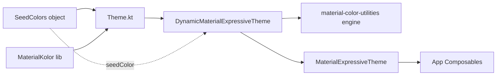

# Implementation Plan: RM-008 MaterialKolor Integration

**Status:** Draft / Proposed  
**Date:** 2026-11-11  
**Target:** `frontend`  
**Harness:** Junie  
**Model:** claude-4-sonnet  
**Session:** session-261111-005705-15gd  

---

## 1. Executive Summary & Goals

Integrate MaterialKolor (v6.0.0) into the `frontend/core/design-system` module to replace the manual color scheme derivation logic with Google's official `material-color-utilities` engine. This provides scientifically accurate Material 3 color harmonization across all platforms (Android, iOS, Desktop JVM, JS, Wasm).

**In Scope:**
- Add MaterialKolor dependency (`com.materialkolor:material-kolor-material3:6.0.0`) to the version catalog and design-system module
- Replace `buildLightColorScheme()` and `buildDarkColorScheme()` in `Color.kt` with MaterialKolor's `DynamicMaterialExpressiveTheme`
- Update `ROADMAP.md` RM-008 status to `DONE`

**Out of Scope:**
- Changing seed color options or the `SeedColors` object
- Modifying the Settings UI for theme customization
- Platform-specific theme files (they only handle system bars)
- Migration to MaterialKolor's expressive palette styles (keeping default `TonalSpot`)

**Functional Requirements:**
- The theme continues to accept a `seedColor` parameter (defaulting to `#2F5597` Professional Blue)
- Dark/light mode switching continues to work via `darkTheme` parameter
- All existing color roles (primary, secondary, tertiary, surface, etc.) remain available through `MaterialTheme.colorScheme`
- The `SeedColors` object and hex parsing utilities (`toColorOrNull`, `toHexString`) remain unchanged
- No visual regression — colors should be more accurate per Material Design spec

## 2. Architecture & Design Principles

### Current Implementation

The design system (`frontend/core/design-system`) uses:
- **`Color.kt`**: Manual `buildLightColorScheme()` / `buildDarkColorScheme()` functions that derive Material 3 colors from a seed using simple RGB arithmetic (e.g., `seed.red * 0.5f + 0.5f`). Many colors are hardcoded (secondary container, tertiary, background, etc.).
- **`Theme.kt`**: `JobTrackerTheme()` composable that calls the manual color scheme builders, then wraps content in `MaterialExpressiveTheme` (from Compose Material 3 alpha).
- **Version catalog**: `gradle/libs.versions.toml` manages all dependencies via type-safe catalogs.
- **Design-system build.gradle.kts**: Depends on `libs.bundles.compose.ui` which includes `compose-material3`.

### Key Decisions

**Use `material-kolor-material3` adapter** — The project uses Material 3 Expressive (`MaterialExpressiveTheme`), so the `material-kolor-material3` artifact is the right choice. It provides `DynamicMaterialExpressiveTheme` which wraps `MaterialExpressiveTheme` and generates color schemes from a seed.

**Keep `SeedColors` object and hex utilities** — These are used by the Settings UI for theme customization and are not affected by MaterialKolor.

**Remove manual color scheme functions** — `buildLightColorScheme()` and `buildDarkColorScheme()` will be deleted entirely since MaterialKolor handles both modes internally via `isDark` parameter.

**Default to `TonalSpot` palette style** — MaterialKolor defaults to `TonalSpot`, which produces colors closest to the current manual derivation.

### Architecture Diagram

### Risks

- **MaterialKolor 6.0.0 stability**: The library is recent (released ~15 days ago per Maven Central). Mitigation: pin to exact version `6.0.0` in the catalog.
- **Color appearance change**: MaterialKolor uses Google's official algorithm, so colors will differ slightly from the manual derivation. This is an improvement, not a regression.
- **Compose Multiplatform compatibility**: MaterialKolor supports Android, iOS, JVM, JS, and Wasm — matching the project's targets.

## 3. Proposed Changes & Implementation Steps

### Step 1: Add MaterialKolor dependency to version catalog and design-system module

**Files Modified:**
| File | Action |
|------|--------|
| `gradle/libs.versions.toml` | Modified — add version + library |
| `frontend/core/design-system/build.gradle.kts` | Modified — add dependency |

- Add `materialKolor = "6.0.0"` version entry to `gradle/libs.versions.toml` `[versions]` section
- Add `materialKolor-material3 = { module = "com.materialkolor:material-kolor-material3", version.ref = "materialKolor" }` to `[libraries]` section
- Add `api(libs.materialKolor.material3)` dependency to `frontend/core/design-system/build.gradle.kts` `commonMain.dependencies`
- Verify the project syncs and resolves the new dependency without errors

### Step 2: Replace manual color derivation with MaterialKolor in Theme and Color modules

**Files Modified:**
| File | Action |
|------|--------|
| `frontend/core/design-system/src/commonMain/.../Color.kt` | Modified — remove color scheme functions |
| `frontend/core/design-system/src/commonMain/.../Theme.kt` | Modified — use DynamicMaterialExpressiveTheme |
| `ROADMAP.md` | Modified — update RM-008 status |

- Delete `buildLightColorScheme()` and `buildDarkColorScheme()` from `Color.kt` (keep `SeedColors`, `toColorOrNull`, `toHexString`)
- Replace the color scheme derivation + `MaterialExpressiveTheme` call in `Theme.kt` with `DynamicMaterialExpressiveTheme(seedColor, isDark, typography, shapes)`
- Remove unused imports (`lightColorScheme`, `darkColorScheme`, `ColorScheme`, `luminance`) from `Color.kt`
- Update imports in `Theme.kt` to use MaterialKolor's `DynamicMaterialExpressiveTheme`
- Keep `SetupSystemBars`, `CompositionLocalProvider`, typography, and shapes configuration in `Theme.kt`
- Verify the project compiles across all targets (desktop, Android, JS/Wasm)
- Update RM-008 status in `ROADMAP.md` to `DONE` with completion date

## 4. Verification Plan & Testing Checklist

- [ ] Project syncs and resolves MaterialKolor 6.0.0 dependency without errors
- [ ] `frontend/core/design-system` compiles across all targets (desktop, Android, JS/Wasm)
- [ ] `JobTrackerTheme(seedColor, darkTheme)` signature remains unchanged
- [ ] Dark/light mode switching continues to work
- [ ] All color roles (primary, secondary, tertiary, surface, etc.) accessible via `MaterialTheme.colorScheme`
- [ ] `SeedColors.All` preset swatches still available for Settings UI
- [ ] `toHexString()` and `toColorOrNull()` utilities still work
- [ ] No visual regression — colors appear more accurate per Material Design spec
- [ ] Settings feature integrations unchanged (no modifications needed in `features/settings`)

## 5. Bookkeeping
- [ ] Plan persisted at `frontend/.agents/plans/2026-11-11/HHMMSS_rm-008-materialkolor-integration.md`
- [ ] Registry `frontend/.agents/plans/README.md` row added / status synchronized
- [ ] Craft a single commit of all changed files
- [ ] Stage changed files and craft a commit message based on the name of this file
- [ ] Push `git push origin main`