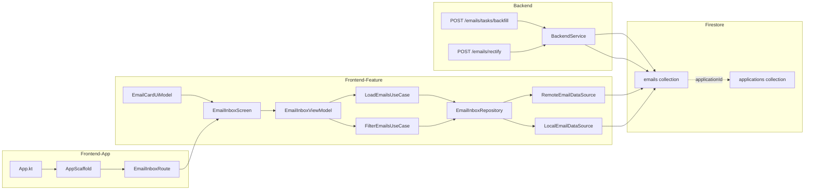

# Implementation Plan: RM-006 Email Inbox Top-Level Destination

## 1. Executive Summary & Goals

The RM-006 item requests a new top-level Email Inbox destination in the Compose Multiplatform app. This inbox surfaces the evidence emails used behind automated tracker decisions, showing `from`, `subject`, `body` (snippet), `labels`, and `date received`, tied to existing companies and job applications. The goal is to make the reasoning behind automated decisions transparent and auditable.

### Goals
1. Create a new top-level `emails` collection in Firestore, populated by a backfill command that reads from `generated/gmail-inbox.json` and correlates with existing applications.
2. Add a new "Emails" feature module in `frontend/features/email-inbox/` following the established data/domain/ui layered pattern.
3. Add "Emails" as a 5th top-level navigation destination in `AppScaffold`.
4. Provide a rectification flow so users can reassign misattributed emails to different applications or mark them as noise.
5. Display email details (from, subject, snippet, labels, date) in a list with filtering by application/company.

### Scope

**In Scope:**
- Backend: `POST /emails/tasks/backfill` endpoint to populate the `emails` collection from `gmail-inbox.json` + Firestore correlation
- Backend: `POST /emails/rectify` endpoint to reassign an email to a different application or mark as noise
- Mise task: `tracker:emails:backfill` wrapping the backend backfill endpoint
- Firestore: New top-level `emails` collection where each document is keyed by Gmail message ID
- Frontend: New `email-inbox` feature module (data/domain/ui layers)
- Frontend: Email list screen with search, filter by application, and detail view
- Frontend: Rectification dialog to reassign emails
- Frontend: 5th navigation bar item in `AppScaffold`
- Frontend: Navigation integration in `App.kt`

**Out of Scope:**
- Real-time Gmail synchronization (uses cached `gmail-inbox.json` populated by existing `mise` tasks)
- Email sending capabilities
- Reading full email bodies (snippet-only for privacy and performance)
- TUI changes for email inbox
- Web dashboard (HTML) changes

### User Stories
- As a user, I want to see all emails related to my job applications in one place so I can understand the evidence behind tracker decisions.
- As a user, I want to tap an email to see its details (from, subject, snippet, date, labels) and which application it's linked to.
- As a user, I want to reassign an email to a different application if it was misattributed, so my records stay accurate.
- As a user, I want to filter emails by application or company so I can focus on a specific role.

## 2. Architecture & Design Principles

### Current Implementation

**Firestore Data:**
- `applications/{id}` documents have `emailMessageIds: string[]` — a list of Gmail message IDs associated with the application
- `applications/{id}/events/{eventId}` documents have `emailMessageId: string?` — a single email ID on each event
- No top-level `emails` collection exists yet

**Email Infrastructure:**
- `generated/gmail-inbox.json` — cached inbox messages with `messageId`, `subject`, `sender`, `snippet`, `receivedAt`
- `gmail-sync/state.json` — processed message IDs from Gmail sync
- `BackfillEmailsCommand.kt` — CLI command that correlates Gmail messages with applications and writes `emailMessageIds` to Firestore
- `BackfillEmailsCommand.InboxMessage` — local data class with `messageId`, `subject`, `sender`, `snippet`, `receivedAt`

**Frontend Feature Pattern (from `companies-list`):**
- `data/` layer: `Repository` interface, `RemoteDataSource` + `LocalDataSource`, `RepositoryImpl`, DI module
- `domain/` layer: Use cases (LoadAll, Filter, Sort), DI module
- `ui/` layer: `XxxRoute` (NavKey), `XxxNavHook`, `XxxScreen`, `XxxViewModel`, `XxxUiState`, `XxxUiIntent`, `XxxUiModel`, components, DI module
- Each layer has its own `build.gradle.kts`
- Feature module registered in `App.kt` navigation `entryProvider` and `AppDI.kt`
- Top-level destinations defined in `AppScaffold.kt` `topLevelDestinations` list

**Navigation Pattern:**
- `@Serializable data object XxxRoute : NavKey` with `titleRes`
- `FeatureNavigationHook` factory function
- Polymorphic serializer registered in `App.kt` `navigationSavedStateConfig`
- `TopLevelDestination.from()` in `AppScaffold.kt` with route, label, icons

### Key Decisions

1. **Top-level `emails` collection keyed by Gmail message ID**: Each email document uses the Gmail message ID as the Firestore document ID (e.g., `emails/1a1c719c260d87b9`). This ensures uniqueness and allows O(1) lookups. Each document stores: `messageId`, `from`, `subject`, `snippet`, `labels`, `receivedAt`, `applicationId` (nullable), `companyId` (derived), `isNoise` (boolean), `rectifiedAt` (timestamp).

2. **Backfill command populates the collection**: The `POST /emails/tasks/backfill` backend endpoint reads `gmail-inbox.json`, correlates with Firestore applications (using the same logic as `BackfillEmailsCommand`), and writes documents to the `emails` collection. Existing `emailMessageIds` on applications are used to set `applicationId` on email documents.

3. **Rectification via reassignment**: The `POST /emails/rectify` endpoint allows changing `applicationId` on an email document or setting `isNoise=true`. This updates the application's `emailMessageIds` array to remove the reassigned email.

4. **Email inbox as 5th nav destination**: Following the existing pattern in `AppScaffold.kt`, adding a 5th `TopLevelDestination` entry. On compact screens, the bottom nav bar will have 5 items. On desktop, the navigation rail will show 5 items.

5. **Email detail as a sub-route, not a separate feature**: The email detail view is part of the `email-inbox` feature module, not a separate feature. Tapping an email shows a detail dialog/sheet within the inbox screen.

### Architecture Diagram



## 3. Proposed Changes & Implementation Steps

### Step 1: Backend email backfill and rectification endpoints

Add two new endpoints to the backend service:

**`POST /emails/tasks/backfill`** in `BackendService.kt`:
- Reads `generated/gmail-inbox.json` (or accepts messages in the request body for remote execution)
- For each message, looks up which application(s) have this `messageId` in their `emailMessageIds` array
- Writes a document to `emails/{messageId}` with fields: `messageId`, `from`, `subject`, `snippet`, `labels`, `receivedAt`, `applicationId`, `companyId`, `isNoise=false`
- Uses transactional writes to ensure idempotency (skip if document exists)
- Returns summary: total processed, new documents, skipped duplicates

**`POST /emails/rectify`** in `BackendService.kt`:
- Accepts: `messageId`, `applicationId` (nullable — null means mark as noise), `isNoise` (boolean)
- Updates the email document's `applicationId`, `isNoise`, and `rectifiedAt`
- If `applicationId` changed, removes the `messageId` from the old application's `emailMessageIds` and adds it to the new application's `emailMessageIds`
- Returns the updated email document

**Mise task `tracker:emails:backfill`**:
- Follows `remote/sweep.sh` pattern: resolves Cloud Run endpoint, calls `POST /emails/tasks/backfill`
- Local fallback via `gradlew -p backend run --args="--emails-backfill"`

### Step 2: Firestore `emails` data model and domain layer

**`Email.kt`** in `frontend/core/data/src/commonMain/.../model/`:
```
kotlin
data class Email(
    val id: String,              // Gmail message ID
    val from: String,
    val subject: String,
    val snippet: String,
    val labels: List<String>,
    val receivedAt: Instant,
    val applicationId: String?,  // nullable — null if noise or unattributed
    val companyId: String?,      // derived from application
    val isNoise: Boolean = false,
    val rectifiedAt: Instant? = null,
)
```

**`EmailInboxRepository`** interface in `features/email-inbox/data/`:
- `invoke(forceRefresh: Boolean): List<Email>` — load all emails
- `rectify(messageId: String, applicationId: String?, isNoise: Boolean): Email` — reassign email

**`RemoteEmailDataSource`**: Queries Firestore `emails` collection directly
**`LocalEmailDataSource`**: Room 3 entity + DAO for local cache (following `JobApplicationEntity` pattern)

**Domain use cases**:
- `LoadAllEmailsUseCase` — loads all emails from repository
- `FilterEmailsUseCase` — filters by search query, application ID, noise flag
- `SortEmailsUseCase` — sorts by received date (newest first by default)

### Step 3: Email inbox UI feature module

**`EmailInboxRoute.kt`** (Navigation):
```
kotlin
@Serializable
data object EmailInboxRoute : NavKey {
    override val titleRes: StringResource = Res.string.emails_route_title
}

fun emailInboxNavHook(
    onEmailClick: (emailId: String) -> Unit,
    onApplicationClick: (applicationId: String) -> Unit,
): FeatureNavigationHook
```

**`EmailInboxScreen.kt`**:
- Pull-to-refresh list of `EmailCard` components
- Search bar for filtering by subject/sender
- Filter chip to show/hide noise emails
- Empty state when no emails exist
- Detail dialog when tapping an email (shows full snippet, from, subject, date, labels, linked application)
- Rectification button in detail dialog (reassign to different application or mark as noise)

**`EmailCardUiModel`**:
```
kotlin
data class EmailCardUiModel(
    val id: String,
    val from: String,
    val subject: String,
    val snippet: String,
    val receivedAt: String,       // formatted date
    val applicationId: String?,
    val applicationLabel: String?, // "Company - Role" if linked
    val isNoise: Boolean,
    val labels: List<String>,
)
```

**`EmailInboxViewModel`**:
- `uiState: StateFlow<EmailInboxUiState>`
- `onIntent(intent: EmailInboxUiIntent)`
- Intents: Refresh, Search, FilterByApplication, ToggleNoise, RectifyEmail, SelectEmail

**String resources** in `composeResources/values/strings.xml`:
- `emails_route_title`, `emails_empty_message`, `emails_search_placeholder`
- `emails_detail_from`, `emails_detail_subject`, `emails_detail_date`
- `emails_detail_application`, `emails_detail_rectify`, `emails_detail_mark_noise`
- `emails_filter_all`, `emails_filter_noise`, `emails_filter_linked`

### Step 4: Navigation integration

**`App.kt`** changes:
- Add `EmailInboxRoute` to `navigationSavedStateConfig` polymorphic serializers
- Add `emailInboxNavHook` to `entryProvider`
- Pass callbacks to navigate to application details from emails

**`AppScaffold.kt`** changes:
- Add `isEmailsSelected` destination check
- Add `EmailInboxRoute` to `topLevelDestinations` list with `Icons.Filled.Email` / `Icons.Outlined.Email`
- Add `EmailInboxRoute` to `titleText` when block
- Add `EmailInboxRoute` to `selected` when blocks in NavigationBarItem and NavigationRailItem
- Add `isEmailsSelected` to `isTopLevelDestination`

**`AppDI.kt`** changes:
- Add `emailInboxFeatureModule` to `includes(...)` in `MainApplication`

**New string resources** in `apps/core` resources:
- `app_nav_emails`, `app_nav_emails_cd`

## 4. Verification Plan & Testing Checklist

- [ ] Backend compiles: `./gradlew -p backend compileKotlin`
- [ ] Frontend compiles: `./gradlew -p frontend compileKotlinJvm`
- [ ] Run `mise run tracker:emails:backfill` to populate `emails` collection
- [ ] Verify `emails` collection in Firestore has documents with correct fields
- [ ] Verify Email Inbox appears as 5th nav item in the app
- [ ] Verify email list loads and displays correctly
- [ ] Verify search filtering works
- [ ] Verify email detail dialog shows all fields
- [ ] Verify rectification flow reassigns emails correctly
- [ ] Verify navigating from email to application details works
- [ ] Verify no regression in existing navigation (Applications, Companies, Edits, Settings)

## 5. Bookkeeping
- [ ] Plan persisted at `.agents/plans/2026-11-10/162000_email-inbox-top-level-destination.md`
- [ ] Registry `README.md` row added / status synchronized
- [ ] Update RM-006 status to `IN_PROGRESS` in `ROADMAP.md`
- [ ] Craft a single commit of all changed files
- [ ] Stage changed files and craft a commit message based on the name of this plan
- [ ] Push `git push origin main`
