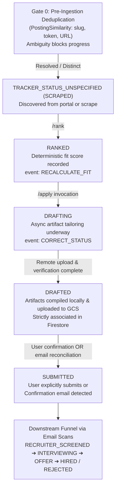

# Canonical Job Application Lifecycle & Funnel States

This document establishes the canonical lifecycle states, transition gates, and persistence rules for job applications across all monorepo subsystems (`records`, `backend`, `frontend`, `.agents`).

---

## 1. Funnel State Progression

Every application follows a strict unidirectional lifecycle progression. Applications **never jump prematurely** to downstream states (e.g. `SUBMITTED`), and unmapped or unrecognized inputs fall back to neutral (`TRACKER_STATUS_UNSPECIFIED`) rather than assuming submission.

---

## 2. State Definitions & Semantics

| State | Wire Key (`TrackerStatus`) | Rank | Kind | Description |
| :--- | :--- | :---: | :---: | :--- |
| **Scraped / Unspecified** | `TRACKER_STATUS_UNSPECIFIED` | 4 | Neutral Active | Newly scraped or ingested listing. Awaiting ranking or review. **Default fallback for unmapped input.** |
| **Ranked** | `RANKED` | 4 | Active | Evaluated against candidate profile via `RankScorer` (`search:rank`). Fit score (0-100) and rationale recorded via append-only event. |
| **Drafting** | `DRAFTING` | 4 | Active | Application workflow (`/apply`) invoked. Tailoring of CV, cover letter, `job-posting.md`, and `outcome.md` in progress. |
| **Drafted** | `DRAFTED` | 4 | Active | All artifacts compiled locally, validated, **uploaded to Remote Object Storage (GCS)** under `artifacts/<id>/`, and strictly registered in Firestore `applications/{id}.artifacts`. Immediately visible in `@frontend/apps`. |
| **Submitted** | `SUBMITTED` | 5 | Active | Application formally submitted to the hiring organization. Transitioned **only** upon explicit user confirmation or automated application acknowledgment email reconciliation. |
| **Recruiter Screened** | `RECRUITER_SCREENED` | 6 | Active | Recruiter screening scheduled or completed. Triggered by email scan. |
| **Interviewing** | `INTERVIEWING` | 7 | Active | Technical, architectural, or behavioral interview loop in progress. Carries strongly-typed `InterviewProgress`. |
| **Negotiating Pre-Offer** | `NEGOTIATING_PRE_OFFER` | 8 | Active | Leveling, compensation alignment, or team match discussion underway. |
| **Offer** | `OFFER` | 9 | Active | Formal offer extended by employer. |
| **Negotiating Post-Offer** | `NEGOTIATING_POST_OFFER` | 10 | Active | Counter-offer or post-offer negotiation in progress. |
| **Hired** | `HIRED` | 11 | Terminal Success | Candidate accepted offer; successful hire completed. |
| **No Response** | `NO_RESPONSE` | 0 | Terminal Inactive | Employer silence exceeding 30 days. |
| **Offer Declined** | `OFFER_DECLINED` | 1 | Terminal Inactive | Candidate declined extended offer. |
| **Application Withdrawn** | `APPLICATION_WITHDRAWN` | 2 | Terminal Inactive | Candidate voluntarily withdrew from consideration. |
| **Rejected** | `REJECTED` | 3 | Terminal Inactive | Employer rejected candidate. Transitioned via email scan proposal reconciliation. |

---

## 3. Strict Transition Gates

### Gate 0: Pre-Ingestion Deduplication & Ambiguity Halting
- **Rule:** No database record may be created or mutated before deduplication against existing Firestore applications is complete.
- **Implementation:** [`PostingSimilarity.kt`](file:///Users/fnc314/Work/Search/ai-job-tracker/records/parser/src/main/kotlin/dev/fnc314/aijobtracker/records/parser/PostingSimilarity.kt).
- **Collision Criteria:**
  - Identical canonical company slug + sanitized role token overlap $\ge 75\%$.
  - Matching document ID (`DocumentIdGenerator.documentId(company, role)`).
  - Matching normalized job posting URL (ignoring query parameters and trailing slashes).
- **Action on Match:** Pipeline **halts execution immediately**. No documents are written. The user must provide explicit resolution:
  - `merge`: Update/re-post to existing application document.
  - `new`: Confirmed distinct opening; creates suffixed record (e.g. `--YYYY-MM-DD`).
  - `skip`: Discard duplicate; abort without writing.

### Gate 1: Non-Regression of Progressed Applications
- When `RankScorer` re-evaluates an application that already progressed beyond initial ranking (e.g. `DRAFTED`, `SUBMITTED`, `INTERVIEWING`), it updates `fitRating` and emits `RECALCULATE_FIT` **without regressing `status` back to `RANKED`**.

### Gate 2: Mandatory Remote Object Storage (GCS) Binding
- Generated LaTeX CVs, cover letters, `job-posting.md`, and `outcome.md` must be uploaded to `gs://$TRACKER_BUCKET/artifacts/<applicationId>/` before the application can enter `DRAFTED`.
- Firestore `applications/{id}.artifacts` must contain the populated references with `remoteUrl` and `pdfRemoteUrl`.
- If upload fails, the application remains in `DRAFTING`.

### Gate 3: Submission Exclusivity
- `/apply` pipelines and automated drafting scripts **never** default or auto-advance to `SUBMITTED`.
- The `--submitted` flag cannot be combined with asset drafting in `apply`.
- Submission is triggered strictly by:
  1. Explicit user directive (`/outcome <company>` or `tracker edit <id> --status SUBMITTED`).
  2. Automated confirmation email detection via `email:collect`.

### Gate 4: Post-Submission Email-Driven Funnel
- From `SUBMITTED` onward, transitions (`RECRUITER_SCREENED`, `INTERVIEWING`, `OFFER`, `REJECTED`) are driven almost exclusively via `email:collect` and proposal reconciliation (`proposals:approve`).
- Manual status changes are reserved for withdrawals or offline interactions.
