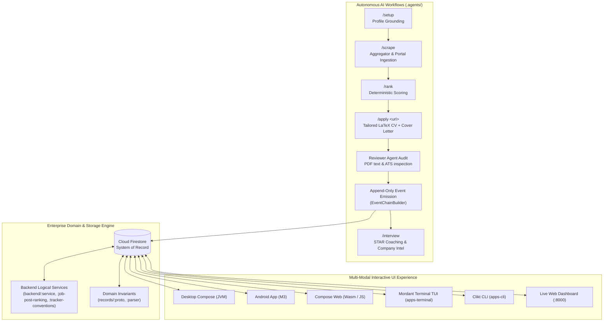

<p align="center">
  
</p>

# AI Job Search & Personal Application OS

_The job search platform that runs entirely on your machine._

[](https://github.com/fnc314/ai-job-search/actions/workflows/ci.yml)
[](https://kotlinlang.org)
[](https://www.jetbrains.com/lp/compose-multiplatform/)
[](https://mise.jdx.dev)
[](#event-sourced-system-of-record)
[](LICENSE)

---

## A Lifeline in an Exhausting Job Market

Navigating today's tech job search can feel disheartening, opaque, and dehumanizing: hundreds of customized cover letters sent into ATS black holes, ghosting, uncoordinated follow-ups, and cognitive overload from juggling tracking sheets.

**This framework was forged to take back control.**

It is an autonomous career cockpit that transforms your personal AI CLI into an empathetic, tireless, and hyper-competent Chief of Staff. It eliminates repetitive friction: discovering listings across aggregators and direct portals, computing deterministic match scores against your verified profile, drafting tailored LaTeX CVs and cover letters, running multi-agent critique audits, generating STAR interview cheat-sheets, and automatically capturing application milestones with zero manual bookkeeping.

Simultaneously, this repository doubles as an **enterprise flagship portfolio** — demonstrating modern architecture, Kotlin Multiplatform mastery, event-sourced domain design, deterministic scoring pipelines, and rigorous engineering quality gates across CLI, terminal, web, desktop, and mobile surfaces.

---

## System Overview & Unified Agent Flow

Whether you drive your search via **Claude Code**, **Google Gemini / Antigravity**, **OpenCode**, or **Codex**, the system standardizes agent capabilities through the **Universal Agent Pattern** (`.agents/`). For detailed state definitions, Gate 0 deduplication, and transition requirements, see [`JOB-APPLICATION-STATES.md`](./JOB-APPLICATION-STATES.md).



---

## Architectural Principles & Monorepo Structure

The repository adheres to strict modern engineering standards: isolated modular boundaries, composite builds, interface-first naming, strict `explicitApi()`, and unified dependency catalogs.

### 1. Isolated Gradle Composite Build Architecture

Instead of an unwieldy mega-project with coupled build logic, the repository is partitioned into isolated, self-contained Gradle included builds united by a shared Version Catalog ([`gradle/libs.versions.toml`](gradle/libs.versions.toml)):

```
ai-job-search/
├── backend/                  # Pure headless backend services & deterministic business engines
│   ├── service/              # Core Ktor microservice & Firestore sync operations
│   ├── job-post-ranking/     # Standalone deterministic match scoring engine
│   ├── tracker-conventions/  # Canonical slugification, URL sanitization & ID generation
│   ├── email-classification/ # Email intent & proposal categorization engine
│   ├── company-metadata-enrichment/ # Company enrichment & sector resolution
│   └── event-chain/          # Cryptographic event hashing & chain verification
│
├── frontend/                 # Kotlin Multiplatform Compose client applications & UI suite
│   ├── apps/
│   │   ├── cli/              # Headless developer & automation Clikt CLI (`mise run tracker`)
│   │   ├── terminal/         # Rich terminal interactive dashboard (Mordant TUI, `mise run tui`)
│   │   ├── desktop/          # Native Desktop GUI application (JVM)
│   │   ├── android/          # Native Android Material 3 application
│   │   └── web/              # Compose for Web (Wasm & JavaScript)
│   ├── core/                 # Shared design system, UI widgets, network, & offline data layers
│   └── features/             # Modular, MVI feature packages (applications, companies, settings, edits)
│
├── records/                  # System-wide domain types and wire protocols
│   ├── proto/                # Protocol Buffer definitions (`tracker/v1/application.proto`)
│   └── parser/               # Timeline projectors, cache engines & proto converters
│
├── internal/                 # Internal developer and maintainer applications
│   └── apps/terminal/roadmap/# Interactive Roadmap management TUI (`mise run roadmap:edit`)
│
├── tests/                    # Monorepo-wide Konsist architectural enforcement test suites
│   └── src/test/kotlin/...   # Zero tool leakage, KDoc enforcement, explicit visibility
│
├── gradle/tools/             # Custom convention plugins and shared Gradle settings
└── .agents/                  # Universal AI agent instructions, portable skills & slash commands
```

### 2. "Backend" as Headless Logic & Distributed Services

In this architecture, **"Backend" carries zero user interface**. It represents pure headless logical services, scheduled background tasks, deterministic evaluation rules, and third-party webhooks (e.g., email ingestion, company data enrichment, Hunter.io resolvers). UI code is strictly sequestered inside `frontend/`.

### 3. Event-Sourced System of Record

Cloud Firestore is the single authoritative system of record (`applications`, `companies`, `emails`).

- **Append-Only History:** Application status changes, recruiter interactions, notes, and salary negotiations are logged as immutable events in `applications/{id}/events`.
- **Zero Fabrication (Grounding):** No AI tool is permitted to fabricate achievements or metrics. All generated materials are audited against [`01-candidate-profile.md`](.agents/skills/job-application-assistant/01-candidate-profile.md).
- **Interface-First Naming:** Public APIs, data models, and services name their role and capability (`Remote`, `Local`, `Network`, `Email`, `Blob`), never vendor or third-party tool implementations.

---

## Multi-Modal User Experience

Manage and inspect your search across whatever medium suits your flow:

| Surface             | Interface                   | How to Launch                       | Highlights                                                                                      |
| :------------------ | :-------------------------- | :---------------------------------- | :---------------------------------------------------------------------------------------------- |
| **Desktop GUI**     | Compose Multiplatform (JVM) | `mise run frontend:desktop:run`     | Full responsive windowed desktop application, split-pane detail views, offline caching.         |
| **Mobile App**      | Android (Compose M3)        | `mise run frontend:android:install` | Native Material 3 app, offline-first Room-backed database, dynamic theming.                     |
| **Web App**         | Compose Web (Wasm / JS)     | `mise run frontend:web:wasm:dev`    | Modern browser-based dashboard running Kotlin compiled directly to WebAssembly.                 |
| **Interactive TUI** | Mordant Terminal UI         | `mise run tui`                      | Fast, keyboard-driven console experience; live filtering, review queue, and quick PDF launcher. |
| **Headless CLI**    | Clikt Kotlin CLI            | `mise run tracker <command>`        | Scriptable terminal operations for listing, inspecting, updating, and scoring.                  |
| **Roadmap TUI**     | Internal Manager            | `mise run roadmap:edit`             | Developer TUI to review milestones, inspect complexity, and update development items.           |
| **Web Dashboard**   | Lightweight HTML/SVG Server | `mise run dashboard`                | Zero-dependency local visualizer (`http://127.0.0.1:8000`) for pipeline statistics.             |

---

## Autonomous Agent Skills & Workflows

All agent workflows are self-contained and portable across Claude Code, Gemini, OpenCode, and Codex via `.agents/commands/`:

- **/setup** — Interactive interview initializing your verified candidate profile, target roles, salary floors, and deal-breakers.
- **/scrape** — Multi-source discovery across LinkedIn, FreeHire, and regional portals with automatic deduplication.
- **/rank** — Pure deterministic scoring evaluating job postings against skills, domain match, and compensation.
- **/apply `<url>`** — End-to-end drafter-reviewer pipeline generating tailored LaTeX documents with strict verification.
- **/interview** — Stage-specific coaching (technical deep dives, company research, and STAR behavioral prep).
- **/outcome** — Funnel milestone recorder that safely writes append-only lifecycle events into Firestore.

---

## Task Automation Reference (`mise`)

The repository uses [`mise`](https://mise.jdx.dev/) for unified command orchestration across toolchains:

### Search & Pipeline Management

```bash
mise run scrape                     # Scrape active postings across configured search portals
mise run search:rank                # Compute deterministic match scores across new postings
mise run tracker list --open        # List all currently active applications
mise run tracker get <id>           # Inspect detailed history and events for an application
mise run tracker score <id>         # Recalculate deterministic fit score for an application
mise run align                      # Realign IDs, reproject notes, and refresh outcome summaries
```

### Email Integration & Proposals

```bash
mise run email:sync-labels          # Synchronize provider email labels and folder mappings
mise run email:read-inbox           # Ingest job-related correspondence into local payloads
mise run email:collect              # Stage discovered application updates as reviewable proposals
```

### Multiplatform Builds & Quality Gates

```bash
mise run frontend:build             # Build all Kotlin Multiplatform targets
mise run frontend:desktop:run       # Launch Compose desktop client
mise run dev:test                   # Execute unit tests across parser, CLI, and services
mise run dev:konsist                # Run Konsist architectural rules and KDoc audit
mise run dev:detekt                 # Run Detekt static analysis
mise run dev:guards                 # Verify supply-chain permissions and naming constraints
```

---

## Prerequisites & Quickstart

### Prerequisites

1. **AI Assistant CLI**: [Claude Code](https://claude.ai/code), [Gemini CLI / Antigravity](https://github.com/google-gemini), [OpenCode](https://opencode.dev), or Codex.
2. **Task Runner**: [mise](https://mise.jdx.dev/) (`brew install mise` or `curl https://mise.run | sh`).
3. **Runtimes**: JDK 17+ (JDK 21 recommended), Python 3.10+, [Bun](https://bun.sh).
4. **Document Compilers**: `lualatex` or `pdflatex` (for CV) and `xelatex` (for Cover Letter) via BasicTeX (`brew install --cask basictex` — recommended lightweight option), MacTeX, TeX Live, or MiKTeX; `pdftotext` (`brew install poppler`).

### Setup

```bash
# 1. Clone repository and install toolchains
git clone https://github.com/fnc314/ai-job-tracker.git
cd ai-job-search
mise install

# 2. Run environment validation & dependency check
mise run setup --check

# 3. Launch your AI environment
antigravity # or claude, opencode
```

Inside your AI CLI session, initialize your background:

```text
/setup
```

---

## Attribution & Origins

This project originated as a fork of [**ai-job-search**](https://github.com/MadsLorentzen/ai-job-search) created by [**Mads Lorentzen**](https://www.linkedin.com/in/mads-lorentzen/). When Mads faced sudden unemployment in late 2025, he built the original agentic pipeline to run his search — landing 20 first-round interviews and an AI engineering role in June 2026.

We honor that original spark: a developer using code to turn an overwhelming process into an empowering, structured journey. This fork expands upon that vision with an enterprise Kotlin Multiplatform architecture, deterministic ranking algorithms, multi-module distributed Gradle engineering, and an expansive multi-modal UI suite.

- **Original Creator:** [Mads Lorentzen](https://github.com/MadsLorentzen) ([ai-job-search](https://github.com/MadsLorentzen/ai-job-search))
- **Portal Search Integrations:** [Mikkel Kroghsholm](https://github.com/mikkelkrogsholm)

---

## License

Distributed under the [MIT License](LICENSE).
