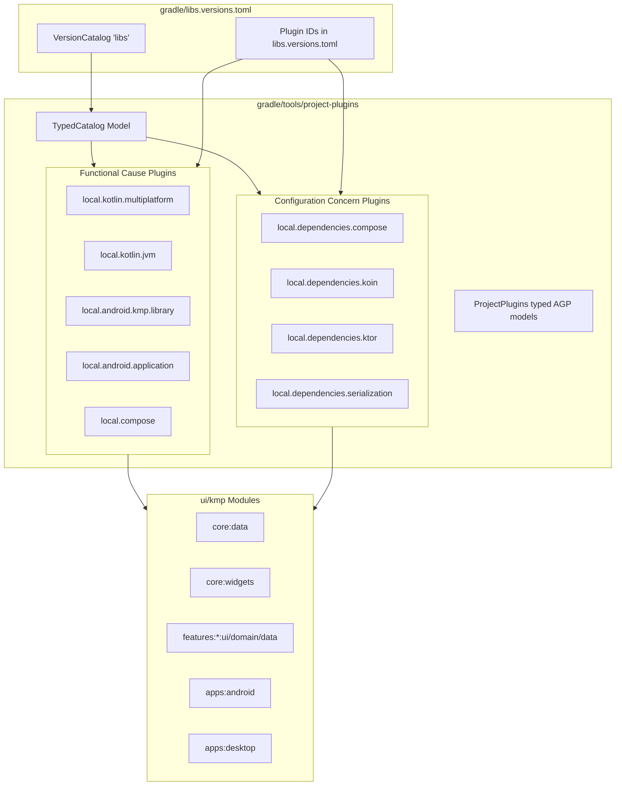

# Architecture Plan: Custom Gradle Convention Plugins (gradle/tools/project-plugins)

**Status:** Completed  
**Date:** 2026-11-05  
**Target:** ui/kmp:gradle/tools/project-plugins  

---

## 1. Executive Summary & Goals

Over the project's evolution, build scripts across `ui/kmp` (17 subprojects across `apps/`, `core/`, `features/`, and `shared/`) have accumulated significant duplication in:
- Multiplatform target configuration (`jvm`, `js`, `wasmJs`, `iosArm64`, `iosSimulatorArm64`, `androidLibrary`)
- Android SDK versions (`compileSdk = 37`, `minSdk = 24`, `targetSdk = 37`, Java 17 compatibility)
- Kotlin compiler settings (`jvmTarget = JvmTarget.JVM_17`, `-Xexpect-actual-classes`)
- Repetitive dependency bundles (`compose.ui`, `koin`, `ktor.client`, `serialization`)

This plan establishes a suite of custom convention plugins defined within the `gradle/tools/project-plugins` included build. It fulfills four core requirements:
1. **Catalog-Driven Plugin IDs**: All plugin IDs declared and maintained centrally in `gradle/libs.versions.toml`.
2. **Separation of Concerns**: Strict bifurcation into **Functional Cause** plugins (toolchains, SDKs, targets) vs. **Configuration Concern** plugins (targeted dependency sets).
3. **Type-Safe `VersionCatalog` Accessor**: A typed catalog model eliminating brittle `.findLibrary("...")` / `.findVersion("...")` string lookups.
4. **Enforced Uniformity for Kotlin**: Centralized configuration of Kotlin toolchains, targets, and compiler flags across all subprojects.

---

## 2. Architecture & Plugin Taxonomy



### 2.1 Functional Cause Plugins (Infrastructure & Toolchains)
These plugins configure build environments, compilation targets, and platform extensions without bundling application-specific libraries.

| Plugin ID Alias | Plugin ID | Implementation Class | Responsibilities |
|---|---|---|---|
| `libs.plugins.local.kotlin.multiplatform` | `dev.fnc314.tools.jobtracker.kotlin-multiplatform` | `KotlinMultiplatformConventionPlugin` | Configures `org.jetbrains.kotlin.multiplatform`, sets JVM toolchain to 17, configures standard targets (`jvm`, `js`, `wasmJs`, `ios`), sets unified compiler options (`-Xexpect-actual-classes`, `jvmTarget = JVM_17`). |
| `libs.plugins.local.kotlin.jvm` | `dev.fnc314.tools.jobtracker.kotlin-jvm` | `KotlinJvmConventionPlugin` | Configures `org.jetbrains.kotlin.jvm`, sets JVM toolchain to 17, configures JVM compilation options. |
| `libs.plugins.local.android.kmp.library` | `dev.fnc314.tools.jobtracker.android-kmp-library` | `AndroidKmpLibraryConventionPlugin` | Implements `ProjectPlugins.MultiplatformLibrary`, configures `compileSdk`, `minSdk`, automatically infers `namespace` from project path (e.g. `dev.fnc314.tools.jobtracker.core.data`), enables host test resources. |
| `libs.plugins.local.android.application` | `dev.fnc314.tools.jobtracker.android-application` | `AndroidApplicationConventionPlugin` | Implements `ProjectPlugins.AndroidApplication`, configures `com.android.application`, `compileSdk`, `minSdk`, `targetSdk`, Java 17 compatibility, packaging rules, and release build types. |
| `libs.plugins.local.compose` | `dev.fnc314.tools.jobtracker.compose` | `ComposeConventionPlugin` | Applies `org.jetbrains.compose` and `org.jetbrains.kotlin.plugin.compose`. Configures Compose compiler flags without injecting UI libraries. |

### 2.2 Configuration Concern Plugins (Dependencies)
These plugins encapsulate specific, cohesive dependency sets across modules without touching build toolchains.

| Plugin ID Alias | Plugin ID | Implementation Class | Target SourceSets & Dependencies |
|---|---|---|---|
| `libs.plugins.local.dependencies.compose` | `dev.fnc314.tools.jobtracker.dependencies.compose` | `ComposeDependenciesConventionPlugin` | `commonMain`: `libs.bundles.compose.ui`<br>`androidMain`: `libs.bundles.compose.tooling` |
| `libs.plugins.local.dependencies.koin` | `dev.fnc314.tools.jobtracker.dependencies.koin` | `KoinDependenciesConventionPlugin` | `commonMain`: `libs.bundles.koin` (`koin-core`, `koin-compose`, `koin-viewmodel`) |
| `libs.plugins.local.dependencies.ktor` | `dev.fnc314.tools.jobtracker.dependencies.ktor` | `KtorDependenciesConventionPlugin` | `commonMain`: `libs.bundles.ktor.client`<br>`androidMain`: `ktor-client-okhttp`<br>`jvmMain`: `ktor-client-cio`<br>`iosMain`: `ktor-client-darwin`<br>`jsMain`: `ktor-client-js` |
| `libs.plugins.local.dependencies.serialization`| `dev.fnc314.tools.jobtracker.dependencies.serialization` | `SerializationDependenciesConventionPlugin` | Applies `org.jetbrains.kotlin.plugin.serialization`<br>`commonMain`: `kotlinx-serialization-json` |

---

## 3. Typed `VersionCatalog` Accessor Design

### 3.1 The Problem
Inside standard convention plugins located in an included build, Gradle only provides the generic API:
```kotlin
// Brittle, error-prone string lookups
val catalog = project.extensions.getByType(VersionCatalogsExtension::class.java).named("libs")
val compileSdk = catalog.findVersion("android-compileSdk").get().requiredVersion.toInt()
val composeBundle = catalog.findBundle("compose-ui").get()
```

### 3.2 The Typed Model Solution: `CatalogTypes<out T>` Sealed Hierarchy

> [!IMPORTANT]
> **Strict ABI Separation (`explicitApi()` Mode)**:
> In accordance with Kotlin's explicit API mode, all catalog models, base interfaces, and utility lookups are strictly **`internal`**. Only the concrete `Plugin<Project>` classes (and any public extensions explicitly intended to be configured in consumer `build.gradle.kts` scripts) are marked **`public`**.

Instead of loosely structured accessor classes, we define an internal unified `CatalogTypes<out T>` sealed interface where each catalog category (Versions, Libraries, Bundles, Plugins) is a strongly-typed enum implementing `CatalogTypes<T>`:

```kotlin
package dev.fnc314.tools.jobtracker.kmp.gradle.catalog

import org.gradle.api.Project
import org.gradle.api.artifacts.ExternalModuleDependencyBundle
import org.gradle.api.artifacts.MinimalExternalModuleDependency
import org.gradle.api.artifacts.VersionCatalog
import org.gradle.api.artifacts.VersionCatalogsExtension
import org.gradle.api.artifacts.VersionConstraint
import org.gradle.api.provider.Provider
import org.gradle.plugin.use.PluginDependency

/** Base typed contract for catalog entry lookups. Kept internal to prevent leaking to consuming buildscripts. */
internal sealed interface CatalogTypes<out T> {
    public val catalogKey: String
    public fun fromCatalog(project: Project): T

    public operator fun invoke(project: Project): T = fromCatalog(project)

    /** Strongly-typed version constraints from libs.versions.toml */
    public enum class Versions(
        override val catalogKey: String,
    ) : CatalogTypes<VersionConstraint> {
        JVM("jvm"),
        ANDROID_COMPILE_SDK("android-compileSdk"),
        ANDROID_MIN_SDK("android-minSdk"),
        ANDROID_TARGET_SDK("android-targetSdk"),
        KOTLIN("kotlin"),
        AGP("agp"),
        NODE("node");

        override fun fromCatalog(project: Project): VersionConstraint =
            project.versionCatalog.findVersion(catalogKey).orElseThrow {
                IllegalArgumentException("Missing version '$catalogKey' in catalog")
            }

        public fun asString(project: Project): String = fromCatalog(project).requiredVersion
        public fun asInt(project: Project): Int = asString(project).toInt()
    }

    /** Strongly-typed library coordinates from libs.versions.toml */
    public enum class Libraries(
        override val catalogKey: String,
    ) : CatalogTypes<Provider<MinimalExternalModuleDependency>> {
        KOTLINX_COROUTINES_CORE("kotlinx-coroutines-core"),
        KOTLINX_DATETIME("kotlinx-datetime"),
        KOTLINX_SERIALIZATION_JSON("kotlinx-serialization-json"),
        KOTLIN_TEST("kotlin-test"),
        KTOR_CLIENT_OKHTTP("ktor-client-okhttp"),
        KTOR_CLIENT_CIO("ktor-client-cio"),
        KTOR_CLIENT_DARWIN("ktor-client-darwin"),
        KTOR_CLIENT_JS("ktor-client-js"),
        COMPOSE_UI_TOOLING("compose-uiTooling");

        override fun fromCatalog(project: Project): Provider<MinimalExternalModuleDependency> =
            project.versionCatalog.findLibrary(catalogKey).orElseThrow {
                IllegalArgumentException("Missing library '$catalogKey' in catalog")
            }
    }

    /** Strongly-typed dependency bundles from libs.versions.toml */
    public enum class Bundles(
        override val catalogKey: String,
    ) : CatalogTypes<Provider<ExternalModuleDependencyBundle>> {
        COMPOSE_UI("compose-ui"),
        COMPOSE_TOOLING("compose-tooling"),
        KTOR_CLIENT("ktor-client"),
        KOIN("koin"),
        ANDROIDX_LIFECYCLE_COMPOSE("androidx-lifecycle-compose"),
        FIREBASE_ANDROID("firebase-android"),
        FIREBASE_JVM("firebase-jvm");

        override fun fromCatalog(project: Project): Provider<ExternalModuleDependencyBundle> =
            project.versionCatalog.findBundle(catalogKey).orElseThrow {
                IllegalArgumentException("Missing bundle '$catalogKey' in catalog")
            }
    }

    /** Strongly-typed plugin dependencies from libs.versions.toml */
    public enum class Plugins(
        override val catalogKey: String,
    ) : CatalogTypes<Provider<PluginDependency>> {
        KOTLIN_MULTIPLATFORM("kotlinMultiplatform"),
        KOTLIN_JVM("kotlinJvm"),
        KOTLIN_SERIALIZATION("kotlinSerialization"),
        ANDROID_APPLICATION("androidApplication"),
        ANDROID_MULTIPLATFORM_LIBRARY("androidMultiplatformLibrary"),
        COMPOSE_MULTIPLATFORM("composeMultiplatform"),
        COMPOSE_COMPILER("composeCompiler");

        override fun fromCatalog(project: Project): Provider<PluginDependency> =
            project.versionCatalog.findPlugin(catalogKey).orElseThrow {
                IllegalArgumentException("Missing plugin '$catalogKey' in catalog")
            }
    }
}

/** Extension to retrieve the default 'libs' VersionCatalog (internal) */
internal val Project.versionCatalog: VersionCatalog
    get() = extensions.getByType(VersionCatalogsExtension::class.java).named("libs")

/** Convenience lookup extension on Project (internal) */
internal fun <T> Project.fromCatalog(catalogType: CatalogTypes<T>): T = catalogType.fromCatalog(this)
```

---

## 4. Encapsulation with Existing Typed `ProjectPlugins`

We enhance the existing `ProjectPlugins.kt` hierarchy to inherit `BaseConventionPlugin` and provide safe lifecycle bindings with direct `CatalogTypes` support. Notice that the entire scaffolding is strictly marked **`internal`** so no Gradle/AGP framework internals leak across the module boundary.

```kotlin
package dev.fnc314.tools.jobtracker.kmp.gradle.plugins

import com.android.build.api.variant.AndroidComponentsExtension
import com.android.build.api.variant.ApplicationAndroidComponentsExtension
import com.android.build.api.variant.KotlinMultiplatformAndroidComponentsExtension
import com.android.build.api.variant.LibraryAndroidComponentsExtension
import com.android.build.gradle.AppPlugin
import com.android.build.gradle.LibraryPlugin
import com.android.build.gradle.api.KotlinMultiplatformAndroidPlugin
import dev.fnc314.tools.jobtracker.kmp.gradle.catalog.CatalogTypes
import dev.fnc314.tools.jobtracker.kmp.gradle.catalog.fromCatalog
import org.gradle.api.Plugin
import org.gradle.api.Project

/** Common internal contract providing typed catalog access and execution hooks. */
internal sealed interface BaseConventionPlugin : Plugin<Project> {
    public fun <T> Project.fromCatalog(item: CatalogTypes<T>): T = item.fromCatalog(this)

    override fun apply(target: Project) {
        target.configurePlugin()
    }

    public fun Project.configurePlugin()
}

/** Typed internal contract for AGP-integrated plugins. */
internal sealed interface ProjectPlugins<
    AndroidPlugin : Plugin<Project>,
    Ext : AndroidComponentsExtension<*, *, *>
> : BaseConventionPlugin {

    public val extensionClass: Class<Ext>
    public val pluginClass: Class<AndroidPlugin>

    public fun Project.androidExtension(): Ext = extensions.getByType(extensionClass)

    override fun apply(target: Project) {
        target.plugins.apply(pluginClass)
        super.apply(target)
    }

    public interface AndroidApplication : ProjectPlugins<AppPlugin, ApplicationAndroidComponentsExtension> {
        override val pluginClass: Class<AppPlugin> get() = AppPlugin::class.java
        override val extensionClass: Class<ApplicationAndroidComponentsExtension>
            get() = ApplicationAndroidComponentsExtension::class.java
    }

    public interface AndroidLibrary : ProjectPlugins<LibraryPlugin, LibraryAndroidComponentsExtension> {
        override val pluginClass: Class<LibraryPlugin> get() = LibraryPlugin::class.java
        override val extensionClass: Class<LibraryAndroidComponentsExtension>
            get() = LibraryAndroidComponentsExtension::class.java
    }

    public interface MultiplatformLibrary :
        ProjectPlugins<KotlinMultiplatformAndroidPlugin, KotlinMultiplatformAndroidComponentsExtension> {
        override val pluginClass: Class<KotlinMultiplatformAndroidPlugin>
            get() = KotlinMultiplatformAndroidPlugin::class.java
        override val extensionClass: Class<KotlinMultiplatformAndroidComponentsExtension>
            get() = KotlinMultiplatformAndroidComponentsExtension::class.java
    }
}
```

---

## 5. Uniform Kotlin Settings Implementation

`KotlinMultiplatformConventionPlugin` is **`public`** (as required by Gradle plugin instantiation), but encapsulates all its configuration internally:

```kotlin
package dev.fnc314.tools.jobtracker.kmp.gradle.plugins.functional

import dev.fnc314.tools.jobtracker.kmp.gradle.catalog.CatalogTypes
import dev.fnc314.tools.jobtracker.kmp.gradle.plugins.BaseConventionPlugin
import org.gradle.api.Project
import org.jetbrains.kotlin.gradle.ExperimentalWasmDsl
import org.jetbrains.kotlin.gradle.dsl.JvmTarget
import org.jetbrains.kotlin.gradle.dsl.KotlinMultiplatformExtension
import org.jetbrains.kotlin.gradle.tasks.KotlinCompilationTask
import org.jetbrains.kotlin.gradle.tasks.KotlinJvmCompilerOptions

public class KotlinMultiplatformConventionPlugin : BaseConventionPlugin {
    override fun Project.configurePlugin() {
        plugins.apply(CatalogTypes.Plugins.KOTLIN_MULTIPLATFORM(this).get().pluginId)

        val kotlin = extensions.getByType(KotlinMultiplatformExtension::class.java)

        // Enforce explicitApi with warning severity across all consuming projects
        kotlin.explicitApiWarning()

        // 1. Toolchain parity across all projects
        kotlin.jvmToolchain(CatalogTypes.Versions.JVM.asInt(this))

        // 2. Standard multiplatform targets
        with(kotlin) {
            jvm()
            js {
                browser()
            }
            @OptIn(ExperimentalWasmDsl::class)
            wasmJs {
                browser()
            }
            listOf(iosArm64(), iosSimulatorArm64()).forEach { iosTarget ->
                iosTarget.binaries.framework {
                    baseName = project.name.split("-").joinToString("") { it.replaceFirstChar(Char::titlecase) }
                    isStatic = true
                }
            }
        }

        // 3. Uniform compiler flags & target
        tasks.withType(KotlinCompilationTask::class.java).configureEach {
            compilerOptions {
                freeCompilerArgs.addAll("-Xexpect-actual-classes")
                if (this is KotlinJvmCompilerOptions) {
                    jvmTarget.set(JvmTarget.JVM_17)
                }
            }
        }
    }
}
```

### 5.1 Configuration Concern Plugin Example: `ComposeDependenciesConventionPlugin`

Demonstrating how a configuration plugin focuses purely on dependency injection via `CatalogTypes`, with strictly `public class` for the plugin and `internal` dependencies:

```kotlin
package dev.fnc314.tools.jobtracker.kmp.gradle.plugins.config

import dev.fnc314.tools.jobtracker.kmp.gradle.catalog.CatalogTypes
import dev.fnc314.tools.jobtracker.kmp.gradle.plugins.BaseConventionPlugin
import org.gradle.api.Project
import org.jetbrains.kotlin.gradle.dsl.KotlinMultiplatformExtension

public class ComposeDependenciesConventionPlugin : BaseConventionPlugin {
    override fun Project.configurePlugin() {
        val kotlin = extensions.getByType(KotlinMultiplatformExtension::class.java)

        kotlin.sourceSets.named("commonMain").configure {
            dependencies {
                implementation(CatalogTypes.Bundles.COMPOSE_UI(project))
            }
        }

        kotlin.sourceSets.findByName("androidMain")?.configure {
            dependencies {
                implementation(CatalogTypes.Bundles.COMPOSE_TOOLING(project))
            }
        }
    }
}
```

---

## 6. Catalog Bindings in `gradle/libs.versions.toml`

The version catalog acts as the single source of truth for plugin IDs:

```toml
[plugins]
  # External
  androidApplication = { id = "com.android.application", version.ref = "agp" }
  androidMultiplatformLibrary = { id = "com.android.kotlin.multiplatform.library", version.ref = "agp" }
  composeMultiplatform = { id = "org.jetbrains.compose", version.ref = "composeMultiplatform" }
  composeCompiler = { id = "org.jetbrains.kotlin.plugin.compose", version.ref = "kotlin" }
  kotlinJvm = { id = "org.jetbrains.kotlin.jvm", version.ref = "kotlin" }
  kotlinMultiplatform = { id = "org.jetbrains.kotlin.multiplatform", version.ref = "kotlin" }
  kotlinSerialization = { id = "org.jetbrains.kotlin.plugin.serialization", version.ref = "kotlin" }

  # Local Functional Cause Plugins
  local-kotlin-multiplatform = { id = "dev.fnc314.tools.jobtracker.kotlin-multiplatform" }
  local-kotlin-jvm = { id = "dev.fnc314.tools.jobtracker.kotlin-jvm" }
  local-android-kmp-library = { id = "dev.fnc314.tools.jobtracker.android-kmp-library" }
  local-android-application = { id = "dev.fnc314.tools.jobtracker.android-application" }
  local-compose = { id = "dev.fnc314.tools.jobtracker.compose" }

  # Local Configuration Concern Plugins
  local-dependencies-compose = { id = "dev.fnc314.tools.jobtracker.dependencies.compose" }
  local-dependencies-koin = { id = "dev.fnc314.tools.jobtracker.dependencies.koin" }
  local-dependencies-ktor = { id = "dev.fnc314.tools.jobtracker.dependencies.ktor" }
  local-dependencies-serialization = { id = "dev.fnc314.tools.jobtracker.dependencies.serialization" }
```

In `gradle/tools/project-plugins/build.gradle.kts`:
```kotlin
gradlePlugin {
  plugins {
    create("kotlin-multiplatform") {
      id = libs.plugins.local.kotlin.multiplatform.map { it.pluginId }.get()
      implementationClass = "dev.fnc314.tools.jobtracker.kmp.gradle.plugins.functional.KotlinMultiplatformConventionPlugin"
    }
    create("android-kmp-library") {
      id = libs.plugins.local.android.kmp.library.map { it.pluginId }.get()
      implementationClass = "dev.fnc314.tools.jobtracker.kmp.gradle.plugins.functional.AndroidKmpLibraryConventionPlugin"
    }
    // ... remaining plugins mapped via libs.plugins.local.*
  }
}
```

---

## 7. Migration Example: Before & After

### Before (`core/data/build.gradle.kts` - 43 lines):
```kotlin
import org.jetbrains.kotlin.gradle.ExperimentalWasmDsl
import org.jetbrains.kotlin.gradle.dsl.JvmTarget

plugins {
    alias(libs.plugins.kotlinMultiplatform)
    alias(libs.plugins.androidMultiplatformLibrary)
    alias(libs.plugins.kotlinSerialization)
}

kotlin {
    listOf(iosArm64(), iosSimulatorArm64()).forEach { iosTarget ->
        iosTarget.binaries.framework { baseName = "CoreData"; isStatic = true }
    }
    jvm()
    js { browser() }
    @OptIn(ExperimentalWasmDsl::class)
    wasmJs { browser() }
    android {
        namespace = "dev.fnc314.tools.jobtracker.core.data"
        compileSdk = libs.versions.android.compileSdk.get().toInt()
        minSdk = libs.versions.android.minSdk.get().toInt()
        compilerOptions { jvmTarget = JvmTarget.JVM_17 }
    }
    sourceSets {
        commonMain.dependencies {
            implementation(libs.kotlinx.coroutines.core)
            implementation(libs.kotlinx.datetime)
            implementation(libs.kotlinx.serialization.json)
        }
    }
}
```

### After (`core/data/build.gradle.kts` - 12 lines):
```kotlin
plugins {
    alias(libs.plugins.local.kotlin.multiplatform)
    alias(libs.plugins.local.android.kmp.library)
    alias(libs.plugins.local.dependencies.serialization)
}

kotlin {
    sourceSets {
        commonMain.dependencies {
            implementation(libs.kotlinx.coroutines.core)
            implementation(libs.kotlinx.datetime)
        }
    }
}
```

---

## 8. Phased Implementation Roadmap

1. **Phase 1: Catalog & Build Infrastructure Prep**
   - Add plugin IDs to `gradle/libs.versions.toml`.
   - Update `gradle/tools/project-plugins/build.gradle.kts` with `kotlin { explicitApi() }` (strict build-failing ABI verification) and required plugin dependencies (`kotlin-gradle-plugin`, `compose-gradle-plugin`).
2. **Phase 2: Typed Catalog & Base Plugin Architecture**
   - Implement `internal sealed interface CatalogTypes<out T>` and its enum categories in `gradle/tools/project-plugins`.
   - Enhance `ProjectPlugins.kt` with `internal sealed interface BaseConventionPlugin` and typed `CatalogTypes` lookups.
3. **Phase 3: Implement Functional Cause Plugins**
   - Implement `public class KotlinMultiplatformConventionPlugin` and `public class AndroidKmpLibraryConventionPlugin`.
   - Register them in `gradlePlugin { plugins { ... } }`.
4. **Phase 4: Implement Configuration Concern Plugins**
   - Implement `public class ComposeDependenciesConventionPlugin`, `public class KoinDependenciesConventionPlugin`, etc.
5. **Phase 5: Incremental Subproject Migration & Verification**
   - Migrate pilot module: `core/data`.
   - Run `./gradlew :core:data:assemble` and `:apps-android:assembleDebug`.
   - Progressively migrate `core/*`, `features/*`, and `shared`.
