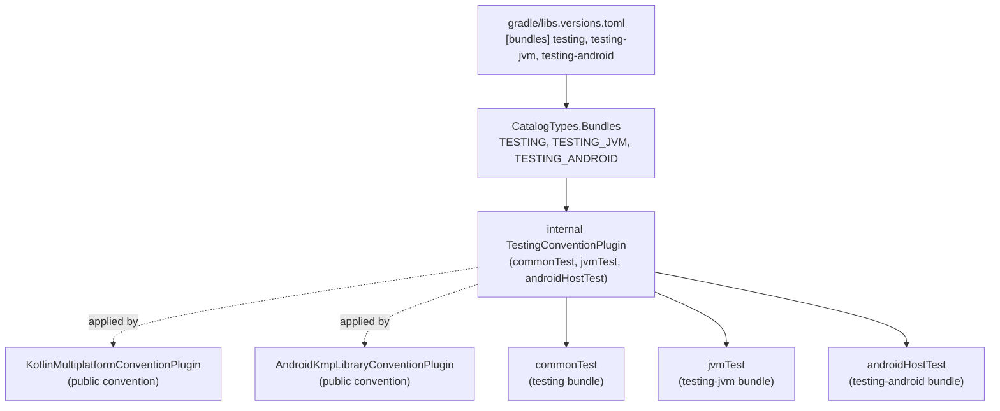

# Implementation Plan: Testing Dependency Bundles & Multiplatform Testing Plugin

**Status:** Completed  
**Date:** 2026-11-05  
**Target:** ui/kmp:gradle  

---

## Goal Description
Expand our testing dependency architecture by crafting comprehensive version catalog bundles under `[bundles]` in [`gradle/libs.versions.toml`](file:///Users/fnc314/Work/Search/waleedtarbosh-ai-job-search/ui/kmp/gradle/libs.versions.toml):
1. **`testing` (Multiplatform Common)**: Core assertions, coroutine test scopes, serialization, immutable collections, and datetime.
2. **`testing-jvm` (JVM Target)**: Standard JUnit runner and Kotlin test JUnit bridge.
3. **`testing-android` (Android Target)**: AndroidX Test runner, JUnit extension, and Espresso test infrastructure.

Update `CatalogTypes.Bundles` in `project-plugins` and adapt [`TestingConventionPlugin`](file:///Users/fnc314/Work/Search/waleedtarbosh-ai-job-search/ui/kmp/gradle/tools/project-plugins/src/main/kotlin/dev/fnc314/tools/jobtracker/kmp/gradle/plugins/internal/TestingConventionPlugin.kt) to configure these bundles across `commonTest`, `jvmTest`, and `androidHostTest` automatically.

---

## User Review Required

> [!IMPORTANT]
> The common bundle `testing` now includes both `kotlinx-serialization-json` and `kotlinx-collections-immutable` (alongside `kotlin-test`, `kotlinx-coroutines-test`, and `kotlinx-datetime`). This ensures any multiplatform test suite can test model serialization, immutable list mutations, and coroutine flows without declaring boilerplate dependencies in each module.

> [!NOTE]
> Target-specific bundles (`testing-jvm` and `testing-android`) are wired lazily into `jvmTest` and `androidHostTest` respectively, leaving native (iOS) and web (JS/Wasm) to inherit the pure multiplatform `testing` bundle from `commonTest`.

---

## Open Questions

None. All target requirements and dependency scopes are accounted for.

---

## Proposed Changes



### 1. Version Catalog (`gradle/libs.versions.toml`)

#### [MODIFY] `gradle/libs.versions.toml`
Add `testing`, `testing-jvm`, and `testing-android` under `[bundles]`:

```toml
[bundles]
  testing = [
    "kotlin-test",
    "kotlinx-coroutines-test",
    "kotlinx-serialization-json",
    "kotlinx-collections-immutable",
    "kotlinx-datetime",
  ]
  testing-jvm = [
    "junit",
    "kotlin-testJunit",
  ]
  testing-android = [
    "androidx-testExt-junit",
    "androidx-testRunner",
  ]
```

---

### 2. Project Plugins (`gradle/tools/project-plugins`)

#### [MODIFY] [`CatalogTypes.kt`](file:///Users/fnc314/Work/Search/waleedtarbosh-ai-job-search/ui/kmp/gradle/tools/project-plugins/src/main/kotlin/dev/fnc314/tools/jobtracker/kmp/gradle/catalog/CatalogTypes.kt)
Register the new bundles in `CatalogTypes.Bundles`:

```kotlin
    public enum class Bundles(
        override val catalogKey: String,
    ) : CatalogTypes<Provider<ExternalModuleDependencyBundle>> {
        COMPOSE_UI("compose-ui"),
        COMPOSE_TOOLING("compose-tooling"),
        KTOR_CLIENT("ktor-client"),
        KOIN("koin"),
        ANDROIDX_LIFECYCLE_COMPOSE("androidx-lifecycle-compose"),
        FIREBASE_ANDROID("firebase-android"),
        FIREBASE_JVM("firebase-jvm"),
        NAVIGATION3("navigation3"),
        TESTING("testing"),
        TESTING_JVM("testing-jvm"),
        TESTING_ANDROID("testing-android");
```

#### [MODIFY] [`TestingConventionPlugin.kt`](file:///Users/fnc314/Work/Search/waleedtarbosh-ai-job-search/ui/kmp/gradle/tools/project-plugins/src/main/kotlin/dev/fnc314/tools/jobtracker/kmp/gradle/plugins/internal/TestingConventionPlugin.kt)
Update `TestingConventionPlugin.configurePlugin()`:
1. Apply `CatalogTypes.Bundles.TESTING(project)` to `commonTest`.
2. Apply `CatalogTypes.Bundles.TESTING_JVM(project)` to `jvmTest` (lazily via `sourceSets.matching { it.name == "jvmTest" }.configureEach`).
3. Apply `CatalogTypes.Bundles.TESTING_ANDROID(project)` to `androidHostTest` (lazily via `sourceSets.matching { it.name == "androidHostTest" }.configureEach`).
4. Keep standard `TestLogging` on all `Test` tasks.

```kotlin
        // 2. Configure Kotlin Multiplatform test source set dependencies
        pluginManager.withPlugin(CatalogTypes.Plugins.KOTLIN_MULTIPLATFORM(this).get().pluginId) {
            kotlinMultiplatform {
                commonTest {
                    dependencies {
                        implementation(CatalogTypes.Bundles.TESTING(project))
                    }
                }
                sourceSets.matching { it.name == "jvmTest" }.configureEach {
                    dependencies {
                        implementation(CatalogTypes.Bundles.TESTING_JVM(project))
                    }
                }
            }
        }

        // 3. Configure Android Multiplatform host tests if android KMP library is applied
        pluginManager.withPlugin(CatalogTypes.Plugins.ANDROID_MULTIPLATFORM_LIBRARY(this).get().pluginId) {
            val kotlin = extensions.findByType(KotlinMultiplatformExtension::class.java)
            val extAware = kotlin as? ExtensionAware
            extAware?.extensions?.configure(KotlinMultiplatformAndroidLibraryTarget::class.java) { android ->
                android.withHostTest {}
            }
            kotlin?.sourceSets?.matching { it.name == "androidHostTest" }?.configureEach {
                dependencies {
                    implementation(CatalogTypes.Bundles.TESTING_ANDROID(project))
                }
            }
        }
```

---

## Verification Plan

### Automated Tests
1. **Compile Convention Plugins**:
   ```bash
   ./gradlew :tools:project-plugins:compileKotlin
   ```
2. **Compile All Multiplatform Metadata**:
   ```bash
   ./gradlew compileCommonMainKotlinMetadata
   ```
3. **Execute Full Unit Test Suite Across All Modules**:
   ```bash
   ./gradlew :core-data:jvmTest \
             :features-job-applications-list-domain:jvmTest \
             :features-job-applications-details-data:jvmTest \
             :features-add-job-application-data:jvmTest \
             :features-tracker-edits-data:jvmTest \
             :features-settings-data:jvmTest \
             :features-sign-in-domain:jvmTest
   ```
4. **Assemble Android Debug**:
   ```bash
   ./gradlew :apps-android:assembleDebug
   ```
5. **Validate Module READMEs**:
   ```bash
   mise run //:ui:kmp:docs:readmes
   ```

### Manual Verification
- Verify that `commonTest` source sets can freely use `kotlinx.serialization` JSON decoding and `kotlinx.collections.immutable` operations without manual per-module dependency declarations.
