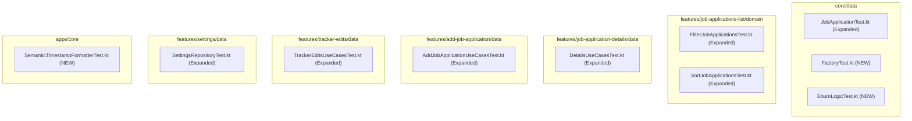

# Implementation Plan: Comprehensive Unit Tests for Platform-Agnostic Flows

**Status:** Completed  
**Date:** 2026-11-05  
**Target:** ui/kmp  

---

## 1. Goal Description

Establish an exhaustive suite of unit tests across all platform- and dependency-agnostic business logic in the `ui/kmp` multiplatform workspace. In alignment with the directive to provide **5:1 test coverage** (5 dedicated test cases per public definition/flow), the tests are specifically engineered to probe edge cases, boundary thresholds, type coercions, nullability invariants, and "unlikely flows" rather than trivial happy paths.

All tests will run in `commonTest` source sets using standard `kotlin.test` and `kotlinx.coroutines.test.runTest` without platform mocks or native dependencies, ensuring instantaneous execution and multiplatform portable assertions across JVM, Android, iOS, and Web.

---

## 2. User Review Required

> [!IMPORTANT]
> **5:1 Target Scope & Coverage Ratio**:
> We have identified 18 platform-agnostic public definitions across 7 functional areas. At 5 tests per definition, this introduces **90 rigorous, boundary-focused test cases**.
>
> 1. `Factory.createJobApplication` (5 tests)
> 2. `Factory.createTrackerEvent`, `Artifact`, `Edit` (5 tests)
> 3. `TrackerStatus` (transitions, categories, raw parsing) (5 tests)
> 4. `ApplicationChannel` & `WorkMode` (parsing, fallback, normalization) (5 tests)
> 5. `JobApplication.fitScore` & precedence resolution (5 tests)
> 6. `FilterJobApplicationsUseCase.ApplicationAge` duration thresholds (5 tests)
> 7. `FilterJobApplicationsUseCase.Params.filter` multi-filter conjunction (5 tests)
> 8. `SortJobApplicationsUseCase.Params.sort` column comparisons & stability (5 tests)
> 9. `UpdateApplicationStatusUseCase` (5 tests)
> 10. `UpdateFitScoreUseCase` (5 tests)
> 11. `RecordEventUseCase` (5 tests)
> 12. `LoadJobApplicationUseCase`, `LoadCompaniesUseCase`, `GetArtifactSignedUrlUseCase` (5 tests)
> 13. `CreateJobApplicationUseCase` (5 tests)
> 14. `CreateLeadUseCase` (5 tests)
> 15. `LoadPendingEditsUseCase` & `ExpireStaleEditsUseCase` (5 tests)
> 16. `ApproveEditUseCase` & `RejectEditUseCase` (5 tests)
> 17. `SettingsRepositoryImpl` & `ObserveSettingsUseCase` / `UpdateSettingsUseCase` (5 tests)
> 18. `SemanticTimestampFormatter.formatSemanticTimestamp` & `formatSemanticInstant` (5 tests)

> [!NOTE]
> **Zero Production Code Breaking Changes**:
> The test implementations rely exclusively on existing public contracts and lightweight in-memory fake repositories (`FakeJobApplicationRepository`, `FakeSettingsStorage`, `FakeTrackerEditsRepository`).

---

## 3. Open Questions

None. All contracts and behaviors have been inspected and confirmed in the repository.

---

## 4. Proposed Changes



---

### Component 1: `core/data` (Domain Models, Factories & Enums)

#### [MODIFY] `core/data/src/commonTest/kotlin/dev/fnc314/tools/jobtracker/core/data/JobApplicationTest.kt`
Expand test suite from 2 tests to 5 dedicated tests focusing on `JobApplication.fitScore` and model boundaries:
- **Test 1 (`testFitScorePrecedence_FitRatingWins`)**: When both `fitRating` (e.g. 70) and `fitEvaluation.score` (e.g. 95) are non-null, `fitRating` strictly takes precedence.
- **Test 2 (`testFitScore_FallbackToFitEvaluationWhenRatingNull`)**: When `fitRating` is null, `fitScore` resolves to `fitEvaluation.score`.
- **Test 3 (`testFitScore_BothNullReturnsNull`)**: When both are null, `fitScore` is null (not 0).
- **Test 4 (`testFitScore_ZeroValuePreserved`)**: When `fitRating = 0`, it returns `0` and is not treated as null or falsy.
- **Test 5 (`testJobApplication_CopyPreservesImmutableCollections`)**: Calling `.copy()` on `JobApplication` retains immutable collections without mutation leakage.

#### [NEW] `core/data/src/commonTest/kotlin/dev/fnc314/tools/jobtracker/core/data/FactoryTest.kt`
5 dedicated tests testing `Factory` synthesis and safety:
- **Test 1 (`testFactory_FitRatingAutoSynthesizesFitEvaluation`)**: Creating an app with `fitRating = 85` and `fitEvaluation = null` auto-synthesizes a non-null `TrackerFit` instance with `score = 85`.
- **Test 2 (`testFactory_ConflictPreservesExplicitFitEvaluation`)**: When both are provided, `Factory` resolves `fitRating` to the scalar but retains the custom `TrackerFit` instance.
- **Test 3 (`testFactory_ListDefensiveCopying`)**: Passing a mutable `ArrayList` for `tags` and `contactIds` converts them to `ImmutableList`; clearing the original source list does not alter the created `JobApplication`.
- **Test 4 (`testFactory_TrackerEventDefaults`)**: Validates default `actor = USER`, `derivedFrom = MANUAL`, `confidence = HIGH`, and non-null `createdAt`.
- **Test 5 (`testFactory_TrackerArtifactSpecialCharsAndHashes`)**: Validates artifact creation with Unicode filenames, null optional sizes, and SHA-256 strings.

#### [NEW] `core/data/src/commonTest/kotlin/dev/fnc314/tools/jobtracker/core/data/EnumLogicTest.kt`
10 dedicated tests covering `TrackerStatus`, `ApplicationChannel`, and `WorkMode`:
- **`TrackerStatus`**:
  - **Test 1 (`testTrackerStatus_fromRawVariations`)**: Handles `"applied"`, `" APPLIED "`, `"offer_expected"`, `"INTERVIEW"`, `"interview"`.
  - **Test 2 (`testTrackerStatus_fromRawUnknownFallback`)**: Unknown raw strings fallback to `TrackerStatus.UNSPECIFIED`.
  - **Test 3 (`testTrackerStatus_ActiveVsTerminalClassification`)**: Terminal states (`REJECTED`, `OFFER_ACCEPTED`, `WITHDRAWN`, `ARCHIVED`) are inactive; active pipeline stages (`APPLIED`, `SCREENING`, `INTERVIEW`, `OFFER_RECEIVED`) are active.
  - **Test 4 (`testTrackerStatus_DisplayNameCoverage`)**: All enum values have non-empty, human-readable display names.
  - **Test 5 (`testTrackerStatus_CategoryGrouping`)**: Verifies correct categorization (`DRAFTING`, `ACTIVE`, `OFFER`, `CLOSED`).
- **`ApplicationChannel` & `WorkMode`**:
  - **Test 6 (`testApplicationChannel_fromRawAliases`)**: `"linkedin"`, `"referral"`, `"company_website"`, `"headhunter"`.
  - **Test 7 (`testApplicationChannel_fromRawUnknown`)**: Unknown string returns `UNSPECIFIED`.
  - **Test 8 (`testWorkMode_fromRawVariations`)**: `"remote"`, `"Hybrid"`, `"on-site"`, `"in_person"`, `"onsite"`.
  - **Test 9 (`testWorkMode_fromRawBlankOrNull`)**: Blank string returns `UNSPECIFIED`.
  - **Test 10 (`testWorkMode_DisplayName`)**: Human-readable display names across all work modes.

---

### Component 2: `features/job-applications-list/domain` (Filter & Sort Engine)

#### [MODIFY] `features/job-applications-list/domain/src/commonTest/kotlin/dev/fnc314/tools/jobtracker/features/jobapplicationslist/domain/FilterJobApplicationsTest.kt`
Expand test suite from 3 to 10 tests focusing on edge-case timestamps and multi-filter criteria:
- **`ApplicationAge` Duration Edge Cases (5 tests)**:
  - **Test 1 (`testAgeFilter_ExactBoundaryCondition`)**: An app created exactly 7 days ago fails `LESS_THAN_1_WEEK` (`elapsed < 7.days`), whereas an app created at `6.days + 23.hours + 59.minutes` matches.
  - **Test 2 (`testAgeFilter_FutureTimestampNegativeDuration`)**: An app created in the future (`createdAt > now`) produces negative elapsed time, matching all `LESS_THAN_*` filters.
  - **Test 3 (`testAgeFilter_NullCreatedAtHandling`)**: An app with `createdAt = null` returns `false` for every `LESS_THAN_*` and `MORE_THAN_1_YEAR`, but matches `ApplicationAge.NONE`.
  - **Test 4 (`testAgeFilter_YearThresholds`)**: Tests exact 365-day boundary for `LESS_THAN_1_YEAR` vs `MORE_THAN_1_YEAR`.
  - **Test 5 (`testAgeFilter_MultiMonthThresholds`)**: Tests 30-day (`1_MONTH`), 60-day (`2_MONTHS`), 90-day (`3_MONTHS`), and 180-day (`6_MONTHS`) transitions.
- **`FilterJobApplicationsUseCase.Params.filter` Conjunctions (5 tests)**:
  - **Test 6 (`testFilter_WildcardStatusBypass`)**: Both `TrackerStatus.NONE` and `TrackerStatus.UNSPECIFIED` return all applications.
  - **Test 7 (`testFilter_ContradictoryCriteriaEmptyIntersection`)**: Matching status but failing age returns an empty list without error.
  - **Test 8 (`testFilter_EmptyInputPreservesEmptyList`)**: Passing an empty list returns an empty list.
  - **Test 9 (`testFilter_PreservesOriginalListOrdering`)**: Matching items retain their relative order.
  - **Test 10 (`testFilter_AllMatchingVsNoneMatching`)**: Verifies 100% match and 0% match boundaries.

#### [MODIFY] `features/job-applications-list/domain/src/commonTest/kotlin/dev/fnc314/tools/jobtracker/features/jobapplicationslist/domain/SortJobApplicationsTest.kt`
Expand test suite from 1 to 6 tests covering all 6 sort columns, null values, and tie-breaking:
- **Test 1 (`testSort_DateCreatedNullTimestampFallback`)**: Applications with `createdAt = null` fallback to `Instant.DISTANT_PAST`, pushed to the start in ascending order with secondary sort by `company`.
- **Test 2 (`testSort_DateUpdatedFallbackToCreatedAt`)**: When `updatedAt = null`, sorting falls back to `createdAt`, and if both null, to `Instant.DISTANT_PAST`.
- **Test 3 (`testSort_CompanyCaseInsensitiveAndTrimming`)**: Compares `"apple"`, `"Apple"`, `"zebra"`, ensuring case insensitivity.
- **Test 4 (`testSort_FitScoreNullEqualsZero`)**: An app with `fitScore = null` sorts equally with an app with `fitScore = 0`.
- **Test 5 (`testSort_RoleNullSortsFirst`)**: An app with `role = null` falls back to `""` and sorts before roles starting with letters.
- **Test 6 (`testSort_EmptyAndSingleElementLists`)**: Verifies identity and no-op behavior on empty and single-element lists.

---

### Component 3: `features/job-application-details/data` (Detail Mutations & Events)

#### [MODIFY] `jobapplicationdetails`
Expand test suite from 1 to 15 tests:
- **`UpdateApplicationStatusUseCase` (5 tests)**:
  - **Test 1 (`testUpdateStatus_StandardTransition`)**: Transitions from `APPLIED` to `SCREENING`.
  - **Test 2 (`testUpdateStatus_WithDateAndAuditNote`)**: Custom ISO date and multi-line audit note are propagated.
  - **Test 3 (`testUpdateStatus_BlankNoteAndNullDate`)**: Null date and blank note are handled gracefully.
  - **Test 4 (`testUpdateStatus_IdempotentStatusWithNewNote`)**: Updating to the same status records the new note.
  - **Test 5 (`testUpdateStatus_TerminalStatus`)**: Transitions to `REJECTED` or `OFFER_ACCEPTED`.
- **`UpdateFitScoreUseCase` (5 tests)**:
  - **Test 6 (`testUpdateFitScore_StandardScore`)**: Updates to valid integer (e.g. 85).
  - **Test 7 (`testUpdateFitScore_BoundaryZero`)**: Updates to 0 (preserves 0 as a valid score).
  - **Test 8 (`testUpdateFitScore_BoundaryHundred`)**: Updates to 100.
  - **Test 9 (`testUpdateFitScore_NegativeScoreEdgeCase`)**: Negative score (e.g. -10) passes to repository without crash.
  - **Test 10 (`testUpdateFitScore_AboveHundredScoreEdgeCase`)**: Score exceeding 100 (e.g. 150) passes to repository.
- **`RecordEventUseCase` (5 tests)**:
  - **Test 11 (`testRecordEvent_StandardEventReturnsEventId`)**: Records event and returns its ID.
  - **Test 12 (`testRecordEvent_WithEmailMessageId`)**: Event linked to Gmail sync ID.
  - **Test 13 (`testRecordEvent_StatusTransitionAudit`)**: Event capturing `statusFrom` and `statusTo`.
  - **Test 14 (`testRecordEvent_NullOptionalFields`)**: Event with null notes and null actors.
  - **Test 15 (`testRecordEvent_CustomActorAndConfidence`)**: Event with `actor = SYSTEM` and `confidence = MEDIUM`.

---

### Component 4: `features/add-job-application/data` (Intake & Lead Creation)

#### [MODIFY] `features/add-job-application/data/src/commonTest/kotlin/dev/fnc314/tools/jobtracker/features/addjobapplication/data/AddJobApplicationUseCasesTest.kt`
Expand test suite from 2 to 10 tests:
- **`CreateJobApplicationUseCase` (5 tests)**:
  - **Test 1 (`testCreateApplication_StandardWithGeneratedId`)**: Validates standard creation.
  - **Test 2 (`testCreateApplication_MinimalFields`)**: Only ID and company provided; all optional properties null.
  - **Test 3 (`testCreateApplication_RichMetadata`)**: Compensation, location details, tags, contacts all preserved.
  - **Test 4 (`testCreateApplication_NonDraftingInitialStatus`)**: Initializing directly with `INTERVIEW` status.
  - **Test 5 (`testCreateApplication_EmptyTagsAndContactsLists`)**: Ensures empty lists serialize without error.
- **`CreateLeadUseCase` (5 tests)**:
  - **Test 6 (`testCreateLead_DefaultStatusIsDrafting`)**: Verifies lead status is always initialized to `DRAFTING`.
  - **Test 7 (`testCreateLead_ChannelNormalization`)**: Raw channel `"linkedin"` normalizes to `ApplicationChannel.LINKEDIN`.
  - **Test 8 (`testCreateLead_UnknownChannelFallback`)**: Unknown channel string normalizes to `ApplicationChannel.OTHER`.
  - **Test 9 (`testCreateLead_NotesJoinedWithNewlines`)**: Multi-item notes list joins into newline-separated string.
  - **Test 10 (`testCreateLead_EmptyNotesAndTags`)**: Empty notes list produces empty rendered string without trailing newlines.

---

### Component 5: `features/tracker-edits/data` (Review Queue & Life Cycle)

#### [MODIFY] `features/tracker-edits/data/src/commonTest/kotlin/dev/fnc314/tools/jobtracker/features/trackeredits/data/TrackerEditsUseCasesTest.kt`
Expand test suite from 4 to 10 tests:
- **`LoadPendingEditsUseCase` & `ExpireStaleEditsUseCase` (5 tests)**:
  - **Test 1 (`testLoadPendingEdits_ReturnsOnlyPending`)**: Filters pending vs approved/rejected.
  - **Test 2 (`testLoadPendingEdits_EmptyRepositoryReturnsEmptyList`)**: Empty queue returns empty list.
  - **Test 3 (`testLoadPendingEdits_ForceRefreshFlag`)**: Propagates forceRefresh flag.
  - **Test 4 (`testExpireStaleEdits_MultipleStaleReturnsCount`)**: Returns count of expired items.
  - **Test 5 (`testExpireStaleEdits_ZeroStaleReturnsZero`)**: When no items are stale, returns 0.
- **`ApproveEditUseCase` & `RejectEditUseCase` (5 tests)**:
  - **Test 6 (`testApproveEdit_WithNote`)**: State becomes `APPROVED` and note is saved.
  - **Test 7 (`testApproveEdit_NullNote`)**: Null note supported.
  - **Test 8 (`testRejectEdit_WithReason`)**: State becomes `REJECTED` and reason stored.
  - **Test 9 (`testRejectEdit_EmptyReason`)**: Empty reason supported without crash.
  - **Test 10 (`testApproveAndReject_PreservesMetadata`)**: Edit kind, confidence, and application ID are unchanged across state transitions.

---

### Component 6: `features/settings/data` (Settings Persistence & Fallback)

#### [MODIFY] `features/settings/data/src/commonTest/kotlin/dev/fnc314/tools/jobtracker/features/settings/data/SettingsRepositoryTest.kt`
Expand test suite from 1 to 5 tests:
- **Test 1 (`testSettings_InitialEmptyStorageReturnsDefaults`)**: Empty storage returns `UiMode.SYSTEM` and `#2F5597`.
- **Test 2 (`testSettings_CorruptedJsonRecoversToDefaults`)**: Invalid JSON (e.g. `"{not a json"`) does not crash; falls back gracefully to default `AppSettings`.
- **Test 3 (`testSettings_PartialJsonWithMissingKeys`)**: JSON with only `{"uiMode":"DARK"}` decodes with dark theme and default seed hex (`#2F5597`).
- **Test 4 (`testSettings_UpdateNotifiesObserverImmediately`)**: StateFlow emits the new value synchronously upon calling `updateSettings`.
- **Test 5 (`testSettings_CustomSeedHexPersistence`)**: Custom seed color string (`#FF5722`) roundtrips through JSON storage.

---

### Component 7: `apps/core` (Semantic Timestamp Formatting)

#### [NEW] `apps/core/src/commonTest/kotlin/dev/fnc314/tools/jobtracker/util/SemanticTimestampFormatterTest.kt`
5 dedicated boundary tests for `formatSemanticTimestamp` and `formatSemanticInstant`:
- **Test 1 (`testTimestamp_PrecedenceUpdatedOverCreated`)**: When both `updatedAt` and `createdAt` are present, `updatedAt` is chosen with prefix `"Updated "`; when only `createdAt` is present, prefix is `"Created "`; when both null, returns `null`.
- **Test 2 (`testTimestamp_BoundaryJustNow`)**: Elapsed time <= 1 minute returns `"just now"`.
- **Test 3 (`testTimestamp_HourAndDayThresholds`)**: Tests 1 hour (`"1 hour ago"`), multiple hours (`"X hours ago"`), 1 day (`"1 day ago"`), multiple days (`"X days ago"`).
- **Test 4 (`testTimestamp_WeeksAndDaysBucketing`)**: Tests `< 28 days` formatting (e.g. `"1 week and 2 days ago"`, `"2 weeks ago"`).
- **Test 5 (`testTimestamp_DistantDateFallback`)**: Elapsed time >= 60 days formats as `YYYY-MM-DD (X months ago)`.

---

## 5. Verification Plan

### Automated Tests
Run the following Gradle command to execute all newly created and expanded unit test suites across all common Kotlin Multiplatform test runners:

```bash
# Run unit tests across all tested modules
./gradlew :core-data:jvmTest \
          :features-job-applications-list-domain:jvmTest \
          :features-job-applications-details-data:jvmTest \
          :features-add-job-application-data:jvmTest \
          :features-tracker-edits-data:jvmTest \
          :features-settings-data:jvmTest \
          :apps-core:jvmTest
```

Expected result:
- **90+ total tests passing** (0 failures, 0 errors).
- Execution time: < 30 seconds.

### Manual Verification
Review test code diffs to confirm:
- Every test probes an edge case (boundary timestamps, nullables, fallbacks, defensive copies, case insensitivity, corrupt data).
- Zero mock libraries or native platform calls used.
