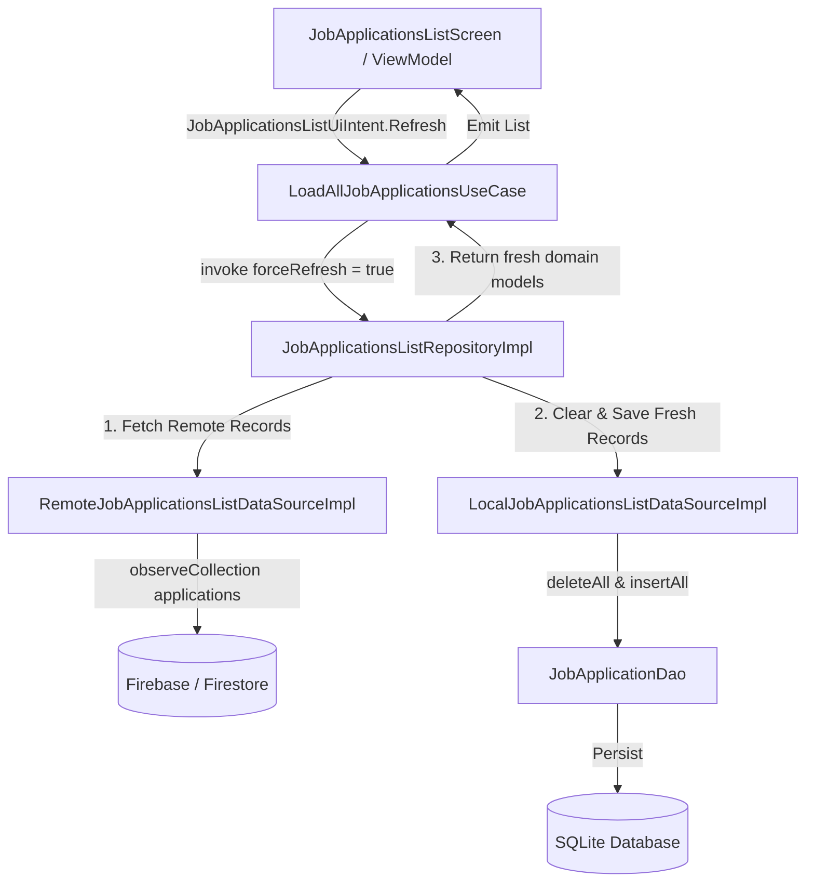

# Implementation Plan: Force Refresh Data Synchronization from Firebase to Room

**Status:** Completed  
**Date:** 2026-11-09  
**Target:** `ui/kmp`  
**Depends On:** `features/job-applications-list`  

---

## 1. Overview & Scope

### Goals
Provide a robust force-refresh mechanism allowing users to click the "REFRESH" button in `job-applications-list` UI to bypass local Room/memory cache, re-fetch remote job applications from Firebase/Firestore, overwrite local storage, and update the UI with the latest dataset.

### Scope
- **In Scope**:
  - Add `forceRefresh: Boolean = false` parameter to `JobApplicationsListRepository`.
  - Update `LoadAllJobApplicationsUseCaseImpl` to forward `forceRefresh` from `LoadAllJobApplicationsUseCase.Params`.
  - Add `clearAndSaveJobApplications(...)` capability to `LocalJobApplicationsListDataSource` and `JobApplicationDao` to purge stale records and insert fresh entities upon refresh.
  - Verify UI intent handling in `JobApplicationsListViewModel`.
  - Update unit tests in data, domain, and UI layers of `job-applications-list`.
  - Update `features/job-applications-list/README.md` to reflect new data synchronization API.
- **Out of Scope**:
  - Background sync / push notifications.
  - Changes outside `job-applications-list` module.

---

## 2. Technical Design & Architecture

### Data Flow Sequence


### Key Changes
1. **Repository Interface (`features/job-applications-list/data`)**:
   ```kotlin
   public interface JobApplicationsListRepository {
       public suspend operator fun invoke(forceRefresh: Boolean = false): List<JobApplication>
   }
   ```

2. **Local Data Source Interface (`features/job-applications-list/data`)**:
   ```kotlin
   internal interface LocalJobApplicationsListDataSource {
       public suspend fun getJobApplications(): List<JobApplication>
       public suspend fun saveJobApplications(applications: List<JobApplication>): Unit
       public suspend fun clearAndSaveJobApplications(applications: List<JobApplication>): Unit
   }
   ```

3. **Domain Use Case (`features/job-applications-list/domain`)**:
   ```kotlin
   override suspend fun invoke(params: LoadAllJobApplicationsUseCase.Params): List<JobApplication> =
       repository(forceRefresh = params.forceRefresh)
   ```

---

## 3. Delivery Steps

### Step 1: Implement forceRefresh in Repository and UseCase layers
Update `JobApplicationsListRepository` interface and `JobApplicationsListRepositoryImpl` to accept `forceRefresh: Boolean`.
- Update `JobApplicationsListRepository.kt` operator `invoke(forceRefresh: Boolean = false)`.
- Update `LoadAllJobApplicationsUseCaseImpl.kt` to pass `params.forceRefresh` to repository invocation.
- Modify `JobApplicationsListRepositoryImpl.kt` logic: when `forceRefresh == true`, bypass local cache lookup, fetch from `RemoteJobApplicationsListDataSource`, purge/overwrite Room cache in `LocalJobApplicationsListDataSource`, and return fresh remote records.
- Add repository unit tests in `JobApplicationsListRepositoryTest.kt`.

### Step 2: Implement cache clear and overwrite in Local Data Source
Enhance `LocalJobApplicationsListDataSource` and `JobApplicationDao` to support clearing/replacing cached data on force refresh.
- Add `clearAndSaveJobApplications(applications: List<JobApplication>)` to `LocalJobApplicationsListDataSource` interface and implementation.
- Execute `dbDao.deleteAll()` followed by `dbDao.insertAll()` in `LocalJobApplicationsListDataSourceImpl`.
- Update memory cache clearing and replacing in `LocalJobApplicationsListDataSourceImpl`.

### Step 3: Connect UI intent, update tests and module documentation
Connect UI Refresh Intent and Update Documentation.
- Ensure `JobApplicationsListViewModel` passes `forceRefresh = true` during `JobApplicationsListUiIntent.Refresh`.
- Update ViewModel tests in `JobApplicationsListViewModelTest.kt` to verify `forceRefresh` handling.
- Synchronize module documentation in `features/job-applications-list/README.md`.

### Step 4: Commit and push changes
Commit all modified files and push to main.
- Run `git add .` to stage all changes across data, domain, UI, tests, and documentation.
- Commit the staged changes using the plan file name `refresh-firebase-room-sync.md` as the commit message.
- Push the commit to the `main` branch.
