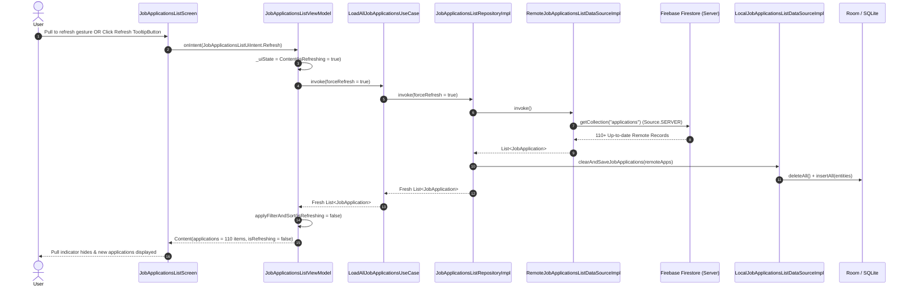

# Implementation Plan: Pull-to-Refresh Experience & Firebase Data Synchronization

**Status:** Completed  
**Date:** 2026-11-09  
**Target:** `ui/kmp` (`features/job-applications-list`, `core/data`)  
**Depends On:** `features/job-applications-list`, `core/data`  

---

## 1. Overview & Scope

### Goals
1. Implement an intuitive Material 3 **pull-to-refresh experience** in `ui/kmp/features/job-applications-list/ui` using `androidx.compose.material3.pulltorefresh.PullToRefreshBox` based on Android documentation (`android docs fetch kb://android/develop/ui/compose/components/pull-to-refresh`).
2. Fix the **stale data defect** where newly completed and pushed job applications in Firebase do not appear when refreshing:
   - **Android**: `RemoteJobApplicationsListDataSourceImpl` was calling `observeCollection("applications").first()`, which immediately returned the stale on-disk cache from Firestore's local persistence and canceled before receiving network updates from the Firebase server.
   - **JVM/Desktop**: `RemotePlatform.initialize()` was never called on startup, and credentials only checked `GoogleCredentials.getApplicationDefault()`, missing the repository's canonical service account file at `~/.config/job-tracker/sa.json`. Additionally, `RemoteDataSource.jvm.kt` threw an uninitialized Firebase error that was silently caught, causing the repository to fall back to stale Room data.
3. Fix the **infinite refreshing spinner** state defect in `JobApplicationsListViewModel.kt` where `isRefreshing = true` was never reset to `false` when loading finished, causing `JobApplicationsListViewModelTest.testRefreshIntent_TriggersForceRefresh` to fail.

### Scope
- **In Scope**:
  - Add `getCollection(collectionPath: String): List<RemoteRecord>` to `RemoteDataSource` across all platforms (Android, JVM, iOS, JS, WasmJS).
  - Update `AndroidRemoteDataSource` to fetch from `Source.SERVER` with fallback to `Source.DEFAULT`.
  - Update `JvmRemoteDataSource` and `RemotePlatform.jvm.kt` to resolve credentials canonically and initialize Firebase on JVM.
  - Update `RemoteJobApplicationsListDataSourceImpl` to call `remoteDataSource.getCollection("applications")`.
  - Fix `JobApplicationsListViewModel` state transition to reset `isRefreshing = false` on completion.
  - Wrap job applications list/grid in `PullToRefreshBox` in `JobApplicationsListScreen.kt`.
  - Verify with unit tests (`JobApplicationsListViewModelTest`, `JobApplicationsListRepositoryTest`, `mise run ui:kmp:test`).
- **Out of Scope**:
  - Non-tracker features (`settings`, `tracker-edits`).

---

## 2. Technical Design & Architecture

### Sequence Diagram


---

## 3. Delivery Steps

### Step 1: Extend `RemoteDataSource` Contract & Multiplatform Implementations
- In `core/data/source/RemoteDataSource.kt`, declare:
  ```kotlin
  public suspend fun getCollection(collectionPath: String): List<RemoteRecord>
  ```
- In `RemoteDataSource.android.kt`:
  ```kotlin
  override suspend fun getCollection(collectionPath: String): List<RemoteRecord> {
      val snapshot = try {
          firestore.collection(collectionPath).get(com.google.firebase.firestore.Source.SERVER).await()
      } catch (_: Throwable) {
          firestore.collection(collectionPath).get().await()
      }
      return snapshot.documents.map { doc ->
          MapRemoteRecord(id = doc.id, fields = sanitizeFirestoreMap(doc.data ?: emptyMap()))
      }
  }
  ```
- In `RemotePlatform.jvm.kt`:
  - Enhance credential loading to check `TRACKER_SA_KEY`, `~/.config/job-tracker/sa.json`, `GOOGLE_APPLICATION_CREDENTIALS`, and fallback to `GoogleCredentials.getApplicationDefault()`.
- In `RemoteDataSource.jvm.kt`:
  - Initialize `RemotePlatform` in `createRemoteDataSource()`.
  - Implement `getCollection(collectionPath: String)` querying Firestore.
- In `RemoteDataSource.ios.kt`, `RemoteDataSource.js.kt`, `RemoteDataSource.wasmJs.kt`:
  - Stub `getCollection` returning `emptyList()`.

### Step 2: Update Remote Data Source in `job-applications-list`
- In `RemoteJobApplicationsListDataSourceImpl.kt`:
  ```kotlin
  override suspend operator fun invoke(): List<JobApplication> {
      return withContext(Dispatchers.Default) {
          remoteDataSource
              .getCollection("applications")
              .map(::mapRecordToJobApplication)
      }
  }
  ```

### Step 3: Fix ViewModel `isRefreshing` State Machine & Add `PullToRefreshBox`
- In `JobApplicationsListViewModel.kt`:
  - Update `loadApplications`: when successful, call `applyFilterAndSort(isRefreshing = false)`.
  - When caught in exception, reset `isRefreshing = false` (or transition to `Error`).
- In `JobApplicationsListScreen.kt`:
  - Wrap the list and grid in `PullToRefreshBox` with `isRefreshing = content.isRefreshing` and `onRefresh = { onIntent(JobApplicationsListUiIntent.Refresh) }`.

### Step 4: Verification & Test Execution
- Run `JobApplicationsListViewModelTest` to verify that `testRefreshIntent_TriggersForceRefresh` now passes.
- Run `mise run ui:kmp:test` and `mise run dev:konsist`.
