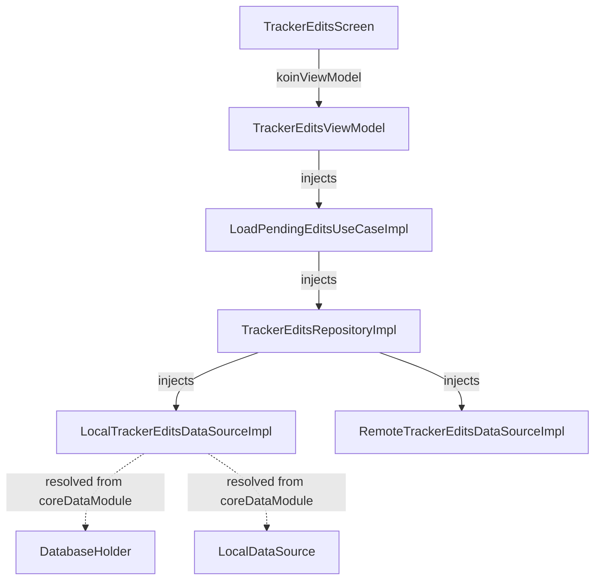

# Implementation Plan: Fix Tracker Edits Koin Resolution Crash for AppDatabase

**Status:** Completed  
**Date:** 2026-11-09  
**Target:** `ui/kmp` (`features/tracker-edits`)  
**Depends On:** `core/data`  

---

## 1. Overview & Scope

### Goals
Resolve the fatal application crash occurring when navigating to the Tracker Edits screen:
```
org.koin.core.error.NoDefinitionFoundException: No definition found for type 'dev.fnc314.tools.jobtracker.core.data.database.AppDatabase' on scope '['_root_']'
```
Root cause: `LocalTrackerEditsDataSourceImpl` takes `appDatabase: AppDatabase? = null`. When Koin evaluates `singleOf(::LocalTrackerEditsDataSourceImpl)`, reflection tries to resolve `AppDatabase` from the root scope. `coreDataModule` provides `DatabaseHolder`, not raw `AppDatabase`.

### Scope
- **In Scope**:
  - Replace `appDatabase: AppDatabase? = null` with `databaseHolder: DatabaseHolder? = null` in `LocalTrackerEditsDataSourceImpl.kt`.
  - Delete orphan empty file `ui/kmp/features/tracker-edits/data/src/commonMain/kotlin/dev/fnc314/tools/jobtracker/features/trackeredits/data/repository/TrackerEditsRepositoryImpl.kt`.
  - Add module dependency test in `features/tracker-edits/data`.
  - Verify with unit tests, Konsist, and Detekt.
- **Out of Scope**:
  - Changing Tracker Edits business logic or UI layouts.

---

## 2. Technical Design & Architecture



---

## 3. Delivery Steps

### Step 1: Update `LocalTrackerEditsDataSourceImpl.kt`
- Replace `AppDatabase` import and parameter with `DatabaseHolder`:
  ```kotlin
  internal class LocalTrackerEditsDataSourceImpl(
      private val localDataSource: LocalDataSource? = null,
      private val databaseHolder: DatabaseHolder? = null,
  ) : LocalTrackerEditsDataSource
  ```

### Step 2: Delete Orphan Stale File
- Delete `features/tracker-edits/data/src/commonMain/kotlin/dev/fnc314/tools/jobtracker/features/trackeredits/data/repository/TrackerEditsRepositoryImpl.kt`.

### Step 3: Add Module Resolution Test & Verify
- Add `TrackerEditsDataModuleTest` to test Koin resolution.
- Run tests with `./gradlew :features-tracker-edits-data:jvmTest`.
- Run full suite with `mise run ui:kmp:test` and `mise run dev:konsist`.
