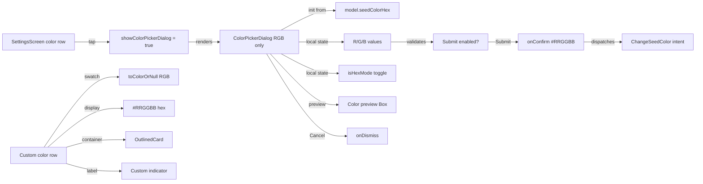

# Implementation Plan: Config-Change Navigation and Settings Color Picker Dialog

**Status:** Completed
**Date:** 2026-11-11  
**Target:** `frontend`  
**Harness:** Junie  
**Model:** Qwen/Qwen3.6-27B-FP8  
**Session:** session-261111-184440-1ofu  

---

## 1. Executive Summary & Goals

Three issues affect the frontend's user experience on foldable devices and in the Settings screen:

1. **Configuration-change navigation loss**: On a Galaxy Fold6 (or any device), opening the fold or rotating the screen resets the app to the initial list screen, losing the user's navigation position (e.g., details screen, scroll position, etc.).
2. **Settings color input UX**: The custom theme color hex input in Settings was difficult to use — intermediate typing was silently ignored, there was no visual feedback for invalid input, and the `#` prefix handling was inconsistent.
3. **Color picker enhancement**: The hex-only input was replaced with a full color picker dialog inspired by Android's TimePickerDialog, providing RGB channel control, a large preview region, and decimal/hex input modes.
4. **Color picker keyboard types**: The channel input fields should show a numeric keypad for decimal mode and a text keyboard for hex mode.
5. **Custom color visual treatment**: The custom color row should be visually distinct and show the seed color clearly.
6. **Alpha channel removal**: The dialog supported alpha, but the ViewModel and theme application only support RGB — alpha was silently discarded. The alpha channel must be removed from the dialog and the custom color row simplified.

**Goals:**
- Ensure device rotation and shape-change preserve all temporary application state (navigation, scroll, etc.).
- Replace the hex text field with a full color picker dialog for precise, accessible color control.
- Extend color utilities to support RGBA parsing and formatting with alpha channel.
- Use appropriate keyboard types for each input mode (numeric for decimal, text for hex).
- Provide a distinct visual treatment for custom colors.
- Remove the non-functional alpha channel from the dialog and simplify the custom color row to RGB-only.

## 2. Architecture & Design Principles

### Navigation State Preservation
- Opening/closing a foldable, rotating the device, or any configuration change must preserve:
  - Current navigation destination (e.g., JobApplication details, Company details)
  - Full back stack history
  - Scroll positions within screens (handled by Navigation3 entry retention)
- The app must not reset to the Job Applications List after a config change

### Color Picker Dialog
- Triggered by tapping the current custom seed color row (showing a color swatch and hex value)
- 3 input fields: Red, Green, Blue — each accepting 0-255 (decimal) or 00-FF (hex)
- A toggle switch to switch between decimal and hex input mode (affects all 3 fields)
- A large color preview region (≥50% of dialog area, 200dp height) showing the current parsed color
- A "Submit" button — enabled only when all 3 channels have valid values
- A "Cancel" button — always enabled; dismisses the dialog without changing the color
- The dialog initializes with the current seed color values
- On Submit, the color is applied via the existing `ChangeSeedColor` intent
- In decimal mode, each channel input shows a numeric keyboard (`KeyboardType.Number`)
- In hex mode, each channel input shows a text keyboard with uppercase capitalization (`KeyboardType.Text` + `KeyboardCapitalization.Characters`)

### Custom Color Visual Treatment
- The custom color row should be visually distinct from the preset color row (e.g., outlined container, divider, or background treatment)
- The color swatch uses `toColorOrNull()` to display the RGB seed color
- The hex text displays the `#RRGGBB` value
- A label or indicator (e.g., "Custom") should clarify that this is a custom color, not a preset

### Scope
**In Scope:**
- `App.kt` — auth initialization and navigation state lifecycle
- `AppNavigatorImpl.kt` — `login()` idempotency
- `SettingsScreen.kt` — replaced hex field with dialog trigger, added `ColorPickerDialog` composable
- `Color.kt` — extended RGBA utilities for parsing and formatting

**Out of Scope:**
- `SettingsViewModel.kt` — no changes needed; the dialog dispatches the existing `ChangeSeedColor` intent
- `SettingsUiState.kt` — no changes needed
- Multi-pane / list-detail adaptive layouts (separate concern)
- Process-death state restoration beyond what Navigation3's `rememberNavBackStack` provides
- Adding a color palette/picker wheel
- HSL/HSV color space support
- Changing the preset color selection behavior

## 3. Proposed Changes & Implementation Steps

### Issue 1: Configuration-Change Navigation Loss

**Root Cause:** `LaunchedEffect(isAuthenticated)` fires `appNavigator.login()` → `switchRoot(JobApplicationListRoute)` after every config change, clearing the back stack that `rememberNavBackStack` just restored. The `authInitialized` state is also not saved, causing unnecessary early returns.

**Changes:**
- **`App.kt`**: Replace `mutableStateOf(false)` for `authInitialized` with `rememberSaveable { mutableStateOf(false) }` so auth initialization is not re-run on config changes. Guard the `LaunchedEffect(isAuthenticated)` so `login()` is only called when `authInitialized` transitions from `false` to `true`, not on every recomposition after a config change. Add a `rememberSaveable` flag tracking whether `login()` has already been called for the current auth session, preventing `switchRoot` from firing on restored compositions.
- **`AppNavigatorImpl.kt`**: Update `login()` to check if the current back stack root is already `JobApplicationListRoute` before calling `switchRoot`, avoiding unnecessary back stack resets even if `login()` is called redundantly.

### Issue 2: Settings Color Picker Dialog

**Current Problems:**
- Hex-only input is not accessible or precise for color selection
- No alpha channel support
- No visual preview of the color while adjusting

**Changes Implemented:**
- **`Color.kt`**: Added RGBA utilities — `toRgbChannels()`, `toRgbaChannels()`, `IntArray.toColor()` factory, `toColorWithAlphaOrNull()` for parsing `#RRGGBB`/`#AARRGGBB`, and updated `toHexString(includeAlpha)` with a default parameter for backward compatibility.
- **`SettingsScreen.kt`**: Replaced the hex `OutlinedTextField` with a clickable `Row` showing a color swatch and hex value. Added `ColorPickerDialog` composable with:
  - `AlertDialog` wrapper with `@OptIn(ExperimentalMaterial3Api::class)`
  - Large color preview `Box` (200dp height, ≥50% of dialog) with dynamic background color
  - Decimal/Hex mode toggle using `Switch`
  - 3 `OutlinedTextField` inputs (R, G on first row; B full-width on second row)
  - Each field validates independently (0-255 decimal or 00-FF hex)
  - Submit button enabled only when all 3 channels are valid
  - Cancel button always enabled
  - Initialize R/G/B from `currentHex.toColorOrNull()`
  - On Submit: construct `#RRGGBB` hex string, dispatch `ChangeSeedColor`
  - On Cancel/Dismiss: no state change
  - `ChannelInputField` helper composable for individual channel inputs

### Issue 3: Color Picker Keyboard Types

**Changes Implemented:**
- **`SettingsScreen.kt`**: Added `isHexMode: Boolean` parameter to `ChannelInputField` composable. Applied `KeyboardOptions(keyboardType = KeyboardType.Number)` for decimal mode and `KeyboardOptions(keyboardType = KeyboardType.Text, capitalization = KeyboardCapitalization.Characters)` for hex mode. Passed `isHexMode` from all 3 call sites (R, G, B).

### Issue 4: Custom Color Visual Treatment

**Current Problems:**
- The custom color row blends visually with the preset color row — no clear distinction
- No label or indicator to clarify that this is a custom (non-preset) color

**Changes Implemented:**
- **`SettingsScreen.kt`**: Wrapped the custom color row in an `OutlinedCard` with a "Custom Seed Hex" label to visually separate it from preset colors. Simple swatch using `toColorOrNull()` for the color preview. Display shows `#RRGGBB` hex value. Added spacing between preset colors and the custom color card.

### Issue 5: Remove Alpha Channel from Color Picker

**Current Problems:**
- The `ColorPickerDialog` supported alpha (4-channel RGBA input), but `SettingsViewModel.handleChangeSeedColor()` only accepts 6-char hex (`normalized.length == 6`) and stores `#$normalized` — alpha was always stripped.
- `App.kt` uses `toColorOrNull()` (RGB-only) to parse the seed color for the theme — alpha is ignored even if stored.
- The dialog's `buildHexString()` produced `#AARRGGBB` when alpha < 255, but the ViewModel rejected 8-char hex silently.
- The custom color row used `toColorWithAlphaOrNull()` and showed `#AARRGGBB` when alpha < 255, but alpha could never be < 255 since the ViewModel stripped it.

**Root cause:** The dialog supported alpha, but the ViewModel and theme application only support RGB. Alpha was silently discarded, creating a misleading UX where users could adjust alpha but it never took effect.

**Key Decisions:**
1. **Remove Alpha entirely** — rather than adding alpha support to the ViewModel and theme, remove it from the dialog. Material3 seed colors don't support alpha (they're used for color scheme derivation which requires opaque colors).
2. **Simplify custom color row** — remove checkerboard background and alpha-aware display logic since alpha is never stored.
3. **Keep RGBA utilities in `Color.kt`** — they're not harmful and may be useful for other features.

**Changes Implemented:**

**`SettingsScreen.kt`:**
- Removed `a`, `aText`, `aValid` state variables from `ColorPickerDialog`
- Removed Alpha `ChannelInputField` from the second row; Blue row becomes a single full-width field
- Removed alpha from `previewColor`: uses `intArrayOf(previewR, previewG, previewB).toColor()` (size 3)
- Simplified `buildHexString()` to always produce `#RRGGBB`
- Removed `aText` from `LaunchedEffect` mode sync
- Updated `allValid` to check only R, G, B
- Updated dialog KDoc to remove alpha references
- In custom color row: replaced `toColorWithAlphaOrNull()` with `toColorOrNull()`, removed `rgbaChannels`/`alpha`/`displayHex` logic, shows normalized hex directly
- Removed checkerboard gradient background — simple swatch

**`SettingsUiIntent.kt`:**
- Updated `SettingsUiModel` KDoc: changed `"#RRGGBB" or "#AARRGGBB"` to `"#RRGGBB"`

### Architecture Diagram

## 4. Verification Plan & Testing Checklist

### Navigation State Preservation
- Navigate to a Job Application details screen → trigger config change (rotation or foldable open) → verify the details screen is still displayed with correct data
- Navigate to a Company details screen → trigger config change → verify the details screen is preserved
- Navigate through multiple screens (List → Details → Settings) → trigger config change → verify back stack is intact and back navigation works
- Trigger config change while on the List screen → verify no regression (stays on List)

### Color Picker Dialog
- Tap the custom seed color row → dialog opens with current color values
- Dialog initializes R/G/B from the current `seedColorHex`
- Enter 0-255 in each field in decimal mode → numeric keyboard shown, preview updates, submit enabled when all valid
- Enter 256 → field shows error, submit disabled
- Toggle to hex mode → fields show 00-FF values, text keyboard with uppercase shown
- Enter "FF" in Red → preview updates to red
- Enter "GG" → field shows error, submit disabled
- Preview region updates in real-time as any channel changes
- Submit with valid values → color applied as `#RRGGBB`, dialog dismisses
- Cancel → dialog dismisses, color unchanged
- Back press → dialog dismisses, color unchanged
- Keyboard type switches when toggling between decimal and hex modes

### Edge Cases
- Config change during auth initialization (rare race condition) → app should not crash
- Current color is invalid hex → dialog initializes with defaults (Professional Blue)
- Config change while dialog is open → dialog state is lost (acceptable — ephemeral UI)
- Empty input in any field → submit disabled, inline error shown
- Process death (beyond config change) → Navigation3 `rememberNavBackStack` handles this via `SavedStateRegistry`; back stack should restore

### Build Verification
- `:frontend:apps-android:assembleDebug` builds successfully with no compilation errors

## 5. Bookkeeping
- [x] Plan persisted at `frontend/.agents/plans/2026-11-11/185500_config-change-nav-and-settings-color-ux.md`
- [x] Registry `README.md` row added / status synchronized
- [x] Craft a single commit of all changed files
- [x] Stage changed files and craft a commit message based on the name of this file
- [ ] Push `git push origin main`
