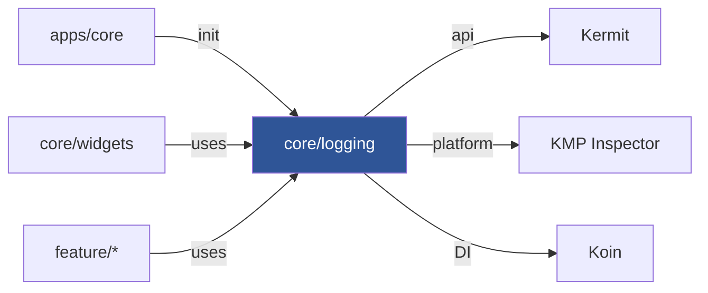

# Implementation Plan: Core Logging Module

**Status:** Completed
**Date:** 2026-11-12  
**Target:** `frontend`  
**Harness:** Junie  
**Model:** Qwen/Qwen3.6-27B-FP8  
**Session:** session-261112-222757-1f0w  

---

## 1. Executive Summary & Goals

Create a new `core/logging` module that wraps Kermit logging and exposes convenient, tagged logging methods for all `feature/*` modules. Move `KmpInspectorLogWriter` from `apps/core` into `core/logging`. Wire the module into `core/widgets` so shared widgets can log as well.

### Current Problems
- Kermit is only initialized in `apps/core/App.kt` — no other module can log through it cleanly.
- Feature modules (e.g. `sign-in/data`) use `android.util.Log` directly, bypassing the unified logging pipeline.
- `KmpInspectorLogWriter` lives in `apps/core` instead of a shared core module.

### Goals
1. **`core/logging` module** — thin Kermit wrapper with `AppLogger` object exposing `v()`, `d()`, `i()`, `w()`, `e()`, `e(throwable)` with automatic tag derivation.
2. **`KmpInspectorLogWriter`** moved to `core/logging` as expect/actual (android/ios/jvm = real, js/wasmJs = no-op).
3. **Koin DI** — `coreLoggingModule` provides `AppLogger` as a singleton so feature modules can inject it.
4. **`core/widgets`** depends on `core/logging` and can use `AppLogger`.
5. **`apps/core`** initialization simplified to call `AppLogger.init()` instead of `Logger.setLogWriters()` directly.

### Scope
- **In Scope:** New `core/logging` module, move `KmpInspectorLogWriter`, update `core/widgets` dependency, update `apps/core` initialization, update `appModule` DI.
- **Out of Scope:** Migrating existing `android.util.Log` calls in feature modules to use `AppLogger` (that's a follow-up). No severity filtering config — keep it simple.

## 2. Architecture & Design Principles

### Current Implementation
- **Kermit** (v2.2.0) is in the version catalog as `libs.kermit`. Only `apps/core` depends on it.
- `App.kt` calls `Logger.setLogWriters(listOf(platformLogWriter(), KmpInspectorLogWriter()))` directly.
- `KmpInspectorLogWriter` is an `expect class` in `apps/core` with actuals in android/ios/jvm (routes to `InspectorLog`) and no-ops in js/wasmJs.
- Core modules follow a standard pattern: KMP plugins (`local.kotlin.multiplatform`, `local.android.kmp.library`), `commonMain` + platform source sets, Koin `*Module` exported.
- `core/network` is the closest reference — it has expect/actual across 5 platforms and a simple DI module.
- `settings.gradle.kts` uses `registerProjectCollection("core")` so new core modules are auto-discovered.

### Key Decisions
- **`AppLogger` as a `public object`** — simple, no DI needed for the logger itself. Feature modules call `AppLogger.d { "message" }` directly. Koin still provides it for modules that prefer injection.
- **Tag derivation** — `AppLogger` methods accept an optional `tag` parameter; if omitted, the caller's class name is derived via `StackTrace`. To keep it lightweight, the default tag will be the fully-qualified class name of the caller (2nd stack frame).
- **`KmpInspectorLogWriter` moves to `core/logging`** — it's logging infrastructure, not app-specific. Same expect/actual pattern.
- **`core/logging` has zero core dependencies** — it's the most foundational core module. No dependency on `core/data`, `core/network`, etc.
- **Koin `coreLoggingModule`** registers `AppLogger` as a singleton so feature modules can `get<AppLogger>()` if they prefer DI over the object accessor.

### Architecture Diagram



### Risks
- **`StackTrace`-based tag derivation** has a small performance cost. Mitigation: callers can supply an explicit tag to bypass stack inspection. The `msg: () -> String` lambda ensures the message isn't built unless the severity is enabled.
- **Breaking change**: removing `KmpInspectorLogWriter` from `apps/core` — but only `App.kt` references it, and we're updating it in the same change.

## 3. Proposed Changes & Implementation Steps

#### 1. New `core/logging` module
```
core/logging/
  build.gradle.kts
  src/
    commonMain/kotlin/dev/fnc314/tools/jobtracker/core/logging/
      AppLogger.kt
      KmpInspectorLogWriter.kt        (expect)
      di/CoreLoggingModule.kt
    androidMain/kotlin/.../
      KmpInspectorLogWriter.android.kt (actual)
    iosMain/kotlin/.../
      KmpInspectorLogWriter.ios.kt     (actual)
    jvmMain/kotlin/.../
      KmpInspectorLogWriter.jvm.kt     (actual)
    jsMain/kotlin/.../
      KmpInspectorLogWriter.js.kt      (actual, no-op)
    wasmJsMain/kotlin/.../
      KmpInspectorLogWriter.wasmJs.kt  (actual, no-op)
```

**`AppLogger.kt`** (commonMain):
- `public object AppLogger`
- `fun init(vararg writers: LogWriter)` — calls `Logger.setLogWriters()` once.
- `fun v(tag: String = defaultTag(), msg: () -> String)`, same for `d()`, `i()`, `w()`, `e()`.
- `fun e(tag: String = defaultTag(), throwable: Throwable, msg: () -> String)` — error with cause.
- `private fun defaultTag(): String` — extracts caller class name from `StackTrace[2]`.

**`KmpInspectorLogWriter.kt`** (commonMain):
- `public expect class KmpInspectorLogWriter() : LogWriter` — moved from `apps/core`.

**`CoreLoggingModule.kt`** (commonMain/di):
- `public val coreLoggingModule: Module = module { single { AppLogger } }`

**`build.gradle.kts`**:
- Plugins: `local.kotlin.multiplatform`, `local.android.kmp.library`, `local.dependencies.di`.
- `commonMain`: `api(libs.kermit)`, `implementation(libs.koin.core)`.
- `androidMain`, `iosMain`, `jvmMain`: `implementation(libs.kmp.inspector)`.

#### 2. Update `core/widgets`
- Add `implementation(projects.coreLogging)` to `core/widgets/build.gradle.kts`.
- Replace `println` in `DefaultImageLoadEventListener` with `AppLogger.e()`.
- Replace `CoilEventListenerBridge` Coil `Logger` usage with `AppLogger`.

#### 3. Update `apps/core`
- Replace `implementation(libs.kermit)` with `implementation(projects.coreLogging)`.
- In `App.kt`: replace `Logger.setLogWriters(...)` with `AppLogger.init(platformLogWriter(), KmpInspectorLogWriter())`.
- Delete `KmpInspectorLogWriter.*.kt` files from `apps/core` (moved to `core/logging`).

#### 4. Update DI
- `AppDI.kt`: add `coreLoggingModule` to `appModule` includes.

#### 5. Update `apps/core/build.gradle.kts`
- Remove `libs.kermit` direct dependency (now transitively via `projects.coreLogging`).
- Add `projects.coreLogging`.

## 4. Verification Plan & Testing Checklist

### Step 1: Create core/logging module with AppLogger and KmpInspectorLogWriter
- Create `core/logging/build.gradle.kts` with KMP plugins, `api(libs.kermit)`, platform `kmp-inspector` deps.
- Create `core/logging/src/commonMain/.../AppLogger.kt` with `v/d/i/w/e` methods, lazy message lambdas, and stack-trace tag derivation.
- Create `core/logging/src/commonMain/.../KmpInspectorLogWriter.kt` (expect) moved from `apps/core`.
- Create platform actuals: `androidMain`, `iosMain`, `jvmMain` (real KMP Inspector routing), `jsMain`, `wasmJsMain` (no-op).
- Create `core/logging/src/commonMain/.../di/CoreLoggingModule.kt` with `coreLoggingModule` Koin module.
- Verify the module compiles: `cd frontend && ./gradlew :core-logging:compileKotlinJvm`.

### Step 2: Wire core/logging into core/widgets and apps/core
- Add `implementation(projects.coreLogging)` to `core/widgets/build.gradle.kts`.
- Replace `println` in `DefaultImageLoadEventListener.onError` with `AppLogger.e()`.
- Replace `CoilEventListenerBridge` Coil `Logger` usage with `AppLogger` calls.
- In `apps/core/build.gradle.kts`: replace `libs.kermit` with `projects.coreLogging`.
- In `App.kt`: replace `Logger.setLogWriters(...)` with `AppLogger.init(platformLogWriter(), KmpInspectorLogWriter())`.
- Delete `KmpInspectorLogWriter.*.kt` from `apps/core/src/` (all 5 platform files + common expect).
- Add `coreLoggingModule` to `appModule` includes in `AppDI.kt`.
- Verify full compile: `cd frontend && ./gradlew :apps-core:compileKotlinJvm :core-widgets:compileKotlinJvm`.

## 5. Bookkeeping
- [x] Plan persisted at `.agents/plans/2026-11-12/223200_core_logging_module.md`
- [x] Registry `README.md` row added / status synchronized
- [ ] Craft a single commit of all changed files
- [ ] Stage changed files and craft a commit message based on the name of this file
- [ ] Push `git push origin main`
