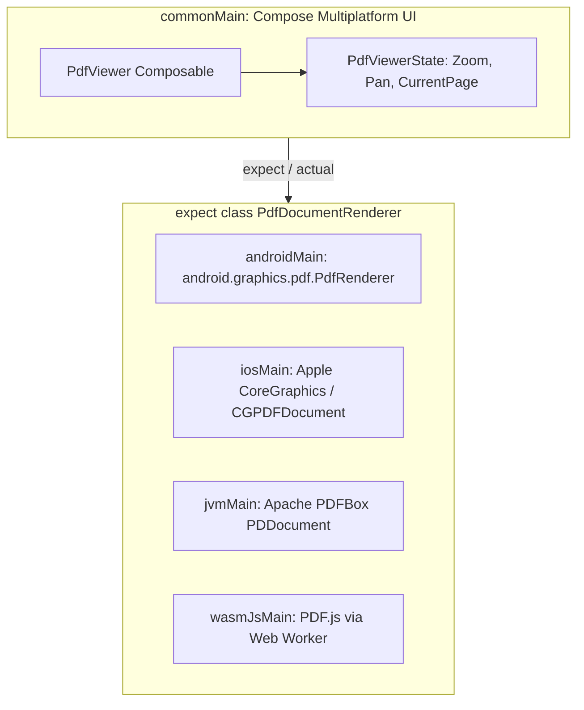

# Implementation Plan: Compose Multiplatform (KMC) PDF Rendering Solution

**Status:** Completed
**Date:** 2026-11-16
**Target:** `frontend/features/artifact-previewer`, `frontend/core/design-system`, `frontend/core/data`
**Depends On:** `.agents/plans/2026-11-16/054800_mobile-migration-and-on-device-intelligence-plan.md`

---

## 1. Goal Description

In Step 3 of the Mobile Migration Plan, the user reviews generated application artifacts (LaTeX-tailored CVs and Cover Letters). While markdown artifacts are already previewed in-app via `ArtifactPreviewScreen.kt` (using MikePenz markdown-m3), **PDF rendering is currently fragmented or offloaded via platform intents** (`PlatformFileOpener.openPdf(url)`), which kicks the user out of the app on Android and iOS.

**Objective:**
Establish an in-app, cross-platform Compose Multiplatform (CMP / KMC) PDF rendering solution that:
1. Prioritizes seamless in-app preview on **Android** (hardware-accelerated on the Galaxy S22 Ultra, Z Fold6, and Tab S10 FE).
2. Delivers robust, native in-app rendering across all supported platforms:
   - **iOS:** Apple PDFKit / CoreGraphics rendering
   - **Desktop (JVM: macOS, Linux, Windows):** Apache PDFBox / Skia Canvas rasterizer
   - **Web (Wasm / JS):** PDF.js canvas worker or browser native `<embed>`/`<iframe>`
3. Integrates directly into `frontend/features/artifact-previewer/ui/` so users can inspect, zoom, page through, and save their compiled CV/Cover Letter PDFs without leaving the Compose experience.

---

## 2. Evaluation of KMC-Compatible PDF Rendering Solutions

We evaluate the four primary approaches to rendering PDFs in Compose Multiplatform:

### Comparative Matrix

| Approach | Android | iOS | Desktop (JVM) | Web (Wasm/JS) | Pros | Cons | Verdict |
| :--- | :--- | :--- | :--- | :--- | :--- | :--- | :--- |
| **Option A: Pure Platform `expect/actual` Native View Interop** | `AndroidView` wrapping `android.graphics.pdf.PdfRenderer` | `UIKitView` wrapping Apple `PDFKit.PDFView` | `SwingPanel` wrapping PDFBox / ICEpdf or Skia rasterizer | `HTMLView` wrapping PDF.js canvas | 100% native performance; utilizes OS platform rendering engines; zero third-party KMP library risk; tiny binary overhead | Platform-specific gesture feel; web iframe styling constraints | **Strong Contender for pure native feel** |
| **Option B: Unified Skia Canvas Image Rasterizer (`expect/actual` Page Provider)** | `PdfRenderer` $\rightarrow$ Bitmap | Apple `CGPDFDocument` $\rightarrow$ Bitmap | Apache `PDFBox` $\rightarrow$ BufferedImage | `PDF.js` $\rightarrow$ ImageData | **100% pure Compose UI**: Pinch-to-zoom, fling, lazy lists, dark mode, overlays, annotations are completely shared in `commonMain`! Zero UI divergence across Android/iOS/Desktop/Web. | Must rasterize pages into Bitmaps/Skia `ImageBitmap` per page | **(Recommended) Best UX & Portability**: Compose controls the viewport, zooming, gestures, and layout identically everywhere |
| **Option C: Third-Party KMP PDF Libraries** (e.g. `kmp-pdf-viewer`, `bouquet`, `compose-pdf`) | Bundled Android views | Bundled UIKit | Limited / none | Limited / none | Quick single dependency | Almost all community libraries are Android/iOS only, abandon Desktop/Wasm, or wrap obsolete View widgets that stutter on foldables | **Not Recommended**: Inflexible across monorepo targets (fails Desktop/Wasm requirements) |
| **Option D: External Platform Intent / Launcher** (Status Quo) | System default app | QuickLook / Safari | System default app | New browser tab | Zero code complexity in app | Destroys the flow of the application; user leaves the app to inspect documents; cannot overlay inline action buttons (Save, Regenerate, Apply) | **Keep solely as fallback action** |

---

## 3. Recommended Architecture: Unified Compose Canvas with `expect/actual` Page Stream

We select **Option B (Compose-Native Viewport with Platform `expect/actual` Page Provider)**:

### 3.1 Architectural Separation
1. **`commonMain` (100% Shared Compose UI):**
   - `PdfViewer(documentUri: String, modifier: Modifier)`
   - Uses Compose `LazyColumn` or horizontal `HorizontalPager` with pinch-to-zoom (`Modifier.transformable`).
   - Renders each page as a Compose `Image` from a shared `ImageBitmap`.
   - Supports page indicators (e.g., "Page 1 of 2"), zoom controls, and an action bar to export/download.
2. **`expect/actual` Page Rasterizer Engine (`PdfPageRenderer`):**
   - A single functional interface / expect class that takes a document byte array or file path and returns page count and `ImageBitmap` for page index $N$:
   ```kotlin
   public expect class PdfDocumentRenderer(documentBytes: ByteArray) {
       public val pageCount: Int
       public fun renderPage(pageIndex: Int, width: Int, height: Int): ImageBitmap
       public fun close()
   }
   ```

### 3.2 Platform-Specific Implementations



- **Android (`androidMain`):**
  Uses `android.graphics.pdf.PdfRenderer` (built into Android since API 21). Rasterizes pages into `android.graphics.Bitmap`, converted to Compose `asImageBitmap()`. Hardware-accelerated, zero external dependencies.
- **iOS (`iosMain`):**
  Uses Apple's native `CGPDFDocument` and `CGPDFPage` via Kotlin/Native C-interop. Renders directly into a CoreGraphics context, producing an `ImageBitmap`. Zero third-party CocoaPods needed.
- **Desktop JVM (`jvmMain`):**
  Uses `org.apache.pdfbox:pdfbox:3.0.x`. Renders pages to `BufferedImage`, converted to Compose `toComposeImageBitmap()`. Solid, battle-tested across macOS, Windows, and Linux.
- **Web (`wasmJsMain` / `jsMain`):**
  Uses browser-standard `pdfjs-dist` to render pages to an offscreen HTML canvas, or provides a seamless fallback native embed view.

---

## 4. Proposed Changes

### Component 1: `frontend/core/data` (or `frontend/core/widgets`)
#### [NEW] `PdfDocumentRenderer.kt` (`commonMain`, `androidMain`, `iosMain`, `jvmMain`, `wasmJsMain`)
- Declares `expect class PdfDocumentRenderer`.
- Implements platform rasterizers returning `androidx.compose.ui.graphics.ImageBitmap`.

### Component 2: `frontend/core/widgets` (Design System UI)
#### [NEW] `PdfViewer.kt`
- Implements `PdfViewer` composable:
  - Vertical lazy scrolling for multi-page documents (e.g. 2-page CV).
  - Pinch-to-zoom and double-tap zoom via Compose `transformable`.
  - Floating page counter and zoom reset button.
  - Asynchronous background rendering to avoid blocking the Compose UI thread.

### Component 3: `frontend/features/artifact-previewer`
#### [MODIFY] `ArtifactPreviewScreen.kt`
- Detects whether the artifact is Markdown (`.md`) or PDF (`.pdf`).
- If Markdown $\rightarrow$ renders existing MikePenz `Markdown` composable.
- If PDF $\rightarrow$ renders the new in-app `PdfViewer` composable, with download/save actions contributed to the top bar.

---

## 5. User Review Required

> [!IMPORTANT]
> **Why Option B (Rasterizer into Compose Image) is Superior to Option A (Native View Embed):**
> 1. Native view embeddings (`AndroidView`, `UIKitView`, `SwingPanel`) behave differently regarding gesture capture, touch events, and window insets, frequently causing conflicts when embedded inside foldables (Galaxy Z Fold6) or split-screen layouts.
> 2. With Option B, the entire viewer (pinch-to-zoom, fling, thumbnails, page badges) is **100% Compose Multiplatform code**, ensuring identical UI and theme integration across Android, iOS, Desktop, and Web.

> [!NOTE]
> **Dependency Footprint & Tracking in `libs.versions.toml`:**
> - Android: **0 KB** additional dependencies (built-in Android SDK `android.graphics.pdf.PdfRenderer`).
> - iOS: **0 KB** additional dependencies (built-in Apple CoreGraphics `CGPDFDocument`).
> - Desktop JVM: Adds `org.apache.pdfbox:pdfbox:3.0.4` (~3MB) to desktop distribution, tracked in `libs.versions.toml` as `pdfbox = "3.0.4"`.
> - Web (Non-Gradle Tracking): **Yes!** We can track non-Gradle dependencies (e.g. `pdfjs-dist = "4.10.38"` or external CDN assets) directly within `gradle/libs.versions.toml` under `[versions]`. Gradle's version catalog parser allows arbitrary version keys in `[versions]`, allowing build scripts, Webpack/Vite tasks, or Kotlin JS/Wasm source generation tasks to read and inject `libs.versions.pdfjs.dist.get()` consistently across the monorepo!

---

## 6. Verification Plan

### Automated Tests
```bash
./gradlew :frontend:core:widgets:test
./gradlew :frontend:features:artifact-previewer:ui:test
```

### Manual Verification on Devices
1. **Samsung Galaxy S22 Ultra (Baseline):**
   - Open a generated 2-page CV PDF.
   - Verify smooth scrolling, pinch-to-zoom, and memory disposal on exit.
2. **Samsung Galaxy Z Fold6:**
   - Test unfolded two-pane view: left pane showing match audit, right pane rendering PDF.
3. **Desktop Application (`mise run desktop`):**
   - Verify CV PDF renders cleanly on macOS/Windows using the PDFBox desktop renderer.
