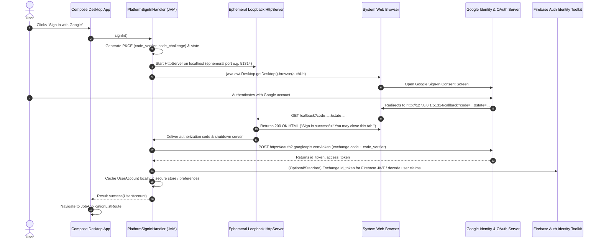

# Architecture Plan: Google Sign-In via Browser Loopback OAuth 2.0 on Desktop (JVM)

**Status:** Draft
**Date:** 2026-11-20
**Target:** `frontend/features/sign-in/data/src/jvmMain/kotlin/dev/fnc314/aijobtracker/frontend/features/signin/data/PlatformSignInHandler.jvm.kt`, `frontend/features/sign-in/data/build.gradle.kts`

---

## 1. Problem Statement & Motivation

On Android and iOS, native platform identity providers (Android Credential Manager and iOS Credentials) authenticate users and yield a valid `UserAccount`. 
On the desktop JVM target (`frontend:apps-desktop`), [`PlatformSignInHandler.jvm.kt`](file:///Users/fnc314/Work/Search/ai-job-tracker/frontend/features/sign-in/data/src/jvmMain/kotlin/dev/fnc314/aijobtracker/frontend/features/signin/data/PlatformSignInHandler.jvm.kt) is currently an unfulfilled stub:
```kotlin
internal actual class PlatformSignInHandler {
    actual suspend fun signIn(): Result<UserAccount> {
        return Result.failure(UnsupportedOperationException("Sign in not supported on JVM"))
    }

    actual suspend fun getCurrentUser(): UserAccount? = null

    actual suspend fun signOut(): Result<Unit> = Result.success(Unit)
}
```
When running the desktop application (`mise frontend:desktop:run`), the navigation system initializes on `SignInRoute`. Clicking **"Sign in With Google"** hits `UnsupportedOperationException`, preventing any access to the desktop dashboard and job pipeline.

To resolve this properly and cross-platform without shortcuts or mock bypasses, desktop JVM must implement the industry-standard **OAuth 2.0 Authorization Code Flow with PKCE (Proof Key for Code Exchange) using a local loopback server** (`http://127.0.0.1:<port>`).

---

## 2. Architecture & OAuth 2.0 Loopback Flow



---

## 3. Detailed Component Design

### 3.1 Loopback Server (`HttpServer`)
- Use Java's built-in `com.sun.net.httpserver.HttpServer` (zero external dependencies, zero footprint overhead).
- Bind to `InetSocketAddress("127.0.0.1", 0)` to allow the operating system to allocate an ephemeral free port dynamically.
- Register context `/oauth2callback` or `/callback`.
- Once the request is received:
  1. Validate the CSRF `state` parameter against the generated in-memory state.
  2. Extract `code`.
  3. Respond with an styled HTML page confirming successful authentication and instructing the user to return to the AI Job Tracker app.
  4. Stop the `HttpServer` with a graceful delay.
- Include a timeout (e.g. 120 seconds) via Kotlin Coroutines `withTimeout` so that if the user closes the browser or aborts, the server gracefully shuts down and cancels the flow.

### 3.2 PKCE & State Security
- **Code Verifier**: 64-character high-entropy cryptographic random string using `java.security.SecureRandom` (URL-safe base64).
- **Code Challenge**: SHA-256 hash of the `code_verifier`, Base64-URL encoded without padding (`S256`).
- **State Parameter**: Random UUID/nonce to prevent CSRF attacks on the loopback port.

### 3.3 Google OAuth Client Configuration
- **OAuth Client ID**: Use the registered Google OAuth 2.0 Web/Desktop Client ID for `dev.fnc314.aijobtracker` (from `credentials` / `google-services.json`).
- **Scopes**: `openid`, `email`, `profile`.
- **Redirect URI**: `http://127.0.0.1:<port>/callback`.

### 3.4 Token Exchange & User Profile Extraction
- Perform a direct HTTPS POST request to `https://oauth2.googleapis.com/token`:
  ```http
  POST /token HTTP/1.1
  Host: oauth2.googleapis.com
  Content-Type: application/x-www-form-urlencoded

  client_id=<CLIENT_ID>&
  code_verifier=<CODE_VERIFIER>&
  code=<AUTH_CODE>&
  grant_type=authorization_code&
  redirect_uri=http://127.0.0.1:<PORT>/callback
  ```
- Parse the resulting JSON to retrieve:
  - `id_token` (JWT): Contains decoded user profile (`sub` -> `uid`, `email`, `name` -> `displayName`, `picture` -> `photoUrl`).
  - `access_token` and `refresh_token`.
- Construct `UserAccount`:
  ```kotlin
  UserAccount(
      uid = claims["sub"] as String,
      email = claims["email"] as String?,
      displayName = claims["name"] as String?,
      photoUrl = claims["picture"] as String?
  )
  ```

### 3.5 Secure Session Persistence & Hardware Vault (`getCurrentUser()` & `signOut()`)
Authentication tokens and refresh credentials must **never** be stored in plaintext files (`.json`, `.properties`, or Java `Preferences`). Desktop persistence must adhere to hardware-backed or OS-level encrypted credential vaults:

1. **macOS (Primary Developer Target): Apple Keychain (`/usr/bin/security`)**
   - Store OAuth refresh tokens and session payload in the user's macOS Login Keychain under service name `dev.fnc314.aijobtracker.auth`:
     ```bash
     # Save / Update password:
     security add-generic-password -U -a "dev.fnc314.aijobtracker" -s "dev.fnc314.aijobtracker.auth" -w "<ENCRYPTED_TOKEN_PAYLOAD>"
     
     # Retrieve password:
     security find-generic-password -a "dev.fnc314.aijobtracker" -s "dev.fnc314.aijobtracker.auth" -w
     
     # Delete on signOut():
     security delete-generic-password -a "dev.fnc314.aijobtracker" -s "dev.fnc314.aijobtracker.auth"
     ```
   - Execution is sandboxed to the active OS user session, encrypted via macOS FileVault/APFS hardware keystore, and protected from other local users or repository scans.

2. **Cross-Platform Fallback (Linux / Windows / Headless): AES-256-GCM Encrypted Store**
   - If macOS Keychain is unavailable (e.g. Linux without Secret Service / DBus or Windows without DPAPI):
     - Encrypt tokens using AES-GCM (256-bit key) with random 96-bit IV via Java Cryptography Architecture (`javax.crypto.Cipher`).
     - Derive key using PBKDF2WithHmacSHA256 bound to hardware identifiers / user home directory salt.
     - Restrict file permissions strictly to user-only (`0600` / `PosixFilePermissions.fromString("rw-------")`) inside `~/.config/ai-job-tracker/auth.vault`.

3. **Lifecycle Integration:**
   - **On App Startup (`getCurrentUser()`):** 
     - Queries macOS Keychain for `dev.fnc314.aijobtracker.auth`.
     - If credentials exist and token is valid, returns `UserAccount`.
     - If access token is expired, executes a token refresh with Google's token endpoint using the stored refresh token, updates the Keychain entry, and returns the refreshed `UserAccount`.
   - **On Sign Out (`signOut()`):** 
     - Deletes the generic password from the Keychain and zeroes in-memory token buffers.
     - Resets `_authState` to `AuthState.Unauthenticated`.

---

## 4. Implementation Steps

### Phase 1: JVM Dependencies & Core Utilities
1. Verify `frontend/features/sign-in/data/build.gradle.kts` has Ktor client or standard Java HTTP client available for token exchange.
2. Implement `PkceUtil` (`generateVerifier()`, `generateChallenge()`).
3. Implement `JwtUtil` / ID token claim extractor (standard base64 payload decoder).

### Phase 2: Local Loopback Auth Server
1. Create `DesktopOAuthServer` managing `HttpServer` lifecycle, port allocation, and callback dispatch with coroutine completion.
2. Handle browser launch with fallback to printing the URL in logs/console if `Desktop.isDesktopSupported()` is unavailable.

### Phase 3: `PlatformSignInHandler.jvm.kt` Full Implementation
1. Implement `signIn()`:
   - Start loopback listener.
   - Launch default browser.
   - Await callback.
   - Exchange code for tokens.
   - Save session.
   - Return `Result.success(UserAccount)`.
2. Implement `getCurrentUser()` to load active saved session.
3. Implement `signOut()` to invalidate and clear saved session.

### Phase 4: Verification & Automated Tests
1. Unit tests for `PkceUtil` and token claim decoding.
2. Architecture test verification (`./gradlew :tests:test`).
3. Manual verification with `mise frontend:desktop:run` confirming browser launch, sign-in, redirect, and desktop app navigation to `JobApplicationListRoute`.
