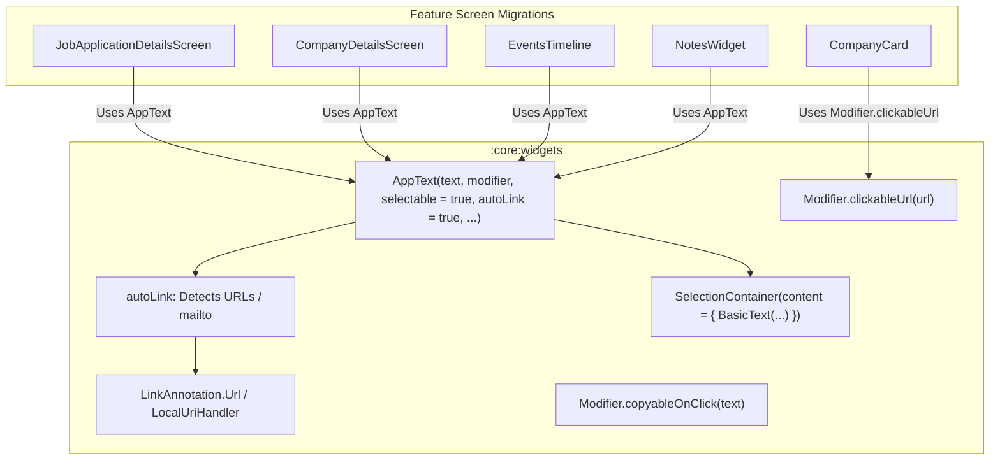

# Implementation Plan: AppText and Modifier-Driven Interactivity & Selection

**Status:** Completed  
**Date:** 2026-11-20  
**Target:** `frontend` (`core:design-system`, `core:widgets`, `features:*`, `apps:core`)  
**Evaluates:** Implementing an `AppText` composable and prebuilt `Modifier` extensions to make text copiable and embedded hyperlinks (`https://`, `mailto:`) automatically clickable without boilerplate.  

---

## 1. Goal Description
The user suggested:
> *"I was thinking an override for `Text` like `AppText(/* params */)` that preconfigures the `Modifier` for what I want. Or just a prebuilt `Modifier` chain..."*

In Compose Multiplatform, making text both **copiable** and **clickable** requires two key mechanics:
1. **Copyable / Selectable:** In Compose, text copyability is governed by `SelectionContainer`. Individual text nodes do not have an isolated `Modifier.copyable()` because selection spans across text layouts, gestures, and clipboard interaction. By providing `AppText` with an optional `selectable: Boolean = true` (or wrapping in an internal selection block), or providing an `AppSelectionContainer`, we achieve seamless copy/paste functionality.
2. **Clickable Hyperlinks:** URLs (`https://...`, `mailto:...`) should be detected, rendered with distinct link styling (brand tint, underline, hand cursor), and automatically dispatched to `LocalUriHandler` / `PlatformFileOpener` when clicked or tapped.

We will provide:
1. **`AppText(...)` in `:core:widgets`**:
   - Acts as the primary drop-in replacement / enhancement for `androidx.compose.material3.Text`.
   - Accepts identical parameters to Material 3 `Text` (`text: String` or `AnnotatedString`, `modifier`, `style`, `color`, `overflow`, `maxLines`, etc.).
   - Includes `selectable: Boolean = true` (wraps in `SelectionContainer` unless explicitly opted out with `selectable = false`).
   - Automatically auto-detects URLs and mailto links when `autoLink = true` (default for string overloads), parsing them into styled, clickable `LinkAnnotation.Url` annotations using `LocalUriHandler`.
2. **Prebuilt `Modifier` extensions**:
   - `Modifier.clickableUrl(url: String)`: Preconfigured modifier that applies pointer hover cursor (`PointerIcon.Hand`), accessible semantics, and invokes URL navigation.
   - `Modifier.copyableOnClick(text: String)`: Quick utility to copy text directly to clipboard on tap/click with feedback.

---

## 2. Architecture & Design



### Signature of `AppText`:
```kotlin
@Composable
public fun AppText(
    text: String,
    modifier: Modifier = Modifier,
    color: Color = Color.Unspecified,
    fontSize: TextUnit = TextUnit.Unspecified,
    fontStyle: FontStyle? = null,
    fontWeight: FontWeight? = null,
    fontFamily: FontFamily? = null,
    letterSpacing: TextUnit = TextUnit.Unspecified,
    textDecoration: TextDecoration? = null,
    textAlign: TextAlign? = null,
    lineHeight: TextUnit = TextUnit.Unspecified,
    overflow: TextOverflow = TextOverflow.Clip,
    softWrap: Boolean = true,
    maxLines: Int = Int.MAX_VALUE,
    minLines: Int = 1,
    onTextLayout: ((TextLayoutResult) -> Unit)? = null,
    style: TextStyle = LocalTextStyle.current,
    selectable: Boolean = true,
    autoLink: Boolean = true,
)
```

---

## 3. Proposed Changes

### Component 1: `:core:widgets` — `AppText` & Modifiers

#### [NEW] `frontend/core/widgets/src/commonMain/kotlin/dev/fnc314/aijobtracker/frontend/core/widgets/AppText.kt`
- Implements `AppText` with both `String` and `AnnotatedString` overloads.
- Auto-detects URLs matching `https?://[^\s]+` and `mailto:[^\s]+`.
- When links are present, styles them using `MaterialTheme.colorScheme.primary` and `TextDecoration.Underline`.
- On link tap/click, dispatches to `LocalUriHandler.current` (with fallback to `PlatformFileOpener`).
- When `selectable = true`, wraps the text node in `SelectionContainer`.

#### [NEW] `frontend/core/widgets/src/commonMain/kotlin/dev/fnc314/aijobtracker/frontend/core/widgets/LinkModifiers.kt`
- `Modifier.clickableUrl(url: String)`: Adds cursor hand pointer and opens the URL on click.
- `Modifier.copyableOnClick(text: String)`: Copies text to clipboard on click using `LocalClipboardManager`.

---

### Component 2: Feature UI Screen Adoption

#### [MODIFY] `frontend/features/job-application-details/ui/.../JobApplicationDetailsScreen.kt`
- Replace plain `Text` with `AppText` for:
  - `jobUrl` and `jobApplicationUrl` (automatically clickable and selectable).
  - `company.website`.
  - Role, company, notes, and timeline entries.

#### [MODIFY] `frontend/features/company-details/ui/.../CompanyDetailsScreen.kt`
- Replace website & LinkedIn text with `AppText` so URLs can be clicked directly in-line or copied.

#### [MODIFY] `frontend/features/companies-list/ui/.../component/CompanyCard.kt`
- Apply `Modifier.clickableUrl(model.website)` on the company website text.

#### [MODIFY] `frontend/features/job-application-details/ui/.../component/EventsTimeline.kt`
- Use `AppText` for event descriptions and notes so embedded links in emails or sync notes are clickable.

#### [MODIFY] `frontend/core/widgets/.../NotesWidget.kt`
- Use `AppText` for saved note rows.

---

## 4. Verification Plan

### Automated Tests
1. **Unit Tests for `AppText` and URL Detection:**
   - Add `AppTextTest.kt` in `core:widgets`:
     - Test plain string without URLs passes through without extra overhead.
     - Test text with `https://...` produces link annotations.
     - Test text with multiple links and punctuation (`https://site.com.`) correctly truncates terminal punctuation.
2. **Build Verification:**
   - Run `./gradlew :frontend:core-widgets:test`
   - Run `./gradlew :frontend:features-job-application-details-ui:test`
   - Run `./gradlew :frontend:features-company-details-ui:test`
   - Run `mise run dev:check`

### Manual Verification
1. Launch Desktop app (`mise run frontend:desktop:run`).
2. Go to **Job Application Details**:
   - Verify `Job URL` and `Application URL` are blue, underlined, show a hand cursor on hover, and open the browser on click.
   - Drag mouse over text $\rightarrow$ verify text selection highlights $\rightarrow$ press `Cmd+C` / `Ctrl+C` $\rightarrow$ paste into terminal/editor to verify clipboard.
3. Go to **Company Details**:
   - Verify website link is clickable and text is selectable.
