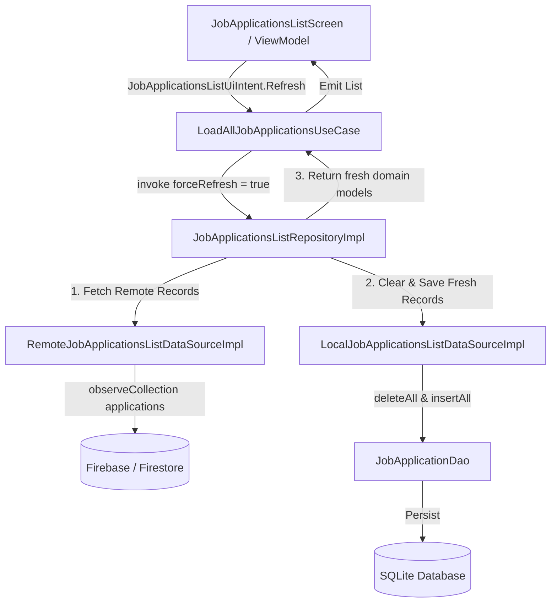

# Requirements

### Overview & Goals
Provide a mechanism allowing the user to click the "REFRESH" button in the `job-applications-list` feature UI to force re-reading application data from Firebase/Firestore, updating the local Room SQLite database cache, and rendering the latest applications on screen.

### Scope
- **In Scope**:
  - Updating `JobApplicationsListRepository` contract and implementation to accept a `forceRefresh` parameter.
  - Modifying `LoadAllJobApplicationsUseCaseImpl` to forward `forceRefresh` from `LoadAllJobApplicationsUseCase.Params`.
  - Updating `LocalJobApplicationsListDataSource` to support wiping/overwriting existing Room SQLite and in-memory cache with fresh remote records on force refresh.
  - Ensuring `JobApplicationsListViewModel` triggers force refresh when `JobApplicationsListUiIntent.Refresh` is dispatched.
  - Updating unit tests across repository, use case, and ViewModel layers.
  - Updating `features/job-applications-list/README.md` to reflect the updated repository API and data synchronization behavior.
- **Out of Scope**:
  - Background automatic polling or push notifications.
  - Modifications to other feature modules.

### Functional Requirements
- When the user clicks the "REFRESH" button on `JobApplicationsListScreen`:
  1. The ViewModel sets `isRefreshing = true` in the content UI state (or loading state).
  2. The ViewModel executes `LoadAllJobApplicationsUseCase(Params(forceRefresh = true))`.
  3. The Repository bypasses local cache and fetches the complete list of remote job applications from Firestore via `RemoteJobApplicationsListDataSource`.
  4. The Repository calls `LocalJobApplicationsListDataSource` to clear existing cached records and persist the fresh list to Room (`JobApplicationDao`) and memory.
  5. The ViewModel updates `rawApplications` with the freshly fetched list, re-applies filter and sort rules, and updates `uiState` to display the up-to-date items while resetting `isRefreshing = false`.
- If remote fetch fails during force refresh:
  - If existing data is already present on screen, preserve it or transition to an error state gracefully according to error handling rules.

# Technical Design

### Current Implementation
- `LoadAllJobApplicationsUseCase.Params` already contains a `val forceRefresh: Boolean = false` flag.
- `LoadAllJobApplicationsUseCaseImpl` calls `repository()` without passing `params.forceRefresh`.
- `JobApplicationsListRepository` is a single-method functional interface (`suspend operator fun invoke(): List<JobApplication>`) that ignores `forceRefresh` and returns cached local data whenever `cached.isNotEmpty()`.
- `LocalJobApplicationsListDataSourceImpl` has `saveJobApplications(applications)` which inserts/replaces entities via `JobApplicationDao.insertAll(...)`, but does not delete stale records that no longer exist remotely.

### Key Decisions
- **Force Refresh Parameter in Repository**: Update `JobApplicationsListRepository` operator signature to `suspend operator fun invoke(forceRefresh: Boolean = false): List<JobApplication>`.
- **Cache Overwrite Strategy**: On `forceRefresh = true`, `LocalJobApplicationsListDataSource` will execute a `deleteAll()` + `insertAll(...)` operation (or `clearAndSaveJobApplications(...)`) to ensure stale/deleted remote applications are removed from Room.

### Proposed Changes

#### 1. Repository Layer (`features/job-applications-list/data`)
- Modify `JobApplicationsListRepository`:
  ```kotlin
  public fun interface JobApplicationsListRepository {
      public suspend operator fun invoke(forceRefresh: Boolean = false): List<JobApplication>
  }
  ```
- Modify `JobApplicationsListRepositoryImpl`:
  - If `forceRefresh == false`: check `localDataSource.getJobApplications()`. If non-empty, return cached list. Otherwise, fetch remote, save to local, return remote.
  - If `forceRefresh == true`: call `remoteDataSource()`. If successful, call `localDataSource.clearAndSaveJobApplications(remote)` and return `remote`. If remote fails or returns empty, fallback to cached data or propagate error.

#### 2. Local Data Source Layer (`features/job-applications-list/data` & `core/data`)
- Add method to `LocalJobApplicationsListDataSource`:
  ```kotlin
  public suspend fun clearAndSaveJobApplications(applications: List<JobApplication>): Unit
  ```
- Implement in `LocalJobApplicationsListDataSourceImpl`:
  - Clear memory cache `memoryCache.clear()`, add `applications`.
  - In `JobApplicationDao`, invoke `deleteAll()` and then `insertAll(JobApplicationMapper.toEntityList(applications))`.

#### 3. Domain Use Case (`features/job-applications-list/domain`)
- Update `LoadAllJobApplicationsUseCaseImpl`:
  ```kotlin
  override suspend fun invoke(params: LoadAllJobApplicationsUseCase.Params): List<JobApplication> =
      repository(forceRefresh = params.forceRefresh)
  ```

#### 4. UI / ViewModel Layer (`features/job-applications-list/ui`)
- `JobApplicationsListViewModel.onIntent(JobApplicationsListUiIntent.Refresh)` already invokes `loadApplications(isRefresh = true)` which passes `LoadAllJobApplicationsUseCase.Params(forceRefresh = true)`.
- Ensure state transitions correctly toggle `isRefreshing = true` and `isRefreshing = false`.

### Architecture Diagram


### File Structure
Affected files:
- `features/job-applications-list/data/src/commonMain/kotlin/dev/fnc314/tools/jobtracker/features/jobapplicationslist/data/repository/JobApplicationsListRepository.kt`
- `features/job-applications-list/data/src/commonMain/kotlin/dev/fnc314/tools/jobtracker/features/jobapplicationslist/data/repository/impl/JobApplicationsListRepositoryImpl.kt`
- `features/job-applications-list/data/src/commonMain/kotlin/dev/fnc314/tools/jobtracker/features/jobapplicationslist/data/source/LocalJobApplicationsListDataSource.kt`
- `features/job-applications-list/data/src/commonMain/kotlin/dev/fnc314/tools/jobtracker/features/jobapplicationslist/data/source/impl/LocalJobApplicationsListDataSourceImpl.kt`
- `features/job-applications-list/domain/src/commonMain/kotlin/dev/fnc314/tools/jobtracker/features/jobapplicationslist/domain/usecase/impl/LoadAllJobApplicationsUseCaseImpl.kt`
- `features/job-applications-list/README.md`
- Related test files under `features/job-applications-list/data/src/commonTest/`, `domain/src/commonTest/`, and `ui/src/commonTest/`.

# Testing

### Validation Approach
Verify using unit tests in Kotlin Multiplatform and compiling Kotlin metadata across all modules.

### Key Scenarios
1. **Force Refresh Fetches Remote**: Test `JobApplicationsListRepositoryImpl` with `forceRefresh = true` when local cache is non-empty. Verify remote data source is called and local cache is updated with remote items.
2. **Force Refresh Clears Stale Cache**: Test `LocalJobApplicationsListDataSourceImpl.clearAndSaveJobApplications` ensures old items not present in the new remote list are deleted from Room and memory cache.
3. **Use Case Forwards Parameter**: Test `LoadAllJobApplicationsUseCaseImpl` passes `forceRefresh = true` to `repository`.
4. **ViewModel Handles Intent**: Test `JobApplicationsListViewModel` emitting content state with updated records upon `JobApplicationsListUiIntent.Refresh`.

### Compilation & Checks
- Run `./gradlew compileCommonMainKotlinMetadata` to verify explicit API mode and compiler correctness.
- Run `mise run ui:kmp:docs:readmes` to verify updated documentation in `README.md`.

# Delivery Steps

### ✓ Step 1: Implement forceRefresh in Repository and UseCase layers
Update `JobApplicationsListRepository` interface and `JobApplicationsListRepositoryImpl` to accept `forceRefresh: Boolean`.
- Update `JobApplicationsListRepository.kt` operator `invoke(forceRefresh: Boolean = false)` (or method overload).
- Update `LoadAllJobApplicationsUseCaseImpl.kt` to pass `params.forceRefresh` to repository invocation.
- Modify `JobApplicationsListRepositoryImpl.kt` logic: when `forceRefresh == true`, bypass local cache lookup, fetch from `RemoteJobApplicationsListDataSource`, purge/overwrite Room cache in `LocalJobApplicationsListDataSource`, and return the fresh remote domain records.
- Add/update repository unit tests in `JobApplicationsListRepositoryTest.kt`.

### ✓ Step 2: Implement cache clear and overwrite in Local Data Source
Enhance `LocalJobApplicationsListDataSource` and `JobApplicationDao` to support clearing/replacing cached data on force refresh.
- Add `clearAndSaveJobApplications(applications: List<JobApplication>)` to `LocalJobApplicationsListDataSource` interface and implementation.
- Execute `dbDao.deleteAll()` followed by `dbDao.insertAll()` in transaction or sequential calls when clearing and saving during refresh.
- Update memory cache clearing and replacing in `LocalJobApplicationsListDataSourceImpl`.

### ✓ Step 3: Connect UI intent, update tests and module documentation
Connect UI Refresh Intent and Update Documentation
- Ensure `JobApplicationsListViewModel` passes `forceRefresh = true` during `JobApplicationsListUiIntent.Refresh`.
- Update ViewModel tests in `JobApplicationsListViewModelTest.kt` to verify `forceRefresh` handling.
- Synchronize module documentation in `features/job-applications-list/README.md` as required by workspace guidelines.

### ✓ Step 4: Commit and push changes
Commit all modified files and push to main.
- Run `git add .` to stage all changes across data, domain, UI, tests, and documentation.
- Commit the staged changes using the plan file name `refresh-firebase-room-sync.md` as the commit message.
- Push the commit to the `main` branch.