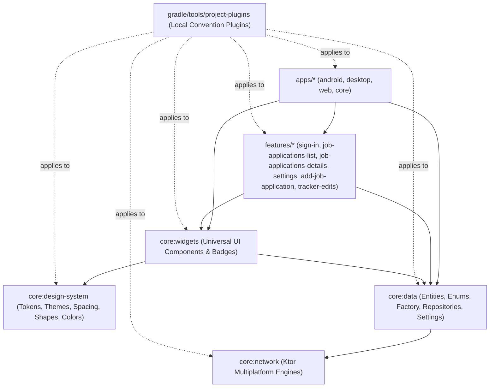

# Agent Guidelines: Frontend Multiplatform Workspace (`frontend`)

This document defines architecture invariants, development workflows, and mandatory rules for AI coding assistants working in the `frontend` multiplatform workspace.

---

## 1. Workspace Architecture Map

The project is structured into three clean layers plus the custom build convention toolchain:

### Module Breakdown
- **`core/data`**: Shared domain models (`JobApplication`, `TrackerEvent`, etc.), self-contained enums, centralized `Factory`, repository contracts, Firestore & Ktor storage implementations.
- **`core/design-system`**: Material 3 styling tokens, dynamic color schemes, seed colors, typography, shapes, spacing, and window size classes. **Contains ZERO composable widgets.**
- **`core/widgets`**: Universal, reusable UI components (`StatusBadge`, `FitBadge`, `NotesWidget`, `TooltipIconButton`). Exports `core:design-system` via `api(projects.coreDesignSystem)` to serve as the unified UI foundation for features.
- **`core/network`**: Multiplatform HTTP engine abstractions and preconfigured JSON Ktor clients.
- **`features/*`**: Consolidated domain, data, and UI feature submodules (`features/<name>/domain`, `features/<name>/data`, `features/<name>/ui`).
- **`apps/*`**: Platform deployment targets (`apps/android`, `apps/desktop`, `apps/web`) and the shared navigation/DI coordinator (`apps/core`).
- **`gradle/tools/project-plugins`**: Included Gradle build providing type-safe convention plugins (`local.kotlin.multiplatform`, `local.android.kmp.library`, `local.compose`, etc.).

---

## 2. Invariants & Rules for AI Agents (MANDATORY)

### Rule 1: Synchronize Module `README.md` Files
Every contributing module under `core/` and `features/` maintains a root `README.md` (e.g. `core/data/README.md`, `features/sign-in/README.md`).
- **Mandate**: Whenever you add, modify, or delete public APIs, use cases, navigation routes, dependencies, or architectural responsibilities in any module, you **MUST** update the corresponding module `README.md` within the same batch of changes.
- **Verification**: Run `mise run frontend:readmes` to ensure all module documentation exists and is up to date.

### Rule 2: Strict Kotlin Explicit API Mode
All modules enforce explicit API mode (`explicitApi()` or `explicitApiWarning()`):
- **Visibility**: Every declaration (class, interface, fun, val, var) must be marked `public`, `internal`, or `private`.
- **Return Types**: Every function and property must explicitly specify its return type.
- **Least Privilege**: Only items intended to be consumed across module boundaries deserve `public` visibility. Screen components, internal dialogs, and platform helper classes must remain `internal`.

### Rule 3: Zero Rogue `Color()` Calls
- The `Color(...)` constructor must **NEVER** be called outside `core/design-system/src/commonMain/kotlin/dev/fnc314/tools/jobtracker/core/designsystem/Color.kt`.
- Hex parsing (`String.toColorOrNull()`) and hex formatting (`Color.toHexString()`) are provided by `core/design-system`.
- In Compose UI, colors must be referenced through `MaterialTheme.colorScheme.*` or canonical `SeedColors` / `AppColors`.

### Rule 4: Clean UI Dependency Decoupling (Option A)
- `core/widgets` exports `core:design-system` via `api(projects.coreDesignSystem)`.
- Feature modules (`features/*/ui`) must depend on `projects.coreWidgets` and **not** directly on `projects.coreDesignSystem`.
- `core/design-system` must remain strictly token- and theme-only; no widgets may be introduced into it.

### Rule 5: Convention Plugins Standard
Build scripts must apply the local convention plugins declared in `gradle/libs.versions.toml`:
- Functional plugins: `local.kotlin.multiplatform`, `local.android.kmp.library`, `local.compose`.
- Concern plugins: `local.dependencies.compose`, `local.dependencies.koin`, `local.dependencies.ktor`, `local.dependencies.serialization`.
- Do not configure target SDKs, compiler options, or toolchains manually in module build scripts.

### Rule 6: Architecture & Design Plans in `.agents/plans/` (MANDATORY)
All technical architecture, design, and migration plans for `frontend` must adhere to these rules:
- **Location**: Technical architecture and design plans oriented specifically to `frontend` must be housed in `frontend/.agents/plans/` and indexed in `frontend/.agents/plans/README.md`. Any plan that spans across multiple subsystems (e.g. `records` + `frontend`) belongs in root `.agents/plans/`.
- **Date Subdirectory & 24-Hour Timestamp Filename**: Plans must **NEVER** be stored as flat files. Each plan must be placed in a `YYYY-MM-DD/` folder based on its creation date and prefixed with a 24-hour clock timestamp: `HHMMSS_<plan-name>.md` (using `00`-`23` for `HH`).
- **Registry Synchronization**: Upon creating or updating any plan, the agent must immediately update `frontend/.agents/plans/README.md` with the link (`./YYYY-MM-DD/HHMMSS_<plan-name>.md`), status, and scope description.
- **Mandatory Opening Frontmatter**: Every plan must start from the canonical template [`.agents/plans/TEMPLATE.md`](../../.agents/plans/TEMPLATE.md): an H1 `# <Type> Plan: <Title>`, then `**Status:**`, `**Date:**`, `**Target:**` (plus optional `Evaluates` / `Schema Authority` / `Depends On` / `Supersedes`), then `---`. No YAML `sessionId` blocks.
- **Repository Root Execution**: Always execute `git` and `mise` commands from the repository root (`/Users/fnc314/Work/Search/waleedtarbosh-ai-job-search`) so pre-commit hooks and `mise.toml` task sources resolve properly.

### Rule 7: Zero-Warning Compilation & Clean Build Logs
- Build logs must remain clean of compiler warnings and deprecations.
- Always use non-deprecated Material 3 APIs (e.g. `menuAnchor(type = ExposedDropdownMenuAnchorType.PrimaryNotEditable, enabled = true)` and `TooltipDefaults.rememberTooltipPositionProvider(positioning = TooltipAnchorPosition.Above)`).
- Ensure all public interfaces, data classes, and properties in domain modules declare explicit visibility and explicit return types.
- Pre-packaged vendor native binaries that lack NDK symbols must be excluded from stripping via `packaging.jniLibs.keepDebugSymbols` rather than emitting packaging warnings.

### Rule 8: Unified Top-Level Card (`TopLevelCard`), `CompanyLogoImage`, & File-Level `@OptIn`
- **File-Level Opt-Ins**: Always declare `@file:OptIn(ExperimentalGridApi::class)` and `@file:OptIn(ExperimentalMaterial3Api::class)` at the top of the Kotlin file rather than per-function.
- **Top-Level Cards**: All top-level list cards (`JobApplicationCard`, `CompanyCard`, `EditCard`) must build upon `TopLevelCard` in `:frontend:core-widgets`, using its `Grid`-based slot layout, `TopLevelCardAction` equalized action buttons, and `TopLevelCardSurfaceVariant` elevation/surface treatments.
- **Company Logos**: All company logo rendering must use `CompanyLogoImage` with `CompanyLogoSize` (`Small`, `Medium`, `Large`). Never construct ad-hoc `Box` + `JobApplicationTrackerImage` wrappers in feature screens.
- **Canonical Company Slugs**: Always derive `companyId` via `DocumentIdGenerator.slug()` (or `canonicalCompanySlug` in KMP `commonMain`) so employer variants (`"Meta Platforms"` vs `"Meta"`, `"Ford Motor Company"` vs `"Ford"`) never create duplicate company cards.

---

## 3. Key Gradle & Mise Execution Commands

> [!IMPORTANT]
> The workspace relies on a custom Java SDK managed via Mise (`26.0.2+101`). Always execute Gradle commands with `BypassSandbox: true` when running in agent sandboxes to ensure access to the Mise runtime.

| Command | Purpose |
| :--- | :--- |
| `./gradlew :frontend:compileCommonMainKotlinMetadata` | Fast compiler check across all KMP modules verifying explicit API mode and metadata |
| `mise run frontend:build` | Compiles full frontend application suite across all platform targets |
| `mise run frontend:test` | Runs frontend unit and architectural tests (:core-data:jvmTest, :apps-core:jvmTest) |
| `mise run frontend:detekt` | Executes Detekt static analysis across all frontend submodules |
| `mise run frontend:android:assemble` | Assembles Android debug APK (`:apps-android:assembleDebug`) |
| `mise run frontend:desktop:run` | Runs the Compose Desktop JVM application |
| `mise run frontend:web:wasm:dev` | Runs Wasm development server in browser |
| `mise run frontend:readmes` | Verifies presence and completeness of all module `README.md` files |
